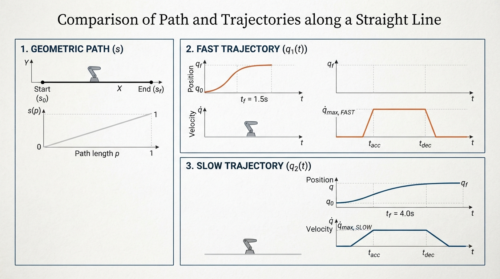
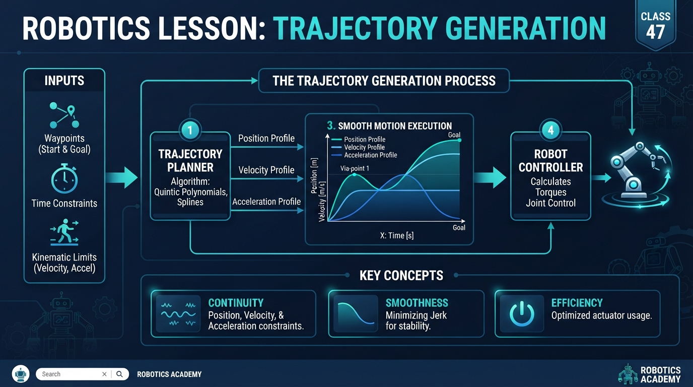
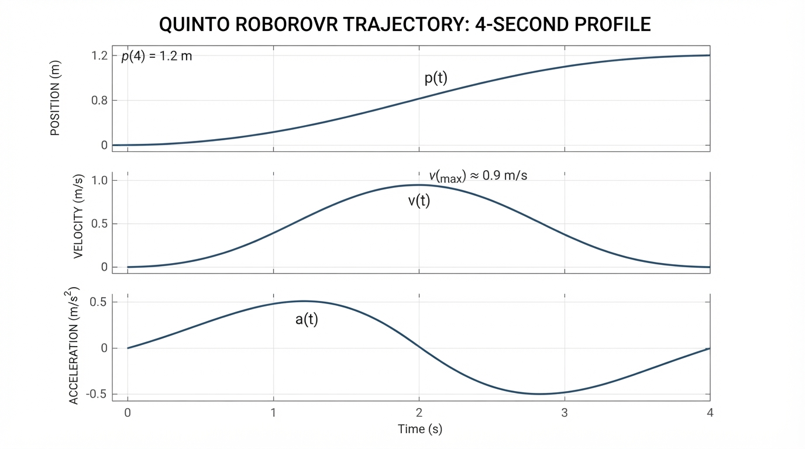
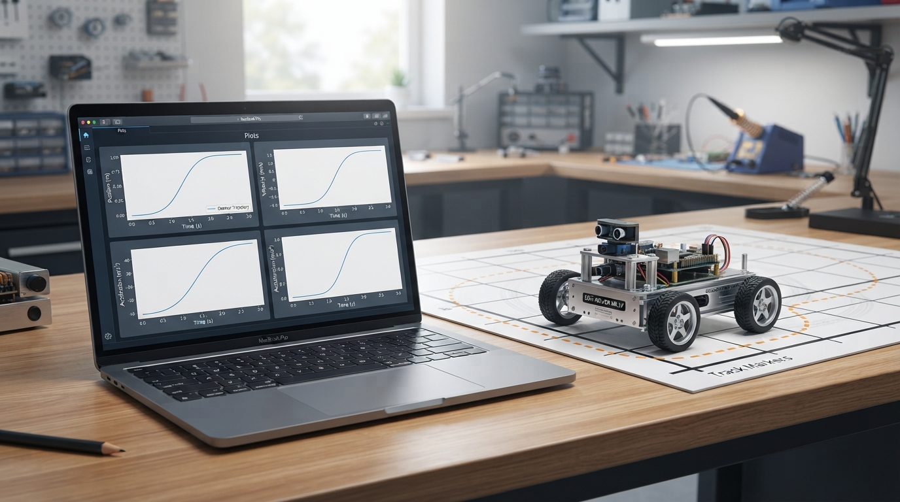

# Class 47: Trajectory Generation

## Where We Are in the Robotics Journey

RoboRover has just learned about **dynamics**: how forces and torques create acceleration, and how mass, friction, and motor limits affect motion.

That knowledge creates an engineering problem:

> If we want RoboRover to move from one place to another, what motion should we command at every instant?

A command such as “move 1 metre forward” is incomplete. RoboRover also needs to know:

- where it should be after 0.5 seconds;
- how fast it should be moving;
- when to speed up;
- when to slow down;
- whether the requested acceleration is physically possible.

This class studies **trajectory generation**: creating a time-ordered motion plan for position, velocity, and sometimes acceleration.

In the next class, **State Machines**, RoboRover will use named operating modes such as `IDLE`, `MOVING`, and `ARRIVED`. A trajectory can be the motion command used while RoboRover is in its `MOVING` state.

## Today We Will Learn

By the end of this class, you should be able to:

1. distinguish a **path** from a **trajectory**;
2. explain why smooth position, velocity, and acceleration matter;
3. calculate a simple one-dimensional trajectory;
4. generate and plot a smooth RoboRover motion in Python;
5. recognize practical problems such as motor saturation, timing errors, and inaccurate calibration.

## 2-Minute Recap

In the previous class, we described motion using quantities such as:

- **position**: where the robot is, measured in metres;
- **velocity**: how quickly position changes, measured in metres per second;
- **acceleration**: how quickly velocity changes, measured in metres per second squared.

A force can change velocity. For a simplified straight-line model,

\[
F = ma
\]

where:

- \(F\) is net force in newtons (N);
- \(m\) is mass in kilograms (kg);
- \(a\) is acceleration in metres per second squared (m/s²).

Dynamics tells us what motion results from a command. Trajectory generation works in the other direction: it proposes a desired motion that the robot should try to follow.

## The Big Idea



**Figure:** The path can stay the same while the trajectory changes the timing and speed.

Imagine pushing a shopping trolley.

If you instantly command the trolley to change from zero speed to 2 m/s, the change would require an unrealistically large acceleration and could create very large transient loads in the wheels, your hands, and the load. Rapid changes in acceleration are also associated with high **jerk**, the rate of change of acceleration.

A better command is:

1. begin at rest;
2. increase speed gradually;
3. perhaps travel at a useful speed;
4. slow down gradually;
5. finish at rest at the target.

A **trajectory** is a motion story with time attached.

A **path** answers:

> Which places should the robot pass through?

A **trajectory** answers:

> Which places should the robot pass through, and at what times and speeds?

For example, these two commands could use the same straight path from the laboratory door to the workbench:

- travel 1 metre in 2 seconds;
- travel 1 metre in 8 seconds.

The path is identical, but the trajectories differ.

Smooth motion is valuable because real mechanisms have:

- limited motor torque;
- flexible parts;
- wheel traction limits;
- gears and belts with backlash;
- sensors that react imperfectly;
- objects that can slide or fall.

## See It in Your Head

### AI-Generated Engineering Visual · Professor OS



**How to read this visual:** Trace the signal or idea from left to right. Match each block to the lesson explanation, then predict what would change if one block produced a wrong value.

Picture three graphs stacked vertically, with time moving from left to right.

**Top graph: position.**  
The curve starts at 0 m and rises gently to 1.2 m.

**Middle graph: velocity.**  
The curve starts at 0 m/s, rises smoothly, reaches a peak near the middle, and returns to 0 m/s.

**Bottom graph: acceleration.**  
The curve begins positive, decreases through zero, becomes negative, and ends at zero.

The existing schematic represents this idea with a smooth motion ribbon beside RoboRover. In the position diagram, the ribbon should be denser near the beginning and end because the robot is moving slowly there; its middle should represent faster travel.

The important visual idea is this:

> If a position function is sufficiently differentiable and has suitable boundary conditions, its derivative can be a smooth velocity curve. A visually smooth position curve alone does not guarantee acceptable acceleration or jerk.

## Core Concept

### A normalized smooth trajectory

Suppose RoboRover moves along one straight line from position \(x_0\) to position \(x_f\) in a total time \(T\).

Define normalized time:

\[
s = \frac{t}{T}
\]

where:

- \(t\) is current time in seconds (s);
- \(T\) is total motion time in seconds (s);
- \(s\) has no units and ranges from 0 to 1.

A useful smooth position profile is the **quintic smoothstep**:

\[
p(s) = 10s^3 - 15s^4 + 6s^5
\]

Then the commanded position is:

\[
x(t) = x_0 + (x_f-x_0)p(s)
\]

Here:

- \(x(t)\) is commanded position in metres (m);
- \(x_0\) is starting position in metres;
- \(x_f\) is final position in metres;
- \(p(s)\) is a unitless progress value.

At \(s=0\), \(p=0\). At \(s=1\), \(p=1\). Thus the robot begins at \(x_0\) and finishes at \(x_f\).

This particular function also gives:

- zero starting velocity;
- zero final velocity;
- zero starting acceleration;
- zero final acceleration.

That makes it gentler than a simple linear command.

The word **quintic** means the highest power is \(s^5\). It does not mean the robot has five wheels or five motors.

### Comparing common profiles

| Profile | Highest power | Typical endpoint conditions | Main teaching point |
|---|---:|---|---|
| Linear | 1 | Position is specified, but velocity jumps if starting and ending at rest are required | Simple, but not smooth at the endpoints |
| Cubic | 3 | Can specify position and velocity at both endpoints | Smooth velocity, but endpoint acceleration generally does not equal zero |
| Quintic | 5 | Can specify position, velocity, and acceleration at both endpoints | Smooth position, velocity, and acceleration for this lesson |

### Why not just use a straight line?

A linear trajectory is:

\[
x(t) = x_0 + (x_f-x_0)\frac{t}{T}
\]

Its velocity is constant during the motion. If the robot begins at rest, the command would require an instantaneous jump from 0 m/s to that constant velocity. At the end, it would require another instantaneous jump back to 0 m/s.

Real motors cannot produce infinite acceleration. A controller may clip the command, causing RoboRover to arrive late or overshoot.

## Math Without Fear

Let the travel distance be:

\[
D = x_f-x_0
\]

For the quintic profile,

\[
x(t)=x_0+D(10s^3-15s^4+6s^5)
\]

The velocity is the derivative of position:

\[
v(t)=\frac{D}{T}(30s^2-60s^3+30s^4)
\]

where \(v(t)\) is in metres per second (m/s).

The acceleration is:

\[
a(t)=\frac{D}{T^2}(60s-180s^2+120s^3)
\]

where \(a(t)\) is in metres per second squared (m/s²).

Notice the time factors:

- velocity scales with \(1/T\);
- acceleration scales with \(1/T^2\).

If the same distance is completed twice as quickly, the speed demand doubles, but the acceleration demand becomes four times as large. This is a direct connection to dynamics: a shorter schedule can require much more force.

For this profile, the acceleration extrema occur where the derivative of the dimensionless acceleration is zero:

\[
60-360s+360s^2=0
\]

so

\[
s=\frac{3\pm\sqrt{3}}{6}.
\]

At those points, the magnitude of the dimensionless acceleration is \(10/\sqrt{3}\). Therefore,

\[
|a|_{\max}=\frac{10}{\sqrt{3}}\frac{|D|}{T^2}.
\]

For \(D=1.2\ \text{m}\) and \(T=4.0\ \text{s}\),

\[
|a|_{\max}
=\frac{10}{\sqrt{3}}\frac{1.2}{4.0^2}
\approx 0.4330127\ \text{m/s}^2.
\]

The positive and negative acceleration peaks have equal magnitude. The midpoint acceleration is zero; it is not the peak acceleration.

These equations describe a **desired** trajectory. They do not guarantee that the real robot can follow it.

## Worked Robotics Example



**Figure:** The three plots show how one smooth position command produces coordinated velocity and acceleration.

RoboRover must move along a straight laboratory marking:

- starting position: \(x_0=0.0\ \text{m}\);
- final position: \(x_f=1.2\ \text{m}\);
- motion time: \(T=4.0\ \text{s}\).

At \(t=1.0\ \text{s}\),

\[
s=\frac{1.0\ \text{s}}{4.0\ \text{s}}=0.25
\]

The progress function is:

\[
p(0.25)
=10(0.25)^3-15(0.25)^4+6(0.25)^5
=0.103515625
\]

Therefore,

\[
x(1.0)=0+(1.2\ \text{m})(0.103515625)
=0.12421875\ \text{m}
\]

So after one second, RoboRover has travelled about \(0.124\ \text{m}\), not \(0.300\ \text{m}\). It is still accelerating gently.

The velocity is:

\[
v(1.0)
=\frac{1.2\ \text{m}}{4.0\ \text{s}}
\left[30(0.25)^2-60(0.25)^3+30(0.25)^4\right]
\]

\[
v(1.0)=0.31640625\ \text{m/s}
\]

The acceleration is:

\[
a(1.0)
=\frac{1.2\ \text{m}}{(4.0\ \text{s})^2}
\left[60(0.25)-180(0.25)^2+120(0.25)^3\right]
\]

\[
a(1.0)=0.421875\ \text{m/s}^2
\]

Interpretation:

- RoboRover is \(0.12421875\ \text{m}\) from its starting point;
- it is moving forward at \(0.31640625\ \text{m/s}\);
- its forward speed is still increasing because acceleration is positive.

At the midpoint \(t=2.0\ \text{s}\), symmetry gives:

- position \(=0.6\ \text{m}\);
- acceleration \(=0\ \text{m/s}^2\);
- velocity reaches its maximum for this profile, \(0.5625\ \text{m/s}\).

The peak acceleration magnitude occurs earlier and later than the midpoint:

\[
|a|_{\max}\approx 0.4330127\ \text{m/s}^2.
\]

The total straight-line distance is \(1.2\ \text{m}\), assuming RoboRover does not reverse direction.

## Python Lab



**Figure:** The Python plot is a model of the motion that RoboRover is being asked to follow.

This program samples RoboRover’s quintic trajectory every \(0.02\) seconds and plots position, velocity, and acceleration. The plotted output is the primary teaching visual: it directly shows the computed trajectory. A workstation illustration in the visual plan is supplementary and should not replace this generated plot.

The program also includes assertions that verify the endpoint, midpoint, worked-example values, and analytical peak-acceleration result.

```python
import numpy as np
import matplotlib.pyplot as plt

# Motion specification
x0 = 0.0       # starting position, metres
xf = 1.2       # final position, metres
T = 4.0        # total time, seconds
dt = 0.02      # sampling interval, seconds

# Time samples, including the final time
time = np.arange(0.0, T + dt, dt)
s = time / T
distance = xf - x0

# Quintic smoothstep and its first two derivatives
p = 10.0 * s**3 - 15.0 * s**4 + 6.0 * s**5
dp_ds = 30.0 * s**2 - 60.0 * s**3 + 30.0 * s**4
d2p_ds2 = 60.0 * s - 180.0 * s**2 + 120.0 * s**3

# Position, velocity, and acceleration
position = x0 + distance * p
velocity = (distance / T) * dp_ds
acceleration = (distance / (T * T)) * d2p_ds2

# Verify important mathematical claims
assert abs(position[0] - x0) < 1e-12
assert abs(position[-1] - xf) < 1e-12
assert abs(velocity[0]) < 1e-12
assert abs(velocity[-1]) < 1e-12
assert abs(acceleration[0]) < 1e-12
assert abs(acceleration[-1]) < 1e-12

# Verify the worked example at t = 1.0 seconds
one_second_index = int(round(1.0 / dt))
assert abs(position[one_second_index] - 0.12421875) < 1e-10
assert abs(velocity[one_second_index] - 0.31640625) < 1e-10
assert abs(acceleration[one_second_index] - 0.421875) < 1e-10

# Verify the midpoint values
midpoint_index = int(round(2.0 / dt))
assert abs(position[midpoint_index] - 0.6) < 1e-10
assert abs(velocity[midpoint_index] - 0.5625) < 1e-10
assert abs(acceleration[midpoint_index]) < 1e-10

# Verify the analytical peak acceleration magnitude.
# The sampled maximum is slightly lower or equal because the samples
# need not fall exactly at the analytical extrema.
analytical_peak_acceleration = (
    (10.0 / np.sqrt(3.0)) * abs(distance) / (T * T)
)
assert abs(analytical_peak_acceleration - 0.4330127019) < 1e-10
assert np.max(np.abs(acceleration)) <= analytical_peak_acceleration + 1e-12

print("All trajectory checks passed.")
print("At 1.0 s: position = {:.8f} m, velocity = {:.8f} m/s, acceleration = {:.8f} m/s^2".format(
    position[one_second_index],
    velocity[one_second_index],
    acceleration[one_second_index]
))
print("At 2.0 s: position = {:.8f} m, velocity = {:.8f} m/s, acceleration = {:.8f} m/s^2".format(
    position[midpoint_index],
    velocity[midpoint_index],
    acceleration[midpoint_index]
))
print("Analytical peak acceleration magnitude = {:.8f} m/s^2".format(
    analytical_peak_acceleration
))

# Plot the three motion quantities
figure, axes = plt.subplots(3, 1, figsize=(9, 8), sharex=True)

axes[0].plot(time, position, color="navy")
axes[0].set_ylabel("Position (m)")
axes[0].grid(True)

axes[1].plot(time, velocity, color="darkgreen")
axes[1].set_ylabel("Velocity (m/s)")
axes[1].grid(True)

axes[2].plot(time, acceleration, color="darkred")
axes[2].set_ylabel("Acceleration (m/s^2)")
axes[2].set_xlabel("Time (s)")
axes[2].grid(True)

figure.suptitle("RoboRover Quintic Trajectory")
figure.tight_layout()
plt.show()
```

Important lines:

- `s = time / T` converts real time into normalized time from 0 to 1.
- `p`, `dp_ds`, and `d2p_ds2` represent progress, progress rate, and progress acceleration.
- The factors `distance / T` and `distance / (T * T)` convert normalized derivatives into physical units.
- The `assert` statements make the program check its own mathematical claims instead of silently producing a graph.
- `analytical_peak_acceleration` verifies the exact peak magnitude for this quintic profile, rather than estimating it only from sampled points.

**Learner prompt:** Change `T` to `2.0` and then to `8.0`, rerun the plot, and compare the numerical maxima with the analytical scaling laws. The peak velocity should scale as \(1/T\), while the peak acceleration should scale as \(1/T^2\).

## Mini Simulation or Game

Try this experiment:

1. Run the program and predict the shape of all three curves.
2. Change `T` from `4.0` to `2.0`.
3. Predict what happens to the velocity and acceleration scales.
4. Run it and compare the graphs.
5. Change `T` to `8.0` and observe the opposite effect.

Do not look at the graph first. Predict:

- Does the final position change?
- Does the peak velocity increase or decrease?
- Does the peak acceleration increase or decrease?
- Does the motion still begin and end at rest?

This is a useful miniature design game: choose the fastest motion that stays within a hypothetical motor limit. For example, imagine RoboRover should not exceed \(0.5\ \text{m/s}\) or \(0.5\ \text{m/s}^2\). The following extension searches candidate durations in \(0.01\)-second increments and reports the shortest candidate that satisfies both limits for the \(1.2\)-metre quintic motion.

For this profile,

\[
v_{\max}=\frac{15}{8}\frac{D}{T}
\]

and

\[
|a|_{\max}=\frac{10}{\sqrt{3}}\frac{D}{T^2}.
\]

With \(D=1.2\ \text{m}\), the speed limit requires \(T\geq 4.5\ \text{s}\), while the acceleration limit alone requires approximately \(T\geq 3.72\ \text{s}\). Therefore, the first \(0.01\)-second candidate satisfying **both** limits is \(4.50\ \text{s}\).

```python
import numpy as np

distance = 1.2
maximum_speed = 0.5
maximum_acceleration = 0.5

candidate_times = np.arange(0.01, 20.0 + 0.005, 0.01)

# For a quintic smoothstep:
# peak speed = (15/8) * distance / T
# peak acceleration magnitude = (10/sqrt(3)) * distance / T^2
peak_speeds = (15.0 / 8.0) * distance / candidate_times
peak_accelerations = (
    (10.0 / np.sqrt(3.0)) * distance / (candidate_times ** 2)
)

acceptable = (
    (peak_speeds <= maximum_speed) &
    (peak_accelerations <= maximum_acceleration)
)

if not np.any(acceptable):
    raise RuntimeError("No acceptable candidate duration was found.")

shortest_index = np.flatnonzero(acceptable)[0]
shortest_time = candidate_times[shortest_index]
shortest_speed = peak_speeds[shortest_index]
shortest_acceleration = peak_accelerations[shortest_index]

# The speed limit is active: 4.49 s is too fast, while 4.50 s
# is the first 0.01-second candidate satisfying both limits.
assert abs(shortest_time - 4.50) < 1e-12
assert peak_speeds[shortest_index - 1] > maximum_speed
assert shortest_speed <= maximum_speed
assert shortest_acceleration <= maximum_acceleration

# Verify the reported numerical values for the selected candidate.
assert abs(shortest_speed - (2.25 / 4.50)) < 1e-12
assert abs(
    shortest_acceleration
    - ((10.0 / np.sqrt(3.0)) * 1.2 / (4.50 ** 2))
) < 1e-12

print("Shortest tested duration: {:.2f} s".format(shortest_time))
print("Peak speed at that duration: {:.6f} m/s".format(shortest_speed))
print("Peak acceleration magnitude at that duration: {:.6f} m/s^2".format(
    shortest_acceleration
))
```

The code does not modify the trajectory to enforce the limits. It searches candidate durations and reports the shortest tested duration whose calculated demands satisfy them. For these inputs, it reports \(4.50\ \text{s}\), a peak speed of approximately \(0.500000\ \text{m/s}\), and a peak acceleration magnitude of approximately \(0.410692\ \text{m/s}^2\). A production planner would also check actuator torque, traction, jerk, obstacles, sampling, and tracking performance.

The quintic profile is a candidate interpolation. The code checks its velocity and acceleration limits analytically; it does not enforce those limits during physical execution.

## What Should Happen?

When you reduce `T`:

- the final position remains \(1.2\ \text{m}\);
- the motion is completed sooner;
- velocity becomes larger because velocity scales with \(1/T\);
- acceleration becomes larger because acceleration scales with \(1/T^2\);
- the start and end conditions remain position and velocity at rest.

When you increase `T`, the motion becomes slower and gentler.

The curve should not have sudden corners. Position should rise smoothly. Velocity should rise and fall smoothly. Acceleration should change sign around the midpoint.

## Common Mistakes

### Confusing path and trajectory

A line on the floor is a path. Adding “arrive after 4 seconds, starting and ending at rest” turns it into a trajectory.

### Assuming a smooth formula guarantees smooth real motion

The formula may be smooth, but the motors may saturate. **Saturation** means an actuator has reached its maximum available command. If the requested acceleration is too high, RoboRover cannot follow the trajectory exactly.

### Ignoring sampling

The program calculates a continuous mathematical curve but sends commands at discrete times. A slow controller, delayed network, or irregular timer can make the real motion less smooth.

### Forgetting calibration

If wheel diameter is estimated incorrectly, the commanded position may be 1.2 m while the actual position is different. A beautiful trajectory plot cannot correct a wrong distance model.

### Treating acceleration as the whole comfort problem

Even if acceleration is acceptable, very rapid changes in acceleration can stress mechanisms. Advanced trajectory generators may also limit **jerk**, the rate of change of acceleration. We will not develop jerk-limited planning fully here, but it is an important engineering extension.

## Try It Yourself

**Challenge:** Modify the program so RoboRover travels from \(x_0=0.5\ \text{m}\) to \(x_f=2.0\ \text{m}\) in \(T=5.0\ \text{s}\).

Your program should:

1. update the three motion parameters;
2. keep the same quintic profile;
3. add an assertion that the final position is \(2.0\ \text{m}\);
4. label the graph correctly.

**Optional extension:** Add a horizontal line showing a chosen maximum allowed speed, such as \(0.5\ \text{m/s}\). Then decide whether your trajectory exceeds that limit. If it does, increase \(T\) and test again.

## Quick Quiz

1. What is the difference between a path and a trajectory?

2. In the normalized time equation \(s=t/T\), what are the units of \(s\)?

3. If the travel distance stays constant but the total time \(T\) is cut in half, what happens to the acceleration scale?

4. Why might a real RoboRover fail to follow a mathematically smooth trajectory exactly?

## Answers

1. A path describes the geometric route through space. A trajectory includes the route plus timing, position, velocity, and possibly acceleration.

2. \(s\) has no units because it is a ratio of two times.

3. The acceleration scale becomes four times larger because acceleration varies with \(1/T^2\).

4. Possible reasons include motor saturation, limited traction, inaccurate calibration, delayed commands, irregular sampling, sensor noise, or an inaccurate physical model.

## Real Robot Connection

A real trajectory generator may produce target values such as:

- desired wheel speed;
- desired body position;
- desired arm-joint angle;
- desired velocity and acceleration.

A lower-level controller then attempts to make the physical robot follow those targets. This separates two jobs:

- **trajectory generation:** decide what motion should happen over time;
- **control:** use motors and measurements to reduce the difference between desired and actual motion.

The example in this class is one-dimensional: it demonstrates scalar position along one axis. A full robot trajectory may also include orientation, heading, curvature, and other state variables. For a differential-drive rover moving through a general plane, a complete body trajectory must coordinate heading, curvature, and the left and right wheel speeds. A one-dimensional position trajectory is therefore a useful teaching model, but it is not by itself a complete planar rover motion.

RoboRover’s dynamics matter because the trajectory must respect its physical capabilities. If its motors can provide only limited torque, a trajectory demanding large acceleration is not merely difficult—it is impossible for that hardware.

Next class, RoboRover will organize behavior with a **state machine**. For example:

- `IDLE`: wait for a mission;
- `MOVING`: execute or follow a trajectory;
- `PAUSED`: stop safely;
- `ARRIVED`: confirm the destination.

A state machine does not replace trajectory generation. It decides when a trajectory begins, pauses, or ends.

## Vocabulary

- **Trajectory:** A time-dependent description of desired motion, commonly including position and possibly velocity, acceleration, orientation, or other state variables.
- **Path:** The geometric route through space, without specifying when each point is reached.
- **Trajectory generation:** The process of creating a time-based motion command. A constrained trajectory generator additionally checks or enforces limits such as maximum velocity, acceleration, jerk, torque, and traction; the quintic generator in this class creates a candidate trajectory but does not enforce all of those limits.
- **Normalized time:** A unitless time variable, here \(s=t/T\), usually ranging from 0 to 1.
- **Quintic polynomial:** A polynomial whose highest power is five; the smoothstep profile in this class uses one.
- **Velocity:** Rate of change of position, measured in m/s.
- **Acceleration:** Rate of change of velocity, measured in m/s².
- **Saturation:** The condition in which an actuator has reached its maximum or minimum available command.
- **Sampling:** Evaluating or sending a command at separate time intervals rather than continuously.
- **Jerk:** Rate of change of acceleration, measured in m/s³.

## Further Learning

To continue developing this topic, study these ideas in order:

1. compare linear, cubic, and quintic position profiles;
2. add explicit maximum velocity and acceleration limits;
3. generate trajectories for two-dimensional positions;
4. coordinate left and right wheel trajectories for a differential-drive robot;
5. examine jerk-limited motion;
6. connect generated trajectories to measured feedback and tracking error.

The key search-friendly topics are **polynomial trajectory planning**, **smoothstep interpolation**, **velocity and acceleration constraints**, and **robot trajectory tracking**.

## Next Class

In **Class 48: State Machines**, RoboRover will stop being described as one continuous action and start behaving as a collection of modes.

You will learn how a robot can switch from `IDLE` to `MOVING`, detect a completion condition, enter `ARRIVED`, and respond safely to events such as a pause command or obstacle warning.

The trajectory from this class will become the motion behavior inside one of those states.