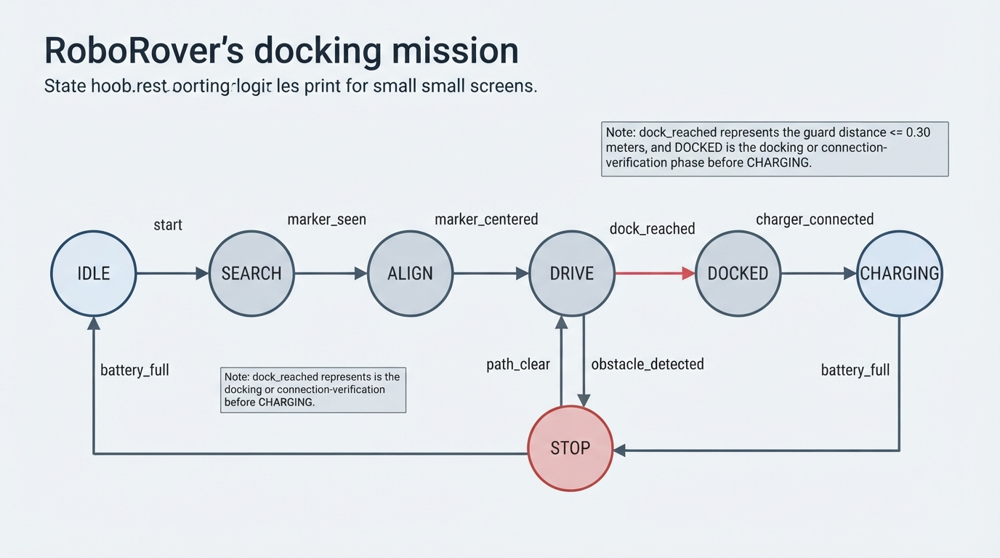
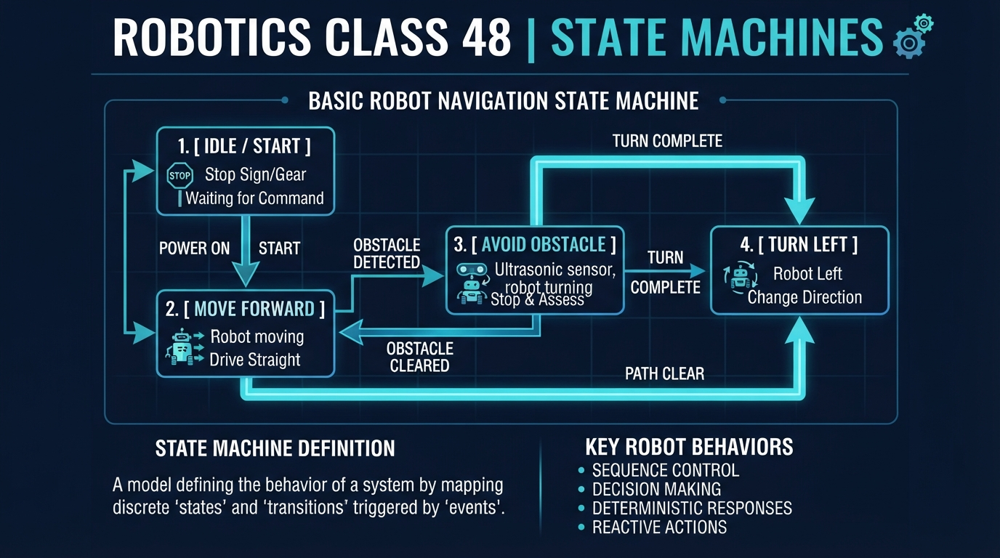
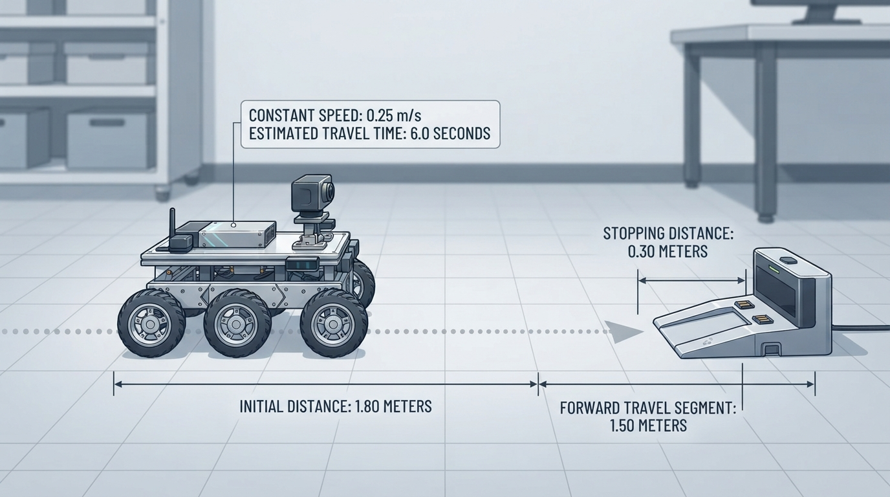
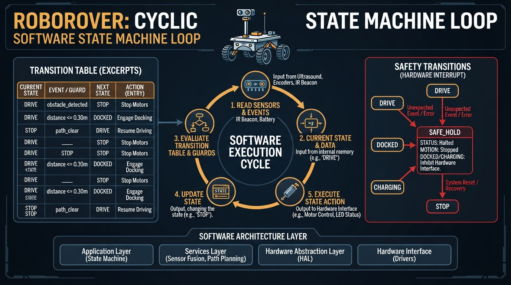

# Class 48: State Machines

## Where We Are in the Robotics Journey

In the previous class, **Trajectory Generation**, RoboRover learned to describe motion as a time-ordered path: where it should be, how fast it should move, and when it should turn or stop.

That answered a motion question:

> “What should RoboRover’s movement look like?”

Today we move one level upward:

> “Which behavior should RoboRover perform right now?”

A robot may have a carefully generated trajectory, but that trajectory is useful only when the robot knows whether it should be searching, aligning, approaching, stopping for safety, docking, or charging.

A **state machine** gives RoboRover a structured way to select behavior. In the next class, **Behavior Trees**, we will study a more hierarchical method for organizing complex decisions. State machines are an important foundation for understanding that method.

## Today We Will Learn

By the end of this class, you should be able to:

- explain what a finite-state machine is;
- distinguish a state, event, guard condition, and action;
- represent transitions in both a diagram and a table;
- calculate a simple state-related travel time;
- implement and test a small finite-state machine in Python;
- evaluate a guard directly from a measurement;
- explain why real systems need sensor filtering, timeouts, and safe handling of unexpected events;
- identify the difference between behavior selection and lower-level motion control.

Our example uses one memorable mission:

> RoboRover must find a blue docking marker, approach it, survive a temporary obstacle, dock, and recharge.

## 2-Minute Recap

A **trajectory** is a planned time history of motion. It may specify position, velocity, or acceleration over time.

For example, a trajectory might tell RoboRover to:

- move forward at \(0.25\ \text{m/s}\);
- slow down near the dock;
- stop at a planned distance.

But a trajectory does not necessarily decide:

- whether RoboRover should search for the dock;
- whether an obstacle requires stopping;
- whether charging has finished;
- whether a human has requested an emergency stop.

Those are **behavior decisions**. Today’s tool for organizing them is the state machine.

## The Big Idea



**Figure:** The circles represent persistent behaviors; the arrows show the events or conditions that cause RoboRover to change behavior.

A state machine does not describe only what happens at one instant. It identifies the behavior that governs the robot while the robot remains in a state.

Imagine RoboRover as an actor in a play. At any moment, it is following one scene’s instructions:

- **SEARCH**: rotate slowly and look for the blue marker;
- **ALIGN**: turn until the marker is centered;
- **DRIVE**: move toward the dock;
- **STOP**: remain still because an obstacle is detected;
- **DOCKED**: perform or monitor the final physical connection;
- **CHARGING**: remain connected until the battery is sufficiently full.

Each scene is a **state**.

An event may trigger a transition whose guard is evaluated:

- marker detected: `SEARCH → ALIGN`;
- marker centered: `ALIGN → DRIVE`;
- obstacle detected: `DRIVE → STOP`;
- path clear: `STOP → DRIVE`;
- measured dock distance is at most \(0.30\ \text{m}\): `DRIVE → DOCKED`.

Here, `DOCKED` is a simplified docking phase: reaching the docking distance means that RoboRover should stop its approach and begin or verify the physical connection. It does not by itself mean that charging has been confirmed. The later `charger_connected` event is required before entering `CHARGING`.

A state machine therefore answers:

> “Given the current state and the information just received, what state should come next, and what should the robot do?”

A state machine usually runs repeatedly. It may be **event-driven**, reacting whenever a new sensor message arrives, or **cyclic**, checking sensors and updating behavior at a regular rate. The short Python program later uses a scripted event sequence as a deterministic transition-policy test. A real robot would repeat the same decision process while operating.

A state machine does not have to control every motor directly. A state may command a lower-level controller:

- the state machine selects **DRIVE**;
- a motion controller follows the current trajectory;
- motor drivers produce the electrical signals.

This separates **behavior selection** from **motion control**.

## See It in Your Head

### AI-Generated Engineering Visual · Professor OS



**How to read this visual:** Trace the signal or idea from left to right. Match each block to the lesson explanation, then inspect where a measurement becomes a decision. In particular, distinguish the condition that indicates docking proximity from the later confirmation that charging is connected.

Picture a small wheeled RoboRover outside a charging station. A clear layout separates the normal mission path from the obstacle-recovery loop:

```text
[IDLE]
   |
   | start
   v
[SEARCH] -- marker_seen --> [ALIGN] -- marker_centered --> [DRIVE]
                                                              |
                                                              | obstacle_detected
                                                              v
                                                           [STOP]
                                                              |
                                                              | path_clear
                                                              +------> [DRIVE]

[DRIVE] -- dock_reached --> [DOCKED] -- charger_connected --> [CHARGING]
                                                                    |
                                                                    | battery_full
                                                                    v
                                                                  [IDLE]
```

The `dock_reached` event is a simplified representation of the guard \(distance \leq 0.30\ \text{m}\). The transition is evaluated only when that measurement condition is true. `DOCKED` represents the docking operation or its verification; `CHARGING` is entered only after `charger_connected` confirms the electrical connection.

The diagram is not merely a list of robot modes. It describes legal **transitions**.

For instance, RoboRover should not jump directly from `SEARCH` to `CHARGING` unless the system has a clear reason and the required physical conditions have been checked.

A well-designed state machine makes behavior visible. That helps with testing, debugging, safety reviews, and communication between engineers.

## Core Concept

The common engineering term is a **finite-state machine**, often shortened to **FSM**. “Finite” means that the machine has a limited set of named states.

Four ideas are central:

1. **State**  
   The mode or situation currently governing behavior.  
   Example: `DRIVE`.

2. **Event**  
   Something that occurs or is reported and may cause a transition.  
   Example: a camera reports that the marker is visible.

3. **Guard condition**  
   A test that must be true before a transition is allowed.  
   Example: the measured distance to the dock is less than or equal to \(0.30\ \text{m}\).

4. **Action**  
   What the robot does when entering, leaving, or remaining in a state.  
   Example: command zero wheel speed while in `STOP`.

Events and guard conditions are related but not identical:

- An **event** is an occurrence or message, such as `obstacle_detected`.
- A **guard** is a test on current information, such as `distance <= 0.30`.

A robot’s sensing layer may convert a continuous measurement into a simpler event. For example:

```text
distance <= 0.30 m
        ↓
sensor or estimator generates: dock_reached
        ↓
DRIVE -- dock_reached --> DOCKED
```

Thus, `dock_reached` in this teaching example is a simplified event generated by a sensor or lower-level estimator. The physical basis is the distance condition.

A guard can also be evaluated directly by the transition logic:

```text
if current_state == DRIVE and distance <= 0.30 m:
    next_state = DOCKED
```

This is different from accepting `dock_reached` without showing how it was produced. In a real system, the measurement may be filtered or estimated before the guard is evaluated.

A transition can be written conceptually as:

```text
current state + event, when guard is true -> next state
```

For RoboRover:

```text
DRIVE + obstacle_detected -> STOP
DRIVE + distance <= 0.30 m -> DOCKED
```

A state machine is not automatically autonomous. It can be commanded by a human, started by a schedule, or run by autonomous software. The state machine organizes behavior; it does not by itself determine who has decision authority.

It is also not automatically a feedback controller. If RoboRover repeatedly measures distance and adjusts wheel speed to reduce distance error, that is feedback control. If a state machine receives one event and starts a fixed sequence, that alone does not establish sustained feedback regulation. In practice, state machines and feedback controllers are often combined.

| System idea | Main question | RoboRover example |
|---|---|---|
| Preprogrammed task sequencing | Is a defined sequence being executed? | Follow the planned docking stages |
| Feedback control | Does measured output affect corrective action? | Adjust speed using measured distance |
| Autonomy | Who selects task-level actions? | Software chooses whether to search, dock, or recharge |

These ideas can overlap. RoboRover may autonomously choose `DRIVE`, execute a preprogrammed docking sequence, and use feedback to correct its motion.

## Math Without Fear

Suppose RoboRover is \(1.8\ \text{m}\) from the docking station. It should stop when it is \(0.30\ \text{m}\) away. While in the `DRIVE` state, it travels at a constant speed of \(0.25\ \text{m/s}\).

The distance it must travel is:

\[
d_{\text{travel}} = d_{\text{initial}} - d_{\text{stop}}
\]

Therefore:

\[
d_{\text{travel}} = 1.8\ \text{m} - 0.30\ \text{m}
= 1.50\ \text{m}
\]

For constant speed:

\[
t = \frac{d}{v}
\]

where \(t\) is time, \(d\) is distance, and \(v\) is speed. Thus:

\[
t = \frac{1.50\ \text{m}}{0.25\ \text{m/s}}
= 6.0\ \text{s}
\]

**Interpretation:** under the constant-speed assumption, RoboRover should travel for about \(6.0\ \text{s}\) before reaching the nominal docking distance.

This calculation does not mean the robot should blindly wait exactly six seconds. Real robots measure distance because:

- wheel speed may vary;
- the floor may cause slipping;
- the distance sensor may be noisy;
- the robot may need to slow down;
- an obstacle may appear.

The calculation is useful for planning and testing. The actual transition should use the measured condition:

```text
if distance <= 0.30 m:
    DRIVE -> DOCKED
```

The simplified event `dock_reached` is a convenient name for the result of that evaluation.

## Worked Robotics Example



**Figure:** The numerical example separates the distance RoboRover must travel from the distance at which it should stop.

Let us design RoboRover’s docking behavior.

**Initial state:** `IDLE`

A human presses the mission button. RoboRover enters `SEARCH` and rotates slowly.

- If the blue marker is not visible, remain in `SEARCH`.
- If the marker becomes visible, enter `ALIGN`.

In `ALIGN`, RoboRover turns until the marker is near the center of its camera image.

- If the marker is not centered, remain in `ALIGN`.
- If it is centered, enter `DRIVE`.

In `DRIVE`, RoboRover follows a short forward trajectory.

- If an obstacle is detected, enter `STOP`.
- If the obstacle disappears, return to `DRIVE`.
- If the measured docking distance is at most \(0.30\ \text{m}\), evaluate the guard as true, generate the simplified event `dock_reached`, and enter `DOCKED`.

In `DOCKED`, RoboRover stops its approach and performs or monitors a careful final connection.

- If the charger is connected, enter `CHARGING`.
- If connection fails, a real design might enter a recovery state rather than continuing.

In `CHARGING`, the drive motors remain disabled.

- If the battery reaches its target level, enter `IDLE`.

Here is the same design as a transition table:

| Current state | Event or guard | Next state | Main action |
|---|---|---|---|
| `IDLE` | `start` | `SEARCH` | Begin the mission |
| `SEARCH` | `marker_seen` | `ALIGN` | Rotate and scan |
| `ALIGN` | `marker_centered` | `DRIVE` | Turn toward the dock |
| `DRIVE` | `obstacle_detected` | `STOP` | Halt safely |
| `STOP` | `path_clear` | `DRIVE` | Resume the approach |
| `DRIVE` | `distance <= 0.30 m` | `DOCKED` | Stop approach and prepare or verify connection |
| `DOCKED` | `charger_connected` | `CHARGING` | Keep drive disabled and enable confirmed charging |
| `CHARGING` | `battery_full` | `IDLE` | End the mission |

The initial `IDLE` state is where the machine begins before the first event. A state can also persist without a state-changing transition. For example, `SEARCH + marker_not_visible` remains `SEARCH`, and `STOP + obstacle_persists` remains `STOP`. These are **self-loops**, even when they are not drawn as arrows.

The table intentionally omits self-transitions such as:

- `SEARCH + marker_not_visible -> SEARCH`;
- `ALIGN + marker_not_centered -> ALIGN`;
- `DRIVE + obstacle_not_detected -> DRIVE`;
- `STOP + obstacle_persists -> STOP`.

These are valid behaviors, but they are omitted here to keep the main transition table focused on changes of state. The state actions still apply while those conditions remain true. In a safety review or implementation specification, include the self-transitions explicitly if they clarify timing, priorities, or fault handling.

Actions can occur at different times:

- an **entry action** happens once when the machine enters a state, such as starting a search rotation;
- an **ongoing action** is maintained while the machine remains in a state, such as holding zero wheel speed in `STOP`;
- an **exit action** happens when leaving a state, such as stopping the search rotation before aligning.

The table is useful before coding because every row states four things explicitly: where the robot is, what information it receives, where it goes next, and what behavior belongs to that state.

A useful engineering question is:

> What happens if the expected event never arrives?

If the marker remains visible but never becomes centered, RoboRover could stay in `ALIGN` forever. A robust design may add:

- a timeout;
- a retry counter;
- a recovery state;
- an error report to the operator.

These additions make the machine more realistic, but they also increase the number of transitions that must be tested.

### Authoritative safety note for this lesson

For this lesson, an unexpected event in `DRIVE`, `DOCKED`, or `CHARGING` enters `SAFE_HOLD`. In `DRIVE`, this means stopping drive motion and reporting the fault. In `DOCKED`, it means stopping approach motion and requesting that the docking or charging interface enter its safe inhibited condition. In `CHARGING`, it means keeping drive disabled and requesting charging inhibition or electrical isolation through the appropriate hardware interface.

This is an instructional policy for the example, not a universal safe default. A real system must classify faults and define responses through hazard analysis and hardware requirements. The exact contactor, charger, and docking-hardware behavior must be specified by the hardware safety design. A software state machine does not replace an independent emergency-stop circuit, charger protection, or electrical safety system.

## Python Lab



**Figure:** The program repeatedly combines the current state with new information, selects a next state, and applies that state's action.

This program implements RoboRover’s state machine. It uses a scripted list of events so the result is repeatable and easy to inspect. It is a **transition-policy test**, not a complete robot controller: it does not read live sensors, command motors, or execute state actions.

The code uses the same event vocabulary as the diagrams and tables:

- `marker_centered` means that the marker is sufficiently aligned;
- `dock_reached` represents the measured guard \(distance <= 0.30\ \text{m}\);
- `charger_connected` means that the physical charging connection has been confirmed.

In a real system, a sensor or estimator would generate these simplified events. The guard itself can be tested separately:

```python
def dock_reached(distance):
    return distance <= 0.30


assert dock_reached(0.25)
assert not dock_reached(0.45)
```

### Scaffolded task

Before reading the full implementation, complete these two transitions:

```python
transitions = {
    ("IDLE", "start"): "SEARCH",
    ("DRIVE", "obstacle_detected"): "STOP",
}
```

Then add the remaining normal-route transitions from the table. Check each row by asking:

1. What is the current state?
2. What event has arrived?
3. What next state should be returned?

Important lines in the complete program are:

- `state = "IDLE"` stores the current state.
- `transitions` maps a pair of current state and event to a next state.
- `step()` performs one transition.
- The assertions verify the normal route, safety behavior, ignored events, and `SAFE_HOLD` persistence.

```python
# Python 3.7-compatible finite-state machine for RoboRover

def step(state, event):
    transitions = {
        ("IDLE", "start"): "SEARCH",
        ("SEARCH", "marker_seen"): "ALIGN",
        ("ALIGN", "marker_centered"): "DRIVE",
        ("DRIVE", "obstacle_detected"): "STOP",
        ("STOP", "path_clear"): "DRIVE",
        ("DRIVE", "dock_reached"): "DOCKED",
        ("DOCKED", "charger_connected"): "CHARGING",
        ("CHARGING", "battery_full"): "IDLE",
    }

    key = (state, event)

    if key in transitions:
        return transitions[key]

    # In this teaching example, unexpected events in motion- or
    # charging-related states cause an explicit safe hold.
    if state in ("DRIVE", "DOCKED", "CHARGING"):
        return "SAFE_HOLD"

    # For less critical states, an unrecognized event leaves the
    # current state unchanged.
    return state


def describe_action(state):
    actions = {
        "IDLE": "wait for a mission",
        "SEARCH": "rotate and look for the blue marker",
        "ALIGN": "turn until the marker is centered",
        "DRIVE": "follow the approach trajectory",
        "STOP": "hold position and wait safely",
        "DOCKED": "stop approach and perform or monitor the docking connection",
        "CHARGING": "keep drive motors disabled while charging is confirmed",
        "SAFE_HOLD": (
            "stop drive motion, request safe inhibition of docking or charging, "
            "and report an unexpected event"
        ),
    }
    return actions[state]


def main():
    events = [
        "start",
        "marker_seen",
        "marker_centered",
        "obstacle_detected",
        "path_clear",
        "dock_reached",
        "charger_connected",
        "battery_full",
    ]

    state = "IDLE"
    trace = [state]

    print("Initial state:", state)
    print("Action:", describe_action(state))

    for event in events:
        old_state = state
        state = step(state, event)
        trace.append(state)

        print("Event: {0} | {1} -> {2}".format(
            event, old_state, state
        ))
        print("Action:", describe_action(state))

    expected_trace = [
        "IDLE",
        "SEARCH",
        "ALIGN",
        "DRIVE",
        "STOP",
        "DRIVE",
        "DOCKED",
        "CHARGING",
        "IDLE",
    ]

    assert state == "IDLE"
    assert len(events) == 8
    assert trace == expected_trace
    assert trace[3] == "DRIVE"
    assert trace[4] == "STOP"
    assert trace[5] == "DRIVE"

    # Unexpected events in motion- or charging-related states
    # enter an explicit safe hold.
    assert step("DRIVE", "unexpected_event") == "SAFE_HOLD"
    assert step("DOCKED", "unexpected_event") == "SAFE_HOLD"
    assert step("CHARGING", "unexpected_event") == "SAFE_HOLD"

    # SAFE_HOLD persists for an unrecognized event in this model.
    assert step("SAFE_HOLD", "unexpected_event") == "SAFE_HOLD"

    # Unexpected events in less critical states are ignored by
    # remaining in the current state.
    ignored_event_cases = [
        ("IDLE", "unexpected_event"),
        ("SEARCH", "unexpected_event"),
        ("ALIGN", "unexpected_event"),
        ("STOP", "unexpected_event"),
    ]

    for source_state, event in ignored_event_cases:
        assert step(source_state, event) == source_state

    # Invalid transitions from every major mission state do not
    # bypass the state-machine policy.
    invalid_transition_cases = [
        ("IDLE", "battery_full", "IDLE"),
        ("SEARCH", "charger_connected", "SEARCH"),
        ("ALIGN", "battery_full", "ALIGN"),
        ("DRIVE", "battery_full", "SAFE_HOLD"),
        ("STOP", "battery_full", "STOP"),
        ("DOCKED", "battery_full", "SAFE_HOLD"),
        ("CHARGING", "dock_reached", "SAFE_HOLD"),
    ]

    for source_state, event, expected_state in invalid_transition_cases:
        assert step(source_state, event) == expected_state

    print("Verified final state: IDLE")
    print("Verified normal trace:", trace)
    print("Verified transition count:", len(events))
    print("Verified unexpected-event safety responses: SAFE_HOLD")
    print("Verified ignored-event and invalid-transition cases")


if __name__ == "__main__":
    main()
```

The dictionary lookup is the software form of the transition table:

```python
transitions = {
    ("DRIVE", "obstacle_detected"): "STOP",
    ("STOP", "path_clear"): "DRIVE",
}

state = "DRIVE"
event = "obstacle_detected"

# This small standalone example uses the same transition idea.
if (state, event) == ("DRIVE", "obstacle_detected"):
    next_state = "STOP"
elif (state, event) == ("STOP", "path_clear"):
    next_state = "DRIVE"
else:
    next_state = state

assert next_state == "STOP"
print(next_state)
```

The pair `(state, event)` is the transition key.

The example uses two policies for unknown events:

- in `IDLE`, `SEARCH`, `ALIGN`, or `STOP`, the robot remains in its current state;
- in `DRIVE`, `DOCKED`, or `CHARGING`, it enters `SAFE_HOLD`.

The `SAFE_HOLD` behavior follows the authoritative safety note above. The physical implementation must be coordinated with independent motor-stop, emergency-stop, charger-protection, and electrical-safety systems.

Keeping the current state can be acceptable in a toy demonstration, but safety-critical systems should define an explicit response for unexpected inputs. The correct response depends on the hardware and risk analysis. It might be a controlled stop, a fault state, an operator alert, or a redundant safety circuit.

A cyclic controller would place the same decision in a loop:

```text
while the mission is active:
    read sensors
    convert measurements into events or guard values
    choose the next state
    update the state
    execute or request the current state's action
```

The lesson's program omits live timing and sensor reads so that the transition policy can be tested deterministically. Do not interpret the scripted event list as a complete implementation of a robot controller.

## Mini Simulation or Game

Try the following paper simulation before running the program.

Start in `IDLE`. Use the event cards in this order:

```text
start, marker_seen, marker_centered, obstacle_detected, path_clear,
dock_reached, charger_connected, battery_full
```

For each card, write:

1. the current state;
2. the event;
3. the next state;
4. RoboRover’s action.

Then change one card:

- replace `marker_centered` with `marker_seen`;
- remove `path_clear`;
- move `obstacle_detected` after `dock_reached`;
- replace `dock_reached` with an unexpected event.

Ask:

> Does RoboRover still behave sensibly?

This is a small but important testing method. You are checking not only the normal route, but also what happens when events arrive at an inconvenient time.

You can turn it into a game with two people:

- one person is the **sensor operator**, announcing events;
- one person is the **state-machine operator**, announcing transitions;
- a third person, if available, is the **safety inspector**, rejecting unsafe actions such as moving while `CHARGING`.

**Expected student output:**

- a completed state trace for the normal event sequence;
- a second trace for one modified sequence;
- one sentence explaining whether the modified behavior is acceptable;
- one proposed timeout, recovery, or fault response.

**Suggested scoring rubric:**

| Criterion | Evidence |
|---|---|
| Transition accuracy | The normal trace follows the table |
| State/action distinction | Actions are associated with the resulting state |
| Guard reasoning | The learner identifies that `dock_reached` comes from a distance condition |
| Fault reasoning | The modified sequence produces a justified response |
| Communication | The trace and explanation are clear enough for another person to review |

## What Should Happen?

**Predict before you run it:** after the event `obstacle_detected`, what should RoboRover’s state be? What should happen after `path_clear`?

The expected behavior is:

```text
DRIVE -- obstacle_detected --> STOP
STOP  -- path_clear         --> DRIVE
```

The program should finish in `IDLE`, because the final event is `battery_full`.

The trace, including the initial state, is:

```text
IDLE, SEARCH, ALIGN, DRIVE, STOP, DRIVE, DOCKED, CHARGING, IDLE
```

The code verifies that this trace has nine states and eight transitions. It also verifies that RoboRover is in `STOP` immediately after the obstacle event.

The additional tests check that unexpected events during `DRIVE`, `DOCKED`, and `CHARGING` produce `SAFE_HOLD`, and that `SAFE_HOLD` persists for another unexpected event. The table-driven checks also verify that ignored events remain in the current state for less critical states and that invalid events do not bypass the transition policy.

If your paper trace disagrees with the program, inspect the event order first. State-machine bugs often come from confusing the event that just occurred with the state that should follow it.

## Common Mistakes

**Treating a state as an instant.**  
A state usually persists over time. RoboRover may remain in `SEARCH` for several seconds while repeatedly checking for the marker.

**Confusing an event with a guard condition.**  
`obstacle_detected` can be an event reported by a sensor. `distance <= 0.30 m` is a guard evaluated from a measurement. A lower-level component may convert that guard result into the simplified event `dock_reached`.

**Putting actions only on arrows.**  
Some actions happen during a state, such as maintaining zero speed in `STOP`. Others happen during a transition, such as recording that docking has begun. Decide which kind is needed. Entry actions happen once, ongoing actions are maintained, and exit actions happen when leaving.

**Forgetting the initial state and self-loops.**  
The machine must define where it begins, such as `IDLE`. It should also make clear what happens when the robot receives information that does not justify a state change.

**Forgetting impossible or unsafe transitions.**  
A robot should not enter `CHARGING` merely because a timer expired. It should verify the physical connection.

**Treating visual proximity as confirmed charging.**  
The `DOCKED` state represents a docking phase or connection-verification phase. The robot should enter `CHARGING` only after `charger_connected` confirms the physical or electrical connection.

**Assuming software safe hold is a complete safety system.**  
The `SAFE_HOLD` policy is defined in the authoritative safety note above. Independent emergency-stop, motor, charger, and electrical-protection systems are still required.

**Ignoring sensor noise.**  
A marker may appear and disappear between camera frames. If RoboRover immediately switches between `SEARCH` and `ALIGN`, its behavior may flicker. Designers often use filtering, confirmation over several readings, or a small delay.

**Using time as a substitute for measurement.**  
The \(6.0\ \text{s}\) travel estimate assumes constant speed and no slip. It is useful for planning and testing, but a distance measurement is safer for the actual transition.

**Leaving states with no escape.**  
A failed alignment, lost marker, or unplugged charger can trap the robot forever. Add timeout or recovery behavior where the consequences matter.

**Handling every unknown event the same way.**  
Ignoring an unexpected event may be acceptable in a harmless waiting state, but it can be unsafe during motion or charging. Define an explicit policy for important states. The policy in this lesson is instructional; a real system requires hazard-based fault classification.

**Confusing a state machine with the entire robot controller.**  
The state machine may choose `DRIVE`, while a separate controller handles wheel speeds and trajectory tracking. Combining these layers carelessly can make debugging difficult.

## Try It Yourself

**Extension challenge: Add a `RETURN_HOME` state.**

This challenge introduces **priority arbitration**, which is an extension of the basic transition-table model. First implement and test ordinary transitions; then decide which condition has priority when more than one event arrives at the same time.

If the battery becomes low while RoboRover is in `SEARCH`, `ALIGN`, or `DRIVE`, it should enter `RETURN_HOME` instead of continuing the mission. When the home marker is found, it should enter `DOCKED`.

Write:

- the new state;
- the low-battery event;
- at least two transitions into `RETURN_HOME`;
- one transition out of `RETURN_HOME`;
- the action performed while returning home.

**Acceptance test:** create a test for every specified source state. For example, verify that:

```text
step("SEARCH", "low_battery") == "RETURN_HOME"
step("ALIGN", "low_battery") == "RETURN_HOME"
step("DRIVE", "low_battery") == "RETURN_HOME"
```

Also verify that an ordinary mission event cannot override the low-battery response in those states. For instance, if the battery is low while in `DRIVE`, the robot must not continue to `DOCKED` merely because a `dock_reached` event arrives before the return behavior has been selected.

Use an explicit priority rule:

1. emergency stop or critical safety fault;
2. critically low battery;
3. obstacle or path restriction;
4. normal mission events.

One way to implement the low-battery rule is to make a decision before the ordinary transition lookup:

```text
if emergency_stop:
    next_state = SAFE_HOLD
elif low_battery and current_state in SEARCH, ALIGN, DRIVE:
    next_state = RETURN_HOME
else:
    use the ordinary transition table
```

This is a design pattern, not a universal priority order. A real robot should derive priorities from its safety and mission requirements.

Write at least one transition out of `RETURN_HOME`, such as:

```text
RETURN_HOME + home_marker_seen -> DOCKED
```

**Optional extension:** add a `TIMEOUT` event. If RoboRover remains in `ALIGN` for too long, send it back to `SEARCH` rather than allowing it to rotate forever.

Before coding, draw the new arrows and update the transition table. A diagram and an acceptance test often reveal missing cases faster than source code.

**Expected submission:**

- an updated state diagram or transition list;
- the priority rule in one or two sentences;
- tests for every required low-battery transition;
- one explanation of what happens when low battery and another event arrive together.

## Quick Quiz

1. What is the difference between a state and an event?

2. In the transition `DRIVE + obstacle_detected → STOP`, which item is the event and which item is the next state?

3. How is the guard `distance <= 0.30 m` related to the simplified event `dock_reached`?

4. Why is a state machine useful even when RoboRover already has a trajectory?

5. True or false: a state machine is automatically a feedback controller and automatically autonomous.

## Answers

1. A state is the current behavioral mode; an event is something that occurs or is reported and may cause a transition.

2. `obstacle_detected` is the event. `STOP` is the next state.

3. The measured distance is the physical guard condition. A sensor or lower-level estimator can generate `dock_reached` when that guard becomes true.

4. A trajectory describes motion, while a state machine selects the appropriate behavior, such as searching, driving, stopping, docking, or charging.

5. False. A state machine can be combined with feedback control and autonomy, but it is not automatically either one.

## Real Robot Connection

Real robots often use state machines at several levels.

A high-level machine may choose:

```text
PATROL -> INVESTIGATE -> REPORT -> PATROL
```

A lower-level machine may manage a gripper:

```text
OPEN -> CLOSING -> GRASPED -> LIFTING
```

The practical challenge is that physical systems are not perfectly clean. Sensors have noise, communication introduces latency, motors saturate at their limits, and mechanical parts may jam. A robust state machine therefore needs explicit safety behavior.

For example, `STOP` should not merely mean “do not issue a new forward command.” It should define what happens to current motor commands, what warning is reported, and what conditions permit movement again.

In a real docking system, `DOCKED` and `CHARGING` should also be distinguished carefully. Physical contact may be detected by switches, electrical measurements, or a charging controller. A robot should not assume that visual proximity means that charging has begun.

The `SAFE_HOLD` response for unexpected events is specified in the authoritative safety note in the worked example. Its exact action depends on the hardware architecture. Software state machines do not replace independent emergency-stop and electrical-safety systems.

State-machine execution is generally cyclic or event-driven rather than a one-time script. The controller repeatedly reads information, evaluates transitions, updates the state, and performs the state action. The Python lab uses a finite list only to make testing deterministic.

This class connects directly backward to trajectory generation: states can select, start, pause, or cancel trajectories. It connects forward to behavior trees: behavior trees organize decisions hierarchically, making it easier to express fallback actions and reusable behaviors when a flat state machine becomes crowded with transitions.

## Vocabulary

**Plain-language summary:** A state machine is a small decision system that keeps track of the robot’s current behavior, checks new events or measurements, and selects the next allowed behavior.

**State:** A named behavioral mode in which the robot follows particular rules.

**Finite-state machine:** A system with a limited set of states and defined transitions between them.

**Event:** An occurrence or reported message that may trigger a state transition.

**Guard condition:** A test that must be satisfied before a transition is allowed.

**Action:** An operation performed when entering, leaving, or remaining in a state.

**Transition:** A change from one state to another.

**Feedback control:** A control arrangement in which measured output or state influences a current or future control action.

**Behavior:** The robot’s observable pattern of actions in a situation.

## Further Learning

To deepen this topic, study these ideas in sequence:

- state-transition tables;
- entry actions and exit actions;
- timeout and recovery states;
- hierarchical state machines;
- event queues and asynchronous sensor messages;
- behavior trees as an alternative behavior architecture.

A useful exercise is to observe a familiar robot or game character and describe its behavior as states, events, guard conditions, and transitions. Focus on what can be observed and tested, not on guessing the exact internal software.

## Next Class

In **Class 49: Behavior Trees**, RoboRover will learn a hierarchical way to organize behavior.

We will ask:

> How can a robot choose among many actions without drawing one enormous web of state transitions?

Behavior trees will reuse today’s ideas—conditions, actions, and decision structure—but arrange them into a tree with priorities, sequences, and fallback choices.