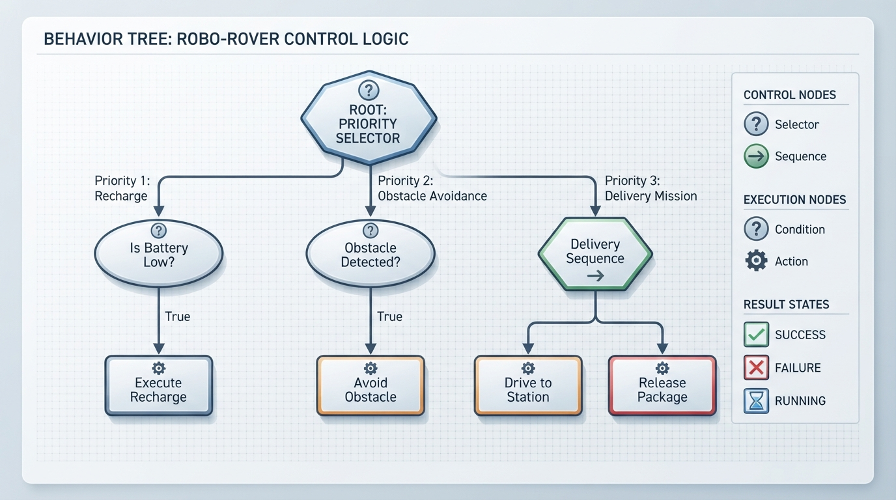
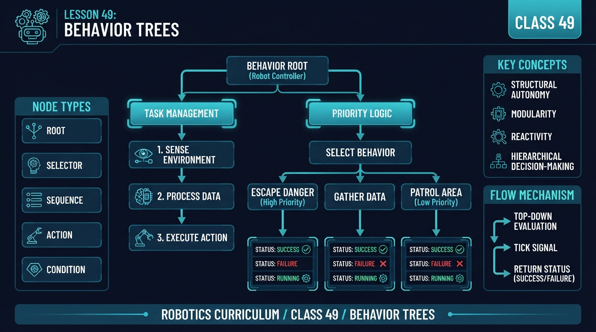
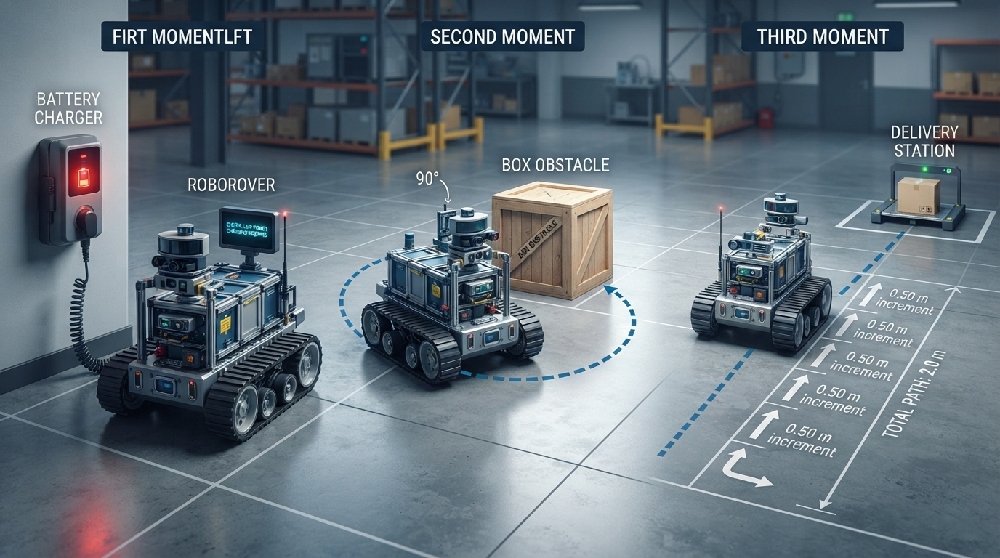
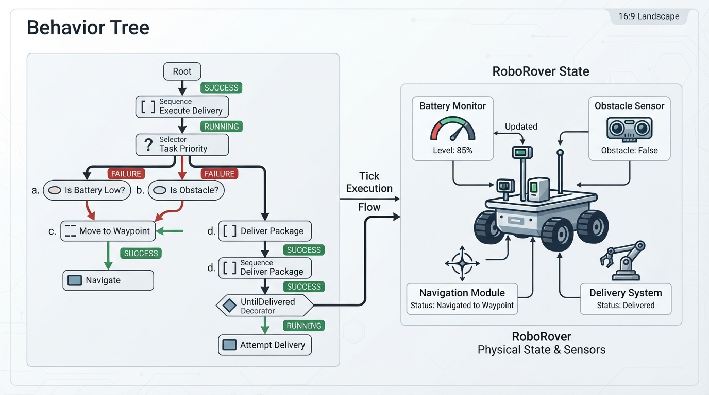

# Class 49: Behavior Trees

## Where We Are in the Robotics Journey

RoboRover has learned to represent situations with a **state machine**, using modes such as:

- `SEARCHING`
- `DRIVING`
- `AVOIDING`
- `CHARGING`
- `DELIVERING`

A state machine is effective when its modes and transitions remain manageable. As RoboRover gains more capabilities, another question becomes important:

> Which behavior should have priority right now?

Suppose RoboRover is driving toward a delivery station. Its battery becomes low, an obstacle appears, and an emergency-stop button is pressed. A large collection of state transitions can become difficult to inspect and maintain.

Today we will organize these decisions with a **behavior tree**: a hierarchical structure that repeatedly evaluates conditions and selects actions according to explicit control-flow rules.

In the next class, we will build a mental model of **ROS 2**, a robotics software framework. Behavior trees fit naturally into that model because they can coordinate sensors, navigation, motor commands, and other software components.

## Today We Will Learn

By the end of this class, you should be able to:

1. Explain what a behavior tree is.
2. Describe `Sequence`, `Selector`, and `Action` nodes.
3. Use the statuses `SUCCESS`, `FAILURE`, and `RUNNING`.
4. Trace a behavior tree one tick at a time.
5. Write a small Python behavior-tree simulation.
6. Explain one advantage and one limitation compared with a state machine.
7. Distinguish a branch status from the status of the complete mission.
8. Explain initialization, ongoing execution, completion, and cancellation for a real action interface.
9. Explain why status names and composite semantics can vary between software libraries.
10. Distinguish reactive and memory-based composite-node semantics.
11. Explain preemption: stopping a lower-priority running behavior so a higher-priority behavior can take control.

## 2-Minute Recap

A **state machine** stores one current state. For example:

```text
DRIVING --obstacle detected--> AVOIDING
AVOIDING --path clear---------> DRIVING
DRIVING --battery low---------> CHARGING
```

The state machine asks:

> “What state am I in, and which transition is enabled?”

A behavior tree asks:

> “Given the current situation, which branch should I try, and what should I do if it succeeds, fails, or is still working?”

Both approaches can represent robot behavior. They organize decisions differently.

## The Big Idea




**Figure:** A selector chooses the first usable branch, while a sequence performs required steps in order. In the status flow, `FAILURE` permits the next selector child, while `SUCCESS` or `RUNNING` stops that selector evaluation.

Imagine a checklist arranged as a decision tree:

```text
RoboRover mission
├── If battery is low: recharge
├── Else if obstacle is present: avoid obstacle
└── Else: drive toward delivery station
```

A common behavior-tree convention uses three results:

- **`SUCCESS`**: the node achieved its intended result.
- **`FAILURE`**: the node could not or should not perform its intended result.
- **`RUNNING`**: the node has started but needs more time or future ticks.

A **tick** is one request to evaluate the tree. An action does not need to finish during one tick. For example, `DriveToStation` may return `RUNNING` while the simulated wheels continue moving.

Status names and composite-node semantics are conventions rather than one universally identical standard. Libraries can add statuses, use different names, or provide variants, so always check the library documentation.

### Selector semantics in this lesson

The `Selector` is a **reactive priority selector**, also called a non-memory selector:

- On every tick, it starts with its first child.
- It evaluates children from left to right.
- It stops at the first child that returns `SUCCESS` or `RUNNING`.
- It proceeds to the next child only when the current child returns `FAILURE`.

Because it restarts at child 0, it can **preempt** a running lower-priority child. Preemption means interrupting that child so a higher-priority behavior can be evaluated and take control. In this program, preemption calls the previous child’s `halt()` method. That method only changes the simulated drive-command flag; it is not a guarantee of safe physical stopping.

A **memory selector** remembers the child that was running and resumes there instead of restarting from the first child.

### Sequence semantics in this lesson

The Python `Sequence` is a **memory sequence**:

- It evaluates children from left to right.
- When a child returns `RUNNING`, it records that child.
- On the next tick, it resumes at the recorded child.
- After success or failure, it resets its remembered child.

A **reactive sequence** would restart at child 0 on every tick.

| Composite | Restarts at child 0 each tick? | Remembers a running child? | Typical use |
|---|---:|---:|---|
| Reactive selector | Yes | No | Recheck priorities and permit preemption |
| Memory selector | No | Yes | Continue a selected alternative |
| Reactive sequence | Yes | No | Recheck prerequisites continuously |
| Memory sequence | No | Yes | Resume a multi-step task |

**Try it:** For the delivery sequence, identify the child remembered after the first drive tick.  
**Answer:** The sequence remembers `Drive to station`, because it returned `RUNNING`.

## See It in Your Head

### AI-Generated Engineering Visual · Professor OS



**How to read this visual:** Trace the signal or idea from left to right. Identify where `SUCCESS`, `FAILURE`, and `RUNNING` leave each node. Then predict which branch is evaluated when a higher-priority condition changes.

Picture a tree with the mission root at the top:

```text
                         Mission root
                              |
                         PRIORITY SELECTOR
                    /          |             \
                   /           |              \
             Recharge       Avoid          Deliver
              branch        branch          branch
```

The selector examines its children from left to right on every tick:

1. Try `Recharge`.
2. If it returns `FAILURE`, try `Avoid`.
3. If that returns `FAILURE`, try `Deliver`.
4. Stop when a child returns `SUCCESS` or `RUNNING`.

A branch returning `SUCCESS` or `RUNNING` stops the selector for that tick.

Now expand the delivery branch:

```text
DELIVER SEQUENCE
├── Drive to station
└── Release package
```

This lesson uses a memory `Sequence`:

- If `Drive to station` fails, stop and return `FAILURE`.
- If it is still moving, remember it and return `RUNNING`.
- On the next tick, resume the running drive child.
- Only if it succeeds, try `Release package`.
- After the sequence succeeds or fails, reset its remembered position.

**Try it:** If `Recharge` returns `FAILURE` and `Avoid` returns `RUNNING`, is `Deliver` evaluated during that selector tick?  
**Answer:** No. `RUNNING` stops the selector for that tick.

## Core Concept

### Conditions and actions

A **condition node** observes state and answers a question:

- Is the battery below 20%?
- Is an obstacle detected?
- Has the package been delivered?

In this lesson, conditions are pure observations. A condition returns `SUCCESS` when its statement is true and `FAILURE` when it is false.

An **action node** attempts to change the world:

- Recharge.
- Turn away from an obstacle.
- Drive.
- Open a gripper.

In this lesson, actions may mutate the robot dictionary. An action may return `RUNNING` for several ticks when work is unfinished.

In a production robotics system, an action commonly has:

1. **Initialization:** acquire resources and start the operation.
2. **Execution:** continue the operation on later ticks.
3. **Completion:** return `SUCCESS` or `FAILURE`.
4. **Cancellation or halt:** safely stop if a higher-priority behavior takes over.

The Python lab includes a minimal `halt` interface. It does not model threads, hardware drivers, communication timeouts, or resource ownership. A real `halt()` implementation must be designed with the hardware and safety requirements of the robot.

### A RoboRover tree

```text
ROOT: continue until package delivered, or propagate terminal failure
└── REACTIVE PRIORITY SELECTOR
    ├── Recharge if battery is low
    ├── Avoid if obstacle is detected
    └── Delivery memory sequence
        ├── Drive to station
        └── Release package
```

The mission root distinguishes temporary noncompletion from terminal failure:

- `RUNNING` means the mission is not finished but may continue.
- `SUCCESS` means the package has been delivered.
- `FAILURE` means the mission cannot proceed under the current policy, or a mission timeout has occurred.

The safety extension later uses a custom imperative wrapper, `SafetyGuard`, rather than adding safety as an ordinary selector child. This makes the policy explicit: halt the normal mission before checking the safety behavior, prevent normal motion while blocked, and latch persistent safety failure. A behavior-tree library could instead provide a priority selector, guard decorator, or parallel safety monitor; the correct choice depends on the library’s halt and scheduling semantics.

**Try it:** Which node is responsible for remembering that driving is still in progress?  
**Answer:** The memory `Sequence`, through its `running_index`.

## Math Without Fear

Suppose RoboRover drives at:

\[
v = 0.50\ \text{m/s}
\]

If the station is \(2.0\ \text{m}\) away:

\[
t = \frac{d}{v}
= \frac{2.0\ \text{m}}{0.50\ \text{m/s}}
= 4.0\ \text{s}
\]

This is an ideal physical calculation. The Python program does not simulate physical time. Its four drive increments represent four ticks, not four one-second intervals.

## Worked Robotics Example




**Figure:** The numerical example combines behavior priority with distance, speed, and battery accounting.

In the program, `distance` means **distance already traveled from the starting point**, not distance remaining to the station. The target is stored separately as `goal_distance`.

RoboRover begins with:

- traveled distance: \(0.0\ \text{m}\);
- goal distance: \(2.0\ \text{m}\);
- battery level: \(15\) energy units;
- low-battery threshold: \(20\);
- an obstacle detected;
- recharge adding \(20\) units;
- driving costing \(5\) units per \(0.50\ \text{m}\).

The first tick evaluates the children internally:

| Internal evaluation | Child | Result | What happens next |
|---:|---|---|---|
| 1 | Recharge condition | `SUCCESS` | Recharge action runs |
| 2 | Recharge action | `SUCCESS` | Recharge branch succeeds; selector stops |
| — | Avoid branch | Not evaluated | A selector stops after `SUCCESS` |
| — | Delivery branch | Not evaluated | A selector stops after `SUCCESS` |

The battery becomes:

\[
15 + 20 = 35
\]

The branch returns `SUCCESS`, but the mission root returns `RUNNING` because delivery has not occurred.

On tick 2:

| Internal evaluation | Child | Result | What happens next |
|---:|---|---|---|
| 1 | Recharge condition | `FAILURE` | Try the next selector child |
| 2 | Avoid condition | `SUCCESS` | Run avoidance |
| 3 | Avoid action | `SUCCESS` | Avoidance branch succeeds; selector stops |
| — | Delivery branch | Not evaluated | A selector stops after `SUCCESS` |

The second tick avoids the obstacle. The root remains `RUNNING`.

On tick 3, the recharge condition fails, the avoidance condition fails, and the delivery branch is evaluated:

| Internal evaluation | Child | Result | What happens next |
|---:|---|---|---|
| 1 | Recharge condition | `FAILURE` | Try avoidance |
| 2 | Avoid condition | `FAILURE` | Try delivery |
| 3 | Drive action | `RUNNING` | Delivery sequence and selector return `RUNNING` |

Ticks 3 through 6 drive four increments:

\[
4 \times 0.50\ \text{m} = 2.0\ \text{m}
\]

The driving cost is:

\[
4 \times 5 = 20
\]

The final battery is:

\[
35 - 20 = 15
\]

On tick 6, driving reaches the goal and returns `SUCCESS`. The sequence immediately evaluates `release_package`, which also returns `SUCCESS`. The root then returns `SUCCESS`.

This simplified policy does not reserve energy for a return trip. That is intentional and would need to be improved for a real robot.

## Python Lab




**Figure:** Each tick evaluates the tree and updates a small model of RoboRover's world. Inspect how `SUCCESS`, `FAILURE`, and `RUNNING` flow from conditions and actions to the mission root.

The following complete Python 3.7 program implements conditions, actions, halt behavior, a memory sequence, a reactive selector, a mission root, and tests for successful delivery and timeout behavior.

```python
from enum import Enum


class Status(Enum):
    SUCCESS = 1
    FAILURE = 2
    RUNNING = 3


class Node(object):
    def tick(self, robot):
        raise NotImplementedError

    def halt(self, robot):
        pass


class Condition(Node):
    def __init__(self, test):
        self.test = test

    def tick(self, robot):
        return Status.SUCCESS if self.test(robot) else Status.FAILURE


class Action(Node):
    def __init__(self, function, halt_function=None):
        self.function = function
        self.halt_function = halt_function

    def tick(self, robot):
        return self.function(robot)

    def halt(self, robot):
        if self.halt_function is not None:
            self.halt_function(robot)


class Sequence(Node):
    def __init__(self, children):
        self.children = children
        self.running_index = 0

    def tick(self, robot):
        index = self.running_index

        while index < len(self.children):
            result = self.children[index].tick(robot)

            if result == Status.RUNNING:
                self.running_index = index
                return Status.RUNNING

            if result == Status.FAILURE:
                self.running_index = 0
                return Status.FAILURE

            index += 1

        self.running_index = 0
        return Status.SUCCESS

    def halt(self, robot):
        if self.running_index < len(self.children):
            self.children[self.running_index].halt(robot)
        self.running_index = 0


class Selector(Node):
    def __init__(self, children):
        self.children = children
        self.running_child = None

    def tick(self, robot):
        previous_running_child = self.running_child

        for child in self.children:
            result = child.tick(robot)

            if result != Status.FAILURE:
                if (
                    previous_running_child is not None
                    and previous_running_child is not child
                ):
                    previous_running_child.halt(robot)

                self.running_child = (
                    child if result == Status.RUNNING else None
                )
                return result

        if previous_running_child is not None:
            previous_running_child.halt(robot)

        self.running_child = None
        return Status.FAILURE

    def halt(self, robot):
        if self.running_child is not None:
            self.running_child.halt(robot)
        self.running_child = None


class UntilDelivered(Node):
    def __init__(self, child, max_ticks):
        self.child = child
        self.max_ticks = max_ticks
        self.ticks_used = 0

    def tick(self, robot):
        if robot.get("delivered", False):
            return Status.SUCCESS

        if self.ticks_used >= self.max_ticks:
            robot["failure_reason"] = "mission timeout"
            self.child.halt(robot)
            return Status.FAILURE

        self.ticks_used += 1
        result = self.child.tick(robot)

        if robot.get("delivered", False):
            return Status.SUCCESS

        if result == Status.FAILURE:
            robot["failure_reason"] = "all available branches failed"
            return Status.FAILURE

        if self.ticks_used >= self.max_ticks:
            robot["failure_reason"] = "mission timeout"
            self.child.halt(robot)
            return Status.FAILURE

        return Status.RUNNING

    def halt(self, robot):
        self.child.halt(robot)


def battery_is_low(robot):
    return robot["battery"] < 20


def obstacle_is_present(robot):
    return robot["obstacle"]


def recharge_if_needed(robot):
    if robot["battery"] < 20:
        robot["battery"] += 20
        return Status.SUCCESS
    return Status.FAILURE


def avoid_obstacle(robot):
    if robot["obstacle"]:
        robot["obstacle"] = False
        return Status.SUCCESS
    return Status.FAILURE


def drive_to_station(robot):
    if robot["distance"] >= robot["goal_distance"]:
        robot["drive_command_active"] = False
        return Status.SUCCESS

    robot["drive_command_active"] = True
    robot["distance"] += 0.50
    robot["battery"] -= 5

    if robot["distance"] >= robot["goal_distance"]:
        robot["drive_command_active"] = False
        return Status.SUCCESS

    return Status.RUNNING


def halt_drive(robot):
    robot["drive_command_active"] = False


def release_package(robot):
    robot["delivered"] = True
    return Status.SUCCESS


def build_tree():
    recharge_branch = Sequence([
        Condition(battery_is_low),
        Action(recharge_if_needed)
    ])

    avoid_branch = Sequence([
        Condition(obstacle_is_present),
        Action(avoid_obstacle)
    ])

    delivery_branch = Sequence([
        Action(drive_to_station, halt_function=halt_drive),
        Action(release_package)
    ])

    return UntilDelivered(
        Selector([
            recharge_branch,
            avoid_branch,
            delivery_branch
        ]),
        max_ticks=20
    )


def run_permanently_running_timeout_test():
    robot = {"delivered": False, "failure_reason": None}
    tree = UntilDelivered(
        Action(lambda state: Status.RUNNING),
        max_ticks=20
    )

    result = None
    for evaluation in range(20):
        result = tree.tick(robot)
        if evaluation < 19:
            assert result == Status.RUNNING

    assert result == Status.FAILURE
    assert tree.ticks_used == 20
    assert robot["failure_reason"] == "mission timeout"


def run_success_without_delivery_timeout_test():
    robot = {"delivered": False, "failure_reason": None}
    tree = UntilDelivered(
        Action(lambda state: Status.SUCCESS),
        max_ticks=3
    )

    result = None
    for evaluation in range(3):
        result = tree.tick(robot)
        if evaluation < 2:
            assert result == Status.RUNNING

    assert result == Status.FAILURE
    assert tree.ticks_used == 3
    assert robot["failure_reason"] == "mission timeout"
    assert robot["delivered"] is False


def main():
    robot = {
        "battery": 15,
        "distance": 0.0,
        "goal_distance": 2.0,
        "obstacle": True,
        "delivered": False,
        "failure_reason": None,
        "drive_command_active": False
    }

    tree = build_tree()
    ticks = 0

    while True:
        ticks += 1
        result = tree.tick(robot)
        print(
            "tick={0}, result={1}, distance={2:.2f} m, "
            "battery={3}, obstacle={4}, delivered={5}".format(
                ticks,
                result.name,
                robot["distance"],
                robot["battery"],
                robot["obstacle"],
                robot["delivered"]
            )
        )

        if result != Status.RUNNING:
            break

    assert result == Status.SUCCESS
    assert robot["delivered"] is True
    assert ticks == 6
    assert robot["distance"] == 2.0
    assert robot["battery"] == 15
    assert robot["obstacle"] is False
    assert robot["failure_reason"] is None
    assert robot["drive_command_active"] is False

    run_permanently_running_timeout_test()
    run_success_without_delivery_timeout_test()

    print("Verified: delivery completed in 6 ticks.")
    print("Verified: final distance is 2.0 m.")
    print("Verified: final battery is 15 energy units.")
    print("Verified: permanent RUNNING tree timed out on evaluation 20.")
    print("Verified: undelivered SUCCESS also timed out on evaluation 3.")


if __name__ == "__main__":
    main()
```

The verified output is:

```text
tick=1, result=RUNNING, distance=0.00 m, battery=35, obstacle=True, delivered=False
tick=2, result=RUNNING, distance=0.00 m, battery=35, obstacle=False, delivered=False
tick=3, result=RUNNING, distance=0.50 m, battery=30, obstacle=False, delivered=False
tick=4, result=RUNNING, distance=1.00 m, battery=25, obstacle=False, delivered=False
tick=5, result=RUNNING, distance=1.50 m, battery=20, obstacle=False, delivered=False
tick=6, result=SUCCESS, distance=2.00 m, battery=15, obstacle=False, delivered=True
Verified: delivery completed in 6 ticks.
Verified: final distance is 2.0 m.
Verified: final battery is 15 energy units.
Verified: permanent RUNNING tree timed out on evaluation 20.
Verified: undelivered SUCCESS also timed out on evaluation 3.
```

The branch status and root mission status are different concepts. On tick 1, the recharge branch returns `SUCCESS`, but the root returns `RUNNING` because the package is not yet delivered.

`UntilDelivered` uses an inclusive tick limit. With `max_ticks=20`, evaluation 20 is the last permitted evaluation. Its `ticks_used` counter is not reset by `halt()`. Therefore, if the mission is halted and later ticked again, it resumes with the previous timeout budget. That is one possible policy, not a universal rule. A different implementation could reset the counter when a mission is restarted; the choice should be documented.

## Mini Simulation or Game

Predict this sequence before reading the table:

1. Tick 1 recharges.
2. Tick 2 removes the obstacle.
3. Ticks 3–6 drive four \(0.50\ \text{m}\) increments.
4. Tick 6 releases the package.

```text
Tick 1: recharge branch SUCCESS; root RUNNING.
Tick 2: avoidance branch SUCCESS; root RUNNING.
Ticks 3–5: drive child RUNNING; root RUNNING.
Tick 6: drive SUCCESS, release SUCCESS; root SUCCESS.
```

| Tick | Internal child evaluations | Selected branch | Branch status | Root mission status | Robot state after the tick |
|---:|---|---|---|---|---|
| 1 | Recharge condition `SUCCESS`; recharge action `SUCCESS` | Recharge | `SUCCESS` | `RUNNING` | Battery \(35\), obstacle present |
| 2 | Recharge condition `FAILURE`; avoid condition `SUCCESS`; avoid action `SUCCESS` | Avoid | `SUCCESS` | `RUNNING` | Battery \(35\), obstacle cleared |
| 3 | Recharge condition `FAILURE`; avoid condition `FAILURE`; drive `RUNNING` | Deliver: drive | `RUNNING` | `RUNNING` | Distance \(0.50\) m, battery \(30\) |
| 4 | Same priority checks; drive `RUNNING` | Deliver: drive | `RUNNING` | `RUNNING` | Distance \(1.00\) m, battery \(25\) |
| 5 | Same priority checks; drive `RUNNING` | Deliver: drive | `RUNNING` | `RUNNING` | Distance \(1.50\) m, battery \(20\) |
| 6 | Same priority checks; drive `SUCCESS`; release `SUCCESS` | Deliver: release | `SUCCESS` | `SUCCESS` | Distance \(2.00\) m, battery \(15\), delivered |

This table shows an important reactive-selector detail: failed recharge and avoidance conditions are evaluated before delivery becomes active. Once delivery is running, the selector still rechecks those higher-priority branches on every tick.

Changing `"battery": 25` skips recharge on the first tick. Changing `"obstacle": False` skips avoidance after recharge.

## What Should Happen?

A branch can return `SUCCESS` while the root returns `RUNNING`. A branch can return `FAILURE`, allowing the selector to try another branch. If all alternatives fail, the root exposes terminal `FAILURE`.

The permanent-`RUNNING` test verifies that `max_ticks=20` returns timeout `FAILURE` on evaluation 20, not evaluation 21.

The timeout counter is part of the decorator’s state. In this implementation, `halt()` stops the child but does not reset `ticks_used`; resetting the budget would be a separate restart policy.

## Common Mistakes

### Treating a selector like a sequence

A selector chooses the first child that does not fail. It does not perform every child.

### Assuming all selectors remember

This lesson uses a reactive selector. It restarts at the first child and can preempt a lower-priority running behavior.

### Assuming all sequences restart

This lesson's delivery sequence is memory-based and resumes its running drive child.

### Returning `RUNNING` after work is complete

`RUNNING` means that the action is unfinished. Recharge completes during one modeled tick and returns `SUCCESS`.

### Forgetting `RUNNING`

Long-running actions need `RUNNING` so the tree can be evaluated again while the action continues.

### Ignoring action cancellation

When a higher-priority branch takes over, a real drive action must be halted or cancelled safely. The example’s `halt_drive()` only clears a simulation flag; it does not prove that physical motion has stopped.

### Converting every non-success into `RUNNING`

Terminal `FAILURE` must not silently become endless `RUNNING`. The mission root also applies an inclusive tick limit.

### Treating child success as mission success

A child can succeed without satisfying the mission objective. `UntilDelivered` checks delivery independently.

### Confusing traveled distance with remaining distance

In this lab, `robot["distance"]` is traveled distance from the starting point. `robot["goal_distance"]` is the target traveled distance.

### Assuming `halt()` resets every decorator

`UntilDelivered.halt()` halts its child but does not reset `ticks_used`. Timeout-budget behavior is an implementation choice that must be made explicit.

## Try It Yourself

**Challenge:** Add a `blocked` condition and a `stop` action.

If `robot["blocked"]` is true, RoboRover should stop before recharge, obstacle avoidance, or delivery.

```text
ROOT SAFETY GUARD
├── If blocked:
│   └── Stop action
│       ├── RUNNING while blocked
│       ├── SUCCESS when safely stopped and the block is cleared
│       └── FAILURE after three blocked ticks
└── Otherwise: run the normal mission root
```

This extension uses an imperative `SafetyGuard` wrapper instead of placing safety inside the ordinary priority selector. The wrapper first halts the normal mission, then owns the blocked-state policy. This makes the safety rule and terminal-failure latch easy to inspect. A production behavior-tree library might express the same architecture with a safety decorator or a higher-priority reactive branch, but the exact result depends on how that library propagates halts and manages running actions.

The following block is independently executable. It includes the definitions used by the safety extension because every Python fence is validated in isolation.

```python
from enum import Enum


class Status(Enum):
    SUCCESS = 1
    FAILURE = 2
    RUNNING = 3


class Node(object):
    def tick(self, robot):
        raise NotImplementedError

    def halt(self, robot):
        pass


class Condition(Node):
    def __init__(self, test):
        self.test = test

    def tick(self, robot):
        return Status.SUCCESS if self.test(robot) else Status.FAILURE


class Action(Node):
    def __init__(self, function, halt_function=None):
        self.function = function
        self.halt_function = halt_function

    def tick(self, robot):
        return self.function(robot)

    def halt(self, robot):
        if self.halt_function is not None:
            self.halt_function(robot)


class Sequence(Node):
    def __init__(self, children):
        self.children = children
        self.running_index = 0

    def tick(self, robot):
        index = self.running_index

        while index < len(self.children):
            result = self.children[index].tick(robot)

            if result == Status.RUNNING:
                self.running_index = index
                return Status.RUNNING

            if result == Status.FAILURE:
                self.running_index = 0
                return Status.FAILURE

            index += 1

        self.running_index = 0
        return Status.SUCCESS

    def halt(self, robot):
        if self.running_index < len(self.children):
            self.children[self.running_index].halt(robot)
        self.running_index = 0


class Selector(Node):
    def __init__(self, children):
        self.children = children
        self.running_child = None

    def tick(self, robot):
        previous = self.running_child

        for child in self.children:
            result = child.tick(robot)

            if result != Status.FAILURE:
                if previous is not None and previous is not child:
                    previous.halt(robot)

                self.running_child = (
                    child if result == Status.RUNNING else None
                )
                return result

        if previous is not None:
            previous.halt(robot)

        self.running_child = None
        return Status.FAILURE

    def halt(self, robot):
        if self.running_child is not None:
            self.running_child.halt(robot)
        self.running_child = None


class UntilDelivered(Node):
    def __init__(self, child, max_ticks):
        self.child = child
        self.max_ticks = max_ticks
        self.ticks_used = 0

    def tick(self, robot):
        if robot.get("delivered", False):
            return Status.SUCCESS

        if self.ticks_used >= self.max_ticks:
            robot["failure_reason"] = "mission timeout"
            self.child.halt(robot)
            return Status.FAILURE

        self.ticks_used += 1
        result = self.child.tick(robot)

        if robot.get("delivered", False):
            return Status.SUCCESS

        if result == Status.FAILURE:
            robot["failure_reason"] = "all available branches failed"
            return Status.FAILURE

        if self.ticks_used >= self.max_ticks:
            robot["failure_reason"] = "mission timeout"
            self.child.halt(robot)
            return Status.FAILURE

        return Status.RUNNING

    def halt(self, robot):
        self.child.halt(robot)


def battery_is_low(robot):
    return robot["battery"] < 20


def obstacle_is_present(robot):
    return robot["obstacle"]


def recharge_if_needed(robot):
    if robot["battery"] < 20:
        robot["battery"] += 20
        return Status.SUCCESS
    return Status.FAILURE


def avoid_obstacle(robot):
    if robot["obstacle"]:
        robot["obstacle"] = False
        return Status.SUCCESS
    return Status.FAILURE


def drive_to_station(robot):
    if robot["distance"] >= robot["goal_distance"]:
        robot["drive_command_active"] = False
        return Status.SUCCESS

    robot["drive_command_active"] = True
    robot["distance"] += 0.50
    robot["battery"] -= 5

    if robot["distance"] >= robot["goal_distance"]:
        robot["drive_command_active"] = False
        return Status.SUCCESS

    return Status.RUNNING


def halt_drive(robot):
    robot["drive_command_active"] = False


def release_package(robot):
    robot["delivered"] = True
    return Status.SUCCESS


def build_tree():
    recharge_branch = Sequence([
        Condition(battery_is_low),
        Action(recharge_if_needed)
    ])

    avoid_branch = Sequence([
        Condition(obstacle_is_present),
        Action(avoid_obstacle)
    ])

    delivery_branch = Sequence([
        Action(drive_to_station, halt_function=halt_drive),
        Action(release_package)
    ])

    return UntilDelivered(
        Selector([
            recharge_branch,
            avoid_branch,
            delivery_branch
        ]),
        max_ticks=20
    )


class StopIfBlocked(Node):
    def __init__(self):
        self.stop_ticks = 0

    def tick(self, robot):
        if not robot["blocked"]:
            self.stop_ticks = 0
            robot["drive_command_active"] = False
            return Status.SUCCESS

        self.stop_ticks += 1
        robot["drive_command_active"] = False

        if self.stop_ticks >= 3:
            robot["failure_reason"] = "blocked for three ticks"
            return Status.FAILURE

        return Status.RUNNING

    def halt(self, robot):
        robot["drive_command_active"] = False


class SafetyGuard(Node):
    def __init__(self, normal_mission):
        self.stop_if_blocked = StopIfBlocked()
        self.normal_mission = normal_mission
        self.terminal_failure = False

    def tick(self, robot):
        if self.terminal_failure:
            return Status.FAILURE

        if robot["blocked"] or self.stop_if_blocked.stop_ticks > 0:
            self.normal_mission.halt(robot)

            result = self.stop_if_blocked.tick(robot)

            if result == Status.FAILURE:
                self.terminal_failure = True
                return Status.FAILURE

            if result == Status.RUNNING:
                return Status.RUNNING

            return self.normal_mission.tick(robot)

        return self.normal_mission.tick(robot)

    def halt(self, robot):
        self.stop_if_blocked.halt(robot)
        self.normal_mission.halt(robot)


def build_safety_tree():
    return SafetyGuard(build_tree())


def run_block_clears_test():
    robot = {
        "battery": 25,
        "distance": 0.0,
        "goal_distance": 2.0,
        "obstacle": False,
        "blocked": True,
        "delivered": False,
        "failure_reason": None,
        "drive_command_active": False
    }

    tree = build_safety_tree()

    first = tree.tick(robot)
    assert first == Status.RUNNING
    assert robot["distance"] == 0.0
    assert robot["drive_command_active"] is False

    robot["blocked"] = False
    second = tree.tick(robot)

    assert second == Status.RUNNING
    assert robot["distance"] == 0.50
    assert robot["failure_reason"] is None


def run_persistent_block_test():
    robot = {
        "battery": 25,
        "distance": 0.0,
        "goal_distance": 2.0,
        "obstacle": False,
        "blocked": True,
        "delivered": False,
        "failure_reason": None,
        "drive_command_active": False
    }

    tree = build_safety_tree()

    first = tree.tick(robot)
    second = tree.tick(robot)
    third = tree.tick(robot)

    assert first == Status.RUNNING
    assert second == Status.RUNNING
    assert third == Status.FAILURE
    assert robot["failure_reason"] == "blocked for three ticks"
    assert robot["distance"] == 0.0
    assert robot["delivered"] is False
    assert robot["drive_command_active"] is False
    assert tree.tick(robot) == Status.FAILURE


def run_safety_tests():
    run_block_clears_test()
    run_persistent_block_test()
    print("Verified: a cleared block permits the normal mission.")
    print("Verified: a persistent block fails on the third blocked tick.")


if __name__ == "__main__":
    run_safety_tests()
```

In this implementation:

- The first two blocked evaluations return `RUNNING`.
- The third blocked evaluation returns terminal `FAILURE`.
- The normal mission is halted before safety behavior is evaluated.
- Delivery is never attempted while the block persists.
- A cleared block returns control to the normal mission.
- The integrated safety root remains terminal after persistent-block failure.

## Quick Quiz

1. What are the three common behavior-tree node results?
2. What does a memory `Sequence` do when one child returns `RUNNING`?
3. Why is recharge placed before delivery?
4. Why can correct tree logic still make a poor decision?
5. Why does recharge return `SUCCESS` rather than `RUNNING`?
6. What happens when every selector child returns `FAILURE`?
7. With `max_ticks=20`, when must timeout occur?
8. What does preemption mean in this lesson?
9. What happens to a running drive action when preempted?
10. What happens when a child returns `SUCCESS` but the package remains undelivered?
11. Why must persistent safety failure be terminal?
12. Does `UntilDelivered.halt()` reset its timeout counter?

## Answers

1. `SUCCESS`, `FAILURE`, and `RUNNING`.
2. It records the running child and resumes it on a later tick.
3. Selector order gives low battery higher priority.
4. Inputs may be noisy, delayed, missing, or incorrectly calibrated.
5. Recharge completes during its one modeled tick.
6. The selector returns `FAILURE`, which the mission root exposes.
7. On evaluation 20.
8. Preemption is stopping or halting a lower-priority running behavior so a higher-priority behavior can take control.
9. Its halt or cancellation behavior must be invoked. In this simulation, `halt_drive()` clears `drive_command_active`; a real robot needs a verified safe-stop mechanism.
10. The root returns `RUNNING` until delivery occurs or the final permitted evaluation produces timeout `FAILURE`.
11. Otherwise lower-priority motion could continue while the robot is blocked.
12. No. It halts the child but leaves `ticks_used` unchanged. Resetting the timeout budget would require an explicit restart policy.

## Real Robot Connection

In a real robot, behavior-tree actions often request lower-level capabilities:

```text
DriveToStation
    └── sends a goal to a navigation component
```

The navigation component may use sensors, localization, and wheel controllers. The behavior tree waits for results such as:

- goal accepted;
- still moving;
- goal reached;
- goal impossible;
- action canceled.

This separation is useful:

- the behavior tree organizes task-level decisions;
- lower-level controllers regulate motors;
- sensors provide measurements;
- communication software transports messages and results.

The behavior tree should not assume that returning from `halt()` proves that a motor has stopped. The lower-level action interface must report cancellation and safe-stop state according to the robot’s actual hardware and communication design.

This separation leads directly toward ROS 2. In the next class, we will study **nodes**, **topics**, **services**, and **actions**.

If the tree ticks at 10 Hz:

\[
\frac{1}{10\ \text{Hz}} = 0.1\ \text{s}
\]

The Python lab does not model physical time; it models one drive increment per tick.

## Vocabulary

- **Behavior tree:** A hierarchical decision structure using statuses such as `SUCCESS`, `FAILURE`, and `RUNNING`.
- **Tick:** One evaluation request sent to a behavior tree.
- **Sequence:** A control-flow node that evaluates children in order.
- **Reactive sequence:** A sequence that restarts at its first child on every tick.
- **Memory sequence:** A sequence that remembers a running child.
- **Selector:** A control-flow node that tries children in order.
- **Reactive selector:** A selector that starts with its first child on every tick.
- **Memory selector:** A selector that remembers a running child.
- **Action:** A node that attempts to perform an operation.
- **Condition:** A node that checks a statement about the robot or environment.
- **Decorator:** A node that changes or interprets another node's result.
- **`SUCCESS`:** The node achieved its intended result.
- **`FAILURE`:** The node could not or should not achieve its intended result.
- **`RUNNING`:** The node has not finished.
- **Priority:** An ordering that gives some behaviors precedence.
- **Preemption:** Halting a lower-priority running behavior so a higher-priority behavior can take control.
- **Halt or cancellation:** An operation that safely stops a running action.
- **Terminal mission failure:** A root-level result indicating that the mission cannot proceed.
- **Timeout budget:** The permitted number of evaluations before a running or otherwise incomplete mission is forced to fail.

## Further Learning

- Draw the same mission as a state machine and a behavior tree.
- Study robotics behavior trees, BT.CPP concepts, and ROS 2 action interfaces.
- Compare reactive and memory selectors.
- Compare reactive and memory sequences.
- Study decorators such as repeat, retry, timeout, and inverter.
- Add a reserve-energy guard.
- Investigate how a robotics library reports cancellation and confirms that a lower-level action has stopped.

## Next Class

**Class 50: ROS 2 Mental Model**

RoboRover’s behavior tree will become part of a larger software system. We will learn how ROS 2 components communicate and how a behavior-tree action can interact with sensors, navigation, and motor-control nodes.