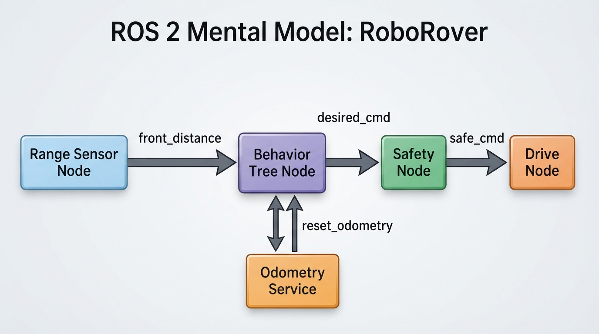
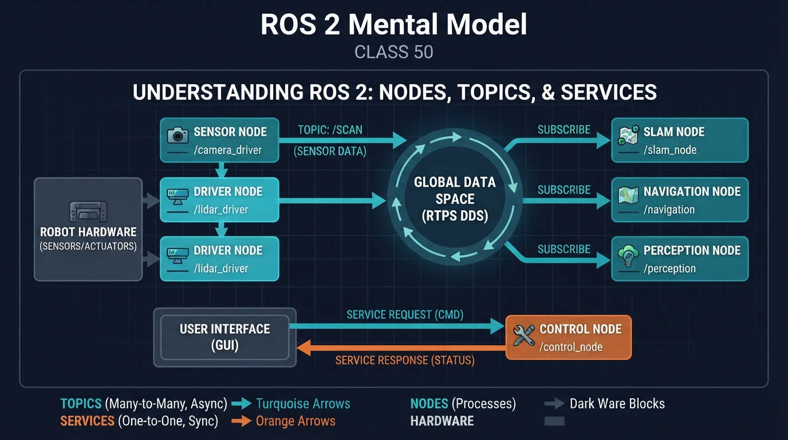
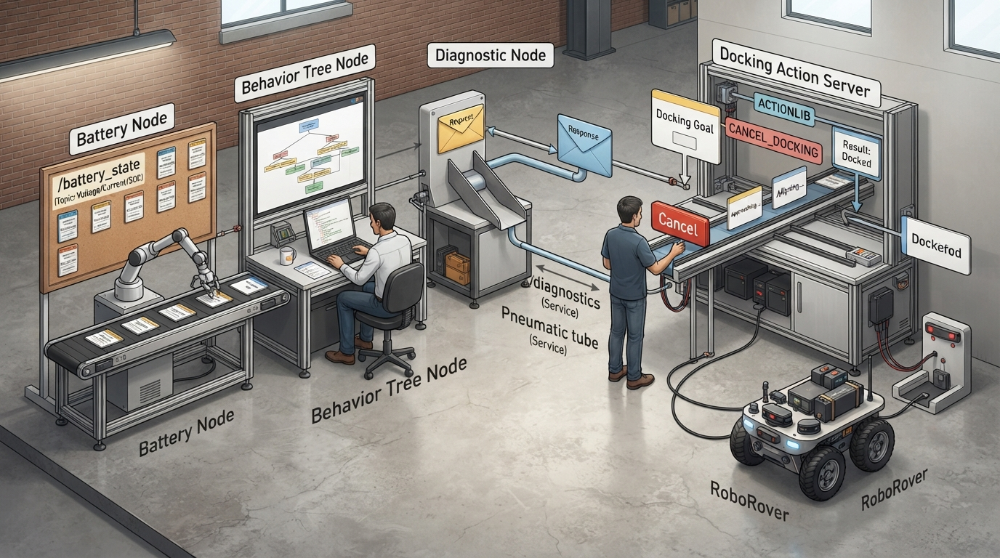
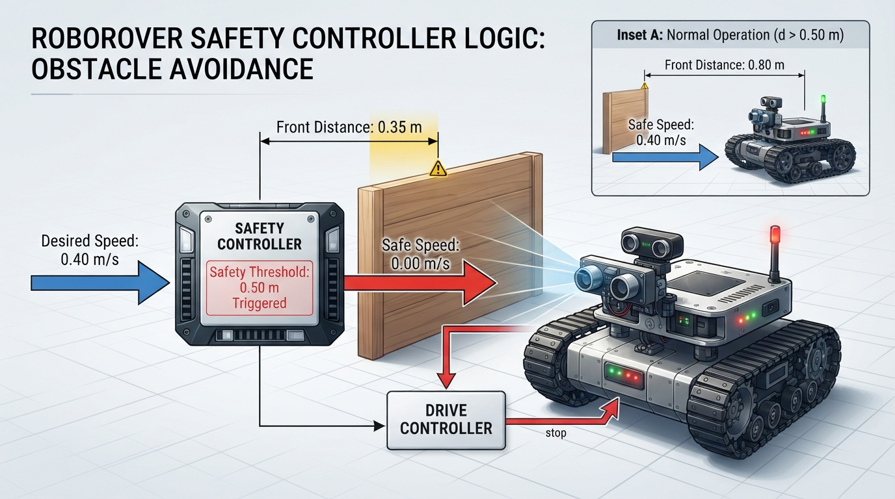
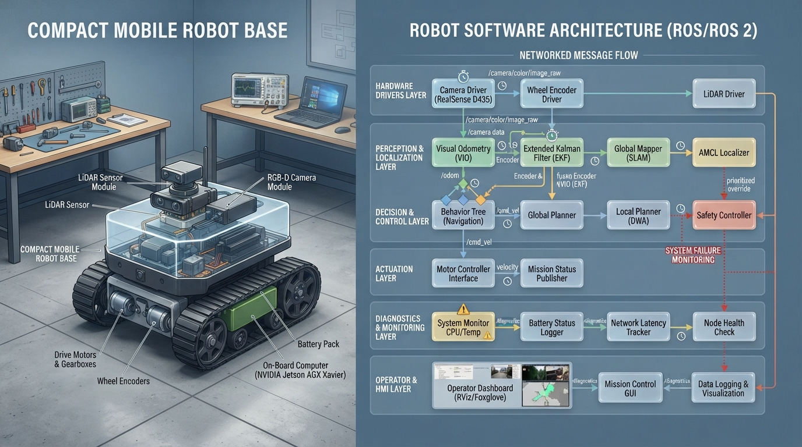

# Class 50: ROS 2 Mental Model

## Where We Are in the Robotics Journey

RoboRover has just learned to organize decisions with a **Behavior Tree**. A behavior tree answers questions such as:

- Should RoboRover search for a charging dock?
- Should it follow a corridor?
- Should it stop because an obstacle is too close?
- Which action should happen next?

That tree is useful, but a real robot is not one giant program. Its camera, motor controller, battery monitor, mapping software, safety system, and behavior logic may all be separate programs running at different speeds.

ROS 2, commonly pronounced “Ross Two,” helps these programs communicate.

This class builds a mental model of three important ROS 2 ideas:

1. **Nodes** — independent programs or program components.
2. **Topics** — named streams of messages.
3. **Services** — request-and-response interactions.

This is not yet a software installation lesson. We will first understand the architecture well enough to draw it, explain it, and simulate a small version in ordinary Python.

## Today We Will Learn

By the end of this class, you should be able to:

- explain why a robot system is divided into nodes;
- distinguish a topic from a service;
- trace a message from a publisher to one or more subscribers;
- explain why a behavior tree usually should not directly contain every hardware detail;
- calculate a simple message rate and data rate;
- recognize practical problems such as stale messages, mismatched interfaces, and service delays;
- run a small Python simulation of RoboRover’s ROS-like communication.

The key idea is:

> A ROS 2 robot is commonly organized as cooperating nodes that exchange typed messages through topics and use services for request-and-response operations.

This is a teaching model, not a complete description of every ROS 2 feature. ROS 2 also includes actions, parameters, launch systems, quality-of-service settings, and much more. We will meet those later.

## 2-Minute Recap

A **Behavior Tree** is a structured decision system. It is made from nodes such as:

- **Sequence**: perform children in order, usually requiring them all to succeed;
- **Selector**: try alternatives until one succeeds;
- **Condition**: check something;
- **Action**: perform something.

For example:

```text
Selector
├── Sequence
│   ├── Battery low?
│   └── Drive to charging dock
└── Sequence
    ├── Obstacle close?
    └── Stop
```

The behavior tree chooses a task-level action. It does not need to know the electrical details of every motor command. A separate part of the robot can turn “drive to the dock” into wheel speeds.

That separation is one reason ROS 2 is useful.

## The Big Idea




**Figure:** Notice that topics carry ongoing messages while the odometry service uses a request-and-response exchange.

Imagine RoboRover as a small company.

- A **node** is a worker with a specific job.
- A **topic** is a labeled notice board or radio channel.
- A **message** is a note placed on that channel.
- A **service** is a direct request: “Please perform this operation and tell me the result.”

A possible RoboRover system looks like this:

```text
             obstacle_distance
[Range Sensor Node] ─────────────────► [Safety Node]
                                           │
                                           │ safe_cmd
                                           ▼
                                      [Drive Node]
                                           │
                                           ▼
                                      Wheel motors

[Behavior Tree Node] ─────► desired_cmd ─► [Safety Node]

[Dashboard Node] ── request ─► [Battery Service Node]
                  ◄─ response ──
```

The arrows represent communication, not necessarily physical wires.

A node usually has one focused responsibility. This gives engineers useful choices:

- restart one component without restarting everything;
- test a sensor node separately;
- replace a simulated motor node with a real motor node;
- inspect messages while the robot is running;
- allow several nodes to use the same information.

For example, the range sensor might publish one distance measurement. Both the safety node and the dashboard could subscribe to it. The sensor does not need to know who is listening.

## See It in Your Head

### AI-Generated Engineering Visual · Professor OS



**How to read this visual:** Trace the signal or idea from left to right. Match each block to the lesson explanation, then predict what would change if one block produced a wrong value.




**Figure:** Each node has a focused responsibility, and communication channels connect the responsibilities without merging them into one giant program.

Picture three rooms in a workshop.

### Room 1: The sensor room

A worker repeatedly measures the distance to the nearest obstacle. Every measurement is placed on a notice board labeled:

```text
/front_distance
```

The note might contain:

```text
distance: 0.42 m
```

This is a **topic message**.

### Room 2: The safety room

The safety worker watches `/front_distance`. If the distance is too small, it publishes a safer velocity command on:

```text
/cmd_safe
```

The safety node may also listen to the behavior tree’s desired command:

```text
/cmd_desired
```

It combines intent with safety.

### Room 3: The drive room

The drive node listens to `/cmd_safe`. It converts a requested speed into motor commands.

Notice the direction of responsibility:

- the behavior tree decides *what task RoboRover wants to do*;
- the safety node decides whether that command is currently acceptable;
- the drive node handles the mechanical interface.

The names here are illustrative. Real robot systems choose names and message types according to their design.

## Core Concept

### Nodes: independent participants

A node is a running unit of computation that communicates with other parts of the robot.

A node may:

- publish data;
- subscribe to data;
- provide a service;
- call a service;
- perform several of these roles.

“Independent” does not mean completely isolated. It means the node has a clear boundary and communicates through defined interfaces.

A camera node might publish images. A perception node might subscribe to those images and publish detected objects. A behavior node might subscribe to detected objects and publish a desired action.

A ROS 2 node is a software-process abstraction. It is not the same thing as a **behavior-tree node**. A behavior-tree node represents a decision, condition, or action within a behavior tree; a ROS 2 node is a communication and computation unit. A behavior tree can run inside a ROS 2 node, and a ROS 2 node can contain code that executes a behavior tree.

### Topics: ongoing streams

A topic is appropriate when information may be produced repeatedly or asynchronously.

Examples include:

- sensor measurements;
- camera images;
- robot pose estimates;
- battery percentage;
- velocity commands;
- detected objects.

A topic commonly has:

- a name;
- a message type;
- one or more publishers;
- zero or more subscribers.

The publisher does not normally wait for each subscriber to ask for the next message. It publishes according to its own timing.

This makes topics useful for “Here is the latest information” communication.

### Services: a request and a response

A service is appropriate when one node asks another node to perform a specific operation and return a result.

Examples:

- reset an odometry counter;
- save a map;
- enable a test mode;
- ask for a diagnostic report;
- request a calibration operation.

A service interaction has two sides:

```text
Client ── request ──► Service server
Client ◄─ response ── Service server
```

A service is not usually the best tool for a high-rate sensor stream. Asking separately for every camera frame would be clumsy and could create delays. A topic is a better fit for continuing data.

### One compact comparison

| Mechanism | Main pattern | Good question to ask |
|---|---|---|
| Topic | Repeated, asynchronous messages | “What information is being announced?” |
| Service | One request followed by one response | “Can you perform this operation and report the result?” |
| Behavior tree | Decision organization | “Which task should happen now?” |

These are not competing choices at the same level. A behavior tree may run inside a ROS 2 node, subscribe to topics, publish commands, and call services.

## Math Without Fear

Suppose RoboRover’s front-distance node publishes:

- one message every \(0.10\ \text{s}\);
- each message contains \(24\ \text{bytes}\).

The publication frequency is:

\[
f = \frac{1}{T}
\]

where:

- \(f\) is frequency in hertz, \(\text{Hz}\), meaning messages per second;
- \(T\) is the time between messages in seconds, \(\text{s}\).

Therefore:

\[
f = \frac{1}{0.10\ \text{s}} = 10\ \text{Hz}
\]

The approximate application-payload data rate for one delivered copy is:

\[
R = fB
\]

where:

- \(R\) is data rate in bytes per second, \(\text{B/s}\);
- \(f\) is messages per second, \(\text{messages/s}\);
- \(B\) is bytes per message, \(\text{B/message}\).

So:

\[
R = (10\ \text{messages/s})(24\ \text{B/message})
= 240\ \text{B/s}
\]

If three subscribers each receive a delivered application-data copy, the total delivered application payload is approximately:

\[
3(240\ \text{B/s}) = 720\ \text{B/s}
\]

This is not necessarily the network bandwidth. Actual traffic depends on the transport topology, serialization, middleware and transport overhead, quality-of-service settings, buffering, compression, and whether communication is intra-process or inter-process. The useful lesson is that node graphs can be analyzed quantitatively, while the exact network cost requires more implementation information.

## Worked Robotics Example




**Figure:** The safety node combines task intent with measured distance and changes the command when the obstacle is inside the threshold.

RoboRover is patrolling a library aisle.

Its behavior tree publishes a desired command:

```text
desired speed: 0.40 m/s
```

The front sensor publishes:

```text
distance: 0.35 m
```

The safety node has a stopping threshold of:

```text
0.50 m
```

The safety node compares the measured distance with the threshold:

\[
0.35\ \text{m} < 0.50\ \text{m}
\]

Because the obstacle is closer than the safety threshold, the safety node publishes:

```text
safe speed: 0.00 m/s
```

Interpretation:

- The behavior tree still expresses the task-level intention to move.
- The safety node modifies the immediate command because the measured state is unsafe.
- The drive node receives the safe command and stops the wheels.

This is a useful architecture because “go forward” and “do not collide” are different responsibilities.

Now imagine the sensor publishes at \(10\ \text{Hz}\), while the drive node processes commands at \(20\ \text{Hz}\). Between new sensor messages, the drive system may see the previous safety result twice. That can be acceptable only if the system accounts for message age and defines what happens when data becomes too old.

A real velocity safety layer typically needs:

- a command timeout;
- sensor-freshness checks based on timestamps or reception time;
- a defined safe behavior if the safety node stops communicating;
- a defined safe behavior if the sensor stops publishing;
- rules for invalid measurements and communication failures.

ROS 2 provides mechanisms that can support these designs, but the safety policy remains the robot developer’s responsibility.

A real safety node might therefore stop the robot when a distance measurement is older than an allowed age, even if the last reported distance was safe.

## Python Lab

The following program is a small ROS-like simulation. It does not require ROS 2. It demonstrates:

- nodes;
- topic publishers and subscribers;
- a service server registered through a node;
- a service client call;
- RoboRover’s safety decision.

The `Topic` class stores subscriber callbacks and invokes them synchronously and immediately when `publish` is called. Real ROS 2 communication is generally asynchronous and is mediated by executors, middleware, quality-of-service settings, serialization, and transport. Consequently, this program does not model real scheduling, message delivery delay, queueing, or concurrency.

The `Node` class provides a simplified service registry. The service is created through an `odometry_node`, and the behavior node calls it through that node’s discoverable service dictionary. Real ROS 2 service discovery and client/server APIs are more detailed.

```python
class Topic:
    def __init__(self, name):
        self.name = name
        self.subscribers = []

    def subscribe(self, callback):
        self.subscribers.append(callback)

    def publish(self, message):
        # Simplification: callbacks run synchronously and immediately.
        for callback in self.subscribers:
            callback(message)


class ServiceServer:
    def __init__(self, name, handler):
        self.name = name
        self.handler = handler

    def call(self, request):
        return self.handler(request)


class Node:
    def __init__(self, name):
        self.name = name
        self.services = {}

    def create_service(self, name, handler):
        self.services[name] = ServiceServer(name, handler)

    def call_service(self, server_node, name, request):
        if name not in server_node.services:
            raise KeyError("Service is not available: {}".format(name))
        return server_node.services[name].call(request)


class SafetyNode(Node):
    def __init__(self, name, distance_topic, desired_topic, safe_topic,
                 threshold_m):
        super().__init__(name)
        self.distance_m = None
        self.desired_speed_mps = 0.0
        self.threshold_m = threshold_m
        self.safe_topic = safe_topic

        distance_topic.subscribe(self.receive_distance)
        desired_topic.subscribe(self.receive_desired_speed)

    def receive_distance(self, distance_m):
        self.distance_m = distance_m
        self.publish_safe_command()

    def receive_desired_speed(self, speed_mps):
        self.desired_speed_mps = speed_mps
        self.publish_safe_command()

    def publish_safe_command(self):
        if self.distance_m is None:
            safe_speed = 0.0
        elif self.distance_m < self.threshold_m:
            safe_speed = 0.0
        else:
            safe_speed = self.desired_speed_mps

        self.safe_topic.publish(safe_speed)


def reset_odometry(request):
    if request == "reset":
        return "odometry reset"
    return "unknown request"


front_distance = Topic("/front_distance")
desired_speed = Topic("/desired_speed")
safe_speed = Topic("/safe_speed")

behavior_node = Node("behavior_tree")
drive_node = Node("drive_controller")
odometry_node = Node("odometry_service")

safety_node = SafetyNode(
    "safety_controller",
    front_distance,
    desired_speed,
    safe_speed,
    threshold_m=0.50
)

drive_commands = []
safe_speed.subscribe(drive_commands.append)

odometry_node.create_service("/reset_odometry", reset_odometry)

desired_speed.publish(0.40)
front_distance.publish(0.35)
assert drive_commands[-1] == 0.0

front_distance.publish(0.80)
assert drive_commands[-1] == 0.40

response = behavior_node.call_service(
    odometry_node,
    "/reset_odometry",
    "reset"
)
assert response == "odometry reset"

# The three safe commands are:
# 1. No distance is known yet: stop.
# 2. The measured distance is 0.35 m: stop.
# 3. The measured distance is 0.80 m: allow 0.40 m/s.
assert drive_commands == [0.0, 0.0, 0.40]

print("First safe command: {:.2f} m/s".format(drive_commands[0]))
print("Second safe command: {:.2f} m/s".format(drive_commands[1]))
print("Third safe command: {:.2f} m/s".format(drive_commands[2]))
print("Service response: {}".format(response))
print("All assertions passed.")
```

The exact output is verified by the assertions and is:

```text
First safe command: 0.00 m/s
Second safe command: 0.00 m/s
Third safe command: 0.40 m/s
Service response: odometry reset
All assertions passed.
```

Important lines:

- `Topic("/front_distance")` creates a named communication channel.
- `subscribe(...)` connects a callback to that channel.
- `publish(...)` sends a message to every subscriber.
- `SafetyNode` remembers the latest distance and desired speed.
- `threshold_m=0.50` gives the safety rule a unit-bearing engineering parameter.
- `odometry_node.create_service(...)` registers a service through the node abstraction.
- `behavior_node.call_service(...)` calls the registered service through the server node.
- The assertions verify all three safety outcomes and the service response.

The simulation is intentionally simpler than ROS 2. It does not model real processes, network transport, message types, timestamps, asynchronous executors, quality-of-service policies, command timeouts, sensor-freshness checks, or behavior when a node or sensor stops communicating. A production safety layer must define those behaviors explicitly.

## Mini Simulation or Game

Play “trace the message.”

Use this communication graph:

```text
Behavior Node ── desired_speed ──► Safety Node
Sensor Node ─── front_distance ───► Safety Node
Safety Node ─── safe_speed ───────► Drive Node
Behavior Node ── reset request ────► Odometry Service
Behavior Node ◄─ reset response ─── Odometry Service
```

Rules:

1. The behavior node publishes \(0.40\ \text{m/s}\).
2. The sensor publishes \(0.35\ \text{m}\).
3. The safety threshold is \(0.50\ \text{m}\).
4. The safety node publishes either \(0.00\ \text{m/s}\) or the desired speed.
5. The behavior node then requests an odometry reset.

For every step, write down:

- the sending node;
- the receiving node;
- the topic or service name;
- the message or request;
- the resulting action.

### Predict before you run it

Before running the Python program, predict:

1. Will the first drive command be \(0.00\ \text{m/s}\) or \(0.40\ \text{m/s}\)?
2. Will the second drive command, after the \(0.35\ \text{m}\) measurement, be \(0.00\ \text{m/s}\) or \(0.40\ \text{m/s}\)?
3. After the distance becomes \(0.80\ \text{m}\), what speed will the drive node receive?
4. What response will the reset service return?

Then run the program and compare your prediction with the assertions and printed lines.

The expected printed lines are:

```text
First safe command: 0.00 m/s
Second safe command: 0.00 m/s
Third safe command: 0.40 m/s
Service response: odometry reset
All assertions passed.
```

These exact values are verified by the assertions in the same program.

## What Should Happen?

The first desired-speed message arrives before a distance measurement. The safety node therefore has no measured distance yet and publishes zero speed. This is a conservative startup behavior.

When the distance message is \(0.35\ \text{m}\), it is below the \(0.50\ \text{m}\) threshold, so the safe command remains \(0.00\ \text{m/s}\).

When the distance becomes \(0.80\ \text{m}\), the obstacle is beyond the threshold. The safety node allows the desired \(0.40\ \text{m/s}\) command.

Thus, the first three safe commands are:

\[
[0.00,\ 0.00,\ 0.40]\ \text{m/s}
\]

The service call is separate from the topic messages. It does not continuously stream odometry data. It asks for one operation and receives one response.

In a real system, the safety node would also need a freshness rule. For example, if the \(0.80\ \text{m}\) measurement became too old, the node might stop rather than continue allowing motion.

## Common Mistakes

### Mistake 1: Thinking a topic is a physical wire

A topic is a communication abstraction. Several nodes may use it, and the underlying transport may involve processes, computers, or networks.

### Mistake 2: Using a service for continuous sensor data

A service is suitable for “reset now” or “save now.” A rapidly repeating stream is generally better represented by a topic.

### Mistake 3: Assuming publishing means the robot acted

A behavior node may publish a desired speed, but that does not guarantee the wheels moved. A safety node, motor controller, hardware fault, or stale command may change the outcome.

### Mistake 4: Ignoring message age

A message can be correct when measured but unsafe when used later. For example, an obstacle distance measured \(0.8\ \text{s}\) ago may no longer describe the robot’s surroundings. A safety layer should define a maximum sensor age and a timeout for commands or safety outputs.

### Mistake 5: Treating nodes as automatically safe boundaries

Separating software into nodes improves organization, but it does not automatically prevent collisions. Safety behavior must be designed, tested, and monitored.

### Mistake 6: Confusing a service response with a guarantee of physical success

A service may report that a request was accepted or processed. That does not always prove that a mechanical action completed successfully. The interface must define what the response means.

### Mistake 7: Confusing a ROS 2 node with a behavior-tree node

The shared word “node” does not mean the abstractions are identical. A ROS 2 node is a software communication and computation unit. A behavior-tree node is an element of a decision structure. One ROS 2 node may execute an entire behavior tree.

### Mistake 8: Assuming the simplified simulation has real ROS 2 timing

The `Topic` class invokes callbacks immediately and synchronously. Real ROS 2 systems may queue and schedule callbacks through executors, middleware, and quality-of-service policies. Timing, ordering, and failure behavior must therefore be designed explicitly in real systems.

## Try It Yourself

### Challenge

Modify the Python program so that the drive node has a second topic called `/drive_status`.

The drive node should publish:

- `"STOPPED"` when it receives \(0.00\ \text{m/s}\);
- `"MOVING"` when it receives a positive speed.

Add an assertion proving that the first status is `"STOPPED"` and the second is `"MOVING"`.

A short reference solution is:

```python
class Topic:
    def __init__(self, name):
        self.name = name
        self.subscribers = []

    def subscribe(self, callback):
        self.subscribers.append(callback)

    def publish(self, message):
        for callback in self.subscribers:
            callback(message)


drive_commands = []
drive_status = Topic("/drive_status")
drive_status_messages = []
drive_status.subscribe(drive_status_messages.append)


def record_drive_command(speed_mps):
    drive_commands.append(speed_mps)
    if speed_mps == 0.0:
        drive_status.publish("STOPPED")
    elif speed_mps > 0.0:
        drive_status.publish("MOVING")


safe_speed = Topic("/safe_speed")
safe_speed.subscribe(record_drive_command)

desired_speed = Topic("/desired_speed")
front_distance = Topic("/front_distance")

distance_m = None
desired_speed_mps = 0.0
threshold_m = 0.50


def publish_safe_command():
    if distance_m is None or distance_m < threshold_m:
        safe_speed.publish(0.0)
    else:
        safe_speed.publish(desired_speed_mps)


def receive_desired_speed(speed_mps):
    global desired_speed_mps
    desired_speed_mps = speed_mps
    publish_safe_command()


def receive_distance(distance):
    global distance_m
    distance_m = distance
    publish_safe_command()


desired_speed.subscribe(receive_desired_speed)
front_distance.subscribe(receive_distance)

# Use the modified subscriber before publishing commands.
desired_speed.publish(0.40)
front_distance.publish(0.35)
assert drive_status_messages[-1] == "STOPPED"

front_distance.publish(0.80)
assert drive_status_messages[-1] == "MOVING"
```

If adapting the full lab, replace the original `safe_speed.subscribe(drive_commands.append)` line with the `record_drive_command` subscription before publishing any commands.

The drive node should own the status that describes the command it received. The safety node could separately publish a safety reason, such as `"OBSTACLE_TOO_CLOSE"` or `"NO_FRESH_SENSOR_DATA"`. These are different kinds of information:

- the drive node knows what command it received;
- the safety node knows why it allowed or changed that command.

### Optional extension

Add a third distance measurement of \(0.20\ \text{m}\) after RoboRover is moving. Verify that the next safe command returns to \(0.00\ \text{m/s}\).

### Interface-choice activity

For each item, choose **topic**, **service**, or **action**, and explain why:

1. A camera image stream.
2. An emergency-stop state that must be observed continuously.
3. A request to save a map immediately.
4. A long navigation goal that reports progress and can be canceled.

Reference answers:

1. **Topic** — images are a continuing stream.
2. **Topic** — the current emergency-stop state must be available continuously; a separate hardware safety circuit may also be required.
3. **Service** — saving a map is a discrete request-and-response operation.
4. **Action** — navigation is a longer-running operation that benefits from progress feedback and cancellation.

## Quick Quiz

1. What is the main difference between a topic and a service?

2. In the RoboRover example, why does the safety node subscribe to both desired speed and front distance?

3. A sensor publishes a measurement every \(0.25\ \text{s}\). What is its publication frequency in hertz?

4. Why might a service be appropriate for resetting odometry but inappropriate for streaming camera images?

5. Why is the `Topic` class in the lab not a faithful model of ROS 2 timing?

## Answers

1. A topic is mainly for ongoing asynchronous messages. A service is mainly for a request followed by a response.

2. The safety node needs the desired action and the measured environment state. It can then decide whether to allow or modify the command.

3. Using \(f = 1/T\):

\[
f = \frac{1}{0.25\ \text{s}} = 4\ \text{Hz}
\]

The sensor publishes four messages per second.

4. Resetting odometry is a single requested operation with a result. Camera images are a continuing stream, so a topic better matches their repeated, time-sensitive nature.

5. The simplified `Topic.publish` method invokes callbacks immediately and synchronously. Real ROS 2 communication involves executors, middleware, serialization, quality-of-service settings, and possible transport and scheduling delays.

## Real Robot Connection




**Figure:** A real robot may contain many cooperating nodes, so latency, stale data, interface units, and node failures must be designed for explicitly.

A real ROS 2 robot may have many nodes:

```text
camera driver
wheel encoder driver
laser scanner driver
localization
behavior tree
safety controller
motor controller
diagnostics
operator dashboard
```

This structure allows teams to replace one part without rewriting everything. A simulator can publish virtual sensor topics using the same conceptual interfaces that real sensors use. A hardware driver can later replace the simulator.

However, communication introduces engineering concerns:

- **Latency**: a message takes time to travel and be processed.
- **Dropped or delayed data**: a subscriber may not receive every message.
- **Stale commands**: an old velocity command may be dangerous.
- **Startup order**: one node may publish before another is ready.
- **Interface mismatch**: two nodes may disagree about units or meaning.
- **Clock differences**: timestamps must be interpreted consistently.
- **Resource limits**: high-rate images can consume much more bandwidth than simple distances.
- **Failure detection**: the robot needs a response when a critical node stops communicating.
- **Freshness**: safety logic must define how old a sensor reading or command may be.
- **Timeout behavior**: the robot needs a defined safe response when a safety node, sensor, or command source stops communicating.

For example, one node might publish speed in kilometers per hour while another expects meters per second. Both messages could look numerically reasonable, yet the robot would behave incorrectly. A message interface should make units and meaning explicit.

A real velocity safety layer commonly uses a command timeout, sensor-freshness checks, and a defined fallback such as stopping the robot. These behaviors are not demonstrated by the simplified Python program, so they must not be inferred from it.

The data-rate calculation in this lesson estimates delivered application payload. Actual network and middleware traffic depends on transport topology, intra-process communication, serialization, quality-of-service settings, compression, buffering, and implementation details.

ROS 2 also supports **actions**, which are useful for longer-running tasks that provide progress and can often be canceled. That is a later topic, not part of today’s core model.

## Vocabulary

**ROS 2** — A software framework and communication system commonly used to build distributed robot applications.

**Node** — A running unit of computation with a defined responsibility that can communicate with other nodes. This is distinct from a behavior-tree node, which is an element in a decision structure.

**Topic** — A named communication channel used mainly for publishing and subscribing to messages, often as an ongoing stream.

**Publisher** — A node or component that sends messages on a topic.

**Subscriber** — A node or component that receives messages from a topic.

**Message** — Structured data exchanged through a topic or included in another communication interface.

**Service** — A request-and-response communication interface for asking one node to perform an operation and return a result.

**Service client** — The part of a system that sends a service request.

**Service server** — The part of a system that receives a service request and produces a response.

**Interface** — The agreed structure and meaning of data exchanged between software components, including fields, units, and expected behavior.

**Latency** — The time delay between an event, a message, or a request and its effect or response.

## Further Learning

To continue developing this mental model:

- Draw RoboRover’s nodes and communication channels on paper.
- Label every arrow with a topic or service name.
- Write the message fields and units beside each topic.
- Identify which messages are continuous streams and which interactions are one-time requests.
- Search for learning resources using the terms **ROS 2 nodes topics services**, **ROS 2 command-line interface**, and **ROS 2 message interfaces**.
- Compare a topic-based sensor stream with a service-based reset operation.
- Add a command-timeout and sensor-freshness rule to the simulation.

When studying real ROS 2 examples, ask three questions:

1. Which node owns this responsibility?
2. Is this communication a stream or a request-response operation?
3. What happens if the data is late, missing, or physically impossible?

## Next Class

In the next class, **Messages and Topics**, we will look more closely at the contents of messages and the rules that make topic communication reliable.

We will examine:

- message fields and data types;
- units and naming;
- one publisher with multiple subscribers;
- how a subscriber reacts when messages arrive;
- why interface design matters as much as the communication graph.

RoboRover will keep the same node structure, but we will inspect the notes traveling through its topics in much greater detail.
