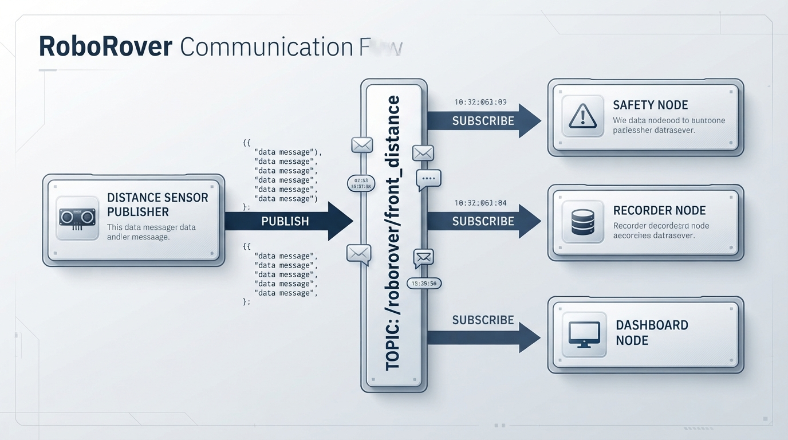
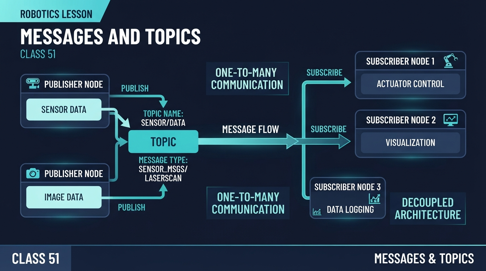
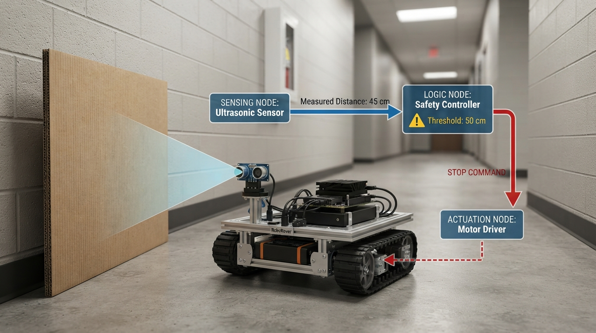
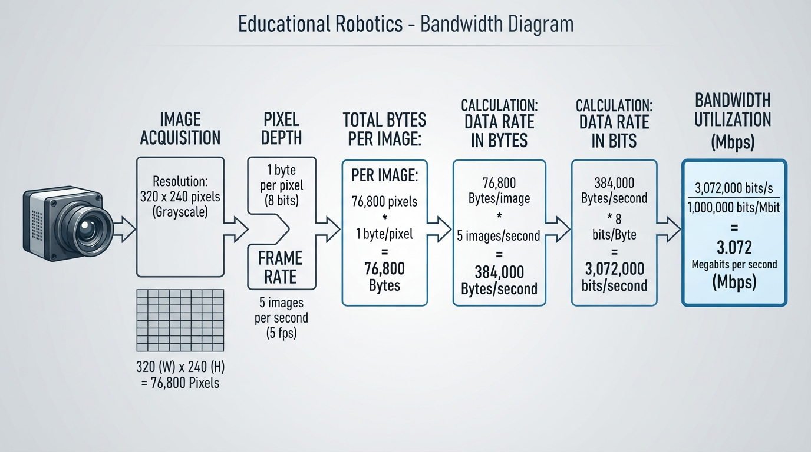
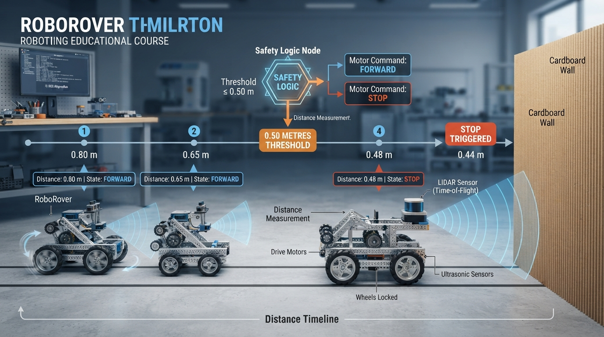

# Class 51: Messages and Topics

## Where We Are in the Robotics Journey

In the previous class, **ROS 2 Mental Model**, RoboRover was no longer just a collection of motors and sensors. We viewed it as a group of cooperating software components called **nodes**.

One node might read a distance sensor. Another might decide whether to slow down. A third might send commands to the wheel motors. ROS 2 provides the communication structure that lets these nodes work together.

Today we study two central ROS 2 ideas:

- a **message**, which is a structured package of information;
- a **topic**, which is a named communication channel carrying messages.

The next class is **Robot Simulation**. There, we will use these ideas to connect simulated sensors, robot logic, and simulated actuators. A simulated robot can communicate through the same kinds of topics as a physical robot.

---

## Today We Will Learn

By the end of this class, you should be able to:

1. explain what a message is;
2. explain what a topic is;
3. distinguish a **publisher** from a **subscriber**;
4. describe how publish/subscribe communication decouples robot components;
5. calculate a simple message data rate;
6. identify practical problems such as stale data, overloaded queues, and mismatched topic names;
7. build a small Python simulation of RoboRover’s topic traffic.

Our main question is:

> How can several robot programs exchange information without each program needing to know the internal code of the others?

---

## 2-Minute Recap

A ROS 2 system is often organized as a graph:

- **nodes** are running programs or program components;
- **topics** are named communication channels;
- **messages** are the data sent through those channels;
- a node can publish, subscribe, or do both.

For example:

```text
[Front Sensor Node] -- publishes --> /roborover/front_distance
                                           |
                                           v
                                [Safety Node subscribes]
                                           |
                                           v
                                  /roborover/cmd_vel
                                           |
                                           v
                                  [Motor Node subscribes]
```

The arrows represent data flow, not physical motion.

A sensor node does not directly “grab” the safety node’s variables. It publishes a message. The safety node receives a copy of that message through the topic.

---

## The Big Idea




**Figure:** One topic can deliver the same published data to several subscribers without the publisher knowing their internal code.

Imagine a school announcement system.

A teacher makes an announcement once. Students who have chosen to listen to that channel hear it. The teacher does not need to walk to every student or know each student’s private notebook format.

Publish/subscribe communication works similarly:

- the **publisher** sends a message to a named topic;
- the **subscriber** listens to that topic;
- the publisher and subscriber can be developed separately.

For RoboRover:

```text
Distance sensor node
        |
        | publishes DistanceReading
        v
/roborover/front_distance
        |
        +------------------> Safety node
        |
        +------------------> Data logger
        |
        +------------------> Dashboard
```

One distance reading can be useful to several subscribers. The distance sensor does not need separate custom connections to the safety node, the logger, and the dashboard.

This is called **decoupling**. The components are connected by an agreed communication interface, but their internal implementations remain separate.

### Message versus topic

A **message** is one item of data.

Example:

```text
distance: 0.42 m
```

A **topic** is the named stream through which messages travel.

Example:

```text
/roborover/front_distance
```

A useful analogy is:

- message = one letter;
- topic = the labeled mailbox or delivery channel;
- publisher = the sender;
- subscriber = the recipient.

The analogy is not perfect. In ROS 2, communication also involves timing, queue behavior, message types, and quality-of-service settings.

### A topic name is only one part of the communication contract

For two ROS 2 components to communicate correctly, they need a compatible contract that includes at least:

- the topic name;
- the message type;
- field meanings and units;
- relevant quality-of-service settings, such as reliability and history behavior.

Matching topic names alone is not sufficient. Two nodes cannot communicate merely because both use `/roborover/front_distance` if their message types are incompatible. Even compatible message types can be used incorrectly if one node interprets a value in millimetres and another interprets it as metres.

---

## See It in Your Head

### AI-Generated Engineering Visual · Professor OS



**How to read this visual:** Trace the signal or idea from left to right. Match each block to the lesson explanation, then predict what would change if one block produced a wrong value.




**Figure:** The sensor publishes information; the safety node interprets it and publishes a motor command.

Picture RoboRover in a hallway.

On its front bumper is a distance sensor. A small computer reads that sensor and publishes:

```text
Topic: /roborover/front_distance
Message:
    distance_m = 0.42
    valid = True
```

Two other nodes listen:

1. **Safety node**  
   It uses the distance to decide whether RoboRover should slow down.

2. **Recorder node**  
   It saves the reading for later analysis.

The sensor node does not need to know that two subscribers exist. It simply publishes readings.

Now imagine adding a third subscriber: a visual dashboard. The sensor node may not need any code change at all. The dashboard joins the topic and begins receiving future messages.

An illustrator could draw this as three layers:

- left: RoboRover with a sensor;
- center: a large labeled pipe, `/roborover/front_distance`;
- right: three separate boxes labeled Safety, Recorder, and Dashboard.

Use arrows from the pipe toward each subscriber to show that one published stream can feed multiple consumers.

**Text-only alternative:** A distance sensor publishes `DistanceReading` messages to `/roborover/front_distance`. The Safety, Recorder, and Dashboard nodes each subscribe to that same topic. The publisher does not call those nodes directly.

---

## Core Concept

### 1. Publishers produce messages

A publisher creates messages and sends them to a topic.

A wheel command publisher might send:

```text
Topic: /roborover/cmd_vel
Message:
    linear_velocity_mps = 0.30
    angular_velocity_rps = 0.00
```

This means “move forward at 0.30 metres per second and rotate at 0.00 radians per second,” assuming the receiving motor node understands that message format.

The publisher owns the decision to send the message, but it does not necessarily control the final physical result. Motors may be limited, disconnected, or unable to produce the requested motion.

### 2. Subscribers receive messages

A subscriber listens to a topic and runs some logic when a message arrives.

A safety subscriber might examine:

```text
distance_m = 0.18
```

and publish a new command:

```text
linear_velocity_mps = 0.00
```

The safety node is both:

- a subscriber to the distance topic;
- a publisher to the velocity-command topic.

### 3. Topic names are contracts

A topic name is not merely decoration. It is part of the communication agreement.

These are different topic names:

```text
/roborover/front_distance
/roborover/front_distances
```

A spelling difference can prevent communication.

Topic names should describe the data clearly. Common naming ideas include:

- include the robot name or subsystem;
- identify the sensor or command;
- use consistent separators;
- avoid vague names such as `/data` or `/thing`.

The topic name must also be paired with a compatible message type, field meaning, units, and relevant quality-of-service settings.

### 4. Message types are contracts too

Suppose one node expects a distance in metres, but another sends a distance in millimetres. Both values may be numerical, but their meanings differ by a factor of 1,000.

A message definition should make the fields and units clear.

For example:

```text
DistanceReading
    distance_m: floating-point number
    valid: true or false
```

The unit belongs in the field name or documentation. `distance_m` is safer than simply `distance`.

A topic name does not override the message type. Nodes using incompatible message types cannot communicate correctly just because they selected the same topic name.

### 5. Communication is usually asynchronous

The publisher and subscriber do not have to run at exactly the same instant.

A sensor may publish every 100 milliseconds. A subscriber may process each incoming message later. ROS 2 middleware may retain samples according to the selected quality-of-service history and depth settings. The topic itself does not universally store messages in one fixed kind of queue.

This creates useful independence, but also introduces engineering questions:

- Is the subscriber keeping up?
- How many messages may wait according to the configured QoS history?
- Is an old message still useful?
- What should happen if messages stop arriving?

These questions become important on real robots.

---

## Math Without Fear




**Figure:** Image dimensions, bytes per pixel, and publication rate determine the raw topic data rate.

Consider a grayscale camera that sends an image with:

- width: \(320\) pixels;
- height: \(240\) pixels;
- \(1\) byte per pixel;
- publication rate: \(5\) images per second.

Let:

- \(W\) = image width in pixels;
- \(H\) = image height in pixels;
- \(B\) = bytes per pixel;
- \(f\) = publication rate in images per second;
- \(R\) = data rate in bytes per second.

The size of one image is:

\[
S = W \times H \times B
\]

Substitute the values, including their units:

\[
S =
320\ \text{pixels/image}
\times
240\ \text{pixels}
\times
1\ \text{byte/pixel}
\]

\[
S = 76{,}800\ \text{bytes/image}
\]

The data rate is:

\[
R = S \times f
\]

\[
R =
76{,}800\ \text{bytes/image}
\times
5\ \text{images/second}
\]

\[
R = 384{,}000\ \text{bytes/second}
\]

Convert bytes per second to bits per second:

\[
384{,}000\ \text{bytes/second}
\times
8\ \text{bits/byte}
=
3{,}072{,}000\ \text{bits/second}
\]

Therefore:

\[
R = 3.072\ \text{megabits/second}
\]

using \(1\ \text{megabit} = 1{,}000{,}000\ \text{bits}\).

The same rate in kibibytes per second is:

\[
\frac{384{,}000\ \text{bytes/second}}
{1024\ \text{bytes/KiB}}
=
375\ \text{KiB/second}
\]

That is approximately:

- \(375\ \text{KiB/s}\), using \(1\ \text{KiB} = 1024\ \text{bytes}\);
- \(3.072\ \text{megabits/second}\), using decimal megabits.

### Interpretation

This is only the raw image data. Real communication may add headers, transport overhead, timing information, and copies in memory.

A small distance message might be easy to send many times per second. A camera stream requires much more bandwidth. Topic design is therefore also a resource-design problem.

---

## Worked Robotics Example




**Figure:** The safety subscriber changes RoboRover’s command when the latest distance message crosses the threshold.

RoboRover drives toward a cardboard wall.

The sensor publishes a front-distance message every \(0.10\ \text{s}\), which is:

\[
f = \frac{1}{0.10\ \text{s}} = 10\ \text{messages/s}
\]

The safety node uses the most recent **valid** message:

- if distance is greater than \(0.50\ \text{m}\), allow forward motion;
- if distance is \(0.50\ \text{m}\) or less, publish a stop command;
- if the message is invalid, do not treat its distance as safe; issue a stop or fault response.

Suppose these messages arrive:

| Arrival time | Sensor timestamp | Distance message | Age at arrival | Safety result |
|---:|---:|---:|---:|---|
| \(0.0\ \text{s}\) | \(0.0\ \text{s}\) | \(0.80\ \text{m}\), valid | \(0.0\ \text{s}\) | forward allowed |
| \(0.1\ \text{s}\) | \(0.1\ \text{s}\) | \(0.65\ \text{m}\), valid | \(0.0\ \text{s}\) | forward allowed |
| \(0.2\ \text{s}\) | \(0.2\ \text{s}\) | \(0.48\ \text{m}\), valid | \(0.0\ \text{s}\) | stop |
| \(0.3\ \text{s}\) | \(0.3\ \text{s}\) | \(0.44\ \text{m}\), valid | \(0.0\ \text{s}\) | stop |

The **age** of a message can be calculated as:

\[
\text{age} =
\text{arrival time} - \text{sensor timestamp}
\]

For example, if the \(0.44\ \text{m}\) message has a sensor timestamp of \(0.3\ \text{s}\) but is processed at \(0.5\ \text{s}\), its age is:

\[
0.5\ \text{s} - 0.3\ \text{s} = 0.2\ \text{s}
\]

Even though \(0.44\ \text{m}\) is numerically below the stop threshold, the safety node should also decide whether \(0.2\ \text{s}\) is acceptably fresh for the robot’s speed and stopping distance.

The sensor node does not directly stop the motors. It publishes information. The safety node interprets that information and publishes a new command.

This separation is valuable:

- the sensor code focuses on measuring;
- the safety code focuses on a safety rule;
- the motor code focuses on applying commands.

### Engineering caveat: stale messages

Suppose the sensor stops publishing at \(0.3\ \text{s}\), but the motor node continues using the previous “forward” command. RoboRover could keep moving even though the last valid distance reading is old.

A real system often uses a **timeout**:

> If no fresh command arrives within a safe time limit, stop the motors.

This is not a complete safety design by itself, but it illustrates an important principle: a message’s age can matter as much as its value.

Other real failure modes include:

- the publisher and subscriber use different topic names;
- the message type or units are misunderstood;
- a slow subscriber falls behind;
- configured QoS history reaches its depth and older samples are discarded or otherwise handled according to the QoS policy;
- network delay makes a command arrive late;
- a sensor publishes invalid data but marks it as valid.

**Text-only alternative:** At times \(0.0\), \(0.1\), \(0.2\), and \(0.3\) seconds, the sensor publishes \(0.80\), \(0.65\), \(0.48\), and \(0.44\) metres. The safety node changes its output from `FORWARD` to `STOP` when the latest valid reading becomes \(0.48\) metres.

---

## Python Lab

This program creates a small publish/subscribe system using only the Python standard library. It is **not ROS 2 itself**. It is an intentionally synchronous, in-memory **structural model**: each `publish` call directly invokes the currently subscribed callbacks.

It demonstrates:

- topic-based routing;
- multiple subscribers;
- callback execution;
- one node subscribing to one topic and publishing to another.

It does **not** model ROS 2 delivery semantics such as:

- separate processes or computers;
- discovery;
- middleware transport;
- delivery delay;
- queues or QoS history;
- scheduling;
- message serialization;
- dropped, reordered, or stale messages.

The safety node explicitly checks the `valid` field. In this example, an invalid distance causes a `STOP` command rather than being processed as safe numerical data.

RoboRover has:

- a distance publisher;
- a safety subscriber;
- a command publisher;
- a motor subscriber.

The safety node receives distance readings and publishes either `"FORWARD"` or `"STOP"`.

```python
class MessageBus:
    def __init__(self):
        self.subscribers = {}

    def subscribe(self, topic_name, callback):
        if topic_name not in self.subscribers:
            self.subscribers[topic_name] = []
        self.subscribers[topic_name].append(callback)

    def publish(self, topic_name, message):
        callbacks = self.subscribers.get(topic_name, [])
        for callback in callbacks:
            callback(message)


class SafetyNode:
    def __init__(self, bus, stop_distance_m):
        self.bus = bus
        self.stop_distance_m = stop_distance_m
        self.decisions = []

        self.bus.subscribe("/roborover/front_distance",
                           self.distance_callback)

    def distance_callback(self, message):
        if not message["valid"]:
            command = "STOP"
            distance_m = message["distance_m"]
        else:
            distance_m = message["distance_m"]

            if distance_m <= self.stop_distance_m:
                command = "STOP"
            else:
                command = "FORWARD"

        self.decisions.append((distance_m, command))
        self.bus.publish("/roborover/motor_command", command)


class MotorNode:
    def __init__(self, bus):
        self.commands_received = []
        bus.subscribe("/roborover/motor_command",
                      self.command_callback)

    def command_callback(self, command):
        self.commands_received.append(command)


def main():
    bus = MessageBus()
    safety = SafetyNode(bus, stop_distance_m=0.50)
    motors = MotorNode(bus)

    distance_messages = [
        {"distance_m": 0.80, "valid": True},
        {"distance_m": 0.65, "valid": True},
        {"distance_m": 0.48, "valid": True},
        {"distance_m": 0.44, "valid": True},
    ]

    for message in distance_messages:
        bus.publish("/roborover/front_distance", message)

    expected_decisions = [
        (0.80, "FORWARD"),
        (0.65, "FORWARD"),
        (0.48, "STOP"),
        (0.44, "STOP"),
    ]

    assert safety.decisions == expected_decisions
    assert motors.commands_received == [
        "FORWARD",
        "FORWARD",
        "STOP",
        "STOP",
    ]

    # Invalid sensor data is not treated as safe.
    bus.publish(
        "/roborover/front_distance",
        {"distance_m": 0.10, "valid": False},
    )

    assert safety.decisions[-1] == (0.10, "STOP")
    assert motors.commands_received[-1] == "STOP"

    print("Safety decisions:", safety.decisions)
    print("Motor commands:", motors.commands_received)
    print("Verified: valid readings followed the distance rule.")
    print("Verified: an invalid reading produced STOP.")


if __name__ == "__main__":
    main()
```

### Important lines

- `subscribe(topic_name, callback)` connects a topic to a function.
- `publish(topic_name, message)` synchronously sends one message to every currently registered subscriber of that topic.
- `distance_callback` is called when a distance message arrives in this simplified model.
- `if not message["valid"]:` prevents an invalid reading from being treated as safe.
- `self.bus.publish("/roborover/motor_command", command)` shows that one node can subscribe to one topic and publish to another.
- The `assert` statements verify the exact decisions, command sequence, and invalid-data response.

This program uses a direct in-memory bus, so it is simpler than ROS 2. Real ROS 2 handles processes, message types, discovery, transport, timing, and quality-of-service settings.

---

## Mini Simulation or Game

Play “RoboRover Topic Dispatcher.”

Draw three boxes:

```text
Sensor Publisher  --->  /roborover/front_distance  --->  Safety Subscriber
                                                           |
                                                           v
                                                /roborover/motor_command
                                                           |
                                                           v
                                                    Motor Subscriber
```

Now use these sensor messages:

```text
0.90 m, 0.72 m, 0.51 m, 0.49 m, 0.30 m
```

Use the rule:

- distance greater than \(0.50\ \text{m}\): `FORWARD`;
- distance less than or equal to \(0.50\ \text{m}\): `STOP`.

Before looking at the answer, write the five motor commands in order.

Then change the game:

1. remove the third sensor message;
2. add a second subscriber called `Recorder`;
3. rename the sensor topic incorrectly to `/roborover/front_distance_sensor`.

Predict which subscribers still receive messages.

The important observation is that the recorder can listen without changing the safety rule. The incorrectly named topic does not match the original topic, so the original subscribers do not receive those messages.

---

## What Should Happen?

For the original five distance messages, the commands should be:

```text
FORWARD, FORWARD, FORWARD, STOP, STOP
```

The value \(0.51\ \text{m}\) is still greater than \(0.50\ \text{m}\), so RoboRover is allowed to move according to this simple rule.

If the third message is removed, the safety node receives no information for that moment. A real robot should not silently assume that “no message” means “safe.” It should use a carefully designed timeout or fault behavior.

If a recorder subscribes to the correct topic, it receives the same distance messages as the safety node. If the topic name is changed incorrectly, the existing subscribers receive nothing from that changed channel.

---

## Common Mistakes

### Mistake 1: Treating a topic as a physical wire

A topic is a software communication channel. It may carry data between processes or computers, but it is not automatically a motor command or a sensor cable.

### Mistake 2: Confusing a message with a topic

A message is one structured data item. A topic is the named stream that carries many messages over time.

### Mistake 3: Assuming every subscriber gets the same timing

Subscribers may process messages at different speeds. A slow logger should not be assumed to have processed a message at exactly the same instant as the safety node.

### Mistake 4: Ignoring units or message compatibility

A field called `speed` is ambiguous. Is it metres per second, kilometres per hour, or motor revolutions per minute? Also, matching topic names do not make incompatible message types communicate correctly. Use names and documentation that make types, units, and meanings explicit.

### Mistake 5: Believing communication guarantees physical success

A motor command message may be published successfully while a wheel is blocked, a cable is disconnected, or the motor controller rejects the command. Communication is not the same as actuation.

### Mistake 6: Treating invalid data as an ordinary measurement

A numerical value in a message is not automatically trustworthy. Check validity flags, timestamps, units, and freshness before using sensor data for safety decisions.

---

## Try It Yourself

### Challenge: Add a warning subscriber

Modify the Python program so that a new `WarningNode` subscribes to `/roborover/front_distance`.

It should record a warning whenever:

\[
\text{distance} \leq 0.30\ \text{m}
\]

For the four original readings,

```text
0.80 m, 0.65 m, 0.48 m, 0.44 m
```

no reading is at or below \(0.30\ \text{m}\). Therefore, the warning list should be empty:

```text
[]
```

Your program should use an `assert` statement to verify this result.

**Optional extension:** Add a `RecorderNode` that stores every distance message, including the `valid` field. Then publish one invalid reading, such as:

```text
{"distance_m": 0.10, "valid": False}
```

Decide whether the safety node should ignore invalid readings, stop immediately, or produce a separate fault command. Explain your design choice before changing the code.

---

## Quick Quiz

1. What is the difference between a message and a topic?

2. What is the role of a publisher?

3. Why can one topic have several subscribers?

4. Why can a valid-looking distance value still be unsafe to use?

---

## Answers

1. A **message** is one structured item of information. A **topic** is a named communication channel that carries messages.

2. A publisher creates and sends messages to a named topic.

3. Publish/subscribe communication allows multiple nodes to listen to the same data stream. For example, safety, recording, and display nodes can all receive the same sensor messages.

4. The value may be stale, have incorrect units, be marked invalid, or have been produced by a faulty sensor. A value must be interpreted together with timing, validity, and agreed meaning.

---

## Real Robot Connection

In a physical RoboRover, topic communication might connect:

```text
/roborover/scan
```

to a node that examines nearby obstacles, while another node records the same data for debugging.

A command topic might be:

```text
/roborover/cmd_vel
```

A controller could publish desired linear and angular velocities, while a motor node subscribes and converts those requests into wheel commands.

Several systems may publish commands at different times. For example:

- navigation may request motion;
- a safety node may request a stop;
- a joystick node may request manual motion.

A real design must define how these commands are combined and which component has authority in an emergency. ROS 2 topics provide communication, but they do not automatically decide the robot’s safety policy.

This class also prepares us for simulation. In the next class, a simulated sensor can publish a distance message just as a physical sensor node would. A simulated motor node can subscribe to commands and update the virtual robot. The same publish/subscribe mental model can therefore connect simulated components.

---

## Vocabulary

- **Message:** A structured packet of information sent between software components.
- **Topic:** A named communication channel carrying messages under an agreed message type, field meaning, units, and relevant quality-of-service settings.
- **Publisher:** A node or component that sends messages to a topic.
- **Subscriber:** A node or component that receives messages from a topic.
- **Publish/subscribe:** A communication pattern in which publishers send to named topics and subscribers listen to those topics.
- **Callback:** A function run when a subscribed message arrives.
- **Decoupling:** Separating components so they communicate through defined interfaces rather than depending on each other’s internal code.
- **Queue:** Temporary storage for messages waiting to be processed. In ROS 2, retention and history behavior depend on the configured middleware quality-of-service settings rather than on one universal topic queue.
- **Stale message:** A message that is old enough that it may no longer describe the robot’s current situation.
- **Data rate:** The amount of data transferred per unit time, commonly measured in bytes per second or bits per second.
- **Topic contract:** The agreed topic name, compatible message type, message fields, units, interpretation, and relevant quality-of-service settings used by communicating components.

---

## Further Learning

To deepen this topic, investigate these search-friendly resource names:

- ROS 2 publisher and subscriber tutorials
- ROS 2 topic command-line tools
- ROS 2 interface definitions and message types
- ROS 2 Quality of Service overview
- robotics sensor data timestamps and stale-data handling

When studying these resources, keep asking four questions:

1. What topic carries the data?
2. What message fields and units are used?
3. Who publishes and who subscribes?
4. What happens if messages are delayed, lost, or invalid?

---

## Next Class

**Class 52: Robot Simulation**

We will place RoboRover in a virtual environment. A simulated sensor will publish information, robot logic will subscribe and make decisions, and simulated actuators will receive commands.

The robot may be virtual, but the communication architecture will resemble a real ROS 2 system.
