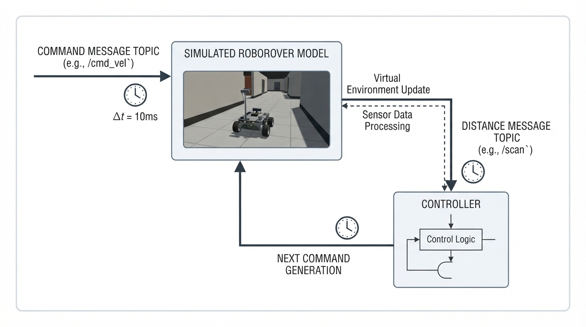
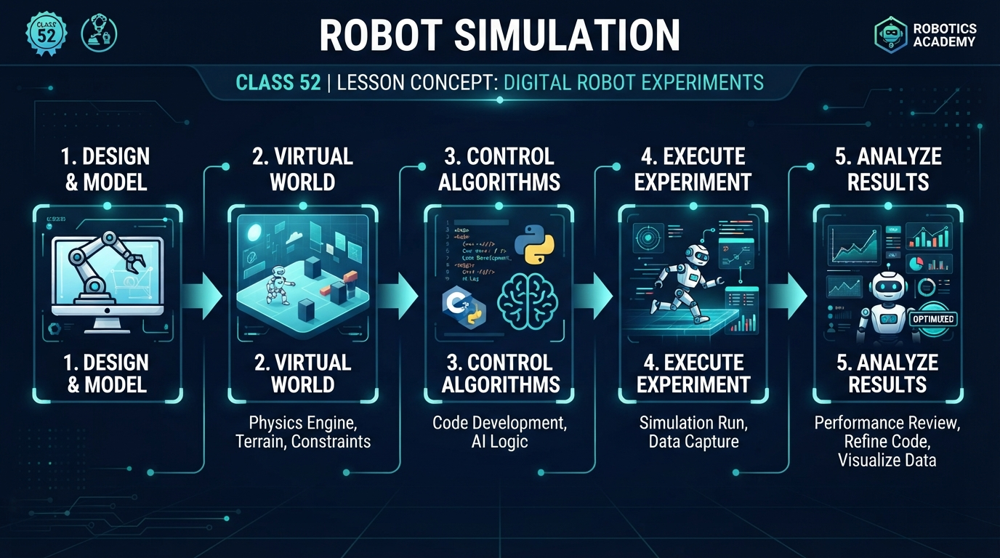
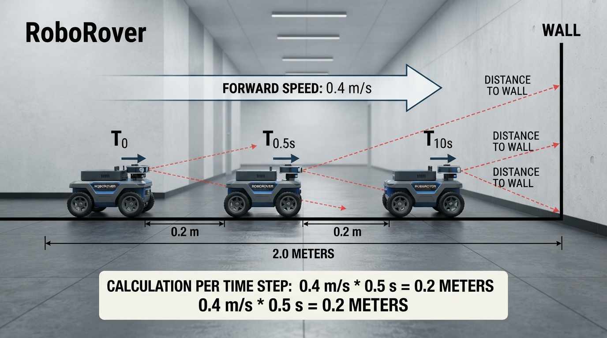
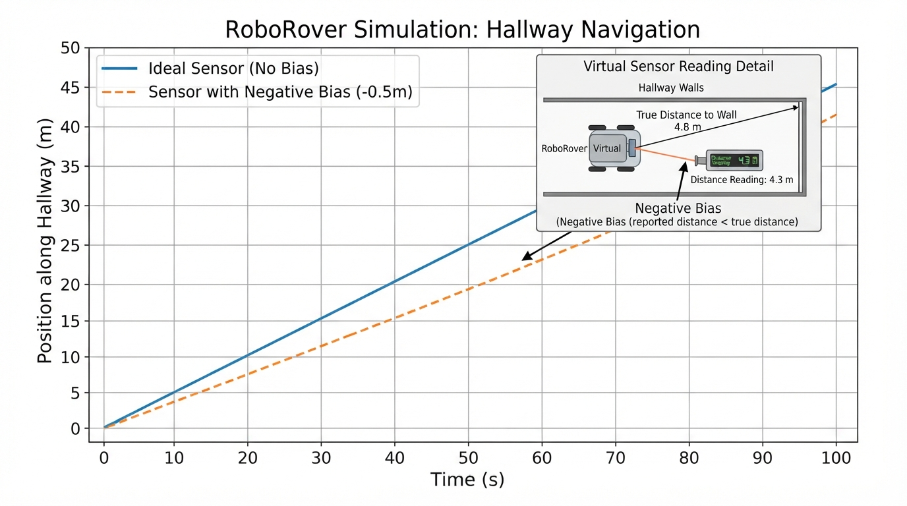

# Class 52: Robot Simulation

## Where We Are in the Robotics Journey

RoboRover has learned to exchange **messages** through **topics**. A command such as “drive forward” can be published on a command topic, while a distance measurement can be published on a sensor topic. Different parts of the robot can then communicate without being tightly connected to one another.

Today we will temporarily replace RoboRover’s physical body with a mathematical model. This creates a **digital experiment**: we can test commands, sensors, timing, and simple decision rules before risking hardware.

In the next class, we will move from a simple mathematical model toward **Gazebo and physics simulation concepts**, where virtual robots can interact with simulated gravity, collisions, friction, joints, and sensors.

## Today We Will Learn

By the end of this class, you should be able to:

- explain what a robot simulation is;
- identify a simulated robot’s state, inputs, outputs, and environment;
- update a simple robot model one time step at a time;
- connect simulation messages to the topics from the previous class;
- use Python and matplotlib to run a small digital experiment;
- explain why a simulation is useful but never exactly the same as a physical robot;
- predict how sensor bias changes RoboRover’s behavior.

## 2-Minute Recap

A **topic** is a named communication channel. A publisher sends messages to it, and a subscriber receives those messages.

For example:

```text
/cmd_vel        RoboRover's desired motion
/range          RoboRover's distance measurement
/battery        RoboRover's battery report
```

A message is data with an agreed meaning. A command message might contain a desired speed. A sensor message might contain a measured distance in meters.

The important connection for today is this:

```text
command message → robot model → simulated sensor message
                         ↑              ↓
                         └── controller ─┘
```

In a physical robot, motors change the robot’s motion. In a simulation, a program changes variables that represent motion. The communication structure can still look similar.

## The Big Idea




**Figure:** A simulation repeats a digital version of the command, motion, sensing, and decision cycle.

A simulation is a **simplified world in a computer**.

Imagine drawing RoboRover on graph paper. You decide:

- where it starts;
- how fast it can move;
- what commands it receives;
- where a wall is;
- what its sensor reports.

Then, instead of moving a real rover, you calculate what should happen after each small time interval.

A useful simulation separates four parts:

| Part | RoboRover example |
|---|---|
| Environment | A straight hallway ending at a wall |
| State | Current position \(x\) |
| Input | Requested forward speed \(v\) |
| Output | Simulated distance sensor reading |

The **state** is the information needed to describe the robot’s current situation. In our first model, position is enough. A more detailed model might also include velocity, orientation, wheel speeds, battery level, and sensor state.

Simulation is not “pretending without rules.” It is an experiment based on explicit rules. The quality of the experiment depends on whether those rules are suitable for the question being asked.

If we are testing topic names and message flow, a simple model may be excellent. If we are testing whether RoboRover tips over on a ramp, a one-dimensional position model is not enough.

## See It in Your Head

### AI-Generated Engineering Visual · Professor OS



**How to read this visual:** Trace the signal or idea from left to right. Match each block to the lesson explanation, then predict what would change if one block produced a wrong value.


Picture a side-view hallway:

```text
start                                      wall
  RoboRover ───────────────────────────────│
  x = 0 m                                  x = 2 m
```

RoboRover publishes a speed command. The simulated world moves it forward. A virtual range sensor measures the remaining distance to the wall.

At every simulation step:

1. the sensor measures the current distance;
2. the sensor publishes a message;
3. a controller reads that message;
4. the controller publishes a speed command;
5. the robot model updates its position;
6. simulated time advances.

An illustrator could show this as six connected boxes around a circular loop. The loop should have a clock symbol labelled “simulation time,” because the simulation advances in discrete steps rather than flowing continuously.

## Core Concept

### A digital robot has a model

A model is a deliberately limited description of something real.

For this class, RoboRover’s model makes these assumptions:

- it moves along one straight line;
- forward speed is either \(0.0\ \text{m/s}\) or \(0.4\ \text{m/s}\);
- it can change speed instantly;
- the floor does not slow it down;
- the sensor measures distance directly;
- the wall does not move;
- the simulation uses fixed time steps.

These assumptions are not true of a real rover. They are useful because they make the first experiment easy to understand.

### Simulation inputs and outputs

The simulation input is a speed command. We can imagine it as a message:

```text
topic: /roborover/cmd_speed
data: 0.4 m/s
```

The simulation output is a range message:

```text
topic: /roborover/range
data: 1.6 m
```

The simulator itself is acting like a small digital world node. A controller node reads the range message and decides whether to continue or stop.

### Automation, feedback, and autonomy

These ideas are related but not identical:

| Idea | Meaning in this experiment |
|---|---|
| Automation | The program carries out a predefined procedure without someone manually moving every step |
| Feedback control | A measured result, such as distance to the wall, affects the next command |
| Autonomy | The robot software chooses actions to achieve a task with limited immediate human direction |

Our experiment uses automation and a small feedback rule. It is not a complete autonomous navigation system. RoboRover has only one simple goal: move forward until its measured distance is small enough, then stop.

## Math Without Fear

We update position in small time steps.

\[
x_{\text{new}} = x_{\text{old}} + v\Delta t
\]

where:

- \(x_{\text{new}}\) is the new position, in meters \((\text{m})\);
- \(x_{\text{old}}\) is the previous position, in meters \((\text{m})\);
- \(v\) is forward speed, in meters per second \((\text{m/s})\);
- \(\Delta t\) is the simulation time step, in seconds \((\text{s})\).

The units are consistent:

\[
(\text{m/s})(\text{s}) = \text{m}
\]

so the added quantity \(v\Delta t\) is a distance.

### Worked numerical example

Suppose RoboRover starts at:

\[
x_{\text{old}} = 0.8\ \text{m}
\]

It receives:

\[
v = 0.4\ \text{m/s}
\]

and the simulation advances by:

\[
\Delta t = 0.5\ \text{s}
\]

The movement during one step is:

\[
v\Delta t = (0.4\ \text{m/s})(0.5\ \text{s}) = 0.2\ \text{m}
\]

Therefore:

\[
x_{\text{new}} = 0.8\ \text{m} + 0.2\ \text{m} = 1.0\ \text{m}
\]

**Interpretation:** during this half-second simulation step, RoboRover moves \(0.2\ \text{m}\), or 20 centimeters.

If the wall is at \(2.0\ \text{m}\), the ideal remaining distance after the update is:

\[
2.0\ \text{m} - 1.0\ \text{m} = 1.0\ \text{m}
\]

A simulation performs this calculation repeatedly. A smaller \(\Delta t\) usually gives a finer-grained approximation, but it also requires more computation.

```python
position = 0.8
command_speed = 0.4
time_step = 0.5

position = position + command_speed * time_step

print("New position: {:.1f} m".format(position))
```

## Worked Robotics Example




**Figure:** The position update equation turns speed and a time step into a small movement.

RoboRover is placed at the beginning of a \(2.0\ \text{m}\) hallway. It is told to drive at \(0.4\ \text{m/s}\). Its controller uses this rule:

> Continue driving while the measured distance to the wall is greater than \(0.7\ \text{m}. Otherwise, stop.

At each step, the controller reads the simulated `/roborover/range` message. The robot does not know its true position directly; it uses the distance message.

Suppose the sensor has a bias of \(-0.2\ \text{m}\). A negative bias means the sensor reports a distance \(0.2\ \text{m}\) smaller than the true distance.

For example:

| True distance | Sensor bias | Measured distance |
|---:|---:|---:|
| \(1.0\ \text{m}\) | \(-0.2\ \text{m}\) | \(0.8\ \text{m}\) |
| \(0.8\ \text{m}\) | \(-0.2\ \text{m}\) | \(0.6\ \text{m}\) |

When the measured distance becomes \(0.6\ \text{m}\), the controller stops because \(0.6\ \text{m}\) is not greater than the \(0.7\ \text{m}\) threshold.

This is an important engineering lesson: a sensor error can change a robot’s behavior even when the controller’s rule is perfectly correct.

## Python Lab




**Figure:** The plotted curves show how sensor bias changes the stopping position even though the controller rule stays the same.

This program simulates two experiments:

1. an ideal range sensor with zero bias;
2. a sensor that under-reports distance by \(0.2\ \text{m}\).

The program uses two conceptual topics:

- `/roborover/range`: a simulated sensor message;
- `/roborover/cmd_speed`: a controller command.

The `simulate` function is the digital world. The `sensor_bias` parameter lets us perform a controlled experiment.

```python
import matplotlib.pyplot as plt


def simulate(sensor_bias):
    wall_position = 2.0
    time_step = 0.5
    forward_speed = 0.4
    stop_distance = 0.7

    time_values = [0.0]
    position_values = [0.0]
    command_values = []
    measured_distance_values = []

    position = 0.0
    current_time = 0.0

    while current_time < 10.0:
        true_distance = wall_position - position
        measured_distance = max(0.0, true_distance + sensor_bias)

        # This represents a message published on /roborover/range.
        measured_distance_values.append(measured_distance)

        # This represents a controller publishing /roborover/cmd_speed.
        if measured_distance > stop_distance:
            command_speed = forward_speed
        else:
            command_speed = 0.0

        command_values.append(command_speed)

        position = position + command_speed * time_step
        current_time = current_time + time_step

        position_values.append(position)
        time_values.append(current_time)

        if command_speed == 0.0:
            break

    path_length = sum(command * time_step for command in command_values)

    return {
        "time": time_values,
        "position": position_values,
        "commands": command_values,
        "measured_distance": measured_distance_values,
        "path_length": path_length
    }


ideal_run = simulate(sensor_bias=0.0)
biased_run = simulate(sensor_bias=-0.2)

# These checks verify the exact claims made by this experiment.
assert round(ideal_run["position"][-1], 2) == 1.40
assert round(biased_run["position"][-1], 2) == 1.20
assert round(ideal_run["path_length"], 2) == 1.40
assert round(biased_run["path_length"], 2) == 1.20

print("Ideal final position: {:.2f} m".format(ideal_run["position"][-1]))
print("Biased final position: {:.2f} m".format(biased_run["position"][-1]))
print("Ideal path length: {:.2f} m".format(ideal_run["path_length"]))
print("Biased path length: {:.2f} m".format(biased_run["path_length"]))
print("Verification passed.")

plt.figure(figsize=(8, 5))
plt.plot(
    ideal_run["time"],
    ideal_run["position"],
    marker="o",
    label="Ideal sensor"
)
plt.plot(
    biased_run["time"],
    biased_run["position"],
    marker="s",
    label="Sensor bias = -0.2 m"
)
plt.axhline(2.0, color="black", linestyle="--", label="Wall at 2.0 m")
plt.xlabel("Simulation time (s)")
plt.ylabel("RoboRover position (m)")
plt.title("RoboRover simulation: sensor bias changes stopping position")
plt.grid(True)
plt.legend()
plt.tight_layout()
plt.show()
```

### Important lines

`true_distance = wall_position - position` calculates what the perfect virtual world knows.

`measured_distance = max(0.0, true_distance + sensor_bias)` creates the sensor message. The `max` prevents the simulated sensor from reporting a negative distance.

The `if` statement is the controller. It reads the measurement and chooses the next speed command.

The update:

```python
position = 0.0
command_speed = 0.4
time_step = 0.5
position = position + command_speed * time_step
```

is the equation from the previous section translated into Python.

The assertions are deliberate. They make the program check that the experiment produced the stated final positions and path lengths. If a later edit changes the model, an assertion will reveal that the original result is no longer true.

## Mini Simulation or Game

### Predict before you run it

Before running the program, answer these questions:

1. Which run should stop sooner: the ideal sensor or the sensor with a \(-0.2\ \text{m}\) bias?
2. Which run should finish closer to the wall?
3. Why does the biased sensor make RoboRover stop early?

Now run the program.

The ideal sensor stops RoboRover when the true distance reaches the threshold region. The negatively biased sensor reports a smaller distance than reality, so the controller believes the wall is closer and stops earlier.

### Turn it into an experiment

Change only one value at a time:

```python
def simulate(sensor_bias):
    wall_position = 2.0
    time_step = 0.5
    forward_speed = 0.4
    stop_distance = 0.7
    position = 0.0

    while True:
        true_distance = wall_position - position
        measured_distance = max(0.0, true_distance + sensor_bias)

        if measured_distance > stop_distance:
            command_speed = forward_speed
        else:
            command_speed = 0.0

        position = position + command_speed * time_step

        if command_speed == 0.0:
            return position


biased_run = simulate(sensor_bias=0.1)
print("Final position with positive sensor bias: {:.2f} m".format(biased_run))
```

A positive bias makes the sensor report a distance larger than the true distance. Predict what will happen before running it.

You can also change:

```python
stop_distance = 0.4
```

or:

```python
time_step = 0.1
```

For this particular simple model, changing the time step changes how often the controller checks the sensor. In a more realistic robot, timing can affect overshoot, computation load, communication traffic, and safety.

## What Should Happen?

The program’s verification checks should pass, and the plot should contain two rising curves:

- the ideal-sensor run should end at \(1.40\ \text{m}\);
- the negatively biased run should end at \(1.20\ \text{m}\).

The exact values are verified by the `assert` statements in the same program.

The biased run travels a shorter distance because its measurement becomes small enough to trigger the stop rule sooner. Notice that the controller itself has not changed. Only its sensor input has changed.

This is one reason simulation is valuable: we can isolate one factor, such as sensor bias, and observe its effect without rebuilding hardware.

## Common Mistakes

### Mistake 1: Treating the simulation as reality

The program assumes instant speed changes and perfect movement. A real motor has delay, friction, electrical limits, and mechanical backlash. The real rover may coast after receiving a stop command.

### Mistake 2: Confusing true state and measured state

The simulator knows `true_distance`. RoboRover’s controller receives `measured_distance`. In a physical robot, the controller generally does not get a magical perfect value.

### Mistake 3: Ignoring units

The expression \(0.4 \times 0.5\) is meaningful here because the units are \((\text{m/s})(\text{s})\). Mixing centimeters, meters, and milliseconds without conversion can create errors by factors of 10, 100, or 1,000.

### Mistake 4: Choosing an unsuitable time step

If a robot moves a large distance during one step, it may appear to jump through an obstacle or stop too late. A smaller time step can improve the approximation, but it does not automatically fix a poor physical model.

### Mistake 5: Assuming repeatability proves correctness

A simulation can produce the same answer every time while still representing the wrong system. Repeatability is useful, but the model must also be compared with real measurements when physical accuracy matters.

## Try It Yourself

### Challenge

Modify the program so that RoboRover has a maximum safe position of \(1.6\ \text{m}\). The controller should stop if either:

- the measured wall distance is at or below the stop threshold; or
- the next commanded movement would pass \(1.6\ \text{m}\).

Do not simply move the wall. Add a separate safety rule.

Your solution should preserve the original experiment and make the safety condition visible in the code.

### Optional extension

Add a fixed command delay. For example, let the controller’s command affect the model one simulation step after it is chosen.

Predict the result first. A delayed stop command may cause RoboRover to travel farther than expected. This is a first glimpse of **latency**, the time between an event and the system’s response.

## Quick Quiz

1. In the equation  
   \[
   x_{\text{new}} = x_{\text{old}} + v\Delta t
   \]
   what does \(\Delta t\) represent?

2. Why does a sensor bias of \(-0.2\ \text{m}\) make RoboRover stop earlier in our experiment?

3. What is the difference between the simulator’s `true_distance` and the controller’s `measured_distance`?

4. Does a simulation guarantee that a physical robot will behave identically? Explain briefly.

## Answers

1. \(\Delta t\) is the simulation time step, measured in seconds. It is the amount of simulated time represented by one update.

2. The negative bias makes the reported distance smaller than the true distance. The stop threshold is therefore reached earlier.

3. `true_distance` is the value calculated from the ideal mathematical world. `measured_distance` is the value delivered to the controller after the simulated sensor effect, including bias.

4. No. A simulation is based on assumptions and approximations. A physical robot may add friction, motor limits, delay, noise, calibration errors, and mechanical effects that the simulation does not include.

## Real Robot Connection

A physical RoboRover would have several additional layers:

```text
controller command
        ↓
motor driver
        ↓
motor and gearbox
        ↓
wheels and floor
        ↓
actual motion
        ↓
sensor measurement
        ↓
message topic
```

Each layer can introduce a difference between the requested and actual behavior.

For example:

- the motor may not produce motion below a minimum command;
- the wheels may slip on a smooth floor;
- the range sensor may have noise or a blind spot;
- messages may arrive late;
- the robot may need time to brake;
- the measured distance may require calibration.

A useful engineering workflow is:

1. test logic in a simple simulation;
2. test the same logic with a more detailed model;
3. measure the real robot;
4. compare simulation and reality;
5. improve the model where the difference matters.

This is sometimes called a **sim-to-real** workflow. The simulation is not valuable because it is perfect. It is valuable because it lets us find some problems early and run experiments cheaply and safely.

Next class, Gazebo-style physics simulation will add concepts that this lesson deliberately left out: bodies, forces, collisions, joints, gravity, friction, and simulated sensors. Those additions can answer questions that the one-dimensional model cannot.

## Vocabulary

- **Simulation:** A computer-based representation of a system used to experiment with its behavior.
- **Model:** A simplified description of a real object, process, or environment.
- **State:** Information describing the current condition of a system, such as position or velocity.
- **Input:** Data or commands supplied to a system.
- **Output:** Data produced by a system, such as a sensor reading or plotted position.
- **Time step:** The fixed amount of simulated time advanced during one update.
- **Sensor bias:** A consistent offset between a sensor’s reported value and the true value.
- **Latency:** A delay between an event, command, or measurement and its effect or arrival.
- **Feedback control:** A method in which a measured result influences a later control action.
- **Digital experiment:** A controlled test performed using a computer model rather than the physical robot.
- **Robot simulation:** A computer-based model of a robot, its environment, and relevant interactions used to test behavior before or alongside physical experiments.

## Further Learning

Useful search terms and tools for continuing this topic include:

- “discrete-time robot simulation”
- “robot simulator sensor noise”
- “simulation timestep robotics”
- “Python matplotlib line plot”
- “ROS 2 topics in simulation”
- “Gazebo robot simulation introduction”
- “sim-to-real robotics”

When studying another simulator, ask the same four questions:

1. What state does it model?
2. What commands can enter the model?
3. What sensors and messages come out?
4. Which real-world effects are included or omitted?

## Next Class

Next class is **Gazebo / Physics Simulation Concepts**.

We will extend RoboRover from a one-dimensional mathematical point into a simulated physical body. We will examine how gravity, collisions, friction, joints, and virtual sensors influence the robot’s behavior.

The message-and-topic structure from the previous class will remain important: simulation gives the messages a virtual world to interact with.
