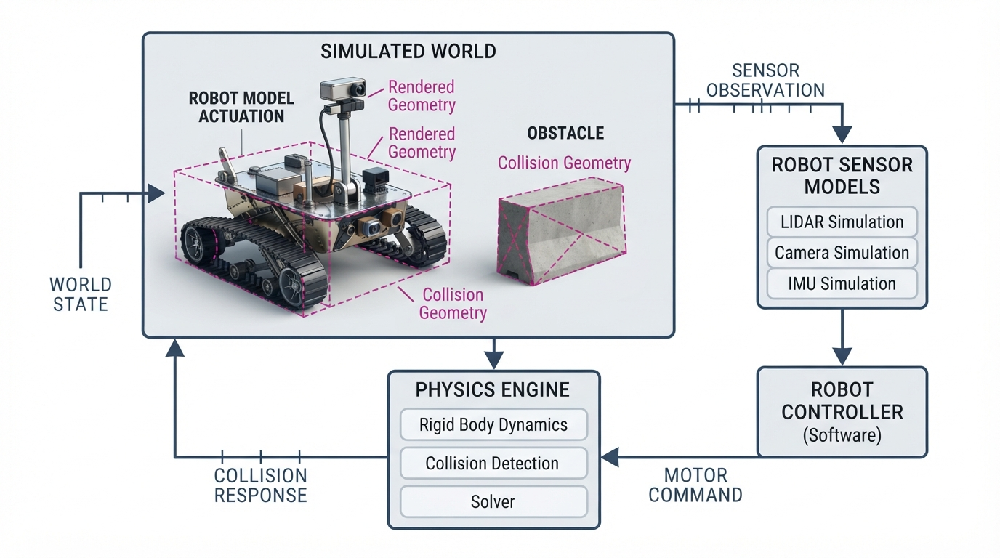
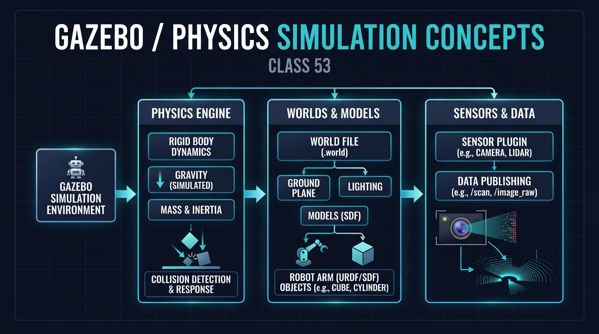
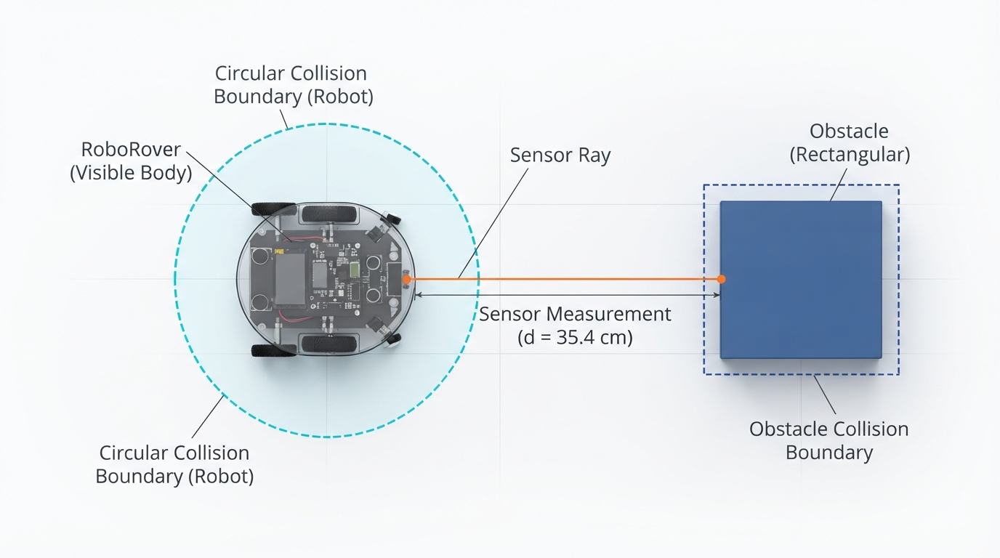
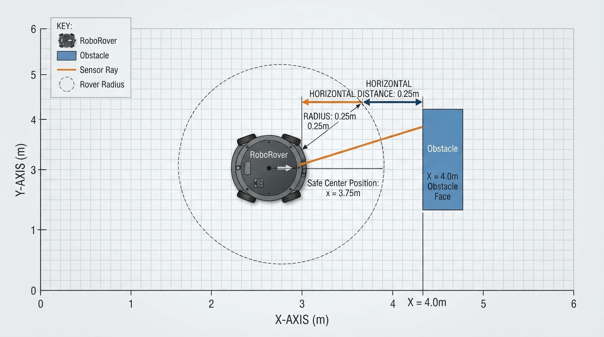
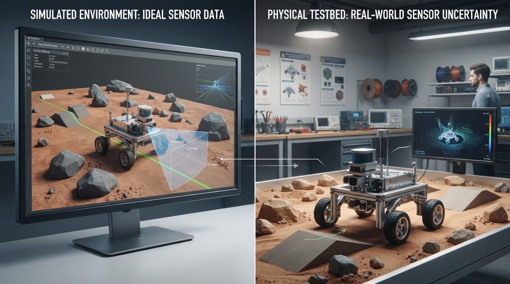

# Class 53: Gazebo / Physics Simulation Concepts

## Where We Are in the Robotics Journey

In the previous class, **Robot Simulation**, RoboRover entered a virtual environment so we could test robot behavior without risking hardware. We treated simulation as a useful model of a robot and its surroundings.

Today we make that model more concrete by studying three ideas used in physics simulators such as **Gazebo**:

1. **Worlds**: the virtual environment containing ground, objects, lights, and robot models.
2. **Collisions**: the geometric and physical rules that prevent objects from passing through each other.
3. **Sensors**: simulated devices that measure the virtual world and provide data to the robot controller.

In the next class, **Reinforcement Learning**, RoboRover will use simulated observations such as distances and collisions as part of a learning problem. Today we are not teaching reinforcement learning yet. We are building the simulated world that can produce useful observations and consequences.

## Today We Will Learn

By the end of this class, you should be able to:

- describe the main parts of a physics-simulation world;
- distinguish a visual model from collision geometry;
- explain how a simulator detects contact;
- describe how a simulated sensor obtains a measurement;
- calculate whether a simple circular rover would collide with an obstacle;
- run and modify a small Python simulation;
- identify why simulated sensors and collisions are useful but imperfect approximations of reality.

## 2-Minute Recap

A robot simulation is a program that represents some parts of a robot and its environment with mathematics and software.

A simulation usually contains:

- a **state**, such as position, velocity, and orientation;
- **commands**, such as motor speeds;
- a model that predicts how the state changes;
- simulated sensors that produce observations;
- a loop that repeats these steps.

A useful mental model is:

```text
command → simulated motion → simulated sensor measurement
              ↑                    ↓
              └──── controller ────┘
```

RoboRover’s simulated position is not the same thing as its physical position. It is a value produced by the simulator’s model. If the model is inaccurate, the virtual behavior may differ from real behavior.

## The Big Idea




**Figure:** A simulator combines a world model, physical rules, collision calculations, and sensor observations.

A physics simulator is a model-based virtual laboratory.

The **world** contains a floor, walls, ramps, boxes, and possibly a target beacon. The **robot model** contains a body, wheels, joints, motors, and sensors. The **physics engine** applies rules that predict motion and contact.

For example, the simulator may calculate:

- whether gravity makes an object fall;
- whether a wheel pushes against the floor;
- whether two objects contact;
- whether friction reduces sliding;
- how a force changes velocity.

The simulator does not normally identify a wall by its human meaning. It uses geometric objects occupying regions of space and applies the selected collision rules to those objects.

Three representations should be kept separate:

- **Visual geometry** helps a person see an object.
- **Collision geometry** helps calculate contact and overlap.
- **Sensor geometry or ray paths** helps a simulated sensor measure the world.

These representations may be similar, but they do not have to be identical. RoboRover’s decorative camera housing might look complex while its collision model is a simple box. The simplified model reduces computation while preserving the behavior that matters for a particular experiment.

## See It in Your Head

### AI-Generated Engineering Visual · Professor OS



**How to read this visual:** Trace the signal or idea from left to right. Match each block to the lesson explanation, then predict what would change if one block produced a wrong value.

Ask yourself:

- Which block describes what exists in the environment?
- Which block decides whether shapes contact?
- Which block produces the rover’s measurement?
- If the sensor block returned an incorrect value, which later result would change?




**Figure:** The picture separates what a person sees, what collision detection uses, and what a forward range sensor measures.

Use the diagram as a reading task:

1. Identify the rendered rover appearance.
2. Identify the simpler circular collision body.
3. Identify the rectangular collision body of the obstacle.
4. Follow the forward sensor ray to its first intersection.
5. Decide which parts are used for collision testing and which part is used for measurement.

The circular body may be the collision shape even if the rendered robot looks like a vehicle with wheels and a camera. The orange line represents an idealized range sensor. It does not push the obstacle; it asks, “How far away is the first surface along this direction?”

```text
                 simulated sensor ray
                         ───────────────►
       RoboRover              obstacle
          ◯  ─────────────────  ███████
       collision body          collision body
```

## Core Concept

### 1. Worlds

A simulated **world** is the complete environment being modeled.

It may contain:

- gravity;
- a ground plane;
- walls and obstacles;
- lighting and camera viewpoints;
- robot models;
- movable objects;
- physical properties such as mass and friction;
- sensor definitions;
- simulation time.

A world has both spatial and temporal meaning. Spatially, it describes what exists and where it is. Temporally, it evolves as the simulator advances from one time step to the next.

A very simple world might contain only:

```text
ground + one wall + RoboRover + one distance sensor
```

A richer world might include uneven terrain, movable blocks, ramps, and several robots.

### 2. Collisions

A **collision** occurs when two collision shapes overlap or make contact according to the simulator’s chosen rules.

Common collision primitives include:

- spheres;
- boxes;
- cylinders;
- capsules.

A triangle mesh can also represent collision geometry, but it is not a primitive in the same sense as a sphere, box, cylinder, or capsule. A mesh is a collection of triangles that describes a more detailed surface. Meshes can represent complex shapes, but they may require more computation and careful settings.

A collision calculation might determine:

- whether contact has occurred;
- where contact occurred;
- the direction of the contact surface;
- how deeply shapes overlap;
- how forces or corrections should separate them.

Collision detection is not identical to physics response:

- **Detection** asks, “Are these shapes contacting or overlapping?”
- **Response** asks, “What should happen because they are contacting?”

A full physics engine may construct contact manifolds, calculate contact normals and penetration depths, and solve for forces or positional corrections. The Python lab below uses only a simple kinematic position-rejection rule; it is not a full physics engine.

### 3. Sensors

A simulated **sensor** converts the virtual world into data, similar to a physical sensor.

Examples include:

- a range sensor measuring distance;
- a camera producing an image;
- an inertial sensor producing acceleration and angular velocity;
- wheel encoders reporting rotation;
- a contact sensor reporting whether a bumper is pressed.

A perfect simulated sensor may return an exact value. A more realistic sensor model may include:

- random noise;
- limited range;
- a blind spot;
- a delay;
- a restricted field of view;
- missed detections;
- quantization, where continuous values are rounded into steps.

A sensor is therefore not the entire world. It is a particular viewpoint through which the robot observes the world.

## Math Without Fear

Before using the Python program, identify its scope:

> The program is a discrete, kinematic collision proxy. It updates a circular rover’s position in fixed time steps and rejects a proposed position when it overlaps an axis-aligned rectangle. It is not a Gazebo implementation and does not solve forces, friction, rotation, or continuous-time physics.

We will use a simple circular model for RoboRover.

Let:

- \(x_R\) and \(y_R\) be the rover-center coordinates in metres;
- \(x_O\) and \(y_O\) be the obstacle-center coordinates in metres;
- \(r_R\) be the rover radius in metres;
- \(r_O\) be the obstacle radius in metres;
- \(d\) be the distance between the two centers in metres.

The center-to-center distance is:

\[
d=\sqrt{(x_R-x_O)^2+(y_R-y_O)^2}
\]

For the general **contact** test in this circular model:

\[
d \leq r_R+r_O
\]

The right-hand side is the sum of the radii. If the centers are close enough that the two circles touch or overlap, the model reports contact.

For a separate **overlap-only blocking** policy, equality is allowed and only this condition blocks motion:

\[
d < r_R+r_O
\]

This distinction matters in the Python lab. The lab deliberately accepts exact geometric tangency as a valid final position, so its rectangle test uses a strict `<` comparison rather than `<=`. Real simulators may use tolerances, contact margins, or solver-specific rules instead.

For a circle and an **axis-aligned rectangle**, the closest-point method used in the program is exact for that simplified geometry:

1. Clamp the circle center’s \(x\)-coordinate to the rectangle’s horizontal limits.
2. Clamp its \(y\)-coordinate to the rectangle’s vertical limits.
3. Measure the distance from the circle center to that closest point.
4. Compare that distance with the circle radius.

For rotated rectangles, irregular robot bodies, or moving shapes, a simulator may need more complex geometry and orientation handling.

### Worked numerical example

Suppose:

- RoboRover’s center is at \((1.60\text{ m}, 1.00\text{ m})\);
- the obstacle’s center is at \((2.20\text{ m}, 1.00\text{ m})\);
- \(r_R=0.20\text{ m}\);
- \(r_O=0.30\text{ m}\).

The vertical difference is \(0\text{ m}\), so:

\[
d=\sqrt{(1.60-2.20)^2+(1.00-1.00)^2}
\]

\[
d=\sqrt{(-0.60)^2+0^2}=0.60\text{ m}
\]

The combined radius is:

\[
r_R+r_O=0.20\text{ m}+0.30\text{ m}=0.50\text{ m}
\]

Because:

\[
0.60\text{ m}>0.50\text{ m}
\]

the circles are separated by \(0.10\text{ m}\), so this model predicts **no contact**.

If RoboRover moved another \(0.10\text{ m}\) directly toward the obstacle, the center distance would become \(0.50\text{ m}\). The circles would just touch, and the contact condition \(d\leq r_R+r_O\) would report contact. Under the lab’s overlap-only motion policy, that tangent position would not yet be blocked.

This is a model, not a complete vehicle simulation. It does not yet include wheel slip, turning, body tilt, or flexible materials.

## Worked Robotics Example




**Figure:** The rover stops when its center is one radius from the obstacle face, while the forward sensor reports that remaining center-to-face distance.

RoboRover is in a \(10\text{ m}\) by \(6\text{ m}\) indoor testing world.

A rectangular obstacle occupies:

\[
4.0\text{ m}\leq x\leq5.0\text{ m}
\]

and:

\[
2.0\text{ m}\leq y\leq4.0\text{ m}
\]

RoboRover has a circular collision body with radius:

\[
r_R=0.25\text{ m}
\]

Its center starts at:

\[
(x,y)=(1.0\text{ m},3.0\text{ m})
\]

It drives east at:

\[
v=0.55\text{ m/s}
\]

The simulator advances in steps of:

\[
\Delta t=0.20\text{ s}
\]

For one proposed step, the forward movement is:

\[
\Delta x=v\Delta t
\]

where:

- \(\Delta x\) is the movement in metres;
- \(v\) is speed in metres per second;
- \(\Delta t\) is the time step in seconds.

Therefore:

\[
\Delta x=(0.55\text{ m/s})(0.20\text{ s})=0.11\text{ m}
\]

Since the rover is centered at \(y=3.0\text{ m}\), it is aimed directly at the obstacle. The closest center position at which the rover is tangent to the obstacle’s left face is approximately:

\[
x=4.0\text{ m}-0.25\text{ m}=3.75\text{ m}
\]

For this teaching program, exact tangency is accepted as non-overlap. The simulator tries each movement and rejects the first proposed center position that would overlap the rectangle, meaning a position beyond \(x=3.75\text{ m}\). Thus the rover stops at \(x=3.75\text{ m}\), touching the obstacle geometrically but not entering it.

The forward range sensor points along the positive \(x\)-direction. While the rover is aligned with the obstacle, its ideal measurement is the distance to the obstacle’s front face:

\[
z=4.0\text{ m}-x_R
\]

At the accepted tangent position \(x_R=3.75\text{ m}\):

\[
z=4.0\text{ m}-3.75\text{ m}=0.25\text{ m}
\]

Interpretation: the rover’s center is \(0.25\text{ m}\) from the obstacle, exactly one rover radius away. The sensor is measuring from the rover center in this simplified example, not from the outer bumper.

**Check your understanding before continuing:** Why does the rover stop with a sensor reading of \(0.25\text{ m}\), rather than \(0\text{ m}\)? State which point the sensor measures from and which boundary the collision rule protects.

## Python Lab

The following complete Python 3.7 program creates a small top-down world. It is a **discrete, kinematic collision proxy**:

- it moves RoboRover by a fixed distance each time step;
- it checks the proposed position against an axis-aligned rectangle;
- it accepts exact geometric tangency;
- it simulates an ideal forward range sensor;
- it records the path;
- it displays the world with Matplotlib;
- it verifies the important numerical results with assertions.

It does not simulate mass, forces, friction, wheel rotation, angular motion, contact manifolds, or continuous-time collision response.

### Installation and execution

Use Python 3.7 or a later Python 3 release. The program requires Matplotlib:

```bash
python -m pip install matplotlib
```

Save the code in a file such as `rover_simulation.py`, then run:

```bash
python rover_simulation.py
```

If you cannot install software locally, use any browser-based Python notebook or coding environment that supports Python and Matplotlib. Paste the program into a cell and run it there. The exact interface varies by service, so the expected-output table below provides a separate way to check the numerical result.

If Matplotlib is unavailable, you can still study or run the numerical portion by removing the plotting imports, the plotting section, and `plt.show()`. The printed results and assertions do not depend on the plot.

```python
import math
import matplotlib.pyplot as plt
from matplotlib.patches import Rectangle, Circle

WORLD_WIDTH = 10.0
WORLD_HEIGHT = 6.0

ROVER_RADIUS = 0.25
ROVER_X_START = 1.0
ROVER_Y_START = 3.0

OBSTACLE_LEFT = 4.0
OBSTACLE_RIGHT = 5.0
OBSTACLE_BOTTOM = 2.0
OBSTACLE_TOP = 4.0

SPEED = 0.55
TIME_STEP = 0.20
NUMBER_OF_STEPS = 40
SENSOR_MAX_RANGE = 3.0


def circle_rectangle_overlap(cx, cy, radius,
                             left, right, bottom, top):
    """Return True only when a circle overlaps a rectangle.

    Exact geometric tangency is accepted as non-overlap by this
    teaching model, so the final comparison is strict: <.
    """
    closest_x = max(left, min(cx, right))
    closest_y = max(bottom, min(cy, top))

    dx = cx - closest_x
    dy = cy - closest_y
    distance_squared = dx * dx + dy * dy

    return distance_squared < radius * radius


def forward_sensor_distance(x, y):
    """Return an ideal forward measurement in metres."""
    if OBSTACLE_BOTTOM <= y <= OBSTACLE_TOP and x < OBSTACLE_LEFT:
        distance = OBSTACLE_LEFT - x
        return min(distance, SENSOR_MAX_RANGE)

    return SENSOR_MAX_RANGE


def run_simulation():
    x = ROVER_X_START
    y = ROVER_Y_START
    movement_per_step = SPEED * TIME_STEP

    path = [(x, y)]
    sensor_readings = []
    accepted_moves = 0
    blocked_moves = 0

    for step in range(NUMBER_OF_STEPS):
        sensor_reading = forward_sensor_distance(x, y)
        sensor_readings.append(sensor_reading)

        proposed_x = x + movement_per_step
        proposed_y = y

        overlaps_obstacle = circle_rectangle_overlap(
            proposed_x,
            proposed_y,
            ROVER_RADIUS,
            OBSTACLE_LEFT,
            OBSTACLE_RIGHT,
            OBSTACLE_BOTTOM,
            OBSTACLE_TOP
        )

        if overlaps_obstacle:
            blocked_moves += 1
        else:
            x = proposed_x
            y = proposed_y
            accepted_moves += 1

        path.append((x, y))

    final_sensor_reading = forward_sensor_distance(x, y)

    print("Final rover center: x={:.2f} m, y={:.2f} m".format(x, y))
    print("Accepted moves:", accepted_moves)
    print("Blocked moves:", blocked_moves)
    print("Final forward sensor reading: {:.2f} m".format(
        final_sensor_reading
    ))

    # These checks verify the exact claims made by this program.
    assert accepted_moves == 25
    assert blocked_moves == 15
    assert round(x, 2) == 3.75
    assert round(y, 2) == 3.00
    assert round(final_sensor_reading, 2) == 0.25
    assert len(path) == NUMBER_OF_STEPS + 1
    assert len(sensor_readings) == NUMBER_OF_STEPS

    figure, axis = plt.subplots(figsize=(10, 6))
    axis.set_xlim(0, WORLD_WIDTH)
    axis.set_ylim(0, WORLD_HEIGHT)
    axis.set_aspect("equal")
    axis.set_xlabel("x position (m)")
    axis.set_ylabel("y position (m)")
    axis.set_title("RoboRover: simulated world, overlap test, and sensor")

    obstacle_width = OBSTACLE_RIGHT - OBSTACLE_LEFT
    obstacle_height = OBSTACLE_TOP - OBSTACLE_BOTTOM

    obstacle = Rectangle(
        (OBSTACLE_LEFT, OBSTACLE_BOTTOM),
        obstacle_width,
        obstacle_height,
        facecolor="steelblue",
        edgecolor="black",
        label="collision obstacle"
    )
    axis.add_patch(obstacle)

    path_x = [point[0] for point in path]
    path_y = [point[1] for point in path]
    axis.plot(path_x, path_y, color="darkgreen", label="rover path")

    rover = Circle(
        (x, y),
        ROVER_RADIUS,
        facecolor="limegreen",
        edgecolor="black",
        label="RoboRover collision body"
    )
    axis.add_patch(rover)

    sensor_end_x = x + final_sensor_reading
    axis.plot(
        [x, sensor_end_x],
        [y, y],
        color="darkorange",
        linewidth=3,
        label="forward sensor ray"
    )

    axis.legend(loc="upper left")
    axis.grid(True, alpha=0.3)
    plt.show()


if __name__ == "__main__":
    run_simulation()
```

The program prints and verifies:

| Quantity | Expected value |
|---|---:|
| Final rover center \(x\) | \(3.75\text{ m}\) |
| Final rover center \(y\) | \(3.00\text{ m}\) |
| Accepted moves | 25 |
| Blocked moves | 15 |
| Final forward sensor reading | \(0.25\text{ m}\) |
| Stored path points | 41 |
| Stored sensor readings | 40 |

Important lines include:

- `movement_per_step = SPEED * TIME_STEP`, which converts speed and time into distance;
- `circle_rectangle_overlap(...)`, which tests the proposed new position before accepting it;
- the strict `<` comparison, which makes exact tangency acceptable;
- `forward_sensor_distance(...)`, which produces an observation from the virtual world;
- the `assert` statements, which automatically check the simulation’s exact results.

## Mini Simulation or Game

Treat the Python program as a small “reach the wall without entering it” game.

First, **predict before running it**:

1. Will RoboRover pass through the blue obstacle?
2. Will it stop before the obstacle, or exactly at its left edge?
3. Will the final sensor reading be closer to \(0\text{ m}\), \(0.25\text{ m}\), or \(3.0\text{ m}\)?
4. How will the path change if the rover starts at \(y=1.0\text{ m}\), below the obstacle?

Now run the program and compare the picture with your prediction.

For an experiment, change only one value at a time:

```text
ROVER_Y_START = 1.0
```

The rover now travels beside the obstacle rather than toward its face. The simplified overlap function should allow it to continue because its center is not aligned with the obstacle’s vertical span.

Then restore the starting height and try:

```text
SPEED = 0.25
```

The rover moves a shorter distance per simulation step. The overlap location should remain governed by the geometry, but more time steps are needed to approach it.

Finally, try changing:

```text
SENSOR_MAX_RANGE = 1.0
```

The sensor now reports no more than \(1.0\text{ m}\), even when the obstacle is farther away. This illustrates **sensor saturation**: the output cannot represent values beyond its configured range.

## What Should Happen?

With the original settings:

- RoboRover should move toward the obstacle.
- Its collision body should stop at the obstacle’s left side without overlapping the blue rectangle.
- The plotted path should become horizontal and end at \(x=3.75\text{ m}\).
- Because the lab accepts tangency, the rover’s circular boundary should touch the obstacle boundary at the final position.
- The orange sensor ray should end at the obstacle.
- The program’s assertions should complete without an error.

The exact numerical checks in the program verify:

- 25 accepted moves;
- 15 blocked movement attempts;
- final center position \(x=3.75\text{ m}\), \(y=3.00\text{ m}\);
- final sensor reading \(0.25\text{ m}\);
- 41 stored path points, including the initial position.

If your plot looks different, check whether you changed a parameter, whether Matplotlib is available, and whether the obstacle coordinates were edited consistently. If the numerical table matches but no figure appears, the issue is likely the execution environment’s plotting support rather than the collision calculation.

## Common Mistakes

### Confusing visual geometry with collision geometry

A detailed model may look realistic but still have a simple invisible collision box. A wheel may be visible while the collision model treats the entire rover as one cylinder.

### Confusing contact with the lab’s overlap policy

A geometric contact test can report tangency as contact using \(d\leq r_R+r_O\). This lab uses a deliberate overlap-only motion policy, so exact tangency is accepted and only strict overlap blocks a proposed position. A production simulator may use contact margins, tolerances, or a physics solver instead.

### Checking only the current position

A robust simulator checks the proposed motion and detects whether the new position causes contact or overlap. If code moves the rover first and checks later, it may allow the rover to teleport partly through a wall.

### Treating a sensor reading as the world itself

A range sensor returning \(0.25\text{ m}\) does not tell RoboRover everything about the world. It may not reveal the obstacle’s height, color, width, or what lies behind it.

### Ignoring time-step size

A large time step can cause an object to move from one side of a thin wall to the other between checks. This is sometimes called **tunneling**. Physics simulators use collision methods and time-step strategies to reduce this failure, but no model is automatically perfect.

### Assuming simulated sensors are realistic by default

A perfect sensor may be useful for debugging but misleading for hardware preparation. Real sensors have noise, delay, limited field of view, calibration errors, reflective-surface problems, and occasional missing readings.

### Forgetting units

A speed of \(0.55\) is incomplete unless we know whether it means metres per second, centimetres per second, or something else. Always track units through the calculation.

## Try It Yourself

### Challenge

Modify the program so RoboRover has a second obstacle:

```text
second obstacle:
left = 7.0 m
right = 8.0 m
bottom = 0.5 m
top = 1.5 m
```

Place the rover at \(y=1.0\text{ m}\) and determine whether the second obstacle blocks its path.

Your program should:

1. draw both obstacles;
2. test the proposed rover position against both obstacles;
3. stop the rover when either obstacle blocks the proposed movement;
4. extend `forward_sensor_distance` so it tests both obstacles and returns the distance to the nearest visible intersection along the forward ray;
5. display the final sensor ray for the obstacle directly ahead.

For this challenge, “nearest visible intersection” means the first obstacle encountered by the forward ray, subject to the sensor’s maximum range. Do not change the collision rule into a completely different navigation algorithm. The purpose is to practice extending a world model.

A conceptual approach for the forward sensor is:

```text
nearest_distance = SENSOR_MAX_RANGE

for each obstacle:
    if the ray's y-coordinate is between the obstacle's bottom and top:
        if the rover is to the left of the obstacle:
            candidate_distance = obstacle.left - rover.x
            if candidate_distance is nonnegative:
                nearest_distance = min(nearest_distance,
                                       candidate_distance)

return nearest_distance
```

This hint assumes the ray points directly along positive \(x\), as in the original program. A general ray at an angle would require calculating where the ray intersects each rectangle boundary and then selecting the smallest nonnegative intersection distance.

**Optional extension:** add a small amount of sensor noise, such as a random value between \(-0.02\text{ m}\) and \(+0.02\text{ m}\). Keep the collision geometry exact, but make the sensor imperfect. Clamp the noisy reading to the configured range, for example to \([0,\text{SENSOR\_MAX\_RANGE}]\), or reject invalid values. Explain why the collision result should remain repeatable while the sensor reading may vary.

## Quick Quiz

1. What is the difference between a simulated world and a simulated sensor?

2. Why might a simulator use simpler collision geometry than visual geometry?

3. In the circular **contact** model, RoboRover has radius \(0.20\text{ m}\), an obstacle has radius \(0.30\text{ m}\), and their centers are \(0.45\text{ m}\) apart. Does the model report contact?

4. Name two reasons why a simulated sensor reading may differ from a real sensor reading.

## Answers

1. A simulated world is the complete modeled environment and its physical contents. A simulated sensor produces a limited measurement of that world from a particular location and direction.

2. Simpler collision geometry requires less computation and can still represent the important contact behavior. A detailed visual model is not always necessary for collision calculations.

3. Yes. The combined radius is \(0.20\text{ m}+0.30\text{ m}=0.50\text{ m}\). Since \(0.45\text{ m}\leq0.50\text{ m}\), the circles touch or overlap, so the contact model reports contact. The Python lab’s separate overlap-only policy would not block a position that was exactly tangent, but that distinction does not change this example because \(0.45\text{ m}\) is less than \(0.50\text{ m}\).

4. Possible reasons include noise, limited range, latency, calibration error, restricted field of view, reflective surfaces, missed detections, and simplified simulator models.

## Real Robot Connection




**Figure:** Simulation enables repeatable testing, but real hardware adds noise, delay, calibration errors, friction, and other sources of mismatch.

In a real RoboRover, a bumper switch might detect physical contact, while an ultrasonic or laser range sensor might detect an obstacle before contact.

In simulation, these devices can be represented with mathematical models. This makes testing safer and faster:

- collisions can be examined without damaging a chassis;
- sensor placement can be changed quickly;
- difficult environments can be repeated;
- software can be tested before hardware is available.

However, simulation creates a **sim-to-real gap**. A controller that works perfectly with noiseless measurements may fail when a real sensor reports delayed or fluctuating values. A rover that never slips in simulation may skid on a dusty floor. A collision model that treats a wheel as perfectly rigid may not represent a flexible tire.

The generated comparison visual highlights the same distinction to inspect: compare the idealized simulated rover with the physical rover, then identify which effects appear only in the real test setup. Look especially for sensor placement, chassis shape, floor contact, and the controlled testing environment.

A practical engineering habit is to test at several levels:

1. ideal simulation for basic logic;
2. simulation with noise, delay, and limits;
3. controlled hardware testing;
4. supervised testing in the intended environment.

The simulator is a test instrument, not a guarantee.

Gazebo-style systems add more structure than our short Python program: models can have links and joints, physical properties, sensor plugins, and controllers. The exact interface depends on the simulator version and configuration, but the underlying ideas remain worlds, collisions, motion, and observations.

## Vocabulary

- **World**: The modeled environment containing objects, surfaces, robots, physical settings, and sensors.
- **Physics engine**: Software that calculates simulated motion, contact, forces, and other physical effects.
- **Collision geometry**: The shape used to determine whether objects contact or overlap.
- **Visual geometry**: The shape or model rendered for a human viewer.
- **Collision detection**: The process of determining whether modeled objects are touching or overlapping.
- **Collision response**: The simulated consequence of contact, such as stopping, separating, bouncing, or sliding.
- **Sensor model**: The mathematical and software description of how a simulated sensor produces measurements.
- **Range sensor**: A sensor that reports distance to a detected surface, often along a ray or across several directions.
- **Time step**: The amount of simulated time advanced during one update.
- **Sensor saturation**: A condition in which a sensor output cannot represent values beyond a minimum or maximum limit.
- **Sim-to-real gap**: The difference between behavior in simulation and behavior on physical hardware.

## Further Learning

To deepen this topic, investigate these ideas in order:

1. rigid bodies, mass, gravity, and friction;
2. joints and actuators;
3. ray-based range sensors and camera sensors;
4. sensor noise and delay models;
5. robot description formats and simulator model files;
6. the difference between collision meshes and visual meshes;
7. simulation testing with repeatable scenarios.

When studying a simulator, search for learning resources using names such as:

- “Gazebo world and model concepts”
- “robot simulator collision geometry”
- “simulated lidar range sensor”
- “physics engine time step and collision detection”

Simulator interfaces and documentation paths can differ across versions and configurations, so verify that a tutorial matches the version you are using.

The next class will use observations and actions from environments like this to introduce **Reinforcement Learning**.

## Next Class

### Class 54: Reinforcement Learning

RoboRover will receive observations from a simulated world, choose actions, and receive a numerical reward or penalty. We will distinguish:

- the environment;
- the agent;
- observations;
- actions;
- rewards;
- episodes.

Our simulated obstacle and range sensor will become part of a learning experiment. The key question will change from:

> “What happens when RoboRover drives forward?”

to:

> “How can RoboRover improve its action choices from experience?”