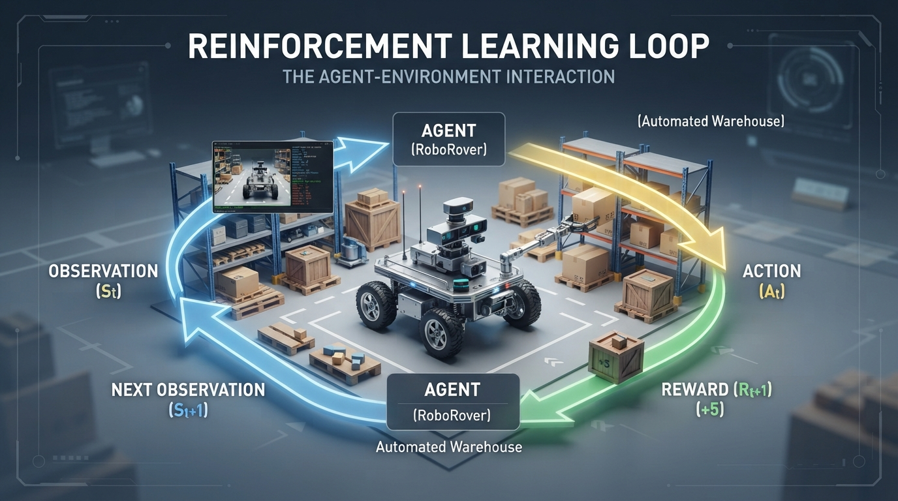
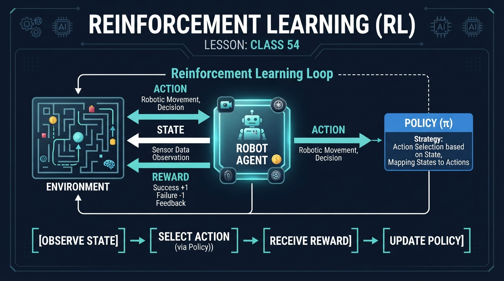
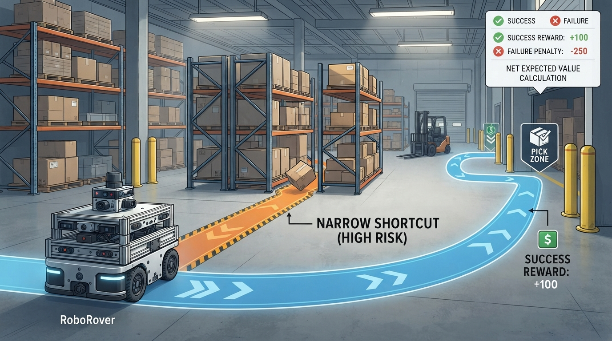
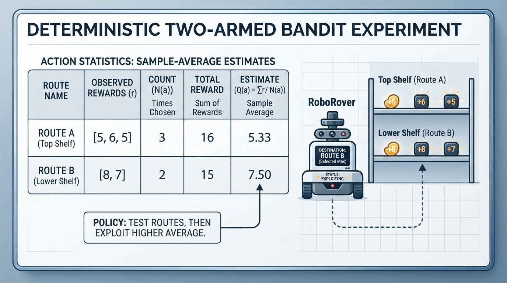

# Class 54: Reinforcement Learning

## Where We Are in the Robotics Journey

In the previous class, we used **Gazebo and physics simulation** to study how a robot can move inside a virtual world. A simulator can calculate contact, friction, gravity, collisions, sensor readings, and motor motion without risking a real machine.

Today, we add a different question:

> How can RoboRover improve its behavior by trying actions and receiving consequences?

This is the central question of **reinforcement learning**, often shortened to **RL**.

Reinforcement learning does not begin with a programmer writing every correct action. Instead, an agent interacts with an environment, receives rewards or penalties, and gradually learns which actions tend to produce better long-term results.

In the next class, we will turn this idea into a specific algorithm: **Q-learning with a grid robot**. Today we will build the vocabulary and mental model needed for that algorithm.

## Today We Will Learn

By the end of this class, you should be able to:

- identify the **agent** and **environment** in a robotics problem;
- explain what a **reward** is and what it is not;
- describe a **policy** as a rule for choosing actions;
- distinguish an immediate reward from a longer-term objective;
- calculate a simple cumulative and discounted reward;
- recognize why reward design can make a robot learn undesirable behavior;
- distinguish a one-state bandit experiment from sequential reinforcement learning;
- distinguish an observation from a state;
- run a small Python simulation in which RoboRover compares actions.

Our focus is on three core concepts:

1. **Agent** — the learner making decisions.
2. **Reward** — numerical feedback from the environment.
3. **Policy** — the agent’s action-selection rule.

## 2-Minute Recap

In Gazebo, RoboRover had:

- a simulated body and wheels;
- motors that produced motion;
- sensors that produced measurements;
- an environment containing surfaces, walls, and objects;
- a physics engine that predicted what happened after an action.

A useful simulation loop was:

1. observe the simulated world;
2. send a motor command;
3. let the physics engine advance time;
4. read the new sensor values.

Reinforcement learning adds a learning system around that loop:

1. the agent observes a situation;
2. the agent chooses an action;
3. the environment changes;
4. the environment produces or supplies a reward;
5. the agent adjusts its future action choices.

In many formulations, the environment generates the reward as part of a transition, conventionally written \(R_{t+1}\), after action \(A_t\) leads from one situation to the next. In other applications, a system designer computes a reward from logged state and action data. In either case, a reward tells the learning system how desirable an outcome was; it does not directly say how to steer.

An **observation** is the information available to the agent, such as camera pixels, range measurements, or encoder readings. A **state** is an abstract description of the situation used for decision-making. A state may be directly available in a simple simulation, or it may be estimated from partial and noisy observations. In many robotics systems, the agent does not observe the complete physical state.

## The Big Idea




**Figure:** The agent–environment loop connects observations, actions, rewards, and the next situation.

Imagine placing RoboRover in a warehouse with a package.

RoboRover can choose between two routes:

- a **wide route** that is slow but reliable;
- a **shortcut** that is fast when clear but sometimes contains a fallen box.

Suppose the robot does not initially know which route is better. It tries one, observes what happens, and receives a numerical score.

For example:

- successful delivery: `+10` points;
- reaching the destination late: `+3` points;
- hitting an obstacle: `-8` points;
- becoming immobilized: `-20` points.

The robot is the **agent**.  
The warehouse and its changing conditions are the **environment**.  
The score is the **reward**.  
The rule used to choose a route is the **policy**.

The important idea is that the robot is not merely reacting to one sensor reading. It is trying to discover a behavior that produces good results over many interactions.

A compact picture for an illustrator would be:

```text
        observation                 action
Environment ───────────► Agent ───────────► Environment
     ▲                                         │
     └──────────── reward and next situation ─┘
```

The arrows form a loop. The agent acts, but the environment determines what actually happens.

### Bandits and Sequential Reinforcement Learning

The Python activity later in this lesson is a **small greedy sample-average two-armed bandit experiment**. It is deliberately not presented as a complete reinforcement-learning system.

A one-state bandit problem has:

- a single decision situation;
- several available actions, called arms;
- one reward after each selected action;
- no modeled state transition or multi-step consequence.

In the bandit used here, selecting a route does not alter a modeled warehouse state. Each route has a stationary reward distribution: every time the route is selected, its outcome is independently sampled using the same success probability and outcome rewards. The learner keeps bookkeeping statistics for each action.

In sequential reinforcement learning, an action can change the next state, and later rewards may depend on the sequence of earlier actions. The transition and future return are part of the problem. For example, moving RoboRover into a grid cell may change which cells are reachable next and may affect later rewards.

The bandit lab is therefore useful for introducing action selection, exploration, exploitation, and sample averages. It is not representative of all reinforcement learning. Q-learning, introduced next class, addresses a state-transition problem.

## See It in Your Head

### AI-Generated Engineering Visual · Professor OS



**How to read this visual:** Trace the signal or idea from left to right. Match each block to the lesson explanation, then predict what would change if one block produced a wrong value. The observation, action, reward, and next-situation arrows correspond to the interaction loop.

Picture RoboRover at a loading-bay junction.

- A blue sign points toward the wide route.
- A yellow sign points toward a shortcut.
- The robot’s battery indicator is visible.
- A transparent score panel shows rewards after each delivery attempt.
- Behind the robot, a trail of previous attempts shows which route was chosen and whether it succeeded.

Now imagine two different policies:

**Policy A: Always choose the wide route**

```text
At the junction → choose wide route
```

**Policy B: Choose based on battery**

```text
If battery is low → choose wide route
Otherwise        → try shortcut
```

A policy is not necessarily a complicated neural network. At its simplest, it can be a table, a flowchart, or an ordinary Python function.

The policy answers:

> Given what I currently know, which action should I choose?

It does not guarantee that the action will succeed. The environment may contain uncertainty, such as a moving worker, wheel slip, or an obstacle that the sensors missed.

## Core Concept

### Agent

The **agent** is the decision-making system that learns or follows a policy.

For RoboRover, the agent might include:

- software running on its computer;
- a policy;
- stored information from earlier attempts;
- code that converts sensor readings into actions.

The physical chassis is part of the robot, but in reinforcement-learning diagrams, “agent” usually refers to the decision-making participant rather than only the metal, wheels, and motors.

### Environment

The **environment** is everything outside the agent that responds to its actions.

In a Gazebo experiment, this may include:

- walls;
- floor friction;
- packages;
- simulated people;
- lighting or sensor noise;
- battery effects;
- the physics engine.

The environment may be deterministic, where the same action always produces the same result, or stochastic, where the result can vary.

### Reward

A **reward** is a numerical signal describing how desirable the latest outcome was.

Rewards may be:

- positive, such as `+10` for a successful delivery;
- negative, such as `-5` for a collision;
- zero, such as receiving no special feedback;
- delayed, such as receiving the main reward only after reaching a destination.

Rewards are usually **score units**, not meters, joules, or newtons. They are numbers chosen by the designer.

A reward should represent the task objective. If we reward only speed, RoboRover may rush into walls. If we reward only avoiding collisions, it may refuse to move.

A reward can also be exploited in an unintended way. For example, suppose a robot receives a small positive reward for every time step that it remains near a goal. It might stop just short of the goal and collect repeated time-based rewards instead of completing the delivery. A redesign could give the main positive reward for actually reaching the goal, limit or remove the per-time-step reward, and impose a cost for unnecessary delay.

### Policy

A **policy** is the agent’s rule for selecting an action from the current situation.

Using mathematical notation:

\[
a = \pi(s)
\]

where:

- \(s\) is the current state or situation;
- \(a\) is the selected action;
- \(\pi\) is the policy;
- the expression means “the policy chooses action \(a\) when it sees situation \(s\).”

A policy may be:

- **deterministic**, always choosing the same action for the same state;
- **stochastic**, choosing among actions with specified probabilities.

For example:

```text
State: battery_low
Policy: choose wide_route
```

A stochastic policy might instead say:

```text
State: battery_normal
Policy: choose shortcut with probability 0.7,
        wide_route with probability 0.3
```

This occasional variation can help an agent explore alternatives. Exploration is important because a robot may otherwise keep using the first action that seemed acceptable.

## Math Without Fear

A reinforcement-learning agent often cares about a sequence of rewards, not just one reward.

Suppose RoboRover experiences three transitions:

- Transition 1: it finds the correct aisle and receives \(R_1=+4\) points.
- Transition 2: it takes a small delay penalty of \(R_2=-1\) point.
- Transition 3: it delivers the package and receives \(R_3=+6\) points.

Some texts write the first reward after action \(A_0\) as \(R_1\), or use \(r_0\) for the first reward. This lesson uses \(r_1\) for the first reward; the numerical calculation is unchanged if the indexing convention is used consistently.

The undiscounted total is:

\[
G = r_1 + r_2 + r_3
\]

where:

- \(G\) is the total return, measured in reward points;
- \(r_1, r_2, r_3\) are rewards after the three transitions, each measured in reward points.

Substituting:

\[
G = 4 + (-1) + 6 = 9\text{ points}
\]

Sometimes later rewards are given less weight. This is represented by a discount factor \(\gamma\):

\[
G_\gamma = r_1 + \gamma r_2 + \gamma^2 r_3
\]

where:

- \(G_\gamma\) is the discounted return, in reward points;
- \(\gamma\) is a dimensionless number from 0 to 1;
- \(r_t\) is the reward after transition \(t\), in reward points;
- the exponent means that rewards farther in the future receive more discounting.

For \(\gamma = 0.9\):

\[
G_\gamma = 4 + 0.9(-1) + 0.9^2(6)
\]

\[
G_\gamma = 4 - 0.9 + 4.86 = 7.96\text{ points}
\]

Interpretation: the robot still values the later delivery reward, but it treats it as slightly less important than an equally large reward received immediately.

The discount factor is a modeling choice. It does not mean the package physically loses value by 10 percent every second.

## Worked Robotics Example




**Figure:** Expected reward must include both successful and unsuccessful route outcomes.

RoboRover must choose between two delivery routes.

| Route | Success probability | Reward if successful | Penalty if blocked |
|---|---:|---:|---:|
| Wide route | 0.95 | \(+4\) points | \(-1\) point |
| Shortcut | 0.70 | \(+8\) points | \(-10\) points |

The **expected reward** is the probability-weighted average outcome:

\[
E[R] = p_{\text{success}}R_{\text{success}}
+ (1-p_{\text{success}})R_{\text{blocked}}
\]

where:

- \(E[R]\) is expected reward, in reward points;
- \(p_{\text{success}}\) is the probability of success;
- \(R_{\text{success}}\) is the reward for success, in reward points;
- \(R_{\text{blocked}}\) is the reward for the unsuccessful outcome, in reward points.

For the wide route:

\[
E[R_{\text{wide}}]
= 0.95(4) + 0.05(-1)
= 3.75\text{ points}
\]

For the shortcut:

\[
E[R_{\text{shortcut}}]
= 0.70(8) + 0.30(-10)
= 2.6\text{ points}
\]

Although the shortcut gives a larger reward when successful, the wide route has the better expected reward because its failure penalty is more frequent and more severe relative to its success reward.

This is a useful engineering lesson:

> “Fastest when successful” is not automatically “best overall.”

If the reward function gave only `+8` for shortcut success and ignored failures, the learned policy could become dangerously optimistic.

## Python Lab




**Figure:** The Python experiment stores action statistics and uses sample-average reward to select later actions; the table is not a sequential value function.

### First, identify what this lab is—and is not

The program below is a **stationary stochastic two-armed bandit demonstration**, not a general reinforcement-learning lab.

It has:

- one decision situation;
- two route actions;
- one immediate reward per selected route;
- no modeled warehouse state;
- no state transition;
- no delayed return;
- no Q-values.

Selecting a route does not change a modeled state. Instead, the program samples a fresh route outcome using a fixed success probability. The outcome distribution stays the same across selections, although the learner’s estimate changes as it gathers data.

This is a genuine toy bandit model, but it remains only a bookkeeping and action-selection exercise. It demonstrates sample-average estimates and greedy exploitation; it does not demonstrate how an agent learns a sequential policy for a changing environment. In sequential reinforcement learning, such as the Q-learning problem in the next class, actions affect later states and future rewards.

The probabilities and rewards in the code match the preceding route table:

- `wide_route` succeeds with probability `0.95`, returning `4` on success and `-1` on failure;
- `shortcut` succeeds with probability `0.70`, returning `8` on success and `-10` on failure.

A fixed random seed makes this small run reproducible, but the exact eight-trial sample is not expected to equal the theoretical probabilities. The program verifies the model definition and bookkeeping rather than claiming that eight trials establish convergence.

```python
# Python 3.7
# RoboRover stationary stochastic two-armed bandit demonstration

import random

random.seed(54)

routes = {
    "wide_route": {
        "success_probability": 0.95,
        "success_reward": 4,
        "failure_reward": -1
    },
    "shortcut": {
        "success_probability": 0.70,
        "success_reward": 8,
        "failure_reward": -10
    }
}

totals = {
    "wide_route": 0,
    "shortcut": 0
}

counts = {
    "wide_route": 0,
    "shortcut": 0
}

choices = []
rewards = []


def average_reward(route_name):
    if counts[route_name] == 0:
        return 0.0
    return float(totals[route_name]) / counts[route_name]


def sample_reward(route_name):
    route = routes[route_name]
    if random.random() < route["success_probability"]:
        return route["success_reward"]
    return route["failure_reward"]


for episode in range(8):
    # Force one early test of each action.
    if episode == 0:
        chosen_route = "wide_route"
    elif episode == 1:
        chosen_route = "shortcut"
    else:
        wide_average = average_reward("wide_route")
        shortcut_average = average_reward("shortcut")

        if wide_average >= shortcut_average:
            chosen_route = "wide_route"
        else:
            chosen_route = "shortcut"

    # Each selection is an independent draw from the route's
    # stationary reward distribution.
    reward = sample_reward(chosen_route)

    counts[chosen_route] += 1
    totals[chosen_route] += reward

    choices.append(chosen_route)
    rewards.append(reward)

    print(
        "Episode {0}: action={1}, reward={2}, average={3:.2f}".format(
            episode + 1,
            chosen_route,
            reward,
            average_reward(chosen_route)
        )
    )

print("Choices:", choices)
print("Rewards:", rewards)
print(
    "Final averages:",
    round(average_reward("wide_route"), 2),
    round(average_reward("shortcut"), 2)
)

# Verify the stationary model's theoretical expected rewards.
wide_expected = (
    0.95 * 4.0 +
    0.05 * (-1.0)
)
shortcut_expected = (
    0.70 * 8.0 +
    0.30 * (-10.0)
)

assert round(wide_expected, 2) == 3.75
assert round(shortcut_expected, 2) == 2.60

# Verify bookkeeping and the reward support of each route.
assert len(choices) == 8
assert len(rewards) == 8
assert counts["wide_route"] + counts["shortcut"] == 8
assert totals["wide_route"] + totals["shortcut"] == sum(rewards)

assert all(
    reward in (4, -1)
    for route, reward in zip(choices, rewards)
    if route == "wide_route"
)
assert all(
    reward in (8, -10)
    for route, reward in zip(choices, rewards)
    if route == "shortcut"
)

# The first two episodes deliberately test both available actions.
assert choices[0] == "wide_route"
assert choices[1] == "shortcut"

print("Verification passed.")
```

Important lines:

- `routes` defines stationary reward distributions for the two actions.
- `sample_reward()` draws a fresh outcome using the route’s success probability.
- `totals` and `counts` store the agent’s experience.
- `average_reward()` estimates how good each action has appeared so far.
- The first two episodes deliberately test both actions. This is a simple form of exploration.
- Later episodes choose the action with the higher observed average. This is greedy exploitation.
- `random.seed(54)` makes this particular run reproducible, but it does not remove the stochastic model.
- The assertions verify the expected-reward calculations, action counts, reward values, and bookkeeping.
- The sample averages from eight trials are empirical estimates. They need not equal the theoretical expected rewards exactly.

The theoretical and empirical quantities are different:

| Route | Theoretical expected reward | Code’s empirical average |
|---|---:|---:|
| Wide route | \(3.75\) | Depends on sampled outcomes |
| Shortcut | \(2.60\) | Depends on sampled outcomes |

The code’s empirical averages are computed from a small random sample. They should not be treated as exact estimates after only eight trials.

This is still a very limited strategy: it can make poor decisions when its information is incomplete, and it does not explicitly model risk, state transitions, or delayed consequences.

### Limits of this toy experiment

This experiment should not be used to claim that:

- greedy sample-average selection is a general reinforcement-learning algorithm;
- eight trials establish which route is universally best;
- a higher observed average guarantees safety;
- a bandit result transfers directly to a moving robot in a warehouse;
- an empirical average must equal the theoretical expected reward in a short run.

The example is useful because it isolates one idea: observed rewards update action preferences. Q-learning will add states, transitions, and future returns.

## Mini Simulation or Game

Play this by hand before running the program.

You are RoboRover’s policy designer. The route outcomes are hidden until the route is tried.

This hand exercise uses a **fixed illustrative trace** so that everyone can calculate the same averages. It is a bookkeeping exercise, not the stochastic Python model above and not a claim that real route outcomes repeat in this order.

### Round rules

- You may choose `wide_route` or `shortcut`.
- Record the reward.
- After each round, calculate each route’s average observed reward.
- From Round 3 onward, choose the route with the higher average.
- If the averages tie, choose the wide route.

Use this illustrative trace when a route is selected:

```text
wide_route:  4, 4, -1, 4
shortcut:    8, -10, 8, -10
```

When a route is selected more times than the listed outcomes, repeat its outcome order from the beginning.

### Predict before you run it

Before running the Python program, predict:

1. Which route will RoboRover choose in Episode 3 if the first two observed rewards are `4` and `8`?
2. After the shortcut produces `-10`, which route has the higher observed average?
3. What kind of problem might occur when a learner trusts a small amount of early experience?

Do not worry if your prediction feels uncomfortable. The point is to notice that a reasonable-looking policy can make poor choices when its information is incomplete.

## What Should Happen?

In the hand trace, the program first tests the wide route and receives `4`. It then tests the shortcut and receives `8`.

At that moment, the observed averages are:

- wide route: \(4.00\) points;
- shortcut: \(8.00\) points.

Therefore, Episode 3 chooses the shortcut under the greedy rule.

If the shortcut then receives `-10`, its observed average becomes:

\[
\frac{8 + (-10)}{2} = -1.00
\]

The wide route’s observed average remains \(4.00\) points, so the greedy policy chooses the wide route next.

The exact later sequence in the Python lab depends on its seeded random draws. The assertions verify the model and bookkeeping rather than asserting that the stochastic sample must follow the hand trace.

This example shows that:

- experience affects a policy;
- rewards can vary across trials;
- early luck can influence later choices;
- learning requires a balance between trying actions and exploiting the best-known action.

Even with stationary reward distributions, a short sample can produce misleading averages. In a sequential environment, the problem is harder because actions can also alter future states and rewards.

## Common Mistakes

### Mistake 1: Treating reward as a direct instruction

A reward of `-10` does not mean “turn left.” It means the recent result was undesirable. The agent must infer which earlier action or situation contributed to that result.

### Mistake 2: Rewarding an easy-to-measure shortcut

If the designer rewards speed but forgets collisions, RoboRover may drive aggressively. A reward function is part of the engineering specification.

A numerical penalty alone does not guarantee safety. A real robot may need hard constraints, action limits, emergency stops, or a safety shield that blocks commands violating required limits.

### Mistake 3: Confusing a bandit with sequential reinforcement learning

The Python lab has one decision situation and immediate rewards. It does not model state transitions or delayed consequences. Sequential reinforcement learning, including Q-learning, represents how actions affect later states and rewards.

### Mistake 4: Assuming one trial proves an action is best

A route may succeed once by chance. Real environments contain sensor noise, changing obstacles, wheel slip, and unmodeled effects.

### Mistake 5: Using a simulation result as if it were a real-robot result

Gazebo may model friction, collisions, and sensors imperfectly. A policy that succeeds in simulation may fail on a real floor because of battery voltage, tire deformation, latency, calibration error, or a gap between simulated and real sensor behavior. This is often called the **sim-to-real gap**.

## Try It Yourself

### Challenge

Modify the stochastic program so that the shortcut failure reward is `-20` instead of `-10`.

Then answer:

1. Does the fixed action-selection rule still keep choosing the shortcut after its first success?
2. How does the shortcut’s theoretical expected reward change?
3. Is choosing by the highest observed average enough to guarantee safe behavior?

The modified shortcut expected reward is:

\[
E[R_{\text{shortcut}}]
= 0.70(8) + 0.30(-20)
= -0.4\text{ points}
\]

Your answer should mention that the policy is limited by the data it has collected. It cannot correctly estimate an action’s risk without experiencing, modeling, or otherwise receiving information about that risk.

Because changing the reward distribution changes the stochastic experiment, the original exact reward-trace assertions should not be added. Verify the changed theoretical expectation and general bookkeeping properties instead:

```python
# Python 3.7
# Self-contained modified stationary bandit:
# shortcut failures are -20.

import random

random.seed(54)

routes = {
    "wide_route": {
        "success_probability": 0.95,
        "success_reward": 4,
        "failure_reward": -1
    },
    "shortcut": {
        "success_probability": 0.70,
        "success_reward": 8,
        "failure_reward": -20
    }
}

totals = {"wide_route": 0, "shortcut": 0}
counts = {"wide_route": 0, "shortcut": 0}
choices = []
rewards = []


def average_reward(route_name):
    if counts[route_name] == 0:
        return 0.0
    return float(totals[route_name]) / counts[route_name]


def sample_reward(route_name):
    route = routes[route_name]
    if random.random() < route["success_probability"]:
        return route["success_reward"]
    return route["failure_reward"]


for episode in range(8):
    if episode == 0:
        chosen_route = "wide_route"
    elif episode == 1:
        chosen_route = "shortcut"
    elif average_reward("wide_route") >= average_reward("shortcut"):
        chosen_route = "wide_route"
    else:
        chosen_route = "shortcut"

    reward = sample_reward(chosen_route)

    counts[chosen_route] += 1
    totals[chosen_route] += reward
    choices.append(chosen_route)
    rewards.append(reward)

wide_expected = 0.95 * 4.0 + 0.05 * (-1.0)
shortcut_expected = 0.70 * 8.0 + 0.30 * (-20.0)

assert round(wide_expected, 2) == 3.75
assert round(shortcut_expected, 2) == -0.40

assert len(choices) == 8
assert len(rewards) == 8
assert counts["wide_route"] + counts["shortcut"] == 8
assert totals["wide_route"] + totals["shortcut"] == sum(rewards)
assert counts["shortcut"] >= 1

assert all(
    reward in (4, -1)
    for route, reward in zip(choices, rewards)
    if route == "wide_route"
)
assert all(
    reward in (8, -20)
    for route, reward in zip(choices, rewards)
    if route == "shortcut"
)

print("Modified experiment verification passed.")
```

These checks verify the changed reward model and bookkeeping without pretending that the modified dataset must produce the original route sequence.

### Optional extension

Add an exploration rule:

- with probability \(0.25\), choose a random route;
- otherwise, choose the route with the higher current average.

Use Python’s `random` module and set a fixed seed so your experiment is reproducible. For example, the following is a self-contained demonstration of the selection logic after both routes have been tried once:

```python
# Python 3.7
# Standalone demonstration of the exploration-selection block.

import random

random.seed(54)

totals = {
    "wide_route": 4,
    "shortcut": 8
}

counts = {
    "wide_route": 1,
    "shortcut": 1
}


def average_reward(route_name):
    return float(totals[route_name]) / counts[route_name]


if random.random() < 0.25:
    chosen_route = random.choice(["wide_route", "shortcut"])
else:
    wide_average = average_reward("wide_route")
    shortcut_average = average_reward("shortcut")

    if wide_average >= shortcut_average:
        chosen_route = "wide_route"
    else:
        chosen_route = "shortcut"

print("Selected route:", chosen_route)
```

Compare the number of times each route is tested.

Random exploration changes the action-selection trace, even though the route outcome distributions remain fixed. The rewards are therefore deterministic only conditional on the selected route and the random draws. The original exact trace assertions do not apply. Replace them with invariant checks such as the length and count checks above, or record and verify a new trace for a specific seed and code version.

Do not claim that one seed proves one policy is universally better. A random experiment is evidence from one run, not a proof for every future environment.

## Quick Quiz

1. In the RoboRover warehouse example, what is the agent?

2. Is a reward the same thing as a steering command?

3. What does a policy do?

4. Why could a shortcut with a higher success reward still have a lower expected reward?

5. Is the Python lab a general sequential reinforcement-learning environment? Why or why not?

6. What is the difference between an observation and a state?

## Answers

1. The agent is RoboRover’s decision-making learning system: the software and policy that select actions based on available information.

2. No. A reward is numerical feedback about how desirable an outcome was. It does not directly specify a motor command.

3. A policy selects an action for a current state or situation.

4. Its failure may be more likely or much more costly. Expected reward includes both successful and unsuccessful outcomes.

5. No. It is a one-state, two-action bandit experiment with immediate rewards and no modeled state transitions. Sequential reinforcement learning includes situations in which actions affect later states and potentially delayed rewards.

6. An observation is the information available to the agent, such as sensor readings. A state is a description of the relevant situation used for decision-making. Observations may be partial or noisy, while a state may be estimated or represented abstractly.

## Real Robot Connection

A real reinforcement-learning system might use:

- wheel encoders to estimate movement;
- cameras or range sensors to detect obstacles;
- a motor controller to execute actions;
- a computer that stores experience;
- a reward calculation based on delivery success, time, energy, and safety.

A practical system usually separates learning from safety-critical control. For example, an outer learning system might choose a target speed, while a lower-level controller limits acceleration and prevents motor commands outside safe bounds.

A safety layer can impose hard constraints that reward penalties alone cannot guarantee. For example, a safety shield may reject a target velocity that would violate a stopping-distance limit or enter a protected region. Emergency stops and collision limits should remain effective even if the learning system has assigned a high numerical reward to a risky action.

This separation matters because reinforcement learning can explore. Exploration that is acceptable in a simulator may be unacceptable near people, stairs, fragile equipment, or expensive machinery.

In Gazebo, RoboRover can collect many trials quickly. In the real world, each trial may consume battery, wear hardware, or create a safety hazard. Engineers therefore use simulation, constrained action limits, logged data, supervised testing, and carefully designed reward signals.

The next class will represent a robot’s situation using grid cells and introduce **Q-learning**, which estimates the long-term usefulness of actions rather than only averaging immediate trial outcomes.

## Vocabulary

- **Agent:** The decision-making participant that observes situations, selects actions, and may learn from outcomes.
- **Environment:** The world outside the agent that responds to actions and produces new situations and rewards.
- **Reinforcement learning:** A machine-learning approach in which an agent improves action selection through interaction and reward feedback.
- **Reward:** A numerical score supplied or computed from environment-related data to indicate how desirable a recent outcome was.
- **Policy:** A rule or function that selects an action from the current state or situation.
- **Action:** A choice made by the agent, such as selecting a route or commanding a target speed.
- **Observation:** Information available to the agent, such as a sensor measurement or camera image; it may be partial or noisy.
- **State:** A description of the relevant situation used for decision-making, possibly estimated from observations.
- **Return:** The accumulated reward over one or more transitions, possibly with discounting.
- **Expected reward:** The probability-weighted average reward across possible outcomes.
- **Exploration:** Trying actions to gain information.
- **Exploitation:** Choosing an action because it currently appears promising.
- **Two-armed bandit:** A one-state action-selection problem with two actions and a reward after each selected action.
- **Sim-to-real gap:** Differences between simulated behavior and real-robot behavior caused by imperfect models, sensors, mechanics, or timing.

## Further Learning

To continue building this topic, study these ideas in order:

1. agent–environment interaction loops;
2. observations, states, and state estimation;
3. bandit problems and sample-average action estimates;
4. episodes, steps, and terminal states;
5. exploration versus exploitation;
6. state–action values;
7. Q-learning;
8. reward shaping and safety constraints;
9. simulation-to-real transfer.

Useful search terms include **reinforcement learning robotics reward design**, **agent environment policy robotics**, **exploration exploitation**, **multi-armed bandits**, and **sim-to-real reinforcement learning**.

## Next Class

**Class 55: Q-Learning with a Grid Robot**

RoboRover will move through a small grid. We will define states and actions, record estimated action values, and see how repeated experience can guide the robot toward a goal.