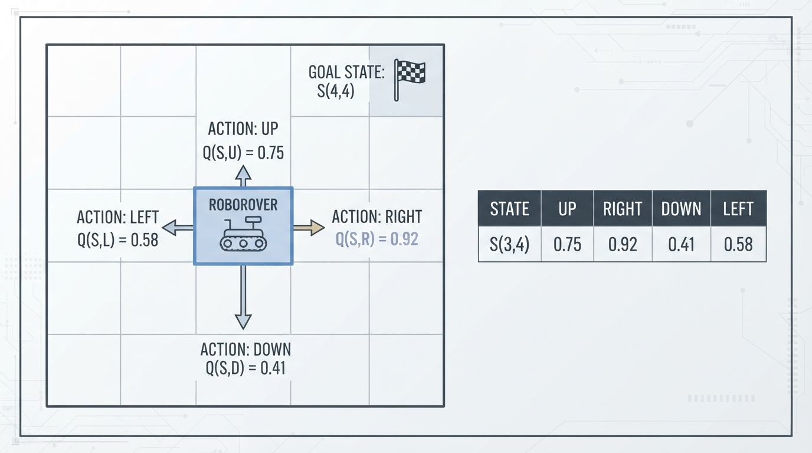
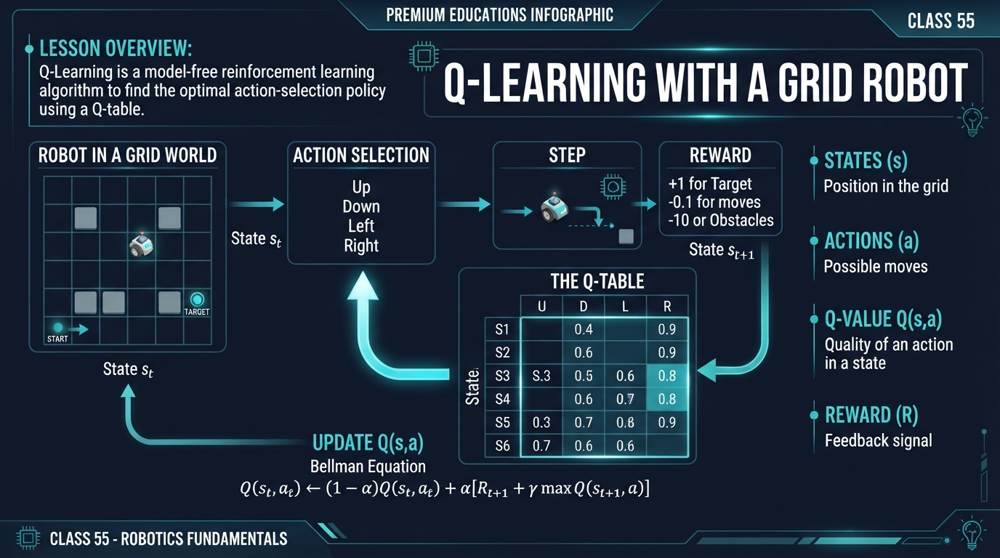
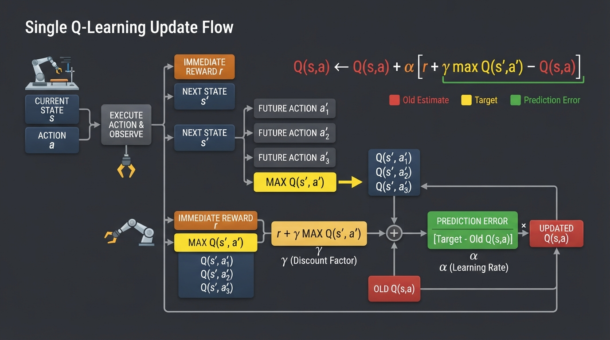
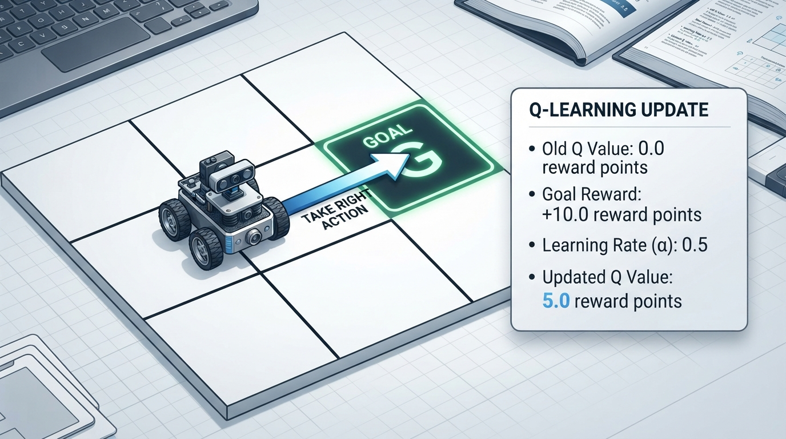
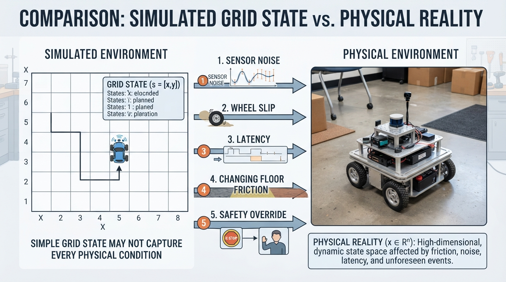

# Class 55: Q-Learning with a Grid Robot

## Where We Are in the Robotics Journey

In the previous class, we introduced **reinforcement learning**: a robot tries actions, receives rewards or penalties, and gradually improves its behavior.

Today we make that idea concrete with a small grid robot. RoboRover will learn which action is useful in each location by building a **Q table**.

The sequence is:

\[
\text{state} \rightarrow \text{action} \rightarrow \text{reward} \rightarrow \text{updated knowledge}
\]

This is not yet a complete real-robot learning system. We will use a simple, known grid world so that the important ideas are visible.

In the next class, we will study **imitation learning**, where a robot learns from examples provided by a human or another controller instead of discovering behavior mainly through rewards.

## Today We Will Learn

By the end of this class, you should be able to:

- describe a robot’s situation as a **state**;
- list possible **actions**;
- explain what a **Q value** means;
- read and update a **Q table**;
- perform one Q-learning update numerically;
- run a small Q-learning simulation in Python;
- explain why a learned table is useful but not automatically reliable on real hardware.

## 2-Minute Recap

In reinforcement learning, an **agent** interacts with an environment.

For RoboRover:

- the **agent** is the software controlling the rover;
- the **environment** is the grid and its obstacles;
- the **state** describes the rover’s current situation;
- an **action** might be moving up, down, left, or right;
- the **reward** tells the agent whether the result was useful.

The robot does not receive a step-by-step route. It receives feedback after trying actions.

A useful distinction:

- **exploration** means trying actions to discover what happens;
- **exploitation** means choosing the action currently believed to be best.

Q-learning combines both. It stores estimates of how useful actions are from particular states.

## The Big Idea




**Figure:** A Q table stores an estimated value for every possible action from a state.

Imagine giving RoboRover a notebook with one row for every square and one column for every possible movement.

For each state-action pair, the notebook contains a number:

> “If I am in this state and choose this action, how promising is that choice?”

That number is called a **Q value**.

For example, suppose RoboRover is at square \(S\):

| State | Up | Right | Down | Left |
|---|---:|---:|---:|---:|
| \(S\) | 2.1 | 5.7 | -1.0 | 0.4 |

The largest value is 5.7, so the current best action is Right.

The table is not a map of distances. It is a collection of learned predictions. A high Q value estimates a larger expected discounted cumulative reward from taking that action in that state; it is not a guarantee of a particular outcome.

A high Q value means:

- the action may produce a good immediate reward;
- it may lead to states from which good future rewards are possible;
- the algorithm currently believes the action is promising.

A diagram for this idea should show a grid square connected to four arrows labeled Up, Right, Down, and Left. Beside each arrow, show a different Q value. The best-valued arrow should lead toward the goal, but the diagram should also make clear that the values are estimates, not guaranteed facts.

## See It in Your Head

### AI-Generated Engineering Visual · Professor OS



**How to read this visual:** Trace the signal or idea from left to right. Match each block to the lesson explanation, then predict what would change if one block produced a wrong value.


Picture RoboRover in a small warehouse:

```text
+---+---+---+---+
|   |   |   | G |
+---+---+---+---+
|   | X |   |   |
+---+---+---+---+
|   |   |   |   |
+---+---+---+---+
| S |   |   |   |
+---+---+---+---+
```

- `S` is the starting square.
- `G` is the goal.
- `X` is an obstacle.
- Empty squares are available locations.

At first, RoboRover’s Q table may contain zeros everywhere. It has no reason to prefer one legal movement over another.

When it reaches the goal, it receives a positive reward. Ordinary movement receives a small penalty, such as \(-1\) point, to encourage shorter solutions. Hitting an obstacle or boundary can receive a larger penalty.

Rewards are not physical forces. They are numerical teaching signals.

## Core Concept

### States

A **state** is the information the learning algorithm uses to describe the current situation.

For this lesson, a state is simply the rover’s grid coordinate:

\[
s=(r,c)
\]

where:

- \(r\) is the row number;
- \(c\) is the column number;
- both are dimensionless grid indices, not metres.

A real robot’s state might include position, heading, battery level, sensor readings, or whether it is carrying an object. Choosing a useful state is an engineering decision. If important information is missing, the same stored state may actually represent several different situations.

### Actions

An **action** is a choice the agent can make.

Our action set is:

\[
A=\{\text{Up},\text{Right},\text{Down},\text{Left}\}
\]

An action is not the same thing as a guaranteed result. If RoboRover chooses Right while next to a wall, the environment may leave it in place and give a penalty.

### The Q Table

A **Q table** stores one value for each state-action pair:

\[
Q(s,a)
\]

where:

- \(s\) is a state;
- \(a\) is an action;
- \(Q(s,a)\) is the estimated long-term usefulness of taking action \(a\) in state \(s\);
- Q values are measured in reward points in this lesson.

More precisely, a Q value estimates expected discounted cumulative reward under the learning setup. It is not a guaranteed utility or a probability.

For a grid with 16 squares and 4 actions per square, the table has:

\[
16 \times 4=64
\]

state-action entries before considering obstacles. The table is often called a lookup table because the algorithm can look up a value directly.

### Updating Knowledge

After taking action \(a\), RoboRover observes:

- a reward \(r\);
- a new state \(s'\).

It then revises its old estimate. The revision considers both the reward just received and the best estimated future value from the new state.

## Math Without Fear




**Figure:** The update moves an old Q estimate toward a target built from immediate and future reward.

The standard Q-learning update is:

\[
Q(s,a)\leftarrow Q(s,a)+\alpha
\left[
r+\gamma\max_{a'}Q(s',a')-Q(s,a)
\right]
\]

Every symbol means:

- \(Q(s,a)\): old estimate, in reward points;
- \(\alpha\): learning rate, dimensionless, usually between 0 and 1;
- \(r\): immediate reward, in reward points;
- \(\gamma\): discount factor, dimensionless, usually between 0 and 1;
- \(s'\): new state after the action;
- \(a'\): a possible next action;
- \(\max_{a'}Q(s',a')\): largest estimated future value from the new state.

The expression inside square brackets is the **prediction error**:

\[
\text{target}-\text{old estimate}
\]

It tells the algorithm how surprising the result was.

### One numerical update

Suppose RoboRover is at state \(s\) and considers moving Right.

- old \(Q(s,\text{Right})=1.2\) reward points;
- learning rate \(\alpha=0.5\);
- immediate reward \(r=-1.0\) reward points;
- discount factor \(\gamma=0.9\);
- best Q value in the new state is \(4.0\) reward points.

First calculate the target:

\[
-1.0+0.9(4.0)=2.6\text{ reward points}
\]

Then calculate the prediction error:

\[
2.6-1.2=1.4\text{ reward points}
\]

Then update:

\[
1.2+0.5(1.4)=1.9\text{ reward points}
\]

So the new value is:

\[
Q(s,\text{Right})=1.9\text{ reward points}
\]

Interpretation: the result was better than RoboRover previously expected, so the value of choosing Right increased. The value did not jump all the way to 2.6 because the learning rate was only 0.5.

## Worked Robotics Example




**Figure:** One successful goal transition raises the Q value for moving Right from the neighboring state.

Suppose RoboRover is one square left of its goal.

```text
+---+---+---+
|   | R | G |
+---+---+---+
```

RoboRover chooses Right and reaches the goal.

Use:

- old \(Q(s,\text{Right})=0.0\) reward points;
- goal reward \(r=10.0\) reward points;
- \(\alpha=0.5\);
- \(\gamma=0.9\);
- future value after reaching the goal \(=0.0\) reward points.

The terminal transition uses future value zero because reaching the goal ends the episode; there is no subsequent decision from which to collect a future value.

The target is:

\[
10.0+0.9(0.0)=10.0\text{ reward points}
\]

The new Q value is:

\[
0.0+0.5(10.0-0.0)=5.0\text{ reward points}
\]

After only one successful experience, Right becomes valuable from that state. Later experiences can spread useful values backward: a square two moves from the goal can learn that moving toward the goal eventually leads to the valuable transition.

This spreading of information is one of the most important features of Q-learning.

## Python Lab

The following complete Python 3.7 program trains RoboRover in a deterministic grid world.

The environment gives:

- \(+10\) points for reaching the goal;
- \(-1\) point for an ordinary move;
- \(-3\) points for trying to enter a wall, obstacle, or outside the grid.

The program uses an epsilon-greedy policy during training:

- with probability \(\varepsilon\), it explores a random action;
- otherwise, it chooses the action with the largest Q value.

After training, `greedy_path` uses the learned table without random exploration: it selects a currently highest-valued action at each state.

```python
import random

ROWS = 4
COLS = 4
START = (3, 0)
GOAL = (0, 3)
OBSTACLE = (1, 1)

ACTIONS = ["U", "R", "D", "L"]
MOVES = {
    "U": (-1, 0),
    "R": (0, 1),
    "D": (1, 0),
    "L": (0, -1),
}

ALPHA = 0.5
GAMMA = 0.9
EPISODES = 2000
MAX_STEPS = 100

rng = random.Random(7)

q_table = {}
for row in range(ROWS):
    for col in range(COLS):
        if (row, col) != OBSTACLE:
            q_table[(row, col)] = {}
            for action in ACTIONS:
                q_table[(row, col)][action] = 0.0


def step(state, action):
    """Return next_state, reward, and whether the episode is finished."""
    row, col = state
    d_row, d_col = MOVES[action]
    next_state = (row + d_row, col + d_col)

    outside = (
        next_state[0] < 0 or next_state[0] >= ROWS or
        next_state[1] < 0 or next_state[1] >= COLS
    )

    if outside or next_state == OBSTACLE:
        return state, -3.0, False

    if next_state == GOAL:
        return next_state, 10.0, True

    return next_state, -1.0, False


def choose_action(state, epsilon):
    """Choose randomly with probability epsilon; otherwise choose greedily."""
    if rng.random() < epsilon:
        return rng.choice(ACTIONS)

    best_value = max(q_table[state].values())
    best_actions = [
        action for action in ACTIONS
        if q_table[state][action] == best_value
    ]
    return rng.choice(best_actions)


for episode in range(EPISODES):
    state = START
    epsilon = max(0.05, 1.0 - episode / 1500.0)

    for step_number in range(MAX_STEPS):
        action = choose_action(state, epsilon)
        next_state, reward, finished = step(state, action)

        if finished:
            future_value = 0.0
        else:
            future_value = max(q_table[next_state].values())

        old_value = q_table[state][action]
        target = reward + GAMMA * future_value
        q_table[state][action] = old_value + ALPHA * (target - old_value)

        state = next_state

        if finished:
            break


def greedy_path():
    """Follow learned greedy actions from START."""
    state = START
    path = [state]

    for unused in range(MAX_STEPS):
        if state == GOAL:
            return path

        best_value = max(q_table[state].values())
        best_actions = [
            action for action in ACTIONS
            if q_table[state][action] == best_value
        ]
        action = best_actions[0]
        state, reward, finished = step(state, action)
        path.append(state)

        if finished:
            return path

    return path


path = greedy_path()

print("Greedy path:", path)
print("Number of moves:", len(path) - 1)
print("Start Q values:", q_table[START])

assert path[0] == START
assert path[-1] == GOAL
assert len(path) - 1 <= 8
print("Verification passed: the learned greedy policy reaches the goal.")
```

Important lines:

- `q_table[state][action]` stores one \(Q(s,a)\) value.
- `step` is the environment transition function. It specifies what happens after an action in this fixed grid; it is not a learned model used by the Q-learning update.
- `future_value = max(...)` implements the “best estimated next action” term.
- `target = reward + GAMMA * future_value` calculates the learning target.
- The assignment to `q_table[state][action]` performs the Q-learning update.
- `assert` statements automatically check the claims made by the program.

The program intentionally does not use a map-reading shortcut to calculate the answer. RoboRover learns through repeated interaction.

The final assertions are empirical checks for this fixed seed, grid, reward setup, and training schedule. They verify what this run produced; they are not a general guarantee that Q-learning will always find a path within eight moves.

## Mini Simulation or Game

Play one round on paper before running the program.

Use this smaller grid:

```text
+---+---+---+
|   |   | G |
+---+---+---+
|   | X |   |
+---+---+---+
| R |   |   |
+---+---+---+
```

RoboRover starts at the bottom-left square.

Rules:

- Up, Right, Down, Left are available actions.
- Ordinary movement gives \(-1\) point.
- Entering `X` or leaving the grid gives \(-3\) points and does not move RoboRover.
- Reaching `G` gives \(+10\) points and ends the round.

Choose three actions yourself. Write down:

1. current state;
2. chosen action;
3. next state;
4. reward;
5. which Q-table entry should be updated.

### Predict before you run it

Before running the Python program, predict:

1. Will the first learned path always be perfect?
2. Will the Q table contain only positive numbers?
3. Will RoboRover eventually reach the goal when following its greedy policy?
4. What might happen if exploration were removed from the beginning?

The program’s final verification checks that the learned greedy path reaches the goal and uses no more than eight moves for this fixed run. The exact printed Q values are allowed to depend on the implementation details, so inspect them rather than guessing their precise decimals.

## What Should Happen?

During early episodes, RoboRover makes many poor choices. It may repeatedly attempt to leave the grid or enter the obstacle.

As training continues:

- successful actions near the goal gain high values;
- useful values propagate to earlier states;
- the greedy policy becomes more consistent;
- exploration decreases but does not disappear entirely, because the minimum epsilon is 0.05.

The learned path need not be the only good path. In this grid, several routes may have the same number of moves. Q-learning is not required to discover a unique route; it needs to learn useful action preferences.

The `assert` statements provide a direct test for this particular experiment: the extracted greedy path must start at `START`, end at `GOAL`, and contain no more than eight moves.

## Common Mistakes

### Confusing a state with an action

The coordinate `(3, 0)` is a state. `R` is an action. The action changes the state through the environment.

### Treating Q values as probabilities

A Q value is not automatically a probability or percentage. It is an estimated expected discounted cumulative reward value.

### Forgetting future reward

Updating from only the immediate reward would make the robot short-sighted. Q-learning also considers the best estimated value in the next state.

### Using a reward that teaches the wrong behavior

If every movement gives zero and the goal gives a reward, wandering may not be strongly discouraged. A small movement penalty often makes shorter solutions more attractive.

### Assuming training guarantees success

The program works in a tiny deterministic environment. Real environments may be noisy, partially observed, or changing. A Q table trained in one warehouse layout may be poor in another.

### Ignoring physical action limits

On a real rover, “move Right” may not mean “move exactly one square.” Wheels can slip, motors can saturate, sensors can be delayed, and the rover may stop short. The state used by the table must match what the robot can actually distinguish.

## Try It Yourself

### Challenge

Modify the program so the goal reward is \(20.0\) points instead of \(10.0\). Keep the movement penalties unchanged.

Then answer:

- Which Q values change?
- Does the greedy route necessarily become shorter?
- Does a larger goal reward change the selected route when two routes have the same number of moves?

Do not assume that multiplying the goal reward automatically multiplies every Q value by exactly the same amount. The update order, penalties, discounting, and incomplete learning all matter.

### Optional extension

Add a second obstacle at `(2, 2)`.

Update the environment and test whether the learned greedy policy still reaches the goal. You may need to increase `EPISODES` if learning becomes slower.

Keep the extension focused on states, actions, and Q values. Do not add path-planning algorithms yet.

## Quick Quiz

1. In this lesson, what does a state represent for RoboRover?

2. What is stored in `q_table[state][action]`?

3. If the old Q value is 2.0 reward points, the target is 6.0 reward points, and \(\alpha=0.25\), what is the updated Q value?

4. Why does Q-learning use both exploration and exploitation?

## Answers

1. A state is RoboRover’s current grid location, represented by a row and column coordinate.

2. It stores the estimated expected discounted cumulative reward, in reward points, of taking that action from that state.

3. Use:

   \[
   Q_{\text{new}}=2.0+0.25(6.0-2.0)
   \]

   \[
   Q_{\text{new}}=2.0+1.0=3.0\text{ reward points}
   \]

4. Exploration discovers the results of actions that may not yet be understood. Exploitation uses the best action currently known. Without exploration, the robot may commit early to a poor choice and never learn about better alternatives.

## Real Robot Connection




**Figure:** A Q table learned in a clean grid may need protection and adaptation before controlling a physical rover.

A physical RoboRover could use a Q table if its world were represented by a manageable number of discrete states. For example, a simple indoor rover might use states such as:

- left, center, or right relative to a corridor;
- near or far from a target;
- obstacle detected or not detected.

However, discretizing the world creates engineering compromises.

If states are too coarse, situations that require different actions may be incorrectly treated as identical. If states are too detailed, the table becomes enormous and training becomes impractical.

Real systems also face:

- **sensor noise:** the same position may produce slightly different readings;
- **latency:** the action may occur before new sensor data arrives;
- **slippage:** commanded motion and actual motion differ;
- **non-stationarity:** battery voltage, floor friction, or lighting may change;
- **unsafe exploration:** trying an action on a real machine can damage equipment.

For these reasons, learning is often performed in simulation first, followed by carefully limited real-world testing. A safety controller may override unsafe actions. That controller is an engineering layer around the learning system, not part of the Q table itself.

Q-learning also assumes that the stored state contains enough information for useful decisions. If RoboRover sees only its grid coordinate but not whether another moving object is approaching, the same state may require different actions at different times.

## Vocabulary

- **Agent:** the learner that selects actions. Here, RoboRover’s control software.
- **Environment:** the world that receives actions and returns rewards and new states.
- **State:** the information describing the current situation.
- **Action:** a choice available to the agent.
- **Reward:** a numerical signal indicating how desirable an outcome is.
- **Q value:** an estimate of expected discounted cumulative reward from taking a particular action in a particular state.
- **Q table:** a lookup table containing Q values for state-action pairs.
- **Exploration:** trying actions to gather information.
- **Exploitation:** choosing the action with the highest current estimated value.
- **Learning rate \(\alpha\):** how strongly a new experience changes an old Q value.
- **Discount factor \(\gamma\):** how strongly future rewards are valued compared with immediate rewards.
- **Greedy policy:** a policy that chooses the action with the highest current Q value.

## Further Learning

To deepen this class, investigate these topics in order:

1. **Temporal-difference learning:** the broader family of methods that updates predictions using later estimates.
2. **Epsilon schedules:** methods for deciding how exploration changes over training.
3. **Reward design:** how reward choices influence the behavior that emerges.
4. **Function approximation:** methods used when a table is too large, often with a model that estimates values instead of storing every entry.
5. **Simulation-to-real transfer:** techniques for moving a learned policy from a simulated robot to physical hardware.

These are previews rather than today’s main subject. First become comfortable tracing one state, one action, one reward, and one Q-table update.

## Next Class

Next class is **Imitation Learning**.

Today RoboRover learned by trying actions and receiving rewards. In imitation learning, it will learn from demonstrations: a human or another controller will show which action to take in particular situations.

The key contrast is:

- **Q-learning:** “Try actions and learn from reward.”
- **Imitation learning:** “Observe examples and learn to reproduce useful actions.”

Both methods still require careful state representation and action definitions. The source of the teaching signal changes.
