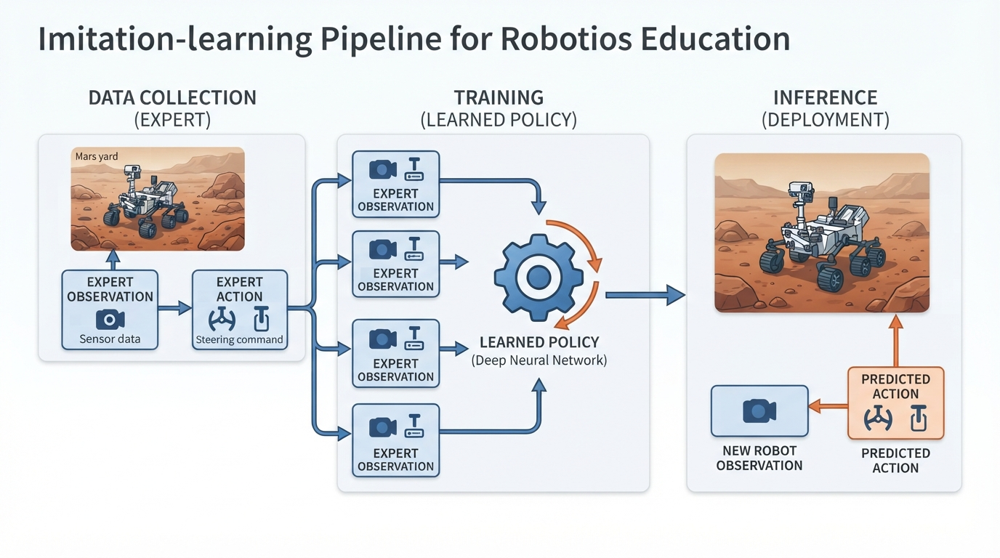
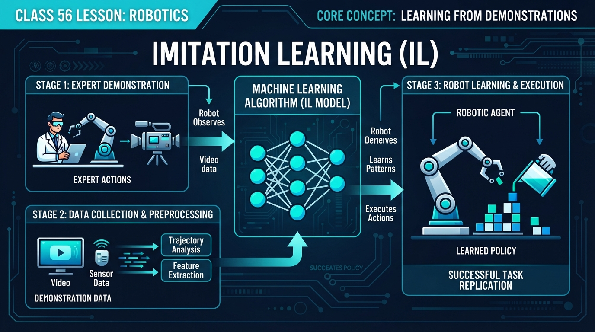
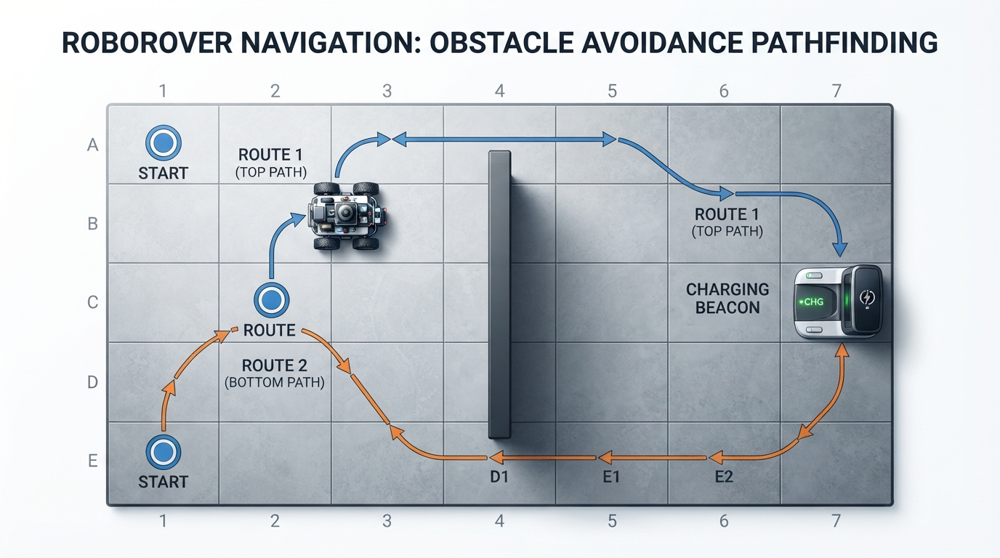
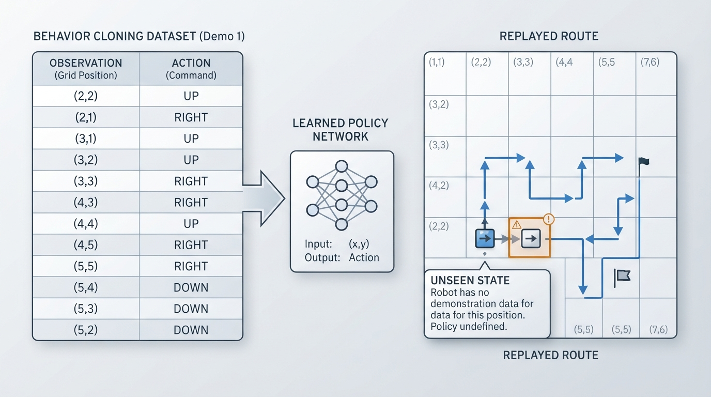

# Class 56: Imitation Learning

## Where We Are in the Robotics Journey

In the previous class, RoboRover used **Q-learning** to improve by trying actions, receiving rewards, and updating a table of action values. It learned through experience and feedback from the environment.

Today, RoboRover will learn in a different way: by watching an expert.

This is called **imitation learning**, or sometimes **learning from demonstrations**. Instead of discovering every useful action by trial and error, the robot receives examples such as:

> “When the robot is in this situation, the expert chose this action.”

In the next class, we will move from a ground robot to **autonomous drones**. Drones also need actions chosen from observations, but their demonstrations and safety requirements are more demanding: a poor action can cause a fall or collision.

## Today We Will Learn

By the end of this class, you should be able to:

- explain what a demonstration contains;
- describe how behavior cloning turns examples into a policy;
- calculate the most common demonstrated action;
- distinguish imitation learning from Q-learning;
- identify why a robot may fail when it encounters a situation missing from its demonstrations;
- run a small Python simulation in which RoboRover copies demonstrated routes.

## 2-Minute Recap

A **policy** is a rule for choosing an action from a situation.

In Q-learning, RoboRover estimated a value such as:

> “How useful is action `RIGHT` from this state?”

It used rewards to improve those estimates.

Imitation learning starts with a different source of information: an **expert demonstration**. A demonstration usually contains pairs or sequences like:

| Situation observed by robot | Expert action |
|---|---|
| Rover is at the left side of the corridor | Move upward |
| Rover is beside the upper wall | Move right |
| Rover is approaching the goal | Move downward |

The robot does not necessarily understand the expert’s reason. It first learns the relationship between observations and actions.

## The Big Idea




**Figure:** Imitation learning turns recorded expert decisions into a policy that predicts actions from observations.

Imagine teaching a new cyclist by saying:

- “At this bend, lean slightly left.”
- “When the path opens, straighten the handlebars.”
- “If the obstacle is close, slow down.”

The learner is copying decisions made by someone who already knows how to ride.

A robot can do something similar:

```text
expert observation → expert action
        ↓
many demonstrations
        ↓
learned observation-to-action rule
        ↓
new observation → predicted action
```

The learned rule is often called a **policy**.

A particularly direct form of imitation learning is **behavior cloning**. The robot treats each demonstration step like a labeled example:

- input: what the robot observed;
- label: what the expert did.

This resembles a student studying solved examples. If the robot sees a familiar situation, it selects the action that was associated with that situation during training.

**Important distinction:** imitation learning copies behavior; it does not automatically copy the expert’s goals, understanding, or safety judgment.

### RoboRover’s example

RoboRover must travel around a blocked central wall to reach a charging beacon. An expert operator drives it around the upper side:

```text
Start → up → up → right → right → right → right → right → right → down → down → Beacon
```

RoboRover records the situation and action at every step. Later, when it encounters one of those recorded situations, it repeats the demonstrated action.

An illustrator could show this as:

1. a small rover following an expert joystick;
2. a notebook containing observation-action pairs;
3. the same rover later choosing actions without the joystick;
4. an arrow labeled “learned policy” connecting the notebook to the rover.

## See It in Your Head

### AI-Generated Engineering Visual · Professor OS



**How to read this visual:** Trace the signal or idea from left to right. Match each block to the lesson explanation, then predict what would change if one block produced a wrong value.


Picture a classroom floor divided into square tiles. A tall wall of red blocks divides the middle of the room.

- RoboRover begins on the left.
- The charging beacon is on the right.
- The expert takes RoboRover around the top of the wall.
- A second demonstration takes another starting position around the bottom.

Each demonstration is a trail of blue arrows. The learned policy is a collection of small arrows attached to floor tiles.

At a tile where the expert went upward, the learned arrow points upward. At a tile where the expert went right, it points right.

Now place RoboRover on a tile that never appeared in the demonstrations. There is no learned arrow there. This is the central weakness of a small behavior-cloning system: **it may have no reliable answer outside its training examples**.

## Core Concept

### 1. Demonstrations are data

A demonstration is not merely a video. For learning, we need useful information extracted from it.

A simple demonstration record might be:

```text
observation = (rover_x, rover_y)
action = "UP"
```

In a real robot, the observation could include:

- camera pixels;
- wheel speed measurements;
- distance readings;
- the direction of a human joystick;
- the drone’s altitude and heading.

The action could be:

- motor commands;
- steering;
- arm-joint motion;
- drone thrust and turning commands.

### 2. Behavior cloning

Behavior cloning learns a mapping:

\[
\hat{\pi}(o) = a
\]

where:

- \(o\) is an observation;
- \(a\) is an action;
- \(\hat{\pi}\) is the learned policy;
- the hat symbol means “estimated” or “learned from data.”

For a tiny discrete example, the learner can count actions:

| Observation | UP examples | RIGHT examples | Learned action |
|---|---:|---:|---|
| A | 4 | 1 | UP |
| B | 0 | 5 | RIGHT |
| C | 2 | 2 | tie; needs a tie rule |

The policy chooses the most frequently demonstrated action.

### 3. Why imitation can be efficient

Q-learning may need many attempts before finding a good route. A skilled operator can provide a useful route immediately.

This is especially valuable when:

- mistakes are expensive;
- the robot moves slowly;
- the environment is difficult to explore;
- an expert already knows safe behavior.

### 4. Why imitation can fail

Suppose a human drives perfectly down the center of a narrow hallway. The training data contains mostly centered observations.

During deployment, RoboRover drifts slightly left. It now sees an observation that was rare or absent in training. Its next action may be poor, causing it to drift farther. That creates an even more unfamiliar observation.

This is commonly called **distribution shift**: the situations encountered while operating differ from the situations in the demonstrations.

A related failure is **compounding error**. One small mistake changes the next observation, which changes the next predicted action, producing more error.

## Math Without Fear

For a discrete behavior-cloning policy, let:

\[
N(o,a)
\]

mean the number of demonstrations in which observation \(o\) was paired with action \(a\).

The simplest learned policy is:

\[
\hat{\pi}(o)=\underset{a}{\operatorname{argmax}}\;N(o,a)
\]

The symbol \(\operatorname{argmax}\) means “choose the action with the largest value.”

### Numerical example

Suppose RoboRover receives four demonstrations of the same observation:

- `RIGHT`: 3 times;
- `UP`: 1 time.

Then:

\[
N(o,\text{RIGHT})=3
\]

\[
N(o,\text{UP})=1
\]

Since \(3>1\),

\[
\hat{\pi}(o)=\text{RIGHT}
\]

The fraction of demonstrations choosing `RIGHT` is:

\[
p=\frac{3}{4}=0.75
\]

Here \(p\) is dimensionless because it is a ratio of counts. It can be described as 75%, but it is not a guarantee that `RIGHT` is correct. It only describes the demonstrations.

Now consider motion timing. If each forward action lasts:

\[
\Delta t=0.25\ \text{s}
\]

and RoboRover travels at:

\[
v=0.20\ \text{m/s},
\]

then one action covers:

\[
d=v\Delta t
\]

\[
d=(0.20\ \text{m/s})(0.25\ \text{s})=0.050\ \text{m}
\]

Three such actions cover:

\[
3d=0.150\ \text{m}
\]

The action label `FORWARD` was copied from the expert, but the physical distance depends on RoboRover’s actual speed and timing. This is why imitation must account for hardware differences.

## Worked Robotics Example




**Figure:** Two expert routes provide RoboRover with action examples for different starting situations.

RoboRover’s training floor is 7 tiles wide and 5 tiles high. A wall occupies:

```text
columns 3, rows 1 through 3
```

The beacon is at the right side. The expert gives two demonstrations:

- from the middle-left, travel around the **top**;
- from the lower-left, travel around the **bottom**.

The learning process is:

1. Record each visited tile.
2. Record the expert’s next movement.
3. Count the action associated with every tile.
4. At run time, look up the current tile.
5. Repeat the learned action.

This is an intentionally simplified model. The code gives RoboRover its exact tile position, which is like providing a perfect position sensor. A real robot would usually need to infer its position from sensors, and that introduces noise and uncertainty.

The top route contains 10 moves. The lower route contains 8 moves. Those route lengths are checked by assertions in the program rather than assumed from the printed display.

The learner does not calculate a new route. It does not search for a shorter path. It simply copies the actions found in its demonstrations.

That limitation is useful: it isolates the central idea of imitation learning.

## Python Lab




**Figure:** The simulation memorizes demonstrated actions and has no guaranteed action for an unseen observation.

The following complete Python 3.7 program learns two demonstrated routes and replays them.

```python
WIDTH = 7
HEIGHT = 5
START_TOP = (0, 2)
START_BOTTOM = (0, 4)
GOAL = (6, 2)

OBSTACLES = {
    (3, 1),
    (3, 2),
    (3, 3),
}

TOP_DEMO = [
    (0, 2), (0, 1), (0, 0),
    (1, 0), (2, 0), (3, 0), (4, 0), (5, 0), (6, 0),
    (6, 1), (6, 2)
]

BOTTOM_DEMO = [
    (0, 4),
    (1, 4), (2, 4), (3, 4), (4, 4), (5, 4), (6, 4),
    (6, 3), (6, 2)
]

DIRECTION_NAMES = {
    (0, -1): "UP",
    (0, 1): "DOWN",
    (1, 0): "RIGHT",
    (-1, 0): "LEFT",
}


def actions_between(path):
    """Convert a sequence of positions into action labels."""
    actions = []

    for index in range(len(path) - 1):
        x1, y1 = path[index]
        x2, y2 = path[index + 1]
        delta = (x2 - x1, y2 - y1)

        if delta not in DIRECTION_NAMES:
            raise ValueError("Demonstration contains a non-adjacent move.")

        actions.append(DIRECTION_NAMES[delta])

    return actions


def learn_policy(demonstrations):
    """Count demonstrated actions and choose the most common one."""
    counts = {}

    for path in demonstrations:
        actions = actions_between(path)

        for index in range(len(actions)):
            observation = path[index]
            action = actions[index]

            if observation not in counts:
                counts[observation] = {}

            if action not in counts[observation]:
                counts[observation][action] = 0

            counts[observation][action] += 1

    policy = {}

    for observation in counts:
        action_counts = counts[observation]
        best_action = None
        best_count = -1

        for action in action_counts:
            if action_counts[action] > best_count:
                best_action = action
                best_count = action_counts[action]

        policy[observation] = best_action

    return policy, counts


def next_position(position, action):
    x, y = position

    if action == "UP":
        return (x, y - 1)
    if action == "DOWN":
        return (x, y + 1)
    if action == "RIGHT":
        return (x + 1, y)
    if action == "LEFT":
        return (x - 1, y)

    raise ValueError("Unknown action.")


def legal(position):
    x, y = position
    inside = 0 <= x < WIDTH and 0 <= y < HEIGHT
    return inside and position not in OBSTACLES


def run_episode(policy, start, goal, maximum_steps=30):
    position = start
    trace = [position]

    for step in range(maximum_steps):
        if position == goal:
            return trace

        if position not in policy:
            raise RuntimeError("The learned policy has no action for this observation.")

        action = policy[position]
        candidate = next_position(position, action)

        if not legal(candidate):
            raise RuntimeError("The learned action drives into a wall or outside the floor.")

        position = candidate
        trace.append(position)

    raise RuntimeError("The robot did not reach the goal in time.")


def print_floor(trace):
    trace_set = set(trace)

    for y in range(HEIGHT):
        row = []

        for x in range(WIDTH):
            position = (x, y)

            if position in OBSTACLES:
                symbol = "#"
            elif position == GOAL:
                symbol = "G"
            elif position == trace[0]:
                symbol = "S"
            elif position in trace_set:
                symbol = "*"
            else:
                symbol = "."

            row.append(symbol)

        print(" ".join(row))


def main():
    demonstrations = [TOP_DEMO, BOTTOM_DEMO]
    policy, counts = learn_policy(demonstrations)

    top_trace = run_episode(policy, START_TOP, GOAL)
    bottom_trace = run_episode(policy, START_BOTTOM, GOAL)

    # These checks verify the exact route lengths used by this lesson.
    assert len(actions_between(TOP_DEMO)) == 10
    assert len(actions_between(BOTTOM_DEMO)) == 8
    assert len(top_trace) - 1 == 10
    assert len(bottom_trace) - 1 == 8
    assert top_trace[-1] == GOAL
    assert bottom_trace[-1] == GOAL
    assert policy[START_TOP] == "UP"
    assert policy[START_BOTTOM] == "RIGHT"

    # This position was not included in either demonstration.
    assert (1, 3) not in policy

    print("Learned action at top start:", policy[START_TOP])
    print("Top route moves:", len(top_trace) - 1)
    print("Bottom route moves:", len(bottom_trace) - 1)
    print("An unseen observation has a learned action:",
          (1, 3) in policy)

    print("\nTop demonstration replay:")
    print_floor(top_trace)

    print("\nBottom demonstration replay:")
    print_floor(bottom_trace)


if __name__ == "__main__":
    main()
```

The important lines are:

- `actions_between`: changes positions into action labels;
- `learn_policy`: counts which actions were demonstrated;
- `policy[observation] = best_action`: creates the behavior-cloned rule;
- `run_episode`: lets RoboRover use the learned policy;
- `assert`: checks exact route lengths and important learned actions.

The program does not invent an action for an unseen observation. That is deliberate. In a larger system, the robot might use a fallback controller, request human help, or collect another demonstration.

## Mini Simulation or Game

Try this experiment:

1. Run the program unchanged.
2. Change `TOP_DEMO` so the expert goes around the bottom instead.
3. Run it again.
4. Add a new demonstration beginning at `(1, 3)`.
5. Observe how the learned policy gains an action for that previously unseen location.

For a paper version, draw the floor on graph paper. Place an arrow on every tile visited by the expert. Cover one tile with a sticky note and ask:

> “What should RoboRover do here if this tile was never demonstrated?”

There is no guaranteed correct answer from imitation alone. That uncertainty is the lesson.

## What Should Happen?

**Predict before you run it:**

1. What action should the learned policy choose at the top starting position `(0, 2)`?
2. What action should it choose at the bottom starting position `(0, 4)`?
3. What should happen when the program checks observation `(1, 3)`?
4. Will the learner calculate a new route if you remove part of a demonstration?

Expected reasoning:

1. The top demonstration begins with `UP`, so the learned action is `UP`.
2. The bottom demonstration begins with `RIGHT`, so the learned action is `RIGHT`.
3. `(1, 3)` is not demonstrated, so it has no learned action.
4. No. This program only replays learned actions; it does not plan a replacement route.

The assertions in the Python block verify the exact answers for the first three route-related checks.

## Common Mistakes

**Mistake 1: Calling imitation learning “copying pixels.”**  
Pixels may be part of the observation, but the learned relationship is between an observation and an action.

**Mistake 2: Assuming the most common action is always correct.**  
A majority action may reflect a biased or incomplete set of demonstrations.

**Mistake 3: Confusing demonstration with explanation.**  
An expert may steer left without recording why. The learner sees the action, not necessarily the reason.

**Mistake 4: Ignoring timing and hardware differences.**  
The expert’s `FORWARD` command may move 5 cm, while RoboRover’s motors move 7 cm because of battery voltage, wheel size, or floor friction.

**Mistake 5: Training only on perfect behavior.**  
If demonstrations contain no recovery from errors, the robot may not know how to recover after drifting.

**Mistake 6: Treating an unseen situation as harmless.**  
A missing policy entry is not the same as a safe policy. Real systems need a clearly designed fallback, stop behavior, or human override.

## Try It Yourself

**Challenge:** Add a third demonstration that begins at `(0, 1)` and reaches the goal by going around the top. Confirm that RoboRover can replay it.

Your solution should:

- create a valid list of adjacent positions;
- include no obstacle positions;
- use `learn_policy` without changing its internal logic;
- verify that the final position is `GOAL`.

**Optional extension:** Make the expert occasionally demonstrate two different actions for the same observation. Print the action counts and explain which action the majority rule selects. Then design a tie-breaking rule for equal counts.

A stronger extension is to add a safe fallback:

```text
if the observation is unseen:
    stop and ask for help
```

That is often safer than guessing, although it may reduce autonomy.

## Quick Quiz

1. What is a demonstration in imitation learning?

2. In behavior cloning, what does the learned policy usually map from and to?

3. How is imitation learning different from Q-learning?

4. Why can a robot fail after making one small error during behavior cloning?

## Answers

1. A demonstration is recorded expert behavior, usually pairing observations with the actions chosen in those observations.

2. It maps an observation to a predicted action.

3. Imitation learning learns from examples supplied by an expert. Q-learning improves action values through trial, environmental feedback, and rewards.

4. The error changes the robot’s next observation. If that new observation was absent or rare in training, the policy may choose a poor action, causing further errors. This is compounding error caused by distribution shift.

## Real Robot Connection

Industrial robots, mobile robots, prosthetic devices, and drones can all use demonstrations. A human may guide a robot arm through a safe motion, drive a rover with a controller, or pilot a drone along a desired route.

However, a real robot has complications absent from the tile simulation:

- camera images vary with lighting;
- sensors contain noise;
- motor commands have delay;
- the expert and robot may move at different speeds;
- the robot may not know its exact position;
- demonstrations may contain inconsistent human actions;
- rare emergency situations may not appear in the training data.

A practical engineering strategy is to combine imitation with safeguards:

```text
demonstration-based action
        ↓
safety checks and limits
        ↓
motor command or emergency stop
```

For example, a learned rover policy might suggest `FORWARD`, but a distance sensor can override that command if an obstacle is dangerously close. The learned action is not automatically trusted.

This class also connects directly to the next class. An autonomous drone can imitate a pilot’s steering decisions, but drones must also respect altitude limits, obstacle clearance, battery constraints, and unstable flight conditions. We will examine how autonomy changes when the robot moves in three dimensions.

## Vocabulary

- **Imitation learning:** Learning behavior from examples of an expert performing a task.
- **Demonstration:** Recorded expert behavior containing observations and corresponding actions.
- **Behavior cloning:** A direct imitation-learning method that learns an observation-to-action mapping.
- **Observation:** Information available to the robot at a particular moment, such as an image, sensor reading, or position estimate.
- **Action:** A command or movement chosen by the robot, such as turning, driving, or changing thrust.
- **Policy:** A rule or function that selects an action from an observation.
- **Distribution shift:** A difference between the situations present during training and those encountered during deployment.
- **Compounding error:** A sequence in which one mistake changes later observations and causes additional mistakes.
- **Fallback behavior:** A predefined response when the learned policy is uncertain, unsafe, or missing an action.

## Further Learning

To continue developing this idea, investigate these topics in order:

1. **Data collection for robot demonstrations** — how to record synchronized sensors and actions.
2. **Supervised learning** — the broader machine-learning framework behind labeled examples.
3. **Recovery demonstrations** — examples showing how to correct mistakes, not only perform perfect runs.
4. **Safety filters for learned policies** — systems that block dangerous commands.
5. **DAgger, or Dataset Aggregation** — a later method that gathers expert corrections on situations visited by the learner.

These are previews rather than requirements for today. The essential idea is the observation-action relationship.

## Next Class

**Class 57: Autonomous Drones**

RoboRover will leave the floor and become a flying robot. We will examine what makes drone autonomy difficult, including three-dimensional movement, altitude, heading, and the need for careful safety boundaries.
