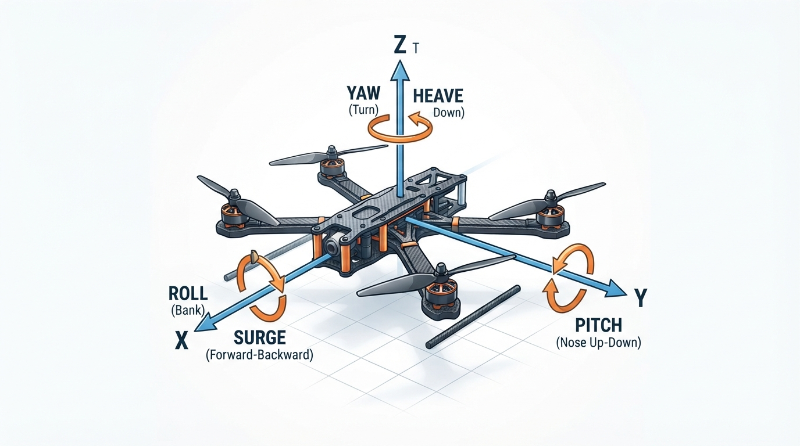
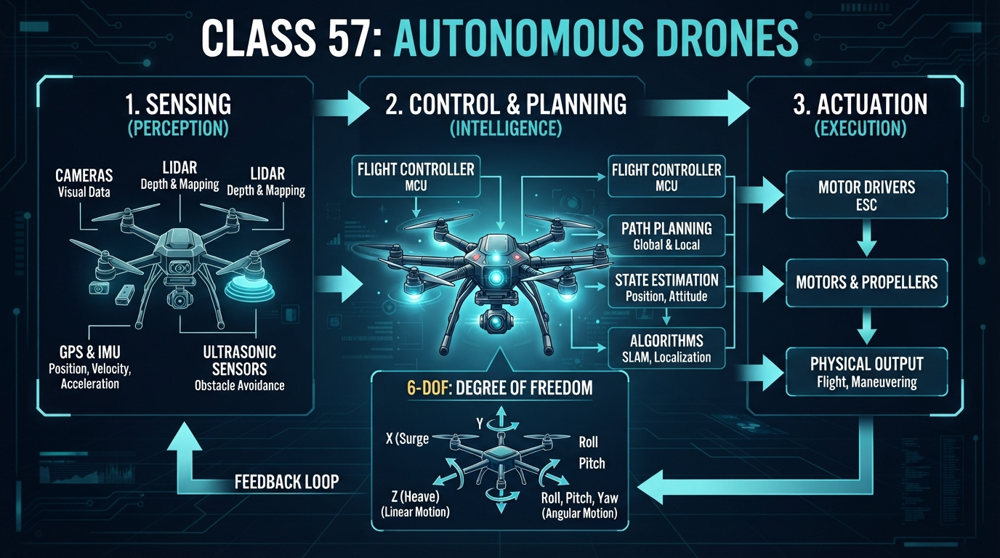
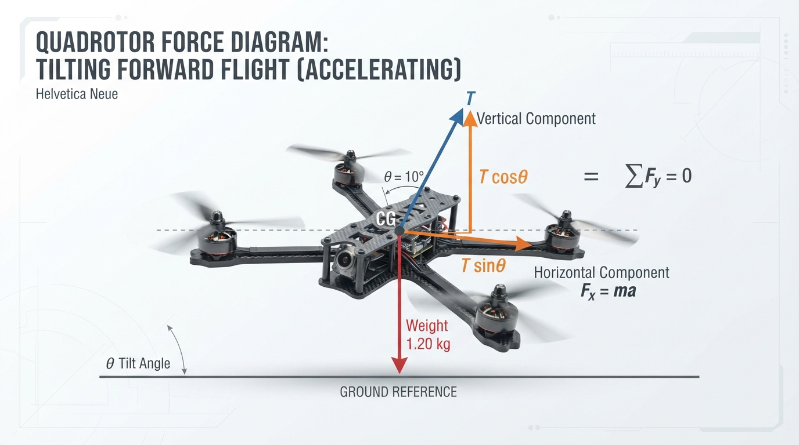
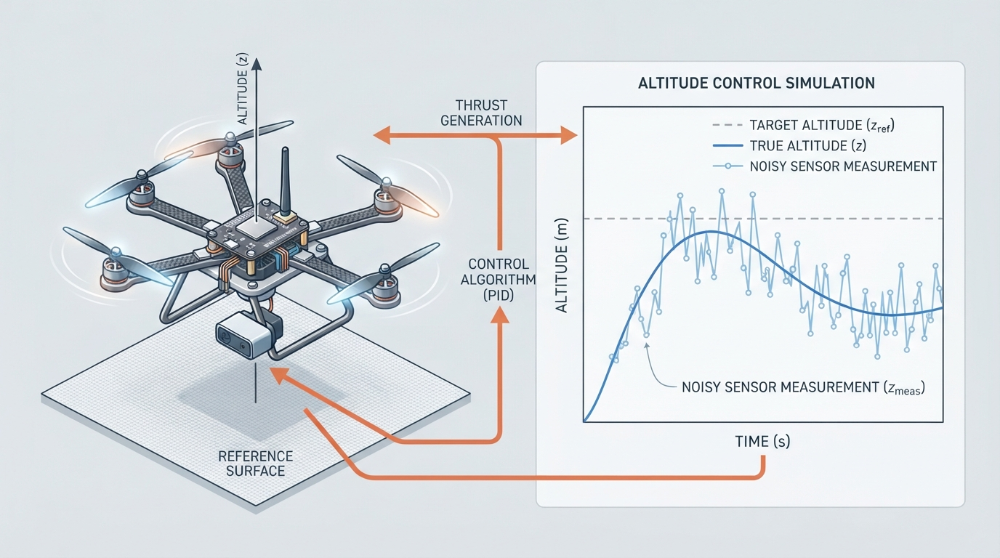

# Class 57: Autonomous Drones

## Where We Are in the Robotics Journey

In the previous class, **Imitation Learning**, RoboRover learned a policy that maps observations to actions resembling those demonstrated by a teacher.

Today, RoboRover gains a new body: a small autonomous quadrotor scout. It must remain airborne, estimate its motion, and select task-level actions without a human continuously commanding every motor.

This class connects learned behavior with physical control:

- Imitation learning can suggest **what action seems appropriate**.
- Sensors estimate **what the drone is actually doing**.
- Feedback control changes actuator commands to reduce the difference between desired and measured behavior.
- Autonomy allows software to select task-level actions.

Next class, **Mobile Robot Navigation Stack**, we will study how a robot combines sensing, localization, mapping, planning, and control. Today we focus on aerial motion, coordinate frames, sensing, control, and the relationship between automation and autonomy.

## Today We Will Learn

By the end of this class, you should be able to:

1. Explain a flying robot’s six degrees of freedom.
2. Distinguish body-frame and world-frame motion.
3. Describe how sensing and control form a feedback loop.
4. Calculate hover thrust and the thrust required during tilted flight.
5. Explain why sensor noise, bias, delay, and actuator limits matter.
6. Run and interpret a Python altitude-control simulation.
7. Explain how imitation learning and autonomous control can work together.

## 2-Minute Recap

A robot does not directly “know” the world. It receives measurements, processes them, and commands actuators.

A common control pattern is:

1. Choose a desired state.
2. Measure or estimate the current state.
3. Compare the desired and estimated states.
4. Apply an action that reduces the difference.
5. Repeat.

For RoboRover’s ground wheels, the desired state might be “move forward at \(0.4\ \text{m/s}\).” For its drone module, it might be “remain \(2\ \text{m}\) above the launch point.”

Keep these ideas separate:

- **Sensing** determines what measurements are available.
- **Control** converts desired and measured states into actuator commands.
- **Autonomy** concerns who or what selects actions toward a task.

They interact, but they are not interchangeable. Autonomous software can use feedback, and a teleoperated robot can also use local feedback.

## The Big Idea




**Figure:** The drone can translate along three axes and rotate around three axes; its main thrust follows the body thrust axis, not necessarily its forward axis.

For this course, a robot is a physical machine commonly treated as a robot in engineering practice whose controlled actuators perform a physical task. Its immediate actions may be selected by a human operator, a preprogrammed controller, or autonomous software. This is a working description for teaching, not a universal necessary-and-sufficient test.

A drone is not merely a flying camera. It must control position and orientation in three-dimensional space.

A freely moving rigid body has six degrees of freedom, or **6-DoF**:

- translation along three axes;
- roll;
- pitch;
- yaw.

The three translational coordinates describe position. Velocity and acceleration are different quantities: velocity describes how position changes, and acceleration describes how velocity changes. Thus, six pose degrees of freedom do not mean that a quadrotor has six independently commanded motors.

A quadrotor has four motor inputs. Their combined effects produce total thrust and three principal body torques. The vehicle tilts to redirect thrust before producing horizontal acceleration, so its six-dimensional motion is coordinated rather than independently commanded one coordinate at a time.

A quadrotor’s main thrust acts along its body thrust axis. In this lesson, we define the body \(z\)-axis to point in the thrust direction, upward from the vehicle. This is a teaching convention, not a universal body-axis convention. Many flight-control texts define body \(z\) downward, so the signs of thrust and attitude equations depend on the selected frame.

To move forward, a quadrotor usually pitches forward. This tilts the thrust axis, causing part of total thrust to point forward and reducing its upward component. The controller must increase total thrust or otherwise compensate if it wants to maintain altitude.

### Body and world frames

A **world frame** is fixed to the room, launch site, or map. For example, world \(Z\) may point vertically upward.

A **body frame** moves with the drone. Body \(x\) commonly points forward, body \(y\) points sideways, and body \(z\) follows the convention selected for the vehicle model. In this lesson, body \(z\) points in the thrust direction.

These frames are not interchangeable. A force aligned with the body thrust axis may have both vertical and horizontal components in the world frame after the drone tilts. Converting between frames requires the drone’s orientation.

## See It in Your Head

### AI-Generated Engineering Visual · Professor OS



**How to read this visual:** Trace the signal or idea from left to right. Match each block to the lesson explanation, then predict what would change if one block produced a wrong value.


Picture RoboRover’s quadrotor above a marked landing pad.

Draw the body-frame axes attached to the vehicle:

- body \(x\): forward;
- body \(y\): left;
- body \(z\): upward and along the thrust direction, using this lesson’s convention.

Draw a second set of axes fixed to the laboratory:

- world \(X\): one horizontal laboratory direction;
- world \(Y\): the other horizontal laboratory direction;
- world \(Z\): vertically upward.

The axes have labels, but their meanings depend on the frame. Body \(x\) moves and rotates with the drone; world \(X\) remains fixed in the laboratory.

| Motion | Meaning in the selected frame |
|---|---|
| Translation along \(x\) | Motion along the frame’s \(x\)-axis; body \(x\) is commonly forward |
| Translation along \(y\) | Motion along the frame’s \(y\)-axis |
| Translation along \(z\) | Motion along the frame’s \(z\)-axis; in this lesson body \(z\) is the thrust direction |
| Roll | Rotation about the forward-backward body axis |
| Pitch | Rotation about the left-right body axis |
| Yaw | Rotation about the vertical direction |

For an illustration, show a quadrotor with straight arrows for translation and curved arrows for rotation. Include both the moving body frame and the fixed world frame. Clearly distinguish the forward body \(x\)-axis from the body thrust \(z\)-axis. Add an inset showing four rotors producing thrust along the body thrust axis. Coordinated differences in rotor speeds create roll, pitch, and yaw torques; the exact rotor pair depends on rotor numbering, rotation directions, and sign convention.

## Core Concept

### 1. Six degrees of freedom

A drone’s position can be written as:

\[
\mathbf{p} =
\begin{bmatrix}
x\\y\\z
\end{bmatrix}
\]

These coordinates describe position in a selected frame. Its orientation is commonly described by:

- roll \(\phi\);
- pitch \(\theta\);
- yaw \(\psi\).

Angles may be reported in degrees or **radians**. A full turn is \(2\pi\) radians, and \(180^\circ=\pi\) radians. Python’s `math` functions commonly use radians.

Together, position and orientation describe the drone’s **pose**. Pose is not the same as velocity or acceleration. A drone may have a fixed pose while moving with nonzero velocity, and it may have zero velocity while accelerating.

### 2. Sensing

A drone may use:

- an **inertial measurement unit (IMU)**, containing accelerometers and gyroscopes;
- a barometer for pressure-based altitude estimates;
- a downward range sensor;
- optical flow for estimating image motion across the ground;
- cameras for detecting visual features;
- GPS or another positioning system for outdoor location.

Measurements are imperfect. Accelerometers contain noise and bias. Gyroscope bias can make orientation estimates drift. Barometers respond to pressure changes and airflow. Cameras can fail in darkness or textureless environments. Range sensors can return invalid values when the surface is too far away.

A downward range sensor does not always measure vertical altitude. When the vehicle is tilted, the sensor may measure slant range along its sensing ray. Correcting that value requires orientation information and assumptions about the ground.

The controller therefore acts on measurements and estimates, not perfect truth.

### 3. Control

Let the desired altitude be \(z_d\) and the measured altitude be \(z_m\). The altitude error is:

\[
e_z=z_d-z_m
\]

If \(e_z\) is positive, the drone is below its target and should generally increase thrust. A simple proportional command is:

\[
T=mg+k_p e_z
\]

where:

- \(T\) is commanded total thrust in newtons;
- \(m\) is mass in kilograms;
- \(g\approx9.81\ \text{m/s}^2\);
- \(k_p\) is proportional gain in \(\text{N/m}\).

The \(mg\) term approximately balances weight. The correction term responds to altitude error.

The Python lab adds a velocity-dependent term, \(-k_dv\), to provide damping-like action and reduce overshoot. Because the simulation supplies true vertical velocity directly, the lab is **PD-like**, not a complete real-world PD implementation.

### Automation, feedback control, and autonomy

These concepts describe different aspects of a system:

| Concept | Main question | Drone example |
|---|---|---|
| Task sequencing | Is a procedure specified in advance? | Repeat a programmed takeoff and landing sequence |
| Immediate decision authority | Who or what selects the next immediate action? | A human pilot, preprogrammed controller, or autonomous software |
| Feedback control | Does measured state influence a current or future action? | Increase thrust after measuring that altitude is too low |
| Task-level autonomy | Does software select task-level actions without continuous human selection? | Select inspection waypoints while respecting a no-fly zone |

A task sequence can be preprogrammed while lower-level subsystems use feedback. For example, a drone may follow a fixed waypoint list while its attitude and altitude controllers respond continuously to measured state.

A drone can therefore be automated without being highly autonomous. It can use feedback while being teleoperated. Do not equate task-level autonomy with feedback control.

In this course, a measured state or output influencing a current or future action counts as **feedback control**. A threshold or hysteresis rule can therefore be feedback control. **Sustained feedback regulation** is a course-specific teaching phrase for repeated measurement-and-correction over time. A single sensor trigger that starts a fixed timed sequence, without later use of the measured state, is not sustained feedback regulation merely because a sensor started it.

An inspection policy might:

1. select the next waypoint from a list;
2. check geofence, battery, and altitude limits;
3. send a desired position or velocity;
4. rely on lower-level feedback loops to stabilize the aircraft.

The policy chooses **what task action to attempt**. The control stack determines **how to perform it physically**.

## Math Without Fear

### Hovering

During ideal level hover, vertical acceleration and vertical velocity are approximately zero, so thrust balances weight:

\[
T=mg
\]

For \(m=1.20\ \text{kg}\):

\[
T=(1.20)(9.81)=11.772\ \text{N}
\]

If four rotors share the load equally:

\[
T_{\text{rotor}}=\frac{11.772}{4}=2.943\ \text{N}
\]

This assumes level flight, equal loading, and no wind or acceleration.

### Tilting to move

Suppose the drone tilts by \(10^\circ\) while maintaining altitude. Only the vertical component of thrust supports the weight:

\[
T\cos(\theta)=mg
\]

Therefore:

\[
T=\frac{mg}{\cos(\theta)}
\]

With \(m=1.20\ \text{kg}\) and \(\theta=10^\circ\):

\[
T=\frac{11.772}{\cos(10^\circ)}
\approx11.954\ \text{N}
\]

The horizontal component is:

\[
F_{\text{horizontal}}=T\sin(\theta)\approx2.076\ \text{N}
\]

Ignoring drag, horizontal acceleration is:

\[
a_{\text{horizontal}}=
\frac{2.076}{1.20}
\approx1.730\ \text{m/s}^2
\]

This calculation assumes steady, level-altitude flight and a simple tilt in one vertical plane. A tilted vehicle requires thrust-vector compensation because not all thrust supports weight. Real flight controllers also account for attitude dynamics, drag, motor limits, and other effects.

The thrust calculation gives a force, not an acceleration. Dividing force by mass gives acceleration.

### A saturation-margin calculation

Suppose maximum total thrust is \(20.0\ \text{N}\). At level hover, the ideal margin above weight is:

\[
20.0-11.772=8.228\ \text{N}
\]

The maximum vertical acceleration, ignoring drag, is:

\[
a_{\max}=\frac{20.0}{1.20}-9.81
\approx6.857\ \text{m/s}^2
\]

When the drone tilts, some available thrust supports weight, leaving less margin for additional vertical or horizontal acceleration.

## Worked Robotics Example




**Figure:** When the drone tilts, thrust splits into vertical and horizontal components, so total thrust must increase to maintain altitude.

RoboRover’s aerial scout has mass \(1.20\ \text{kg}\), a target altitude of \(2.0\ \text{m}\), and a measured altitude of \(1.85\ \text{m}\).

\[
e_z=2.0-1.85=0.15\ \text{m}
\]

With \(k_p=18\ \text{N/m}\):

\[
k_pe_z=(18)(0.15)=2.7\ \text{N}
\]

Hover thrust is:

\[
mg=(1.20)(9.81)=11.772\ \text{N}
\]

The simplified command is:

\[
T=11.772+2.7=14.472\ \text{N}
\]

Because the measured altitude is below the target, the command exceeds hover thrust. The controller does not issue a symbolic “go up” instruction; it changes a physical force, which changes acceleration.

## Python Lab




**Figure:** Illustrative schematic: the simulation separates true altitude from the noisy measurement used by the controller.

This program models only vertical motion. It is not a flight simulator. The drone has altitude, vertical velocity, and commanded thrust. A noisy altitude measurement feeds a PD-like controller, while the simulation supplies true vertical velocity for the damping-like term.

**Predict before running:** Starting at \(0\ \text{m}\) with a target of \(2\ \text{m}\), will the drone teleport, approach gradually, or overshoot? What will increasing `kp` do?

```python
import random
import matplotlib.pyplot as plt

# Physical parameters
mass = 1.0                 # kg
gravity = 9.81             # m/s^2
dt = 0.02                  # s
duration = 8.0             # s
target_altitude = 2.0      # m

# Controller parameters
kp = 18.0                  # N/m
kd = 7.0                   # N/(m/s)

random.seed(4)

altitude = 0.0
vertical_speed = 0.0       # simulated true internal state

times = []
altitudes = []
measured_altitudes = []
thrusts = []

steps = int(duration / dt)

for step in range(steps):
    time = step * dt

    # Noisy altitude measurement.
    measured_altitude = altitude + random.uniform(-0.03, 0.03)
    error = target_altitude - measured_altitude

    # True simulated velocity supplies the damping-like term.
    thrust = mass * gravity + kp * error - kd * vertical_speed

    # Model actuator limits.
    thrust = max(0.0, min(2.0 * mass * gravity, thrust))

    # Simplified vertical dynamics.
    acceleration = thrust / mass - gravity
    vertical_speed += acceleration * dt
    altitude += vertical_speed * dt

    times.append(time)
    altitudes.append(altitude)
    measured_altitudes.append(measured_altitude)
    thrusts.append(thrust)

assert len(times) == steps
assert len(altitudes) == steps
assert len(measured_altitudes) == steps
assert len(thrusts) == steps
assert 1.5 < altitudes[-1] < 2.5
assert min(thrusts) >= 0.0
assert max(thrusts) <= 2.0 * mass * gravity

print("Final altitude: {:.3f} m".format(altitudes[-1]))
print("Final altitude error: {:.3f} m".format(
    target_altitude - altitudes[-1]
))

figure, axes = plt.subplots(2, 1, figsize=(9, 7), sharex=True)

axes[0].plot(
    times,
    altitudes,
    linestyle="-",
    marker="",
    label="true altitude"
)
axes[0].plot(
    times,
    measured_altitudes,
    linestyle=":",
    marker="",
    alpha=0.65,
    label="noisy sensor altitude"
)
axes[0].axhline(
    target_altitude,
    color="black",
    linestyle="--",
    label="target altitude"
)
axes[0].set_ylabel("Altitude (m)")
axes[0].set_title("RoboRover altitude control")
axes[0].grid(True)
axes[0].legend()

axes[1].plot(
    times,
    thrusts,
    color="darkorange",
    linestyle="-",
    marker="",
    label="commanded thrust"
)
axes[1].axhline(
    2.0 * mass * gravity,
    color="red",
    linestyle="--",
    label="maximum thrust"
)
axes[1].set_xlabel("Time (s)")
axes[1].set_ylabel("Thrust (N)")
axes[1].grid(True)
axes[1].legend()

plt.tight_layout()
plt.show()
```

The assertions check the structure and limits of this deterministic run. They do not prove that the controller is safe for a real aircraft.

The final altitude should settle near \(2.0\ \text{m}\), within the assertion band from \(1.5\) to \(2.5\ \text{m}\). The drone should approach the target over several seconds rather than teleporting. Initial thrust is above hover thrust, then generally moves closer to the hover value as the altitude error shrinks. Small sensor noise produces small command variations.

Important lines:

- `measured_altitude` represents imperfect sensing.
- `error` compares desired and measured altitude.
- `mass * gravity` supplies approximate hover thrust.
- `kp * error` increases correction for larger error.
- `-kd * vertical_speed` reduces the command while upward motion is already fast.
- `max` and `min` model actuator saturation.
- The second plot makes thrust limits visible.

### Optional velocity-estimation extension

The lab uses simulated true velocity for its damping-like term. A real controller would estimate velocity from sensors or an estimator. A simple estimate from successive altitude measurements is:

\[
\hat v_z[k]\approx
\frac{z_m[k]-z_m[k-1]}{\Delta t}
\]

Differencing amplifies measurement noise, so a real system would often filter the estimate or combine several sensors.

```python
# Educational velocity estimate from successive altitude measurements.
dt = 0.02
measured_altitudes = [0.00, 0.04, 0.09, 0.13, 0.16, 0.18, 0.19]

alpha = 0.2
estimated_velocity = 0.0
previous_measurement = measured_altitudes[0]
estimated_velocities = [estimated_velocity]

for measurement in measured_altitudes[1:]:
    raw_velocity = (measurement - previous_measurement) / dt
    estimated_velocity = (
        alpha * raw_velocity
        + (1.0 - alpha) * estimated_velocity
    )
    estimated_velocities.append(estimated_velocity)
    previous_measurement = measurement

assert len(estimated_velocities) == len(measured_altitudes)
print("Estimated velocity samples:", len(estimated_velocities))
```

This estimate is not equivalent to the simulated true velocity. It demonstrates the additional uncertainty introduced when a controller must infer velocity from noisy measurements.

## Mini Simulation or Game

Run the original program, then change one parameter at a time:

1. Set `kp = 5.0`.
2. Set `kp = 35.0`.
3. Change the noise range to `-0.20, 0.20`.
4. Set `kd = 0.0`.
5. Set `target_altitude = 4.0`.

Predict both plots before each run.

Expected observations:

- Lower `kp` produces a slower response.
- Higher `kp` produces a more aggressive response and may increase overshoot or oscillation.
- Larger sensor noise makes the measured altitude and thrust command rougher.
- With `kd = 0.0`, overshoot generally increases because the damping-like term is gone.
- A higher target requires a longer climb and may keep the system near its thrust limit longer.
- Saturation can make the real response differ substantially from an unsaturated equation.

This is a numerical experiment, not a flight recipe.

## What Should Happen?

The original simulation should rise from ground level toward \(2.0\ \text{m}\). The noisy measurement should jitter around the true altitude, while commanded thrust should begin above hover thrust and later settle nearer the hover value.

With larger noise, the measured trace and proportional part of the command become less reliable. With no damping term, the drone may pass above the target and oscillate. With excessive gain, thrust may hit its upper limit.

If the altitude sensor always reads \(0.10\ \text{m}\) too high, the controller believes the drone is higher than it really is. In the simplified unsaturated proportional model, the true altitude settles approximately \(0.10\ \text{m}\) below the requested target. Random noise causes jitter; bias shifts the apparent target.

## Common Mistakes

### Mistake 1: Treating six degrees of freedom as six motors

6-DoF describes possible motion, not actuator count. A quadrotor has four motor inputs and coordinates them over time.

### Mistake 2: Mixing body and world axes

A force aligned with the body thrust \(z\)-axis may not be vertical in the world frame after tilting. Body \(x\) usually points forward and is not the thrust axis. Always state which frame a vector belongs to.

### Mistake 3: Forgetting coordinate-sign conventions

This lesson uses an upward body \(z\)-axis, while many flight-control texts use a downward body \(z\)-axis. The signs of thrust components and attitude equations depend on the convention.

### Mistake 4: Assuming a sensor gives the true state

Measurements contain noise, bias, drift, and delay. They are evidence about the state, not the state itself.

### Mistake 5: Calling the lab a complete PD controller

The lab uses noisy altitude for its proportional term but supplies true simulated velocity for damping. That simplification is useful for teaching, but it is not a complete real-world implementation.

### Mistake 6: Forgetting that tilt changes vertical thrust

If total thrust stays constant while the drone tilts, its vertical thrust component decreases and altitude may fall.

### Mistake 7: Calling every programmed action autonomous

A fixed routine can run automatically. Autonomy concerns software selecting task-level actions with limited continuous human direction.

### Mistake 8: Ignoring delay and bias

A delayed measurement describes an earlier state. A biased measurement is consistently shifted. Either can cause persistent error or oscillation if the controller reacts too strongly.

## Try It Yourself

### Challenge

Modify the simulation so that the target altitude is \(2.0\ \text{m}\) during the first half and \(1.0\ \text{m}\) during the second half.

A compact target schedule is:

```python
duration = 8.0
time = 0.0
target_altitude = 2.0 if time < duration / 2.0 else 1.0
assert target_altitude == 2.0
```

Place this line inside the simulation loop, before calculating `error`. Record the target in a new list:

```python
duration = 8.0
target_history = []

for step in range(int(duration / 0.02)):
    time = step * 0.02
    target_altitude = 2.0 if time < duration / 2.0 else 1.0
    target_history.append(target_altitude)

assert target_history[0] == 2.0
assert target_history[-1] == 1.0
```

Plot `target_history` with the altitude traces. Explain why the drone does not instantly move to the new target.

A target change immediately changes the error and therefore the commanded thrust. It does not directly impose downward velocity. The changed thrust first creates a changed net force, which creates acceleration; existing velocity then evolves over time.

Your explanation should mention:

- altitude error;
- acceleration;
- vertical velocity;
- sensor noise;
- thrust limits.

Also test one of these sensor models:

- **Bias:** add `0.10` to every measured altitude. Predict the steady-state altitude error.
- **Delay:** store the last five measurements and control using that older value. Predict whether the response becomes slower or more oscillatory.

### Challenge answer and rubric

A strong answer should include:

- At the target switch, altitude error changes immediately, so commanded thrust changes immediately.
- Thrust changes net vertical force, and net force changes acceleration.
- Acceleration changes vertical velocity; altitude changes as that velocity accumulates.
- Sensor noise causes small variations in measured error and thrust.
- Thrust saturation limits how quickly the drone can climb or descend.
- With a \(+0.10\ \text{m}\) altitude bias, the controller thinks the drone is \(0.10\ \text{m}\) higher than it really is. In the simplified unsaturated proportional model, true altitude settles approximately \(0.10\ \text{m}\) below the requested target.
- Five samples at `dt = 0.02` seconds represent approximately \(0.10\) seconds of delayed measurement. The response generally becomes slower and may become more oscillatory, especially with high gains.

A complete implementation should update the target during the loop, record it alongside altitude and thrust, and make the transition visible in the plot.

### Optional extension

Mark the moments when thrust reaches its minimum or maximum. Explain why saturation prevents a controller from following an ideal mathematical command.

## Quick Quiz

1. What are the six degrees of freedom of a drone?

2. A drone weighs \(9.81\ \text{N}\). What total thrust is required for ideal level hover?

3. Why does a drone generally need more total thrust when it tilts while maintaining altitude?

4. Is a drone autonomous simply because it contains a computer? Explain.

## Answers

1. Three translations along selected axes and three rotations: roll, pitch, and yaw.

2. Ideal hover requires \(9.81\ \text{N}\) of upward thrust because thrust balances weight.

3. Tilting redirects part of the thrust sideways. The vertical component becomes smaller, so total thrust must increase to keep the vertical component equal to weight.

4. No. Autonomy concerns software selecting task-level actions without continuous human selection of each action. A computer may execute a fixed sequence or assist a human operator. Feedback control is separate: both autonomous and teleoperated drones may use feedback-controlled subsystems.

## Real Robot Connection

A real autonomous drone usually has layered control:

```text
Task-level behavior or human command
                |
                v
      Desired position or velocity
                |
                v
       Outer position/altitude loop
                |
                v
        Desired attitude and thrust
                |
                v
        Inner attitude/rate loop
                ^
                |
 Sensor measurements -> State estimation
                |
                v
     Actuator mixing -> Motor commands
```

A task-level behavior or human command becomes a desired position or velocity. An outer position or altitude loop converts that request into desired attitude and thrust. An inner attitude and rate loop stabilizes the vehicle. Sensor measurements feed state estimation, which supplies information to the control loops. Actuator mixing converts total thrust and body-torque requests into individual motor commands.

A fast inner loop stabilizes angular rates and attitude. A slower outer loop controls altitude or position. A higher-level behavior may select inspection, return, hover, or landing.

The state estimator combines IMU, barometer, range, optical-flow, camera, and positioning data. The actuator mixer converts desired thrust and body torques into individual motor commands.

RoboRover’s imitation learner might suggest “move toward the inspection marker.” A safety layer can reject that action if it violates a geofence, battery limit, or altitude limit. If accepted, the navigation controller turns it into desired motion while feedback loops stabilize the aircraft.

Real hardware also requires calibration. IMU bias can corrupt velocity and position estimates. A crooked range sensor may not measure vertical distance. A weak motor can make the mathematical model inaccurate. Communication delay, vibration, wind, and propeller wash further separate real behavior from simulation.

Never operate exposed propellers unsupervised. For physical testing, use trained supervision, propeller protection, an appropriate test environment, and a validated or certified flight controller. Simulation should be the default starting point for this lesson. The simplified vertical dynamics, independent bounded noise, omitted drag, and idealized actuation are educational assumptions, not flight certification.

## Vocabulary

- **6-DoF:** Six degrees of freedom: three translational motions and three rotational motions.
- **Actuator saturation:** A condition in which a requested command exceeds the actuator’s available range.
- **Autonomous:** Able to select actions toward a task with limited continuous human direction.
- **Body frame:** A coordinate frame attached to the moving robot.
- **Control:** Choosing actuator commands to influence a system’s behavior.
- **Degree of freedom:** An independently describable motion coordinate.
- **Feedback control:** Control in which measured state or output influences a current or future control action.
- **Hover:** Flight with approximately constant position and velocity under the lesson’s simplified conditions.
- **IMU:** Inertial measurement unit; a sensor package commonly containing accelerometers and gyroscopes.
- **Pose:** The combination of an object’s position and orientation.
- **Quadrotor:** A drone using four rotors to generate thrust and control torques.
- **Robot:** For this course, a physical machine commonly treated as a robot in engineering practice whose controlled actuators perform a physical task. Its immediate actions may be selected by a human operator, a preprogrammed controller, or autonomous software. This is a working description for teaching, not a universal necessary-and-sufficient test.
- **Roll:** Rotation about the forward-backward axis.
- **Sensor bias:** A consistent offset between a measurement and the quantity being measured.
- **Sensor drift:** A gradual change in sensor error over time.
- **Thrust:** Force produced by a rotor or propulsion system, measured in newtons. Its component signs depend on the selected coordinate convention.
- **World frame:** A coordinate frame fixed to the environment or map.
- **Yaw:** Rotation around the vertical direction.

## Further Learning

Useful search terms include:

- “quadrotor six degree of freedom model”
- “feedback control altitude drone”
- “IMU bias and drift robotics”
- “sensor fusion for aerial robots”
- “inner loop and outer loop flight control”
- “imitation learning policy robotics”

When studying further, ask:

1. What state is the robot trying to achieve?
2. What measurements are available?
3. Which frame describes each measurement?
4. How are measurements converted into safe actuator commands?

## Next Class

In **Class 58: Mobile Robot Navigation Stack**, we will move from immediate motion control to the larger organization of a mobile robot system.

We will examine how sensing, localization, mapping, planning, and control fit together. RoboRover will need more than a stable body: it will need a structured software pipeline for deciding where it is, where it should go, and how to move there.
