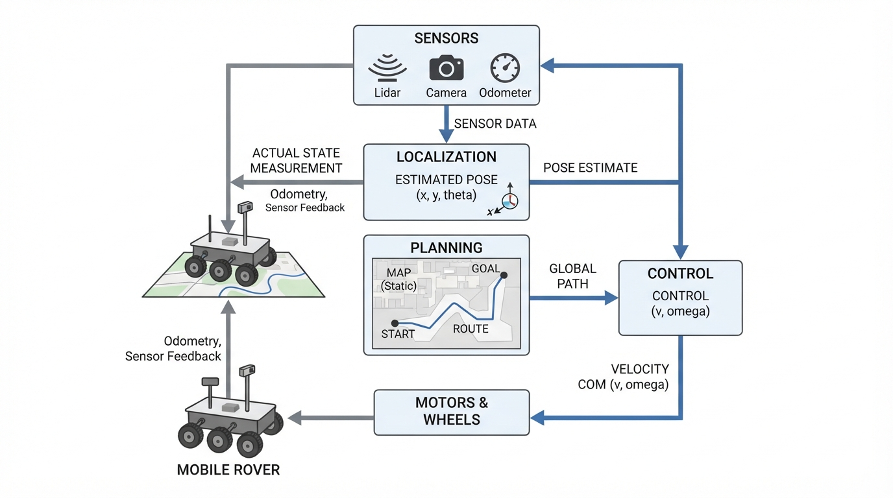
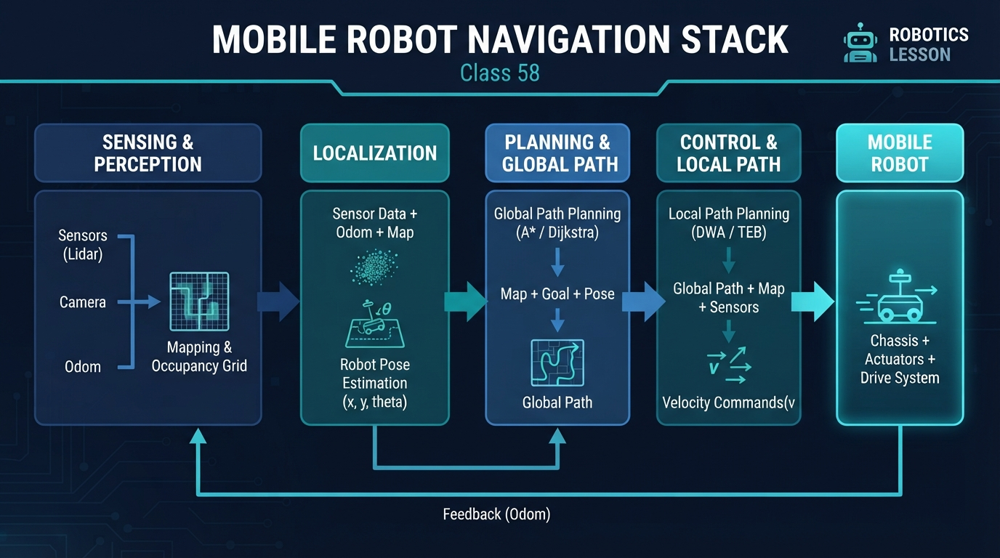
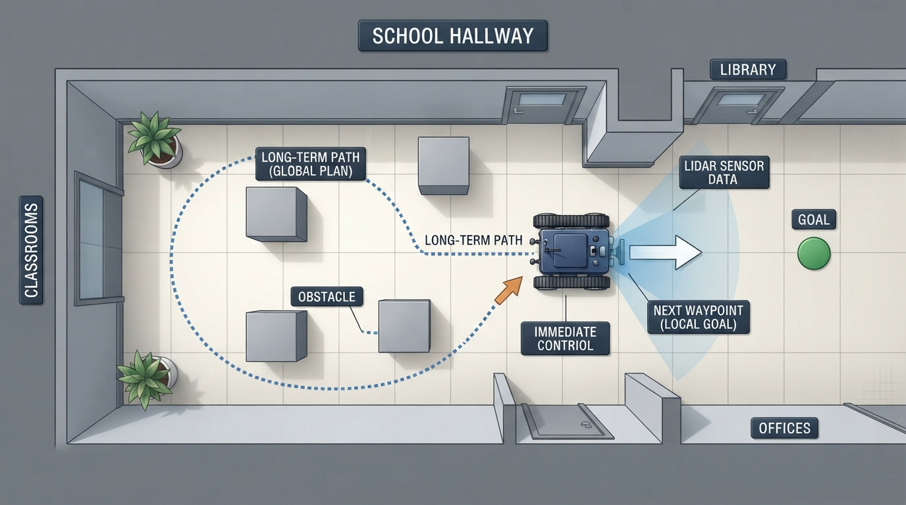
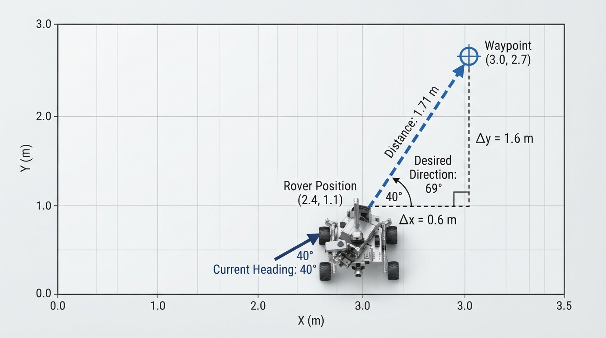
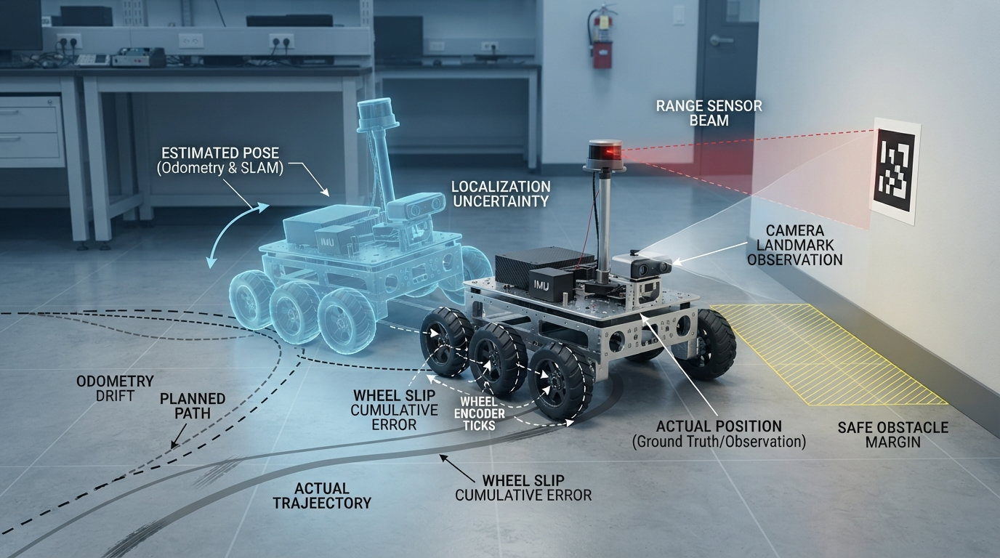

# Class 58: Mobile Robot Navigation Stack

## Where We Are in the Robotics Journey

RoboRover has now travelled with us from the previous class on **Autonomous Drones** to wheeled-robot navigation. A drone and a wheeled rover move differently, but both must answer three fundamental questions:

1. **Where am I?** — localization  
2. **Where should I go?** — planning  
3. **How do I move there safely and accurately?** — control  

Today we apply those questions to a mobile robot traveling across a mapped floor. In the next class, **Robotics Safety and Failure Modes**, we will study what happens when one part of this navigation process becomes wrong, delayed, noisy, or unavailable.

## Today We Will Learn

By the end of this class, you should be able to:

- describe a mobile robot navigation stack;
- distinguish localization, planning, and control;
- explain how information flows between these layers;
- calculate a simple distance, desired heading, and steering command;
- understand why navigation is a repeated feedback process rather than a single decision;
- run a small Python simulation that plans a grid route and executes it one cell at a time;
- identify practical failures caused by bad maps, inaccurate localization, blocked paths, and delayed commands.

## 2-Minute Recap

In the drone class, RoboRover’s flying cousin used sensors and software to estimate its position and choose motion commands. A drone may control thrust and attitude in three dimensions. A wheeled rover usually moves across a surface, but the logic is similar.

A **sensor measurement** is an observation, such as wheel rotation, a camera landmark, or a laser range reading.

A **state estimate** is the robot’s best current description of itself. For a flat-floor rover, this often includes:

- \(x\): position east-west, in metres;
- \(y\): position north-south, in metres;
- \(\theta\): heading angle, in radians or degrees.

The robot’s state is not always known perfectly. Wheel slip, sensor noise, and delayed measurements create uncertainty.

A **command** is an instruction sent to the actuators, such as a left-wheel speed and a right-wheel speed.

## The Big Idea




**Figure:** The navigation stack is a feedback loop: sensing updates the estimate, planning chooses the route, and control commands immediate motion.

A navigation stack is like a small team passing a delivery task between specialists:

- **Localization** says, “RoboRover is probably here.”
- **Planning** says, “From here, this route leads to the goal.”
- **Control** says, “To follow the next part of that route, turn slightly left and drive at this speed.”

The process repeats:

```text
Sensors
   ↓
Localization: estimate current pose
   ↓
Planning: choose route or next waypoint
   ↓
Control: calculate motion command
   ↓
Motors and wheels
   ↓
Robot moves and senses again
```

This is not usually a one-time pipeline. It is a loop. After RoboRover moves, its estimated position changes. The planner may reconsider the route. The controller compares the desired motion with the measured motion and corrects the command.

A useful distinction is:

- **Localization** estimates the present state.
- **Planning** chooses a future route.
- **Control** produces immediate actuator commands.

These functions are often implemented as separate software modules, but real systems are not universally organized into exactly three blocks. Some systems combine functions, split them into more components, or run several loops at different rates.

**Text equivalent of the navigation-stack diagram:** Sensor measurements enter localization, which estimates the robot’s pose. The estimate and map enter planning, which selects a route or waypoint. Control uses the desired motion and current estimate to produce actuator commands. The robot moves, produces new sensor measurements, and the cycle repeats.

## See It in Your Head

### AI-Generated Engineering Visual · Professor OS



**How to read this visual:** Trace the signal or idea from left to right. Match each block to the lesson explanation, then predict what would change if one block produced a wrong value.




**Figure:** The long dotted route is the planner’s output; the short orange arrow represents the controller’s immediate motion target.

Imagine a top-down drawing of a school hallway.

- Draw walls as thick gray rectangles.
- Draw RoboRover as a small blue circle with an arrow showing its heading.
- Draw a green star at the delivery station.
- Draw a dotted blue route around the walls.
- Draw a short orange arrow from RoboRover toward the next waypoint.
- Draw a sensor fan or small landmark symbols around the rover.
- Add three labeled boxes beside the map: **Estimate**, **Plan**, and **Act**.

The dotted route is not the same as the orange motion arrow. The route may extend several metres into the future, while the control command usually concerns the robot’s immediate motion.

That difference is important. Planning might say, “Reach the far doorway.” Control might say, “For the next 0.1 seconds, rotate at this rate and drive forward at this speed.”

## Core Concept

### 1. Localization: “Where am I?”

Localization combines observations and motion information to estimate the robot’s pose.

For example, RoboRover may use:

- wheel encoders, which measure wheel rotation;
- a camera, which recognizes visual landmarks;
- a laser scanner, which measures distances to walls;
- an inertial sensor, which measures acceleration and rotation.

Each source has weaknesses. Wheel encoders can drift when wheels slip. A camera may fail in darkness. A laser scanner may see a person or box that was not in the original map.

Localization therefore produces an estimate, not magical certainty.

A map-based rover might report:

\[
\hat{\mathbf{p}} = (x, y, \theta)
\]

where:

- \(\hat{\mathbf{p}}\) is the estimated pose;
- \(x\) is horizontal position in metres;
- \(y\) is vertical position in metres;
- \(\theta\) is heading angle in radians.

The hat symbol means “estimated.”

### 2. Planning: “Where should I go?”

A planner uses a map, a start estimate, and a goal to choose a route.

For an introductory grid map, the floor is divided into square cells. A free cell can be crossed; an occupied cell cannot.

A planner might produce:

```text
start → cell A → cell B → cell C → goal
```

More advanced navigation stacks commonly contain both **global planning**, which selects a route through a larger map, and **local planning or obstacle avoidance**, which selects safe short-term motion as new obstacles and constraints are observed. These functions may be separate or combined, depending on the system.

A plan is not a command sequence carved in stone. If a chair blocks the route, localization and sensing may reveal that the world has changed. The planner can then create a new route.

### 3. Control: “How do I move now?”

The controller compares the desired motion with the current estimated motion and sends commands to the motors.

For a wheeled rover, commands might be:

- forward speed \(v\), in metres per second;
- turning rate \(\omega\), in radians per second.

The controller may aim toward the next waypoint, slow down near the goal, or stop when an obstacle is too close.

Control is where the plan meets physical reality. Motors have limits. Wheels may skid. Commands may arrive late. The rover cannot instantly rotate to any angle or move sideways like a chess piece.

## Math Without Fear




**Figure:** The controller turns position error into a distance and desired heading before producing a motion command.

Suppose RoboRover’s estimated position is:

\[
(x, y) = (2.4\text{ m}, 1.1\text{ m})
\]

and the next waypoint is:

\[
(x_w, y_w) = (3.0\text{ m}, 2.7\text{ m})
\]

The horizontal and vertical differences are:

\[
\Delta x = x_w - x = 3.0\text{ m} - 2.4\text{ m} = 0.6\text{ m}
\]

\[
\Delta y = y_w - y = 2.7\text{ m} - 1.1\text{ m} = 1.6\text{ m}
\]

The straight-line distance to the waypoint is:

\[
d = \sqrt{(\Delta x)^2 + (\Delta y)^2}
\]

where:

- \(d\) is distance in metres;
- \(\Delta x\) and \(\Delta y\) are position differences in metres.

So:

\[
d = \sqrt{(0.6\text{ m})^2 + (1.6\text{ m})^2}
= \sqrt{2.92\text{ m}^2}
\approx 1.71\text{ m}
\]

The desired heading is calculated using:

\[
\theta_{\text{desired}} = \operatorname{atan2}(\Delta y,\Delta x)
\]

Here:

\[
\theta_{\text{desired}} = \operatorname{atan2}(1.6,0.6)
\approx 69.44^\circ
\]

Suppose RoboRover is currently facing \(40.00^\circ\). The raw heading difference is:

\[
e_{\theta,\text{raw}} = 69.44^\circ - 40.00^\circ = 29.44^\circ
\]

For a general controller, heading error must be normalized to the shortest angular difference. One common wrapping rule is:

\[
e_\theta =
\left((e_{\theta,\text{raw}} + 180^\circ)\bmod 360^\circ\right)-180^\circ
\]

This produces an error in the interval \([-180^\circ,180^\circ)\). In this example, the raw difference is already in that interval, so:

\[
e_\theta = 29.44^\circ
\]

For example, if the desired heading were \(179^\circ\) and the current heading were \(-179^\circ\), direct subtraction would give \(358^\circ\), even though the shortest turn is \(-2^\circ\). Angle wrapping prevents that incorrect large command.

A controller commonly uses radians for turning calculations:

\[
29.44^\circ \times \frac{\pi\text{ rad}}{180^\circ}
\approx 0.514\text{ rad}
\]

For an illustrative proportional steering rule:

\[
\omega = k e_\theta
\]

where:

- \(\omega\) is the commanded turning rate in radians per second;
- \(k\) is a controller gain in inverse seconds;
- \(e_\theta\) is the **wrapped** heading error in radians.

If \(k=1.5\text{ s}^{-1}\):

\[
\omega = (1.5\text{ s}^{-1})(0.514\text{ rad})
\approx 0.771\text{ rad/s}
\]

Interpretation: RoboRover is about \(1.71\text{ m}\) from the waypoint and should turn in the direction of the positive heading error. This is only an illustrative command. A real controller would also consider speed limits, acceleration, wheel geometry, nearby obstacles, and sensor uncertainty.

## Worked Robotics Example

RoboRover must carry a small package from a charging station to a colored floor marker.

Its navigation stack works as follows:

1. **Localization:** Wheel encoders estimate that the rover moved \(0.8\text{ m}\). A camera observes a known wall marker and corrects the sideways position estimate.
2. **Planning:** The map shows a storage box directly ahead. The planner chooses a route around the left side.
3. **Control:** The next waypoint is the corner before the box. The controller turns toward that waypoint while limiting forward speed.
4. **Replanning:** A person places another box in the planned corridor. The range sensor detects it. The planner receives an updated obstacle map and chooses a different route.
5. **Goal approach:** Near the delivery marker, the controller reduces speed so that braking and final alignment are more accurate.

Notice the separation:

- The camera observation helps localization.
- The obstacle map affects planning.
- The steering and speed command belongs to control.

A common engineering mistake is to treat “the robot saw something” as equivalent to “the robot knows exactly where it is.” Sensing, localization, planning, and control are connected but not interchangeable.

## Python Lab

This program creates a small grid map, uses breadth-first search to find a route, and then simulates a simple controller that moves RoboRover from one cell to the next.

The grid planner is intentionally basic:

- `#` means blocked;
- `.` means free;
- `S` is the start;
- `G` is the goal.

The simulated localization is idealized: after each move, a landmark measurement tells the robot its exact cell. Real localization is noisier, but this clean version makes the stack visible.

```python
from collections import deque

WIDTH = 8
HEIGHT = 6
START = (0, 0)
GOAL = (7, 5)

OBSTACLES = {
    (2, 0), (2, 1), (2, 2),
    (4, 2), (5, 2), (6, 2),
    (6, 3),
    (1, 4), (2, 4), (3, 4)
}

def neighbors(cell):
    x, y = cell
    candidates = [
        (x + 1, y),
        (x - 1, y),
        (x, y + 1),
        (x, y - 1)
    ]

    result = []
    for nx, ny in candidates:
        inside = 0 <= nx < WIDTH and 0 <= ny < HEIGHT
        if inside and (nx, ny) not in OBSTACLES:
            result.append((nx, ny))
    return result

def shortest_path(start, goal):
    queue = deque([start])
    previous = {start: None}

    while queue:
        current = queue.popleft()

        if current == goal:
            break

        for next_cell in neighbors(current):
            if next_cell not in previous:
                previous[next_cell] = current
                queue.append(next_cell)

    if goal not in previous:
        return []

    path = []
    current = goal
    while current is not None:
        path.append(current)
        current = previous[current]

    path.reverse()
    return path

def draw_map(path, robot_cell):
    path_set = set(path)

    for y in range(HEIGHT - 1, -1, -1):
        row = []
        for x in range(WIDTH):
            cell = (x, y)

            if cell == robot_cell:
                row.append("R")
            elif cell == START:
                row.append("S")
            elif cell == GOAL:
                row.append("G")
            elif cell in OBSTACLES:
                row.append("#")
            elif cell in path_set:
                row.append("*")
            else:
                row.append(".")
        print(" ".join(row))
    print()

def main():
    path = shortest_path(START, GOAL)

    if not path:
        print("No route found.")
        return

    assert path[0] == START
    assert path[-1] == GOAL
    assert all(cell not in OBSTACLES for cell in path)

    print("Planned route:")
    print(path)
    print("Number of moves:", len(path) - 1)
    print()

    estimated_cell = START
    draw_map(path, estimated_cell)

    for target_cell in path[1:]:
        # This tuple is a symbolic one-cell grid displacement:
        # (dx, dy). It is not a velocity, wheel-speed, or
        # curvature command. This simulation does not model
        # heading or nonholonomic motion constraints.
        control_command = (
            target_cell[0] - estimated_cell[0],
            target_cell[1] - estimated_cell[1]
        )

        print(
            "Control command:",
            control_command,
            "toward",
            target_cell
        )

        # Simulated motion: the command succeeds by one grid cell.
        estimated_cell = target_cell

        # Simulated localization update from a landmark measurement.
        measured_cell = estimated_cell
        estimated_cell = measured_cell

        draw_map(path, estimated_cell)

    assert estimated_cell == GOAL
    print("Verification: RoboRover reached the goal cell.")

if __name__ == "__main__":
    main()
```

Important lines:

- `previous = {start: None}` remembers how each cell was reached.
- `shortest_path` is the planning layer.
- `control_command` is a symbolic one-cell grid displacement, not a physical actuator command such as velocity, wheel speed, or curvature.
- This simulation does not model heading, wheel geometry, turning radius, or nonholonomic constraints.
- `measured_cell = estimated_cell` represents a perfect simulated localization update.
- The `assert` statements verify that the route begins at the start, ends at the goal, avoids obstacles, and finishes at the goal.
- The empty-path check demonstrates graceful handling when no route exists.

This program is not a complete physical robot controller. Its purpose is to make the three-layer structure visible.

## Mini Simulation or Game

Change one part of the program and observe how the stack reacts.

First, predict:

> If you add the obstacle `(5, 3)` to `OBSTACLES`, will RoboRover still reach the goal? Will it use the same route?

Run the program after making the change.

Then try:

1. Add several obstacles near the bottom edge.
2. Remove one obstacle from the vertical wall at \(x=2\).
3. Set `GOAL = (7, 0)`.
4. Temporarily surround the goal with obstacles.

The planner may find a different route or return an empty path. The published baseline handles an empty path by printing `"No route found."` and returning safely. As an experiment, you can temporarily remove that safeguard and observe why indexing `path[0]` is unsafe when the planner returns an empty list. “No route found” should be treated as an expected operating condition, not as an impossible event.

## What Should Happen?

Before running the program, predict these observations:

- The route should avoid every `#` cell.
- The rover should begin at `S`.
- Each control command should move to a neighboring cell.
- The rover should eventually appear at `G`.
- If the goal is unreachable, the program should print `No route found.` and return without indexing an empty path.
- The final verification message should print only after the robot reaches the goal.

The exact route depends on the obstacle arrangement and the neighbor order in the program. The program itself prints and verifies the actual result rather than relying on a guessed route.

## Common Mistakes

### Confusing localization with planning

Knowing that RoboRover is at \((3,2)\) does not tell it where to go. Localization describes the present. Planning chooses a future route.

### Treating a plan as guaranteed motion

A planned path assumes that the map and robot motion are sufficiently accurate. A wheel can slip, a box can move, or a command can be delayed.

### Ignoring robot size

A grid cell may look open on a map, but a real rover has width. Its body may collide with a wall even when its centerline fits through a narrow gap.

### Using stale localization

If the estimated pose is several seconds old, the controller may steer toward where the robot used to be. Latency can be dangerous near obstacles.

### Assuming perfect sensors

A measurement can be noisy, ambiguous, or wrong. Robust navigation checks whether observations are consistent with the map and with recent motion.

### Forgetting unreachable goals

A planner must be able to report “no route.” A robot that repeatedly tries an impossible plan is not behaving intelligently; it is failing to manage an ordinary operating condition.

### Forgetting to wrap heading error

Directly subtracting two headings can produce a large error near the \(-180^\circ/180^\circ\) boundary. A controller should use the shortest angular difference before applying a steering rule.

## Try It Yourself

**Challenge:** Modify the program so that the simulated controller counts how many moves it has executed and stops if the count exceeds a chosen safety limit.

Your program should:

- preserve the planning function;
- add a `move_count` variable;
- stop with a warning if the limit is exceeded;
- still verify successful arrival when the goal is reached.

**Optional extension:** Simulate a blocked motion. On one chosen step, make the robot refuse to move. Then have it print a failure message instead of pretending localization has confirmed success. This separates a command from the physical result of that command.

## Quick Quiz

1. What question does localization answer?

2. Which layer chooses a route around an obstacle?

3. Why does a mobile robot need control if a planner has already produced a path?

4. A range sensor detects a new box in the corridor. Which navigation layer must usually reconsider the route?

5. Why should a controller normalize heading error before using a proportional steering rule?

## Answers

1. Localization estimates the robot’s current state or pose, such as position and heading.

2. Planning chooses a route or sequence of waypoints.

3. Control converts the planned motion into immediate actuator commands and corrects for real motion, heading error, limits, and disturbances.

4. Planning must usually reconsider the route, using updated information from sensing and localization.

5. Normalization converts the difference into the shortest angular error, preventing an unnecessarily large or incorrectly directed turn near the angle wraparound boundary.

## Real Robot Connection




**Figure:** Wheel slip can make the estimated pose differ from the rover’s true pose, so real navigation needs cross-checking and safety margins.

A real navigation system may run several loops at different rates:

- localization may update whenever sensor data arrives;
- planning may run when the goal or obstacle map changes;
- low-level motor control may run many times per second.

These loops communicate through estimates, maps, waypoints, and commands. Timing matters. If planning assumes a pose from the past while control acts on a newer pose, the rover may behave poorly.

A practical failure example is wheel slip on a polished floor. The encoders report that the wheels rotated enough to move \(1.0\text{ m}\), but the chassis actually moved only \(0.7\text{ m}\). Localization based only on wheel motion is now wrong by \(0.3\text{ m}\). The planner may still believe the rover is safely centered in a corridor, while the physical body is closer to a wall.

Good engineering therefore includes:

- calibration;
- sensor cross-checking;
- speed limits;
- obstacle margins;
- stopping conditions;
- recovery behavior when localization becomes uncertain;
- testing with blocked routes and delayed measurements.

In the next class, we will examine these failures systematically. We will ask what happens when sensors lie, actuators saturate, communication stops, or a robot continues acting after its assumptions are no longer valid.

## Vocabulary

- **Navigation stack:** The connected software and control layers that estimate state, choose routes, and command robot motion.
- **Localization:** Estimating a robot’s current position and orientation from sensors and motion information.
- **Pose:** Position and orientation together. For a flat-floor rover, this may be \(x\), \(y\), and heading \(\theta\).
- **Planning:** Selecting a route, trajectory, or next waypoint that moves the robot toward a goal while respecting known constraints.
- **Control:** Computing immediate actuator commands so the robot follows desired motion.
- **Waypoint:** An intermediate target position used to guide motion along a larger route.
- **Map:** A representation of the environment, including usable space and obstacles.
- **Obstacle:** Something the robot should not collide with or enter.
- **Feedback loop:** A process in which measurements of the robot or environment influence later commands.
- **Wheel slip:** Motion in which a wheel rotates without producing the expected movement of the robot chassis.
- **Latency:** A delay between sensing, computation, command transmission, and physical response.
- **Replanning:** Creating a new route after the environment, goal, or state estimate changes.
- **Angle wrapping:** Converting an angular difference to an equivalent shortest difference, commonly in the interval \([-180^\circ,180^\circ)\). For example, \(179^\circ-(-179^\circ)=358^\circ\) as a raw subtraction, but the shortest angular difference is \(-2^\circ\).

## Further Learning

To deepen this class, investigate these topics in order:

1. coordinate frames and angle wrapping;
2. differential-drive kinematics;
3. occupancy-grid maps;
4. waypoint following with speed and turn limits;
5. localization uncertainty;
6. sensor fusion;
7. trajectory planning for robots with nonzero size and turning constraints.

These topics build naturally on today’s separation between localization, planning, and control.

## Next Class

**Class 59: Robotics Safety and Failure Modes**

We will study how navigation systems fail in practice:

- incorrect localization;
- blocked or outdated maps;
- sensor dropout;
- motor saturation;
- communication delay;
- unsafe recovery behavior;
- failure detection and stopping.

The navigation stack tells RoboRover how to move. The next class asks when it should refuse to move, slow down, request help, or stop.
