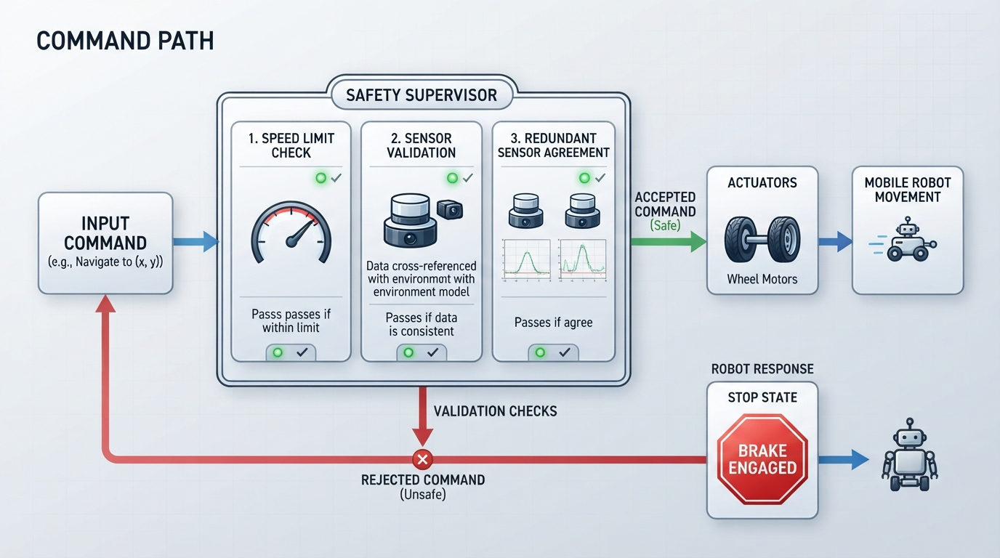
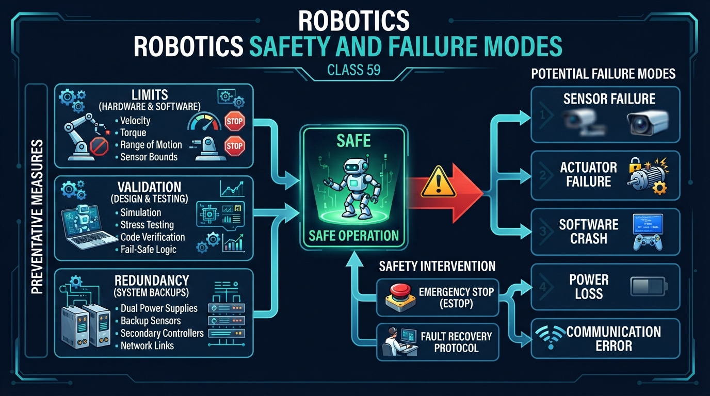
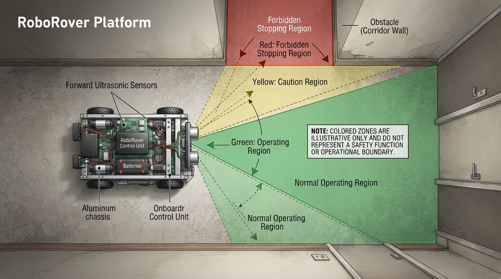
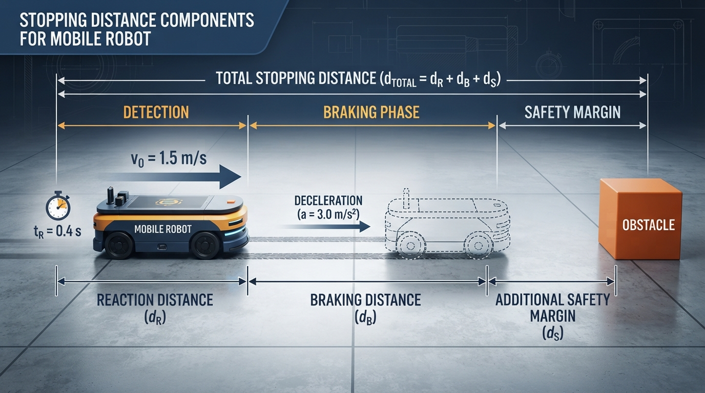
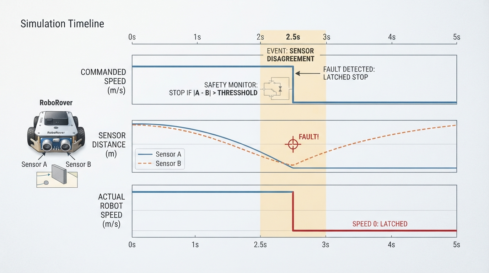

# Class 59: Robotics Safety and Failure Modes

## Where We Are in the Robotics Journey

RoboRover has learned the mobile-robot navigation stack:

```text
Sensors → Measurements → State estimate → Planner → Motion command
        → Motor controller → Wheels
```

That stack can produce useful motion without guaranteeing safe motion. A planner may request too much speed for a narrow corridor. A sensor may return an impossible value. A communication failure may leave a motor controller holding its last command.

This class adds an introductory safety-monitoring layer around normal robot behavior. We will study:

1. **Limits** that keep commands and conditions within permitted ranges.
2. **Validation** that checks whether data and commands are believable and usable.
3. **Redundancy** that provides additional evidence when one component may be wrong.

This lesson presents a teaching model, not a complete functional-safety design, hazard analysis, or certification method. Real systems require a defined operating context, hazard analysis, validated protective measures, testing, and appropriate engineering standards. A software limit is not automatically an independent protective measure; duplicated components are not necessarily independent; and stopping is not automatically the safest response in every environment.

## Today We Will Learn

By the end of this class, you should be able to:

- distinguish normal operating limits, protective limits, and validation checks;
- explain why sensor readings and commands require validation;
- describe the benefits and limitations of redundancy;
- estimate a simple stopping-distance requirement;
- identify failure modes involving delay, stale data, saturation, drift, and hardware faults;
- select a context-appropriate response to a fault;
- specify evidence required before a latched stop may be reset;
- simulate RoboRover’s safety monitor in Python.

## 2-Minute Recap

Every navigation stage relies on assumptions:

- sensors can measure the environment;
- measurements are recent and plausible;
- the state estimate represents reality well enough;
- the planner receives useful information;
- the motor controller receives valid commands;
- the mechanical system can tolerate the requested motion.

A safety system asks a separate question:

> Even if normal navigation requests this action, is it safe to allow?

A simple architecture is:

```text
Normal command ──→ Safety checks ──→ Allowed command ──→ Actuators
                         │
                         └──────────→ Slow, stop, or report a fault
```

The safety layer should be designed with the robot rather than added after autonomy is complete.

## The Big Idea




**Figure:** The safety layer checks normal navigation commands before allowing them to reach the actuators.

Suppose RoboRover is carrying a hot cup through a laboratory. Its navigation software requests \(0.8\ \text{m/s}\). That may be acceptable on an empty test track but inappropriate near a person, wall, or slippery surface.

A safety monitor might:

- **limit:** reject or reduce speeds above \(0.6\ \text{m/s}\);
- **validate:** reject a distance of 80 m when the sensor’s useful range is 5 m;
- **use redundancy:** respond cautiously when two distance sensors disagree.

It helps to separate three ideas that are often confused:

- A **normal operating limit** keeps routine commands within the robot’s intended envelope, such as limiting speed to \(0.6\ \text{m/s}\).
- A **protective limit** is part of a defined response to a hazard, such as commanding a stop when a validated obstacle is too close.
- A **validation check** asks whether an input is trustworthy enough to use, such as checking freshness, numerical validity, or sensor agreement.

All three may use thresholds, but they answer different engineering questions. A threshold in software does not automatically become a validated protective function.

A fail-safe response means transitioning to a **predetermined, context-appropriate safe state** after a fault. For this small rover, that state may be a controlled stop. Another robot might need controlled braking, a mechanical brake, or a designated safe motion instead. The correct response depends on dynamics, payload, stored energy, terrain, and nearby hazards.

## See It in Your Head

### AI-Generated Engineering Visual · Professor OS



**How to read this visual:** Trace the signal or idea from left to right. Match each block to the lesson explanation, then predict what would change if one block produced a wrong value.




**Figure:** Illustrative color zones make abstract limits visible; they are not a safety function or operational boundary.

Picture RoboRover from above:

- a rectangular body;
- two powered wheels;
- two forward distance sensors;
- a red emergency-stop button;
- a computer running navigation software.

Use three colored regions to visualize operating logic:

1. **Green:** normal values and motion.
2. **Yellow:** caution, reduced speed, or additional checking.
3. **Red:** a validated fault response, such as stopping in this example.

```text
0.0 m/s ───────── 0.6 m/s ───────── 0.9 m/s
normal range      maximum allowed    rejected range
```

The numbers are teaching parameters, not universal safety limits. Floor color in a diagram is also only an illustration. It is **not a safety function or an operational boundary**; a real boundary must be supported by validated sensing, control logic, and protective hardware.

If both forward sensors report approximately 1.8 m, their agreement increases confidence. If one reports 1.8 m and the other 0.2 m, the robot should not simply select the convenient value.

## Core Concept

### 1. Limits

A **limit** defines a boundary that a value or condition must not cross. Examples include:

- maximum speed, current, acceleration, or steering angle;
- minimum obstacle distance;
- maximum temperature;
- maximum time since a valid sensor update.

A **hard limit** requires a specified protective response. Depending on the hazard, that response may be rejecting a command, controlled deceleration, clipping a command, or activating an independent protective function. These responses are not interchangeable.

A **soft limit** is a caution boundary. Crossing it may trigger reduced speed, a warning, or additional checking.

Limits can protect people, the robot, its electronics, or the quality of its behavior. A software speed limit alone may fail if another process, communication path, or damaged controller bypasses it. Where consequences justify the complexity, independent hardware protection may be needed.

### 2. Validation

**Validation** checks whether a measurement or command is plausible and acceptable before it is used.

A distance reading can be checked for:

- **range:** is it within the sensor’s useful limits?
- **timing:** is it recent?
- **rate of change:** did it change plausibly?
- **agreement:** does it reasonably match another measurement?
- **numerical validity:** is it finite rather than NaN or infinity?
- **context:** does it make sense given the robot’s surroundings?

A reading of 1.2 m may be numerically valid but unusable if it is three seconds old while the robot is moving quickly.

Validation does not justify inventing a replacement value and treating it as certain. A failed check may instead require slowing, stopping, or entering a defined fallback mode.

### 3. Redundancy

**Redundancy** uses additional components, measurements, or reasoning paths to detect or tolerate failures. Examples include:

- two distance sensors;
- wheel speed plus an independent motion sensor;
- a navigation computer plus a simpler protective circuit;
- separate software checks for command limits.

Redundancy is strongest when the failure modes are different. Identical sensors beside each other may both fail because of dust, glare, fog, a shared power supply, or a common software defect. This is a **common-cause failure**.

The two sensors in this lesson provide useful measurement redundancy for simulation and fault detection. They do not, by themselves, create a safety-rated architecture.

### Compact comparison

| Mechanism | Main question | Typical response |
|---|---|---|
| Operating limit | Is routine behavior within the intended envelope? | Clip, reject, warn, or reduce performance |
| Protective limit | Has a hazardous condition crossed a defined boundary? | Trigger the specified protective response |
| Validation | Is this value finite, timely, plausible, and usable? | Accept, flag, slow, or enter a defined safe state |
| Redundancy | Do independent checks support the same conclusion? | Continue, reduce speed, or respond to disagreement |

## Math Without Fear

After detecting a hazard, a moving robot needs distance to react and brake:

\[
d_{\text{travel}} = vt_r + \frac{v^2}{2a_b}
\]

where:

- \(v\) is speed in m/s;
- \(t_r\) is the time from hazard detection to the beginning of braking;
- \(a_b\) is braking deceleration magnitude in m/s².

Here, \(t_r\) includes processing, communication, and actuator-response delay after the safety decision has the hazard information. Sensor exposure or measurement latency must either be included in the detection delay or represented by another margin, but not counted twice.

This introductory equation assumes forward motion, a stationary hazard, a level surface, approximately constant speed during reaction, constant braking deceleration, and no slipping.

Geometry also matters. Let:

- \(d_s\) be sensor-to-hazard distance;
- \(g\) be the sensor’s forward offset from the nearest hazardous robot surface;
- \(u_s\) be an uncertainty allowance;
- \(c\) be required residual clearance.

Then:

\[
d_{\text{sensor,min}} =
d_{\text{travel}} + u_s + c - g
\]

If \(g>0\), the sensor is ahead of the hazardous surface, so the required sensor distance is smaller. If the sensor is behind it, \(g<0\), and the required distance increases.

Every term is a distance in meters:

- \(vt_r\) has units of meters;
- \(v^2/(2a_b)\) has units of meters;
- \(u_s\), \(c\), and \(g\) are distances.

The equation is an estimate. Real designs must measure braking, latency, uncertainty, geometry, and surface effects.

## Worked Robotics Example




**Figure:** The required stopping distance combines motion during reaction time, braking distance, and a safety margin.

Assume RoboRover travels indoors at:

- \(v=0.80\ \text{m/s}\);
- \(t_r=0.15\ \text{s}\);
- \(a_b=1.20\ \text{m/s}^2\);
- \(u_s=0.15\ \text{m}\);
- \(c=0.10\ \text{m}\);
- \(g=0.10\ \text{m}\).

Reaction distance:

\[
d_r=vt_r=(0.80)(0.15)=0.12\ \text{m}
\]

Braking distance:

\[
d_b=\frac{v^2}{2a_b}
=\frac{0.80^2}{2(1.20)}
\approx0.267\ \text{m}
\]

Travel after detection:

\[
d_{\text{travel}}=0.12+0.267\approx0.387\ \text{m}
\]

Required sensor distance:

\[
d_{\text{sensor,min}}
=0.387+0.15+0.10-0.10
\approx0.537\ \text{m}
\]

Under these assumptions, the sensor should report approximately **0.54 m or more** from the relevant hazardous surface when the safety response begins. The nearest hazardous robot surface travels approximately **0.39 m** during reaction and braking.

These are illustrative assumptions, not validated safety limits. Wet flooring, increased latency, a different sensor location, or lower braking performance would change the result.

## Python Lab




**Figure:** The simulated safety monitor clips excessive speed, detects sensor disagreement, and keeps RoboRover stopped after the fault.

First identify the example hazard, initiating failure, possible consequence, intended safe state, and reset evidence. This is a small teaching exercise, not a complete hazard analysis.

The program below:

- limits speed to \(0.60\ \text{m/s}\) and reports saturation;
- rejects invalid, stale, or out-of-range sensor data;
- rejects invalid commands, timestamps, and safety parameters;
- detects sensor disagreement above \(0.15\ \text{m}\);
- latches a stop when the fault occurs;
- rejects NaN and infinity explicitly.

The \(0.80\ \text{m}\) obstacle threshold is intentionally conservative relative to the worked \(0.54\ \text{m}\) estimate, but it is **not a validated safety limit**. It is only a simplified lab parameter.

The code compares `obstacle_limit` with the **average sensor distance only after the two readings pass the agreement check**. This simplified policy does not account for robot geometry, sensor offset, uncertainty, field of view, or braking distance.

The distance calculation in the simulation assumes instantaneous tracking of each allowed speed during a time step. It is an **idealized commanded-distance integration**, not a physical stopping simulation: it does not model acceleration, deceleration, actuator response, wheel slip, or the stopping-distance equation above. Therefore, the reported distance must not be used as a safety calculation.

| Step | Command | Sensor readings | Expected allowed speed | Expected reason | Latch |
|---:|---:|---:|---:|---|---|
| 0 | 0.40 | 2.00, 2.05 m | 0.40 m/s | accepted | False |
| 1 | 0.50 | 1.95, 1.98 m | 0.50 m/s | accepted | False |
| 2 | 0.70 | 1.90, 1.88 m | 0.60 m/s | speed limited | False |
| 3 | 0.80 | 1.20, 0.79 m | 0.00 m/s | sensor disagreement | True |
| 4–7 | varied | valid readings | 0.00 m/s | latched stop | True |

Predict the fault step and idealized commanded distance. Each time step lasts \(0.10\ \text{s}\).

```python
# Python 3.7-compatible RoboRover safety monitor simulation

import math


def safety_monitor(speed_command, sensor_a, sensor_b, sensor_time,
                   current_time, maximum_sensor_age, obstacle_limit,
                   maximum_speed, disagreement_limit, stop_latched):
    """Return (allowed_speed, new_latch, reason)."""

    values = (
        speed_command, sensor_a, sensor_b, sensor_time, current_time,
        maximum_sensor_age, obstacle_limit, maximum_speed,
        disagreement_limit
    )
    if not all(math.isfinite(value) for value in values):
        return 0.0, True, "non-finite value"

    if (maximum_sensor_age < 0.0 or obstacle_limit < 0.0 or
            maximum_speed < 0.0 or disagreement_limit < 0.0):
        return 0.0, True, "invalid safety parameter"

    if stop_latched:
        return 0.0, True, "latched stop"

    if speed_command < 0.0:
        return 0.0, True, "negative command rejected"

    allowed_speed = min(speed_command, maximum_speed)
    reason = "accepted"
    if allowed_speed < speed_command:
        reason = "speed limited"

    sensor_age = current_time - sensor_time
    if sensor_age < 0.0 or sensor_age > maximum_sensor_age:
        return 0.0, True, "stale sensor data"

    if sensor_a < 0.10 or sensor_b < 0.10:
        return 0.0, True, "sensor below valid range"

    if sensor_a > 5.0 or sensor_b > 5.0:
        return 0.0, True, "sensor above valid range"

    # Check disagreement before averaging.
    if abs(sensor_a - sensor_b) > disagreement_limit:
        return 0.0, True, "sensor disagreement"

    # The obstacle check uses the average only after agreement passes.
    # This simplified check ignores robot geometry, sensor offset,
    # uncertainty, and braking distance.
    average_distance = (sensor_a + sensor_b) / 2.0
    if average_distance < obstacle_limit:
        return 0.0, True, "obstacle too close"

    return allowed_speed, False, reason


def main():
    time_step = 0.10
    maximum_sensor_age = 0.15
    obstacle_limit = 0.80
    maximum_speed = 0.60
    disagreement_limit = 0.15

    commands = [0.40, 0.50, 0.70, 0.80, 0.60, 0.40, 0.30, 0.00]
    sensor_a = [2.00, 1.95, 1.90, 1.20, 1.10, 1.00, 0.95, 0.90]
    sensor_b = [2.05, 1.98, 1.88, 0.79, 1.12, 1.02, 0.97, 0.91]
    sensor_times = [0.00, 0.10, 0.20, 0.30, 0.40, 0.50, 0.60, 0.70]

    stop_latched = False
    idealized_commanded_distance = 0.0
    speeds = []
    reasons = []

    for step in range(len(commands)):
        current_time = step * time_step
        allowed, stop_latched, reason = safety_monitor(
            commands[step], sensor_a[step], sensor_b[step],
            sensor_times[step], current_time, maximum_sensor_age,
            obstacle_limit, maximum_speed, disagreement_limit,
            stop_latched
        )

        # Teaching-model integration: commanded speed x time step.
        # This is not measured travel or a stopping-distance calculation.
        idealized_commanded_distance += allowed * time_step
        speeds.append(allowed)
        reasons.append(reason)

        print("step={0}, command={1:.2f}, allowed={2:.2f}, reason={3}".format(
            step, commands[step], allowed, reason
        ))

    print("idealized commanded distance={0:.2f} m".format(
        idealized_commanded_distance
    ))

    assert speeds == [0.40, 0.50, 0.60, 0.00,
                      0.00, 0.00, 0.00, 0.00]
    assert reasons[2] == "speed limited"
    assert reasons[3] == "sensor disagreement"
    assert stop_latched is True
    assert abs(idealized_commanded_distance - 0.15) < 1e-9

    nan_result = safety_monitor(
        0.40, float("nan"), 1.00, 0.00, 0.00,
        maximum_sensor_age, obstacle_limit, maximum_speed,
        disagreement_limit, False
    )
    infinity_result = safety_monitor(
        0.40, 1.00, 1.00, 0.00, float("inf"),
        maximum_sensor_age, obstacle_limit, maximum_speed,
        disagreement_limit, False
    )
    assert nan_result == (0.0, True, "non-finite value")
    assert infinity_result == (0.0, True, "non-finite value")

    # Additional executable checks for negative commands and stale data.
    negative_result = safety_monitor(
        -0.10, 1.00, 1.00, 0.00, 0.00,
        maximum_sensor_age, obstacle_limit, maximum_speed,
        disagreement_limit, False
    )
    stale_result = safety_monitor(
        0.40, 1.00, 1.00, 0.00, 0.20,
        maximum_sensor_age, obstacle_limit, maximum_speed,
        disagreement_limit, False
    )
    assert negative_result == (0.0, True, "negative command rejected")
    assert stale_result == (0.0, True, "stale sensor data")

    print("All safety checks passed.")


if __name__ == "__main__":
    main()
```

Representative output is:

```text
step=0, command=0.40, allowed=0.40, reason=accepted
step=1, command=0.50, allowed=0.50, reason=accepted
step=2, command=0.70, allowed=0.60, reason=speed limited
step=3, command=0.80, allowed=0.00, reason=sensor disagreement
step=4, command=0.60, allowed=0.00, reason=latched stop
step=5, command=0.40, allowed=0.00, reason=latched stop
step=6, command=0.30, allowed=0.00, reason=latched stop
step=7, command=0.00, allowed=0.00, reason=latched stop
idealized commanded distance=0.15 m
All safety checks passed.
```

At step 2, the \(0.70\ \text{m/s}\) command is reduced to \(0.60\ \text{m/s}\). At step 3, the sensor difference is \(0.41\ \text{m}\), so the disagreement fault occurs before averaging. The latch then holds the robot stopped.

A reset is not simply a Boolean change made because the robot appears ready. A deliberate reset procedure could be represented by:

```text
if stop_latched:
    require authorized_reset
    require fault_cause_identified
    require sensors_pass_self_test
    require path_checked_by_person
    require motion_command_is_zero
    then clear_latch
```

The actual evidence depends on the robot and hazard. A real implementation should also define who may reset the system, how the reset is recorded, and what prevents immediate unexpected motion.

## Mini Simulation or Game

Change one design choice at a time and predict the result:

1. Set `maximum_speed` to `0.90`.
2. Set `disagreement_limit` to `0.50`.
3. Change `sensor_b[3]` from `0.79` to `1.10`.
4. Make one timestamp too old.
5. Replace a reading with `float("nan")`.
6. Temporarily remove the latch and observe the risk.

Ask:

- Does the robot stop?
- How far does it travel in the idealized model?
- Which principle became weaker or stronger?
- Does the higher-level controller learn when its command was clipped?

Changing `sensor_b[3]` to 1.10 reduces disagreement to 0.10 m. The pair then passes that check, and its 1.15 m average passes the obstacle threshold. The robot continues, but the design now accepts more sensor inconsistency.

As an extension, add a third sensor and define what happens when two sensors agree and one disagrees. Three similar sensors may still share a common-cause failure.

## What Should Happen?

The original program should produce:

- accepted speeds of 0.40 and 0.50 m/s at steps 0 and 1;
- a limited speed of 0.60 m/s at step 2;
- a sensor-disagreement fault at step 3;
- zero speed afterward;
- an idealized commanded distance of 0.15 m;
- rejection of NaN, infinity, negative commands, and stale data.

The reported distance is not measured physical travel and does not include braking or actuator dynamics. The monitor checks selected conditions; it does not prove that sensors or actuators are correct.

## Common Mistakes

### Treating a software limit as a guarantee

Another process, communication path, or damaged controller may bypass it. Safety-critical limits may require independent enforcement.

### Hiding disagreement with an average

A neat average can conceal a serious measurement conflict. Check agreement before combining readings.

### Forgetting freshness

A valid-looking reading may be too old to use. Timestamp checks make this failure visible.

### Accepting non-finite numbers

Python comparisons with NaN do not behave like ordinary range checks. Call `math.isfinite` explicitly.

### Assuming redundancy means independence

Common power, placement, software, calibration, glare, dust, or weather can defeat multiple sensors together.

### Restarting automatically after every fault

A temporary communication glitch and an unexplained sensor disagreement may require different recovery policies. RoboRover’s latch requires inspection and deliberate reset.

### Confusing saturation with successful control

If a requested 1.5 m/s becomes 0.6 m/s, the robot is not following the original command. Report the change and its reason.

### Assuming stopping is always safest

A sudden stop may block a route, cause a load to fall, or allow a robot on a slope to roll. Select the response for the actual hazard.

## Try It Yourself

### Challenge: Design RoboRover’s safety envelope

Choose values for:

- maximum speed;
- minimum obstacle distance;
- maximum sensor disagreement;
- maximum sensor age;
- latch behavior;
- human-reset conditions;
- communication-loss response;
- low-battery response.

Complete this table:

| Situation | Allowed speed | Warning? | Safe response | Automatic recovery? | Required evidence |
|---|---:|---|---|---|---|
| Sensors agree; path clear |  |  |  |  |  |
| Sensors disagree |  |  |  |  |  |
| Obstacle is close |  |  |  |  |  |
| Navigation communication lost |  |  |  |  |  |
| Battery is low |  |  |  |  |  |

State why each response is appropriate for the terrain, payload, braking capability, stored energy, and nearby hazards.

For a latched fault, describe reset evidence rather than writing only “press reset.” For example, require an authorized person to identify the fault, inspect the path, verify sensor health, and confirm that the motion command is zero before clearing the latch.

### Optional extension

Add a slow zone: when average distance is below 1.5 m but above the obstacle threshold, limit speed to 0.25 m/s. Add an assertion that a 0.50 m/s command is reduced and reported as limited.

## Quick Quiz

1. What is the difference between an operating limit, a protective limit, and validation?
2. Why might redundant sensors fail together?
3. What happens to ideal braking distance when speed doubles?
4. Why is a latched stop useful after serious disagreement?
5. Why must the stop response be selected for the particular robot and hazard?
6. Why is the Python lab’s distance total not a physical stopping result?

## Answers

1. An operating limit constrains routine behavior. A protective limit defines a response to a hazardous condition. Validation checks whether a value or command is finite, timely, plausible, and usable.
2. A common cause—such as dust, glare, shared power, calibration, or software—may affect both.
3. Since \(d_b=v^2/(2a_b)\), doubling speed makes braking distance four times larger when deceleration is unchanged.
4. It prevents automatic movement while the fault remains unexplained and requires deliberate inspection and reset.
5. Power removal, controlled braking, and other responses can produce different physical effects. The selected response must match the robot’s dynamics, payload, environment, and hazard.
6. It multiplies each allowed commanded speed by the time step. It does not model acceleration, braking, actuator response, wheel slip, or measured robot motion.

## Real Robot Connection

Safety is usually distributed across layers:

```text
Navigation software
        ↓
Safety supervisor
        ↓
Motor controller
        ↓
Motors, brakes, and mechanical structure
```

Possible responsibilities include:

- navigation software chooses a route;
- a safety supervisor checks commands and sensor data;
- a motor controller rejects invalid numerical commands;
- a separate protective circuit provides a manually initiated emergency-stop function or another validated protective response.

In this lesson, **emergency stop** means a manually initiated action intended to stop hazardous motion. A **protective stop** is a response initiated by a safety function after detecting a hazardous condition. A **controlled stop** manages deceleration before a further action, such as restricting actuation. These labels describe different triggers and behaviors; the exact implementation must be selected for the machine and hazard.

Removing actuator power may cause coasting, loss of braking, a dropped load, or loss of balance. Holding power or applying a brake may create a different hazard. A real design therefore needs validated stop behavior and recovery conditions.

| Initiating fault | Detection method | Possible consequence | Example response |
|---|---|---|---|
| Sensor disagreement | Compare independent readings | Obstacle distance is uncertain | Slow or latch a stop; inspect before reset |
| Stale sensor message | Timestamp and age check | Robot acts on an old scene | Stop or enter a defined fallback mode |
| Excessive speed command | Compare command with operating limit | Increased reaction and braking distance | Saturate, report, or reject the command |
| Communication loss | Watchdog or heartbeat timeout | Last command may persist | Command a validated stop or remove motion authority |
| Wheel slip | Compare wheel speed with independent motion evidence | Position estimate becomes wrong | Reduce speed, re-estimate, or stop |

Other practical failures include:

- sensor bias, such as a stable 5 cm error;
- wheel slip;
- a jammed gearbox;
- a blocked sensor;
- low battery;
- unusual flooring.

Software cannot observe every physical failure. Testing must include realistic faults and recovery procedures. A photograph or demonstration of an emergency-stop button can help connect the software monitor to physical hardware, but the button, motor controller, brakes, and stopping behavior must be considered together.

This class connects the navigation stack to the capstone by requiring the robot design to specify allowed actions, validated measurements, independent evidence, fault responses, and human recovery.

## Vocabulary

- **Limit:** A boundary that a value, command, or condition must not cross.
- **Operating limit:** A boundary for routine behavior within the robot’s intended operating envelope.
- **Protective limit:** A hazard-related boundary with a specified protective response.
- **Hard limit:** A mandatory boundary with a hazard-dependent protective response.
- **Soft limit:** A caution boundary that may trigger reduced performance or additional checking.
- **Validation:** Checking whether a measurement or command is plausible, finite, timely, and acceptable.
- **Redundancy:** Additional components, measurements, or checks used to detect or tolerate failure.
- **Common-cause failure:** One cause that defeats safeguards expected to be independent.
- **Fail-safe:** Transitioning to a predetermined, context-appropriate safe state after a fault.
- **Latched stop:** A stop condition that remains active until a deliberate reset procedure.
- **Emergency stop:** A manually initiated action intended to stop hazardous motion.
- **Protective stop:** A safety-function response to a detected hazardous condition.
- **Controlled stop:** A managed reduction or cessation of motion before a further actuation decision.
- **Safe state:** The validated state selected as acceptably safe for a particular robot, fault, environment, and hazard.
- **Saturation:** Clipping a requested command to an available limit; the change and reason should be reported.
- **Reaction time:** Time from hazard detection to the beginning of the safety response; other detection delays must be modeled without double counting.
- **Braking deceleration:** The positive magnitude of speed reduction during braking, in \(\text{m/s}^2\).
- **Safety margin:** Extra distance, time, or capacity allowed for uncertainty.
- **Failure mode:** A specific way a component or process can fail.

## Further Learning

Investigate:

- robotics functional safety;
- fault-tree analysis;
- failure modes and effects analysis;
- robot emergency-stop design;
- sensor fault detection and isolation;
- safety-rated monitored stop.

Keep asking:

> What independent evidence tells the robot that its intended action is still safe?

## Next Class

In **Class 60: Capstone: Design an Autonomous Robot**, you will combine the course ideas into a complete robot concept.

RoboRover’s design should include:

- a physical task and operating environment;
- sensors and actuators;
- navigation and decision architecture;
- motion and energy limits;
- measurement validation;
- redundancy or an independent protective mechanism;
- failure responses and a test plan.

Autonomy is not simply choosing actions without a human. It is choosing and carrying out actions while handling uncertainty responsibly.
