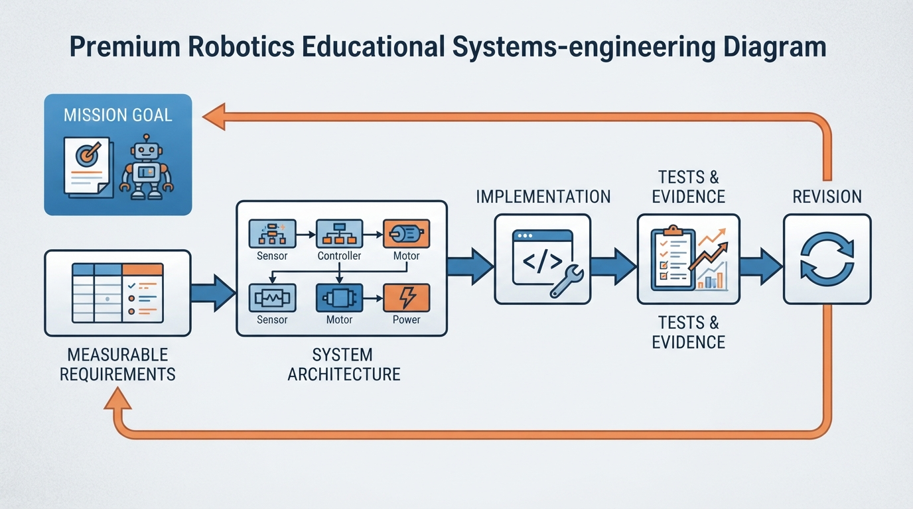
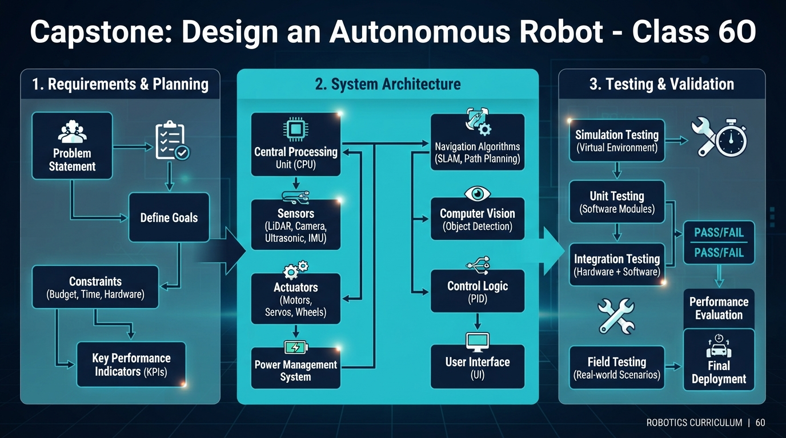
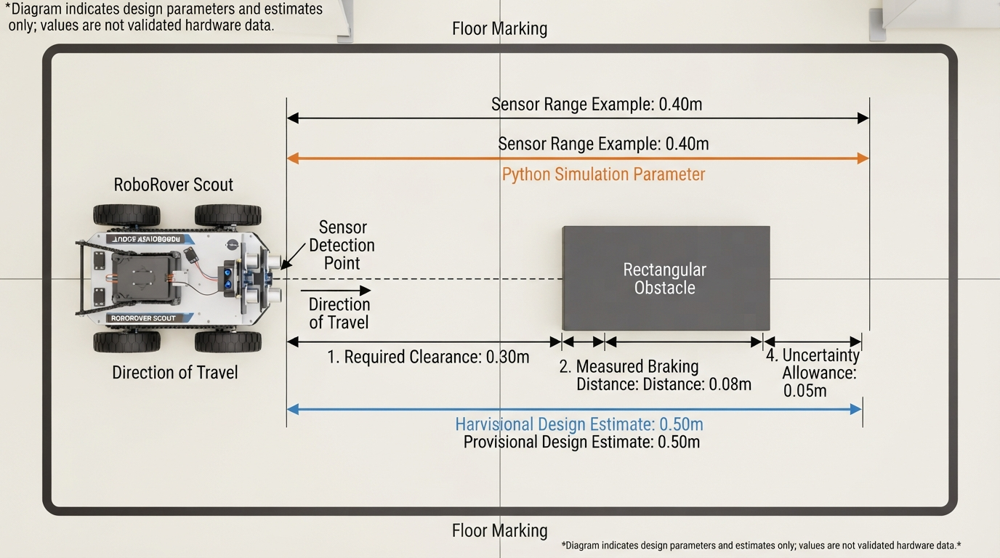
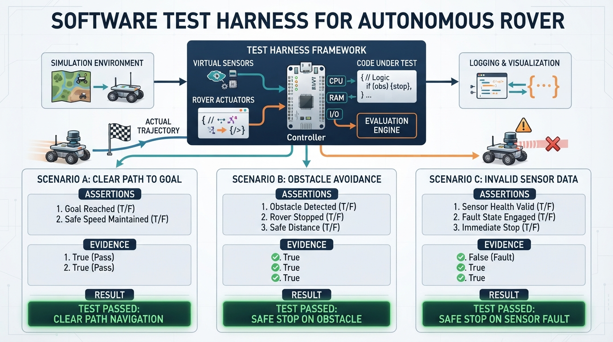

# Class 60: Capstone: Design an Autonomous Robot

## Where We Are in the Robotics Journey

RoboRover has learned to sense, move, make decisions, and respond to failure. In the previous class, **Robotics Safety and Failure Modes**, we examined noisy sensors, blocked mechanisms, low batteries, communication loss, and unsafe behavior.

Today we connect those ideas through an engineering process:

1. **What must the robot accomplish?**
2. **Which parts and software will accomplish it?**
3. **How will we prove that it works safely?**

Our capstone robot is **RoboRover Scout**, a small wheeled robot that travels at a fixed commanded speed along a marked, mostly straight indoor test lane. The lane has a starting zone, a collection zone, and optional rigid obstacles. RoboRover begins autonomous operation when the operator starts the mission; human initiation is outside the autonomous mission. After initiation, the robot selects its own mission actions. A teleoperated or manually driven trial would not be an autonomous-operation trial. RoboRover carries a lightweight sample container, stops before obstacles, and reports its mission state. Advanced route planning is outside today’s scope.

In this lesson, a robot is treated as a physical machine whose controlled actuators perform a physical task. Its immediate actions may be selected by a human operator, a preprogrammed controller, or autonomous software.

The **core capstone path** is requirements, architecture, simulation, testing, and evidence. Energy budgeting, stopping-distance analysis, physical validation, sample-delivery testing, and extended code checks are **engineering extensions** that deepen the core path when time permits.

**Prerequisites:** introductory robot sensors, actuators, state machines, Python functions, loops, assertions, and basic algebra.

**Estimated time:** 90 minutes for the core path; additional supervised sessions may be needed for hardware validation.

> **Core submission when hardware is unavailable:** Submit the requirement table, architecture, state-machine reasoning, traceability matrix, and Python logic exercise. The simulation may claim only the behaviors it actually models: reference-point motion, selected state transitions, energy-reserve logic, status reporting, timeout behavior, and input validation. For R2, R6, and R7, submit a physical-test procedure and identify the result as **not physically verified**, rather than claiming that the requirement passed.

## Today We Will Learn

By the end of this class, you should be able to:

- write measurable robot requirements;
- distinguish requirements from design choices;
- organize a system architecture;
- connect each requirement to a test and evidence;
- use a small Python simulation to check mission logic;
- identify safe responses to sensor, battery, and timeout failures;
- distinguish requirements, design estimates, and measured results;
- explain why a robot that works once is not necessarily reliable;
- identify which claims require simulation, inspection, demonstration, analysis, or physical measurement.

## 2-Minute Recap

A robot is a complete system, not merely a motor or sensor. Its behavior emerges from interactions among:

- **mechanical parts**, such as wheels, brackets, and a sample tray;
- **electrical parts**, such as motors, batteries, and motor drivers;
- **sensors**, which measure the robot or its environment;
- **software**, which interprets measurements and selects actions;
- **the environment**, which introduces friction, obstacles, slopes, shadows, and people.

A useful failure-oriented question is:

> If this component or assumption fails, what will the robot do?

Today we turn that question into requirements, architecture, and tests.

## The Big Idea




**Figure:** A capstone design turns a mission goal into measurable promises, assigned responsibilities, and test evidence.

A capstone robot is developed through this chain:

```text
Mission goal
    ↓
Requirements
    ↓
Architecture
    ↓
Implementation
    ↓
Tests and evidence
    ↓
Revision
```

Suppose RoboRover must carry a sample from a starting zone to a collection zone along a marked lane without touching a barrier. That mission is too vague to build directly. We translate it into measurable requirements:

| ID | Requirement | How to measure it |
|---|---|---|
| R1 | RoboRover shall travel at least 2.0 m along the marked test lane. | Measure completed centerline distance |
| R2 | RoboRover shall stop with at least 0.30 m of final physical clearance from a detected obstacle. | Measure from the robot’s frontmost physical point to the obstacle after stopping |
| R3 | RoboRover shall report its mission status through a serial-console message or recorded software log. | Inspect the status message or log |
| R4 | RoboRover shall enter a safe state when obstacle sensing is unavailable. | Disconnect or invalidate the sensor |
| R5 | RoboRover shall retain at least 20% of its available starting energy after the mission. | Measure or estimate remaining energy and divide by starting energy |
| R6 | RoboRover shall remain within 0.15 m of the marked lane centerline during the straight-course trial. | Measure the maximum lateral deviation over the full trial using continuous tracking or a defined sampling-and-interpolation method |
| R7 | RoboRover shall retain the sample container during motion and deliver it with its entire defined footprint inside the collection zone. | Inspect the container after motion and verify full geometric containment using the defined dimensions and measurement method |
| R8 | RoboRover shall stop and report `TIMEOUT` if the mission is not complete within 120 active control steps under the stated 0.10 s control interval. | Run a mission that cannot complete within the limit and inspect motion and status |

### R7 geometry and acceptance rule

For this lesson, define:

- the sample container footprint as a rigid rectangle **0.20 m long by 0.15 m wide**;
- the collection zone as a marked rectangle **0.40 m long by 0.35 m wide**;
- the final pose as the container’s position and orientation after the robot stops;
- the zone boundary as the inside edge of the marked rectangle;
- the allowed boundary overlap as **0 m**.

R7 passes only when:

1. the container remains secured in its tray throughout the motion;
2. the entire 0.20 m × 0.15 m container footprint, including all four footprint corners, lies inside the collection-zone boundary at the final pose;
3. no part of the container footprint crosses or touches the zone boundary; and
4. the result is documented by calibrated floor measurements, an overhead image with a scale reference, or an equivalent measurement method.

The container center being inside the zone is not sufficient. A center-point criterion could be used in another design, but this lesson uses full containment.

R6 defines the course behavior taught here: straight-lane travel, not general navigation. Its test must establish the **maximum** deviation, not merely the deviation at a few checkpoints. A continuous camera, motion-capture, or tracking system can provide this evidence. If discrete measurements are used instead, the test must specify the sampling interval and an interpolation or between-sample error bound sufficient to support the maximum-deviation claim. Checkpoint values alone cannot establish R6.

R7 makes sample handling an explicit mission requirement rather than an untested promise. R8 makes timeout a requirement with an ID, test condition, and pass rule rather than an undocumented implementation detail.

For R2, a sensor reading is not automatically physical clearance. The sensor may be mounted behind the bumper, and its reading may include **bias**—a consistent measurement offset—**latency**, the delay between a physical event and the system’s response, or other uncertainty. Robot geometry, braking behavior, and sensor mounting must be considered.

A statement such as “RoboRover shall be good at navigation” is not yet testable. It needs a measurable limit.

A requirement describes **what must be true**. It does not prescribe the solution. R2 does not require a particular sensor; an ultrasonic sensor, infrared sensor, or another suitable method might satisfy it.

Before building the full traceability table, classify each statement:

| Statement | Classification |
|---|---|
| “Final physical clearance shall be at least 0.30 m.” | Requirement |
| “Use a forward distance sensor and a safety supervisor.” | Design choice |
| “The stopping trial measured 0.34 m clearance.” | Measured result |
| “The tray retained the container in 10 of 10 trials.” | Measured result |

This distinction prevents a design estimate from being mistaken for evidence that a requirement has passed.

## See It in Your Head

### AI-Generated Engineering Visual · Professor OS



**How to read this visual:** Trace the signal or idea from left to right. Match each block to the lesson explanation, then predict what would change if one block produced a wrong value.

Imagine a top-down drawing of RoboRover Scout:

```text
                Forward direction
                       ↑
        ┌─────────────────────────┐
        │ distance sensor         │
        │        [ S ]             │
        │  left wheel   right wheel│
        │     O             O      │
        │       [controller]       │
        │       [battery]          │
        │       sample tray        │
        └─────────────────────────┘
```

For a hardware stopping calculation, identify these references explicitly:

```text
Forward direction →

sensor origin ●────────────── obstacle reference line
             │<-- d_sensor -->│
             │<-- δ ---------->│
             frontmost point ▲
```

Here, \(d_{\text{sensor}}\) is the forward distance measured from the sensor origin to the obstacle reference line. Define the signed geometry offset \(\delta\) as:

\[
\delta =
x_{\text{frontmost}}-x_{\text{sensor}}
\]

A positive \(\delta\) means the sensor origin is behind the robot’s frontmost point. A negative \(\delta\) means the sensor origin is ahead of the frontmost point. Under the same forward-axis and obstacle-reference assumptions, the frontmost-point clearance at an instant is:

\[
c_{\text{front}} = d_{\text{sensor}}-\delta
\]

The obstacle reference line must also be defined physically—for example, the nearest face of a rigid obstacle perpendicular to the robot’s travel direction. A range value in the simulation is the distance from the modeled reference point to this obstacle reference line, not automatically the distance from the robot’s front bumper.

Now consider a simplified architecture:

```text
Distance sensor ──┐
Wheel encoders ───┼──> Motion controller ──> Motor driver ──> Motors
Battery monitor ──┘             │
                                ├──> Mission manager ──> Serial status log
                                └──> Safety supervisor ──> safe-stop command

Sample-retention sensor ────────> Mission manager
Lane marker sensor ─────────────> Motion controller

Battery ──> Power distribution ──> Controller and sensors
                         ├───────> Motor driver
                         └───────> Status hardware

Independent emergency-stop / power-cutoff path ──> Motor-driver enable
```

The sensor, encoder, and battery-monitor lines represent **information flow**. Battery-to-distribution lines represent **power paths**. Controller-to-driver lines represent command paths. The emergency-stop path is shown separately because it should not depend only on ordinary mission software.

A safety supervisor implemented in ordinary software can detect faults and command a safe stop, but it cannot guarantee motor-power removal if the controller, software, or communication path has failed. The independent emergency-stop or power-cutoff path is a hardware safety mechanism; its exact design depends on the platform and applicable safety practices. It should be drawn with a distinct safety color or double-line convention in a finished diagram.

A complete hardware drawing should also show regulators, fuses or current protection where required, disconnects, voltage compatibility, current capacity, and the actual common-ground topology.

A useful responsibility assignment is:

- **Sensor subsystem:** collect measurements and identify invalid readings.
- **Motion controller:** maintain commanded speed and lane position.
- **Mission manager:** track sample pickup, travel, delivery, and completion.
- **Safety supervisor:** evaluate obstacles, sensor health, battery reserve, and timeout conditions.
- **Actuation subsystem:** convert commands into wheel motion.
- **Power subsystem:** provide energy and report low-power conditions.
- **Status subsystem:** report running, complete, or unsafe states.
- **Emergency-stop path:** remove or inhibit motor power independently of ordinary motion commands.

If the distance sensor stops producing valid readings, the controller must not silently assume that the path is clear.

## Core Concept

### Requirements: the promise

A strong requirement usually identifies:

- an actor: “RoboRover”;
- an action: “shall stop”;
- a condition: “when an obstacle is detected”;
- a measurable limit: “at least 0.30 m before it”;
- a verification method, such as measurement, inspection, demonstration, or analysis.

Avoid combining unrelated promises:

> RoboRover shall move quickly, avoid obstacles, save energy, carry samples, and look stable.

Split that sentence into separate requirements with separate pass rules.

### Architecture: the responsibility map

Architecture answers:

> Which subsystem is responsible for satisfying each requirement?

| Requirement | Main responsibility | Supporting parts |
|---|---|---|
| R1 distance | Motion controller | Encoders, motors, timing |
| R2 obstacle clearance | Safety supervisor | Distance sensor, geometry, braking model |
| R3 status | Mission manager | Serial interface and software log |
| R4 sensor failure | Safety supervisor | Sensor diagnostics, motor driver |
| R5 energy reserve | Power manager | Battery monitor, mission manager |
| R6 lane position | Motion controller | Lane sensors, encoders, calibration |
| R7 sample retention and delivery | Mission manager | Tray, retaining feature, collection-zone marker |
| R8 timeout | Safety supervisor and mission manager | Control clock, status interface |

The architecture is more than a block diagram. It prevents requirements from being left without an owner.

### State behavior

The robot’s state machine makes the safety behavior explicit:

| State | Entry condition | Allowed behavior | Exit or result |
|---|---|---|---|
| `RUNNING` | Mission has started and checks are valid | Drive, sense, log, and update mission progress | Complete, safe stop, or timeout |
| `MISSION_COMPLETE` | Goal and delivery conditions are satisfied | Stop and report success | Final state |
| `SAFE_STOP_OBSTACLE` | Obstacle is within the stopping threshold | Stop motion and report obstacle | Final state unless an operator resets |
| `SAFE_STOP_SENSOR_FAILURE` | Required obstacle sensing is invalid | Stop motion and report sensor failure | Final state |
| `SAFE_STOP_LOW_BATTERY` | Next movement step would violate the reserve | Stop motion and report low battery | Final state |
| `TIMEOUT` | Maximum allowed active steps are reached | Stop motion and report timeout | Final state |

The canonical software status strings in this lesson are:

| Meaning | Exact status string |
|---|---|
| Active mission | `RUNNING` |
| Successful completion | `MISSION_COMPLETE` |
| Obstacle safe stop | `SAFE_STOP_OBSTACLE` |
| Sensor-failure safe stop | `SAFE_STOP_SENSOR_FAILURE` |
| Low-battery safe stop | `SAFE_STOP_LOW_BATTERY` |
| Incomplete mission at limit | `TIMEOUT` |

In physical hardware, an emergency stop or power cutoff should be able to inhibit motor power even if ordinary software is malfunctioning.

### Testing: evidence, not confidence

A test should specify:

1. **Setup:** what is connected and where;
2. **Input or condition:** what the robot encounters;
3. **Expected result:** what must happen;
4. **Measurement:** what evidence is recorded;
5. **Pass rule:** the boundary between pass and fail.

A **traceability matrix** is a table that connects each requirement to its design responsibility, test, evidence, and pass rule.

**Verification** asks whether the implementation satisfies specified requirements. **Validation** asks whether the completed robot meets the mission need in its intended environment.

### Test-coverage table

| Requirement | Python simulation | Inspection or analysis | Supervised hardware trial required for a physical claim? |
|---|---|---|---|
| R1 | Checks idealized reference-point travel | Inspect distance and control parameters | Yes, for measured lane travel |
| R2 | Checks obstacle decision and idealized reference-point stop | Analyze geometry and stopping model | Yes, for frontmost physical clearance |
| R3 | Checks returned status values | Inspect serial/log interface | Usually, to verify the actual interface |
| R4 | Checks invalid-sensor safe state | Inspect safety architecture | Yes, to verify actuator stopping behavior |
| R5 | Checks idealized energy accounting | Analyze power and usable-energy assumptions | Yes, for measured energy behavior |
| R6 | Not modeled | Inspect lane-test procedure | Yes, for maximum lateral deviation |
| R7 | Not modeled | Inspect container and zone dimensions and acceptance method | Yes, for retention and full containment |
| R8 | Checks step limit and `TIMEOUT` status | Inspect timing assumptions | Yes, to verify physical stopping at the limit |

A passing Python assertion is evidence only for the modeled behavior. It is not overall capstone success.

For this capstone:

- **Simulation** can verify control logic, state transitions, reserve checks, status reporting, timeout behavior, and idealized reference-point behavior.
- **Hardware testing** must verify actuator response, sensor-failure behavior, lane tracking, sample retention, status hardware, and measured energy behavior.
- **Both** are needed for R2. Simulation checks the stopping decision; physical testing measures clearance from the robot’s frontmost point.
- R6 and R7 require hardware or an equivalent physical measurement setup. The core submission may document those tests without claiming that they passed.

### Energy reserve in plain language

Define the energy quantities separately:

- \(E_{\text{start}}\): usable energy available at mission start under stated operating conditions;
- \(E_{\text{used}}\): energy consumed by the mission so far or by the planned mission;
- \(E_{\text{remaining}}\): energy still available, calculated as \(E_{\text{start}}-E_{\text{used}}\);
- \(E_{\text{reserve}}\): the required reserve, calculated as \(0.20E_{\text{start}}\).

R5 requires:

\[
E_{\text{remaining}} \geq E_{\text{reserve}}
\]

A 20% reserve means the robot may use no more than 80% of \(E_{\text{start}}\). The value used in the simulation, such as 1200 J, is an **assumed usable starting energy** for the mission model. It is not necessarily the nominal electrical energy printed on a battery. Real usable energy depends on voltage, current, cutoff voltage, discharge behavior, wiring, and conversion losses.

Energy in this lesson is measured in **joules**. Battery capacity in ampere-hours cannot be substituted directly for joules without voltage and discharge assumptions. A nominal watt-hour or ampere-hour rating also does not automatically equal usable energy under the robot’s operating conditions.

## Math Without Fear

Assume:

- average drive input or mechanical/electrical drive-power model: \(9\ \text{W}\);
- computer and sensor power: \(2\ \text{W}\);
- mission time: \(80\ \text{s}\);
- reserve fraction: \(0.20\).

The 9 W value is an assumed average for this model. Real motor power varies with speed, load, acceleration, terrain, and efficiency.

Energy equals power multiplied by time:

\[
E = Pt
\]

The total modeled active power is:

\[
P = 9 + 2 = 11\ \text{W}
\]

Therefore the planned mission use is:

\[
E_{\text{used}} = (11\ \text{W})(80\ \text{s}) = 880\ \text{J}
\]

Because the reserve is 20% of starting energy, the starting energy must satisfy:

\[
E_{\text{start}} - E_{\text{used}} \geq 0.20E_{\text{start}}
\]

Therefore:

\[
E_{\text{start}} \geq
\frac{E_{\text{used}}}{1-0.20}
=
\frac{880}{0.80}
=
1100\ \text{J}
\]

A 1200 J starting-energy model would leave:

\[
E_{\text{remaining}} = 1200 - 880 = 320\ \text{J}
\]

Its reserve requirement is:

\[
E_{\text{reserve}} = 0.20(1200)=240\ \text{J}
\]

Because \(320 \geq 240\), the remaining fraction is:

\[
\frac{320}{1200} \approx 0.267
\]

or 26.7%, which passes R5 in this idealized energy model.

The controller should predict the result of the next movement step:

\[
E_{\text{remaining,post-step}} =
E_{\text{start}} -
(E_{\text{used}} + E_{\text{step}})
\]

If the predicted value is below \(E_{\text{reserve}}\), the robot should stop before taking that step. Equality is allowed because R5 says “at least 20%.”

The Python model charges computer and sensor power only during movement steps. A real controller may consume power while stopped, waiting, logging, or reporting a fault, so physical energy tests must include those periods.

## Worked Robotics Example




**Figure:** The simulation uses a 0.40 m sensor-range example, while the worked calculation gives a separate provisional 0.50 m hardware design estimate.

RoboRover travels at:

\[
v = 0.20\ \text{m/s}
\]

The controller checks the distance sensor every:

\[
\Delta t = 0.10\ \text{s}
\]

Assume:

- reaction time: \(0.10\ \text{s}\);
- measured braking distance: \(0.08\ \text{m}\);
- provisional uncertainty allowance: \(0.10\ \text{m}\);
- required final physical clearance: \(0.30\ \text{m}\);
- signed sensor-to-frontmost-point offset: \(\delta=0.00\ \text{m}\) for this preliminary zero-offset illustration.

Let \(d_{\text{sensor}}\) be measured from the sensor origin to the obstacle reference line. The stopping threshold must satisfy:

\[
d_{\text{threshold}}
=
C_{\text{required}}
+\delta
+d_{\text{reaction}}
+d_{\text{braking}}
+u
\]

where \(C_{\text{required}}\) is the required frontmost-point clearance, \(\delta\) is the signed sensor-to-frontmost-point offset, \(d_{\text{reaction}}\) is travel during reaction time, \(d_{\text{braking}}\) is travel during braking, and \(u\) is the declared uncertainty allowance.

Reaction distance is:

\[
d_{\text{reaction}} =
(0.20)(0.10) = 0.020\ \text{m}
\]

The \(0.08\ \text{m}\) braking distance is treated as a measured result from repeated physical stopping trials. Braking time alone is not enough to calculate braking distance unless a velocity profile is assumed.

With the zero-offset illustration:

\[
d_{\text{threshold}} =
0.30 + 0.00 + 0.020 + 0.080 + 0.100
= 0.500\ \text{m}
\]

If the sensor is actually 0.05 m behind the robot’s frontmost point, then \(\delta=+0.05\ \text{m}\), and the corresponding preliminary threshold would instead be:

\[
d_{\text{threshold}} =
0.30 + 0.05 + 0.020 + 0.080 + 0.100
= 0.550\ \text{m}
\]

This geometry correction is required before applying the calculation to real hardware. If the sensor is ahead of the frontmost point, \(\delta\) is negative, but the physical mounting and obstacle geometry must still be measured and documented.

### Important design warning

**The 0.50 m value is an illustrative zero-offset design estimate, not a validated universal threshold and not a deployment value.**

It must not be used on hardware until sensor bias, mounting offset, latency, braking behavior, speed variation, and uncertainty have been measured. The requirement, design threshold, and measured result are different things:

- **Requirement:** final physical clearance is at least 0.30 m.
- **Illustrative design estimate:** begin stopping near 0.50 m under the stated zero-offset sensor model.
- **Measured result:** the physical clearance recorded during validation.

The Python example uses a separate \(0.40\ \text{m}\) sensor-range value to illustrate program logic. That value is not the validated hardware stopping threshold.

## Python Lab




**Figure:** A test harness converts expected robot behavior into repeatable checks with recorded evidence.

The following Python 3.7-compatible model checks core mission logic. It includes an explicit `max_steps` timeout so the timeout requirement is visible rather than hidden in an implementation constant.

In this interface, `obstacle_m` is the position of the obstacle reference line along the simulated travel axis, and `position_m` is the simulated robot reference point. `sensor_range_m` is the distance from that modeled reference point to the obstacle reference line at which the obstacle check triggers. It is not a front-bumper distance and does not include sensor mounting offset, robot footprint, braking distance, or physical clearance.

The model also requires:

\[
v\Delta t \leq \text{sensor range}
\]

for every validated run. This is a discrete-model safety constraint: a single movement step cannot travel farther than the range that will trigger the next obstacle check. With the obstacle check performed before each movement, this prevents the reference point from crossing an obstacle between checks. A real robot still needs continuous collision, braking, footprint, and geometry analysis.

The simulation is intentionally idealized. Position represents a reference point, not the robot’s frontmost point. It models straight-line progress and obstacle stopping; it does **not** model lane navigation, sample retention or delivery, wheel slip, sensor noise, mounting offset, braking dynamics, or command latency. Therefore:

- R1, R3, R4, R5, R8, and selected state transitions can be checked in this model;
- R2 requires physical clearance validation;
- R6 requires a full-trial lane-following test that establishes maximum lateral deviation;
- R7 requires sample-retention and full-containment delivery tests.

Obstacle stopping is modeled as an immediate command stop with no simulated braking dynamics. The reference-point result must not be interpreted as a physical stopping-distance result.

The input checks reject negative speed, nonpositive timestep, a movement step larger than the sensor range, nonpositive mission distance, invalid obstacle position, negative sensor range, negative power values, invalid battery capacity, and invalid step limits. The model permits an obstacle either before or beyond the goal, so both obstacle-stop and clear-mission examples can be represented.

When goal completion and obstacle detection occur in the same control cycle, this design gives **obstacle detection priority**.

```python
from __future__ import print_function


def planned_energy(drive_power_w, computer_power_w, mission_time_s,
                   reserve_fraction):
    if drive_power_w < 0.0 or computer_power_w < 0.0:
        raise ValueError("power values must be nonnegative")
    if mission_time_s < 0.0:
        raise ValueError("mission_time_s must be nonnegative")
    if not 0.0 <= reserve_fraction < 1.0:
        raise ValueError("reserve_fraction must be in [0, 1)")

    E_used_j = (
        drive_power_w + computer_power_w
    ) * mission_time_s
    return E_used_j / (1.0 - reserve_fraction)


def simulate_mission(goal_m, obstacle_m, sensor_range_m,
                     speed_mps, time_step_s, sensor_valid=True,
                     battery_capacity_j=1200.0,
                     reserve_fraction=0.20,
                     drive_power_w=9.0,
                     computer_power_w=2.0,
                     max_steps=120):
    if goal_m <= 0.0:
        raise ValueError("goal_m must be positive")
    if obstacle_m <= 0.0:
        raise ValueError("obstacle_m must be positive")
    if sensor_range_m < 0.0:
        raise ValueError("sensor_range_m must be nonnegative")
    if speed_mps < 0.0:
        raise ValueError("speed_mps must be nonnegative")
    if time_step_s <= 0.0:
        raise ValueError("time_step_s must be positive")
    if speed_mps * time_step_s > sensor_range_m:
        raise ValueError(
            "one movement step must not exceed sensor range"
        )
    if battery_capacity_j < 0.0:
        raise ValueError("battery_capacity_j must be nonnegative")
    if drive_power_w < 0.0 or computer_power_w < 0.0:
        raise ValueError("power values must be nonnegative")
    if max_steps < 0:
        raise ValueError("max_steps must be nonnegative")
    if not 0.0 <= reserve_fraction < 1.0:
        raise ValueError("reserve_fraction must be in [0, 1)")

    position_m = 0.0
    E_start_j = battery_capacity_j
    E_used_j = 0.0
    steps = 0
    status = "RUNNING"
    E_step_j = (
        drive_power_w + computer_power_w
    ) * time_step_s
    E_reserve_j = reserve_fraction * E_start_j

    while status == "RUNNING" and steps < max_steps:
        distance_to_obstacle_m = obstacle_m - position_m

        # Safety has priority over goal completion.
        if not sensor_valid:
            status = "SAFE_STOP_SENSOR_FAILURE"
        elif distance_to_obstacle_m <= sensor_range_m:
            status = "SAFE_STOP_OBSTACLE"
        elif position_m >= goal_m:
            status = "MISSION_COMPLETE"
        else:
            predicted_E_used_j = E_used_j + E_step_j
            predicted_E_remaining_j = (
                E_start_j - predicted_E_used_j
            )

            if predicted_E_remaining_j < E_reserve_j:
                status = "SAFE_STOP_LOW_BATTERY"
            else:
                position_m = round(
                    position_m + speed_mps * time_step_s, 10
                )
                E_used_j = round(
                    E_used_j + E_step_j, 10
                )
                steps += 1

                if position_m >= goal_m:
                    status = "MISSION_COMPLETE"

    if status == "RUNNING":
        status = "TIMEOUT"

    E_remaining_j = E_start_j - E_used_j

    return {
        "position_m": position_m,
        "energy_used_j": E_used_j,
        "energy_remaining_j": round(E_remaining_j, 10),
        "reserve_limit_j": round(E_reserve_j, 10),
        "steps": steps,
        "status": status,
        # Reference-point clearance, not physical front clearance.
        "idealized_reference_clearance_m": round(
            obstacle_m - position_m, 10
        )
    }


def main():
    energy_plan_j = planned_energy(9.0, 2.0, 80.0, 0.20)
    assert abs(energy_plan_j - 1100.0) < 1e-9

    clear_run = simulate_mission(
        goal_m=2.0, obstacle_m=3.0, sensor_range_m=0.4,
        speed_mps=0.2, time_step_s=0.1
    )
    assert clear_run["status"] == "MISSION_COMPLETE"
    assert clear_run["steps"] == 100
    assert abs(clear_run["position_m"] - 2.0) < 1e-9
    assert clear_run["energy_remaining_j"] / 1200.0 >= 0.20

    obstacle_run = simulate_mission(
        goal_m=2.0, obstacle_m=1.5, sensor_range_m=0.4,
        speed_mps=0.2, time_step_s=0.1
    )
    assert obstacle_run["status"] == "SAFE_STOP_OBSTACLE"
    assert abs(obstacle_run["position_m"] - 1.1) < 1e-9
    assert abs(
        obstacle_run["idealized_reference_clearance_m"] - 0.4
    ) < 1e-9

    sensor_failure_run = simulate_mission(
        goal_m=2.0, obstacle_m=3.0, sensor_range_m=0.4,
        speed_mps=0.2, time_step_s=0.1, sensor_valid=False
    )
    assert sensor_failure_run["status"] == "SAFE_STOP_SENSOR_FAILURE"
    assert sensor_failure_run["steps"] == 0

    low_battery_run = simulate_mission(
        goal_m=2.0, obstacle_m=3.0, sensor_range_m=0.4,
        speed_mps=0.2, time_step_s=0.1,
        battery_capacity_j=120.0
    )
    assert low_battery_run["status"] == "SAFE_STOP_LOW_BATTERY"
    assert low_battery_run["steps"] == 87
    assert abs(low_battery_run["energy_remaining_j"] - 24.3) < 1e-9
    assert (
        low_battery_run["energy_remaining_j"]
        >= low_battery_run["reserve_limit_j"]
    )

    timeout_run = simulate_mission(
        goal_m=3.0, obstacle_m=4.0, sensor_range_m=0.4,
        speed_mps=0.2, time_step_s=0.1, max_steps=100
    )
    assert timeout_run["status"] == "TIMEOUT"
    assert timeout_run["steps"] == 100

    validation_errors = [
        ({"goal_m": -1.0}, "goal"),
        ({"speed_mps": -0.1}, "speed"),
        ({"time_step_s": -0.1}, "time"),
        ({"obstacle_m": -1.0}, "obstacle"),
        ({"speed_mps": 5.0}, "step-range")
    ]
    for changes, label in validation_errors:
        arguments = {
            "goal_m": 2.0,
            "obstacle_m": 3.0,
            "sensor_range_m": 0.4,
            "speed_mps": 0.2,
            "time_step_s": 0.1
        }
        arguments.update(changes)
        try:
            simulate_mission(**arguments)
        except ValueError:
            pass
        else:
            raise AssertionError(
                "expected validation error for " + label
            )

    print("Energy plan:", energy_plan_j, "J")
    print("Clear run:", clear_run)
    print("Obstacle run:", obstacle_run)
    print("Sensor failure run:", sensor_failure_run)
    print("Low-battery run:", low_battery_run)
    print("Timeout run:", timeout_run)
    print("Movement-step constraint check passed.")
    print("Input validation checks passed.")
    print("All capstone checks passed.")


if __name__ == "__main__":
    main()
```

At each timestep:

\[
E_{\text{step}} = (11\ \text{W})(0.1\ \text{s}) = 1.1\ \text{J}
\]

The clear run travels 2.0 m in 100 steps and uses 110 J. The 80-second energy estimate is a separate mission-level budget.

The clear run’s exactly 100 steps is a model-specific expectation based on \(2.0\ \text{m}\), \(0.20\ \text{m/s}\), and \(0.10\ \text{s}\) with the current completion convention. It is not a general property of discrete motion controllers; changing any of those values or the completion rule can change the step count.

A concrete timeout estimate for the stated straight-course mission is:

\[
t_{\text{travel}} = \frac{2.0\ \text{m}}{0.20\ \text{m/s}} = 10\ \text{s}
\]

If we add 1 second for sensing and turns and 1 second for reasonable disturbances, the proposed timeout is:

\[
t_{\text{timeout}} = 10 + 1 + 1 = 12\ \text{s}
\]

At a \(0.10\ \text{s}\) control interval, that corresponds to:

\[
\frac{12\ \text{s}}{0.10\ \text{s}} = 120\ \text{steps}
\]

The code’s `max_steps=120` therefore represents this illustrative 12-second timeout. Hardware testing must replace these assumptions with measured worst-case timing.

For physical R2 validation:

1. Use a rigid, documented obstacle.
2. Define the obstacle reference line and place it within the sensor’s calibrated field of view and range.
3. Measure and record the sensor origin, the robot’s frontmost point, and the signed offset \(\delta\).
4. Mark the robot’s frontmost point and the obstacle reference line.
5. Measure clearance with a calibrated ruler, video method, motion capture, or equivalent.
6. Record speed, sensor offset, latency, braking behavior, and environmental conditions.
7. Repeat the test from defined starting conditions.
8. Declare an uncertainty allowance before evaluating the result.

A concrete uncertainty rule is:

> Pass only if measured frontmost clearance minus the declared uncertainty allowance is at least 0.30 m.

The uncertainty allowance must be stated before the decision and supported by the measurement method, such as sensor calibration, repeatability, mounting measurement, timing uncertainty, and relevant environmental variation. It is an engineering allowance, not automatically a statistical confidence bound.

For example, if the measured clearance is 0.34 m and the declared uncertainty allowance is 0.03 m:

\[
0.34 - 0.03 = 0.31\ \text{m}
\]

The result passes. A measured clearance of 0.31 m with the same allowance gives:

\[
0.31 - 0.03 = 0.28\ \text{m}
\]

and does not pass.

For physical R7 validation:

1. Measure or document the rigid container footprint as 0.20 m × 0.15 m.
2. Mark or measure the collection zone as 0.40 m × 0.35 m.
3. Load the container into the tray and verify that the retaining feature is engaged.
4. Run the defined motion trial.
5. Verify that the container remained secured throughout the trial.
6. After stopping, measure the container’s final pose relative to the zone boundary.
7. Confirm that all four container-footprint corners lie strictly inside the zone boundary, with no touching or crossing.
8. Record the measurement method, scale reference, orientation, and raw observations.

## Mini Simulation or Game

Predict before running the program:

1. If the obstacle is at 1.5 m and the sensor range is 0.4 m, where should the **reference point** stop?
2. If the sensor is invalid before movement begins, how many steps occur?
3. How many 0.02 m steps are needed to travel 2.0 m?
4. Does a 1200 J battery using 880 J meet the 20% reserve requirement?
5. After 87 steps with 120 J available and 1.1 J per step, should another step occur?
6. Why does the sample timeout use 120 steps?
7. Which requirements are not verified by this straight-line simulation?

Answers:

1. The reference point stops at 1.1 m. This is not a frontmost-point clearance measurement.
2. Zero steps.
3. One hundred steps.
4. Yes. \(320/1200 \approx 26.7\%\).
5. No. The next step would reduce remaining energy below the 24 J reserve limit.
6. The 2.0 m mission takes 10 seconds at 0.20 m/s. Adding 2 seconds of sensing, turns, and disturbance margin gives 12 seconds, or 120 intervals of 0.10 seconds.
7. The simulation does not verify lane deviation, sample retention, full-containment sample delivery, or physical clearance.

An assertion failure after changing a parameter may indicate that the test expectation, rather than the program, must be redesigned. In particular, changing speed or timestep may violate the model’s movement-step constraint and should produce a validation error instead of an unexamined obstacle crossing.

## What Should Happen?

A successful design process produces:

- a mission statement;
- measurable requirements;
- an architecture with assigned responsibilities;
- a test for each important requirement;
- safe responses to serious failures;
- recorded evidence.

Use this completed traceability matrix as a model:

| ID | Requirement | Design element | Test setup | Evidence | Pass rule |
|---|---|---|---|---|---|
| R1 | Travel at least 2.0 m along the marked lane | Motion controller, motors, encoders | Clear marked straight course | Measured centerline distance | Distance ≥ 2.0 m |
| R2 | Final physical clearance ≥ 0.30 m | Distance sensor, safety supervisor, signed sensor geometry offset, braking model | Defined rigid obstacle and repeated stopping trials | Frontmost-point clearance and declared uncertainty allowance | Measured clearance minus declared allowance ≥ 0.30 m |
| R3 | Report mission status through a serial-console message or recorded software log | Mission manager and status interface | Completion and safe-stop scenarios | Serial output or log | Report matches actual state |
| R4 | Safe state when sensing is unavailable | Sensor diagnostics and safety supervisor | Disconnect or invalidate sensor | Motor output, motion, and status | Motion stops and failure is reported |
| R5 | Retain at least 20% starting energy | Power monitor and reserve logic | Representative full mission | Starting and remaining energy | Remaining fraction ≥ 0.20 |
| R6 | Remain within 0.15 m of lane centerline | Motion controller and lane sensors | Marked lane with continuous tracking, or defined sampling and between-sample bound | Full-trial lateral-deviation record | Maximum deviation ≤ 0.15 m |
| R7 | Retain the 0.20 m × 0.15 m container and deliver it fully inside the 0.40 m × 0.35 m collection zone | Tray, retaining feature, mission manager, zone marker | Container loaded before motion; collection zone marked | Retention observation and final footprint measurement | Container remains secured and all four footprint corners finish strictly inside the zone boundary |
| R8 | Stop and report `TIMEOUT` within 120 active control steps if incomplete | Safety supervisor, mission manager, control clock | Mission prevented from completing within the limit | Final motion state, step count, and status log | Motion stops at the limit and status is `TIMEOUT` |

A compact traceability example for R2 is:

```text
Requirement:
    Final physical clearance ≥ 0.30 m

Architecture:
    Forward distance sensor + safety supervisor
    Signed sensor-to-frontmost-point offset δ
    Motor driver and braking behavior

Implementation:
    Compare measured sensor distance with a geometry- and
    braking-aware threshold; stop on invalid sensing

Simulation evidence:
    Reference-point stop and obstacle-priority state transition

Physical test:
    Rigid obstacle, measured sensor mounting, repeated stopping trials

Raw evidence:
    Speed, sensor readings, frontmost-point clearance,
    uncertainty allowance, and environmental conditions

Decision:
    Pass only when measured clearance - declared allowance ≥ 0.30 m
```

A physical sample-handling test might use the defined 0.20 m × 0.15 m container and 0.40 m × 0.35 m collection zone. Load the container in the starting zone, run the course at the specified speed, inspect it throughout or immediately after motion, and measure its final footprint relative to the zone boundary. Repeat the test under defined acceleration and obstacle conditions. The simulation does not replace this test.

Example measured records might look like this:

> **Fictional sample data—do not cite as experiment results.** These values illustrate report format only.

| Trial | Condition | Measured result | Status |
|---|---|---:|---|
| 1 | Clear run, 2.0 m lane | 2.04 m; 0.08 m maximum deviation over the full tracked trial | Pass |
| 2 | Obstacle stop | 0.34 m frontmost clearance; 0.03 m allowance | Pass |
| 3 | Invalid sensor at start | 0 movement steps; safe-stop report | Pass |
| 4 | Sample delivery | Container retained; all four footprint corners measured inside the zone boundary | Pass |
| 5 | Low battery | Stopped with 24.3 J remaining from a 24 J reserve limit | Pass |
| 6 | Timeout | Stopped at 120 active steps and reported `TIMEOUT` | Pass |

These are fictional example records, not evidence from an actual robot. A real report must identify equipment, setup, operator, environmental conditions, raw measurements, and pass rules.

For repeated trials, record every result. “Completes 9 of 10 trials” requires ten defined trials and a stated pass rule.

A compact design-sheet rubric is:

| Criterion | Evidence of strong work |
|---|---|
| Requirement measurability | Each requirement has a numerical or observable pass rule |
| Architecture completeness | Sensor, controller, actuator, power, status, sample handling, and relevant interfaces are shown |
| Test reproducibility | Another student could repeat the setup and obtain comparable evidence |
| Safety response | Sensor, battery, timeout, and motion failures have explicit safe states |
| Evidence quality | Results identify setup, measurement, uncertainty or limitations, and pass/fail status |

## Common Mistakes

### Writing vague requirements

“RoboRover shall be reliable” is a goal. Define reliability, such as completing 9 of 10 specified trials.

### Choosing parts first

A readily available sensor may not provide the needed range, update rate, mounting geometry, or uncertainty. Define the requirement before selecting the part.

### Confusing sensor distance with physical clearance

The sensor may be behind the bumper or aimed above the obstacle. Validate the robot’s actual frontmost clearance and include the signed sensor-to-frontmost-point offset in the stopping analysis.

### Using checkpoints as proof of a maximum

Measurements at marked checkpoints do not establish the maximum lateral deviation between checkpoints. Use continuous tracking or define a sampling interval and between-sample bound that supports the maximum-deviation claim.

### Promising behavior without testing it

If the mission says the robot carries and delivers a sample, include the defined container and zone dimensions, a tray design, a delivery-zone test setup, and a full-containment pass rule. Otherwise, narrow the mission statement.

### Testing only the happy path

Include obstacles, invalid readings, low battery, blocked routes, timeout, sample retention, and repeated trials.

### Treating simulation as hardware proof

The simulation omits friction, delay, noise, wheel slip, braking dynamics, lane tracking, sample motion, and battery behavior. It verifies selected logic, not every physical claim.

### Hiding failures

A timeout or invalid sensor result must not be reported as mission success. The status should explain why the robot stopped.

## Try It Yourself

**Core challenge:** Create a capstone design sheet for RoboRover Scout containing:

1. five requirements with IDs and numerical pass rules;
2. a block architecture with sensor, controller, actuator, power, status, and sample-handling blocks;
3. one test for each requirement;
4. one failure mode and its safe response;
5. one measurement to record.

Use this matrix:

```text
Requirement | Design element | Test setup | Expected evidence | Pass rule | Result
```

For one requirement, identify whether the evidence supports verification, validation, or both.

Use the rubric to review the design sheet:

- Are all requirements measurable?
- Are all relevant architecture blocks and interfaces present?
- Could another person reproduce each test?
- Is the safety response explicit?
- Does the evidence support the stated pass rule?

**Optional extension:** Add a wheel encoder and write a requirement that uses it. Explain what evidence would show that the encoder improves the design.

**Optional extension:** Add a sample-retention test using the defined container and collection-zone dimensions. Specify how all four container-footprint corners will be measured relative to the zone boundary.

**Parameter exercise:** Change `sensor_range_m`, `reserve_fraction`, or `max_steps`. Predict the changed status or stopping position before running the program. Label the result as logic verification or physical validation. If changing speed or timestep, also check the movement-step constraint.

**Student-editable Python exercise:** Change `goal_m` to `1.0` m and predict the clear-run status, final position, and number of steps. Add a new assertion for your prediction, run the program, and record whether the assertion passes. Explain that the result verifies only the idealized simulation.

**Python lab deliverable:** Submit:

1. the executed program output;
2. the assertion results or a statement that all assertions passed;
3. one changed parameter and your prediction before execution;
4. the observed result;
5. a short explanation of which behavior was verified by simulation and which claim still requires physical testing.

**Core submission rule:** A core submission is complete when the requirement table, architecture, traceability matrix, state-machine reasoning, and Python logic exercise are present. It must label R2, R6, and R7 as physically unverified unless supervised physical evidence or an equivalent documented measurement exists.

**Advanced physical-validation extension:** With appropriate equipment and supervision, perform the R2 stopping-clearance, R5 energy, R6 lane-deviation, and R7 sample-retention and full-containment trials. Record raw measurements, setup, uncertainty or limitations, and pass/fail decisions. These trials are not required to claim completion of the core software-and-design submission.

**Instructor safety note:** Before hardware trials, define a test boundary, provide an emergency stop or power cutoff, inspect the battery and wiring, and clear people and loose equipment from the motion path. Begin slowly in a controlled area. Never bypass a safety stop to obtain a desired result.

## Quick Quiz

1. What is the difference between a requirement and an architecture?
2. Why does a requirement need a measurable pass rule?
3. Why does the idealized robot stop at 1.1 m when the obstacle is at 1.5 m?
4. Why is simulation not automatically proof of physical safety?
5. What reserve fraction remains when a 1200 J battery uses 880 J?
6. What should happen when the next movement would reduce energy below the reserve limit?
7. Why is a timeout a requirement rather than merely a programming detail?
8. How should a measured clearance of 0.34 m with a declared uncertainty allowance of 0.03 m be evaluated?
9. Which test verifies that the sample was delivered successfully?
10. What is the difference between a simulation reference-point clearance and a physical frontmost clearance?
11. Why are checkpoint measurements alone insufficient to establish R6’s maximum lateral-deviation requirement?
12. In the stopping equation, what does a positive sensor-to-frontmost-point offset mean?
13. Why is a container-center measurement alone insufficient for R7 in this lesson?
14. Which claims remain unverified when all Python assertions pass?

## Answers

1. A requirement states what must be accomplished; architecture assigns responsibilities and interfaces.
2. A pass rule makes the requirement testable with evidence.
3. The reference point stops at 1.1 m, matching the idealized sensor stop range.
4. Simulation omits physical effects such as friction, latency, noise, braking variation, wheel slip, sample motion, and battery behavior.
5. \(320/1200 \approx 26.7\%\), so the requirement passes.
6. The robot enters `"SAFE_STOP_LOW_BATTERY"` before taking that step. Equality with the reserve limit is allowed.
7. A timeout defines how long the robot may remain active before an abnormal or unresolved condition becomes a safe response. Its value must be selected from mission timing and verified in testing.
8. Subtract the declared allowance from the measured clearance: \(0.34 - 0.03 = 0.31\ \text{m}\). Because 0.31 m is at least 0.30 m, the result passes. This is an uncertainty-allowance rule, not automatically a statistical confidence-bound calculation.
9. A defined sample-delivery trial loads the 0.20 m × 0.15 m container before motion, runs the course, inspects retention, and measures whether all four container-footprint corners finish strictly inside the 0.40 m × 0.35 m collection-zone boundary.
10. Reference-point clearance is calculated from a simplified modeled point. Physical frontmost clearance is measured from the robot’s actual nearest physical point to the obstacle.
11. Checkpoints can miss a larger deviation occurring between them. Continuous tracking, or a specified sampling and interpolation/error-bound method, is needed to support a maximum-deviation claim.
12. A positive offset means the sensor origin is behind the robot’s frontmost point along the forward axis. The offset must therefore be added to the sensor-distance threshold when calculating the required stopping threshold.
13. A container center can lie inside a zone while a corner or edge remains outside it. R7 uses full containment, so every footprint corner must be strictly inside the zone boundary.
14. R2 physical frontmost clearance, R6 maximum lane deviation, R7 retention and full-containment delivery, and other hardware behaviors remain unverified unless appropriate physical evidence is supplied.

## Real Robot Connection

Professional robotics teams maintain a **requirements traceability matrix** linking each requirement to its design component, implementation, test, and result.

For example:

```text
R2 obstacle clearance
    ↓
distance sensor + safety supervisor + robot geometry
    ↓
signed sensor-to-frontmost-point offset, stop threshold,
braking model, and invalid-reading handling
    ↓
simulation logic check plus physical-clearance trials
    ↓
frontmost-point measurement, declared uncertainty allowance,
and pass/fail result
```

A failure mode is not fully addressed merely because it appears in a discussion. The architecture must contain a response, and the test plan must check it.

RoboRover should distinguish among:

- mission complete;
- mission failed;
- mission stopped for safety;
- mission timed out;
- mission unable to determine its state.

A software safety supervisor can detect faults and command a safe stop, but an independent emergency-stop or power-cutoff path is a separate hardware safety mechanism. Its design depends on the platform and applicable safety practices and must not be assumed to work merely because a software command exists.

The same discipline applies to sample handling. “The robot carries a sample” is not evidence until the container footprint, collection-zone dimensions, retaining method, motion conditions, final-pose measurements, and full-containment pass rule are defined.

A real hardware photograph can make these issues concrete: sensor mounting, frontmost geometry, obstacle clearance, tray retention, and test-course markings are all physical details that a block diagram simplifies.

## Vocabulary

- **Requirement:** A testable statement of what a robot or subsystem must accomplish.
- **Architecture:** The organized structure of components, responsibilities, information flow, and power flow.
- **Subsystem:** A part of a larger system with a defined responsibility.
- **Acceptance test:** A test used to decide whether a completed system meets a requirement.
- **Traceability:** The ability to connect a requirement to its design, implementation, test, and evidence.
- **Pass rule:** The measurable condition that determines whether a test passes.
- **Safe state:** A condition that reduces risk, often by stopping motion and reporting the reason.
- **Failure mode:** A way in which a component, assumption, or process can fail.
- **Test harness:** Code or equipment that runs tests and records results.
- **Verification:** Evidence that the implementation satisfies specified requirements.
- **Validation:** Evidence that the completed system meets the intended mission need in its target context.
- **Latency:** The delay between a physical event, its measurement, and the system’s response.
- **Sensor bias:** A repeatable offset between a sensor’s reading and the quantity being measured.
- **Usable energy:** The energy that can actually be delivered under specified operating conditions before the system reaches its cutoff limit.
- **Reference-point clearance:** Distance from a simplified modeled point to an obstacle; it is not necessarily clearance from the robot’s frontmost physical point.
- **Signed sensor-to-frontmost-point offset:** The forward-axis difference \(x_{\text{frontmost}}-x_{\text{sensor}}\). It is positive when the sensor origin is behind the frontmost point and negative when it is ahead.
- **Obstacle reference line:** The defined geometric feature of an obstacle from which a sensor range or physical clearance is measured, such as the nearest face perpendicular to the travel direction.
- **Declared uncertainty allowance:** A stated engineering allowance that accounts for relevant measurement and test uncertainties. A pass rule may subtract it from measured clearance; it is not automatically a statistical confidence bound.
- **Full containment:** A geometric acceptance condition in which the entire defined footprint of an object lies strictly inside the defined boundary of a destination zone, with no allowed overlap or boundary contact.
- **Robot:** In this course, a physical machine commonly treated as a robot in engineering practice whose controlled actuators perform a physical task. Its immediate actions may be selected by a human operator, a preprogrammed controller, or autonomous software. This is a working description for teaching, not a universal necessary-and-sufficient test.

## Further Learning

Study these topics as the capstone develops:

- systems engineering requirements traceability;
- robotics verification and validation;
- robot safety-stop design;
- failure mode and effects analysis;
- hardware-in-the-loop testing;
- robot software state machines;
- sample-handling mechanisms and end-effectors;
- lane following and course-level navigation.

These topics become more useful when connected to a complete design and measured evidence.

## Next Class

In **Capstone Completion**, we will turn today’s design sheet into a finished capstone proposal. We will refine requirements, complete the architecture, inspect trade-offs, finalize the verification matrix, and present RoboRover Scout as an engineered system rather than a collection of parts.

The previous class taught us to anticipate failure. Today we assigned responsibilities and tests around those failures. Next class will connect the pieces into a complete, defensible capstone.